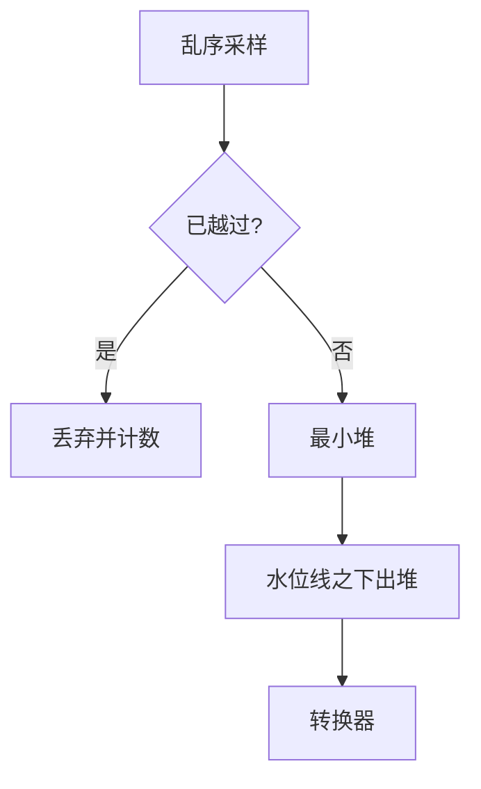

## Q
多台机器的采样汇聚到同一个流式调用栈处理器，时间戳小的采样有时比大的晚到。转换器要求时间戳严格递增，内存又不能随流变长，你怎么处理这些乱序采样？

## A
**转换器前加有界重排缓冲：最小堆加水位线，迟到太久的丢弃**

- **转换器不改**：它的前提是严格递增，乱序在它前面消掉；校验失败仍然一律拒绝
- **重排缓冲**：最小堆按（时间戳，到达序号）；水位线 = 见过的最大时间戳 − 允许迟到的 K
- **出堆**：时间戳不超过水位线的样本不会再有更早的，按顺序交给转换器
- **有界**：堆里最多是 K 个时间单位内的采样，与流的长度无关；代价是输出延迟 K
- **太晚的采样**：转换器已经越过它，计数后丢弃或写进旁路；不能撤回已经产出的事件
- **同刻重复**：在缓冲里只留先到的，不要交给转换器去报错



```python
def reorder(samples, lateness):
    heap, newest, emitted, tie = [], -math.inf, -math.inf, itertools.count()
    for s in itertools.chain(samples, [None]):                  # None：输入结束，冲出全部
        if s is not None and s.ts > emitted:                    # 已越过的时间戳不能再插入
            heapq.heappush(heap, (s.ts, next(tie), s))
            newest = max(newest, s.ts)
        mark = math.inf if s is None else newest - lateness     # 水位线之下不会再有更早的
        while heap and heap[0][0] <= mark:
            ts, _, out = heapq.heappop(heap)
            if ts > emitted:                                    # 同刻重复只留先到的
                emitted = ts
                yield out
```

<details class="pt"><summary>延伸</summary>多个来源时每个来源各有水位线，整体水位线取最小的那个；某个来源长时间不发数据会卡住全局，要给它设空闲超时。</details>

**知识点：** 日志处理与聚合（Log Processing）、按访问模式选结构（Choosing Structures）、迭代器设计（Iterator Design）
