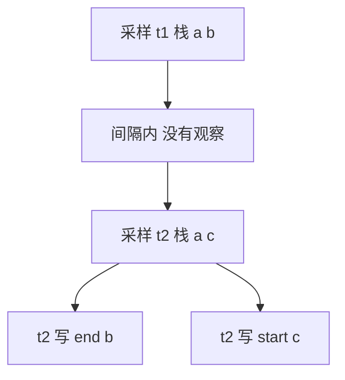

## Q
采样器每隔一小段时间给流式调用栈处理器一个栈。哪怕事后拿到了全部历史，哪些执行事件仍然无法还原？如果另一个处理器只拿到最后 W 个采样（窗口大小 W），它比从头一直运行的处理器少知道什么？

## A
**采样只给那一刻的栈；窗口处理器丢了窗口之前的确认状态**

- **还原不了的事件**：比采样间隔还短的调用；两个采样之间真正的先后与起止时刻；栈在两个采样里相同时，中间有没有返回再重新调用
- **事件时间只是一个范围**：start 的真实时刻在上一个采样与这一个之间，end 同理；事件只能写在看见变化的那个采样上
- **窗口之前就开着的帧**：窗口处理器当成"新出现"，它们的 start 早已属于更早的输出
- **连续次数丢了**：确认数 N 大于窗口里的采样数时，该开的帧不开；刚好够时 start 也晚了
- **长期处理器的补救**：快照里的上一个栈加连续次数，就是窗口之前历史的全部有用信息，大小只与栈深有关



```python
full = [Sample(1, ("m",)), Sample(2, ("m",)), Sample(3, ("m",)), Sample(4, ("m",))]
list(convert_samples(full, 3))        # [Event("start", 3, "m")]
list(convert_samples(full[-2:], 3))   # []：窗口里只见过 2 次，从不开始
list(convert_samples(full[-3:], 3))   # [Event("start", 4, "m")]：晚了一个采样
```

<details class="pt"><summary>延伸</summary>要更精确只能提高采样频率，或让被测程序主动上报进出事件；采样永远给不出精确的起止时刻。</details>

**知识点：** 流式处理大文件（Streaming Large Files）、持久化与恢复（Persistence & Resume）、迭代器设计（Iterator Design）
