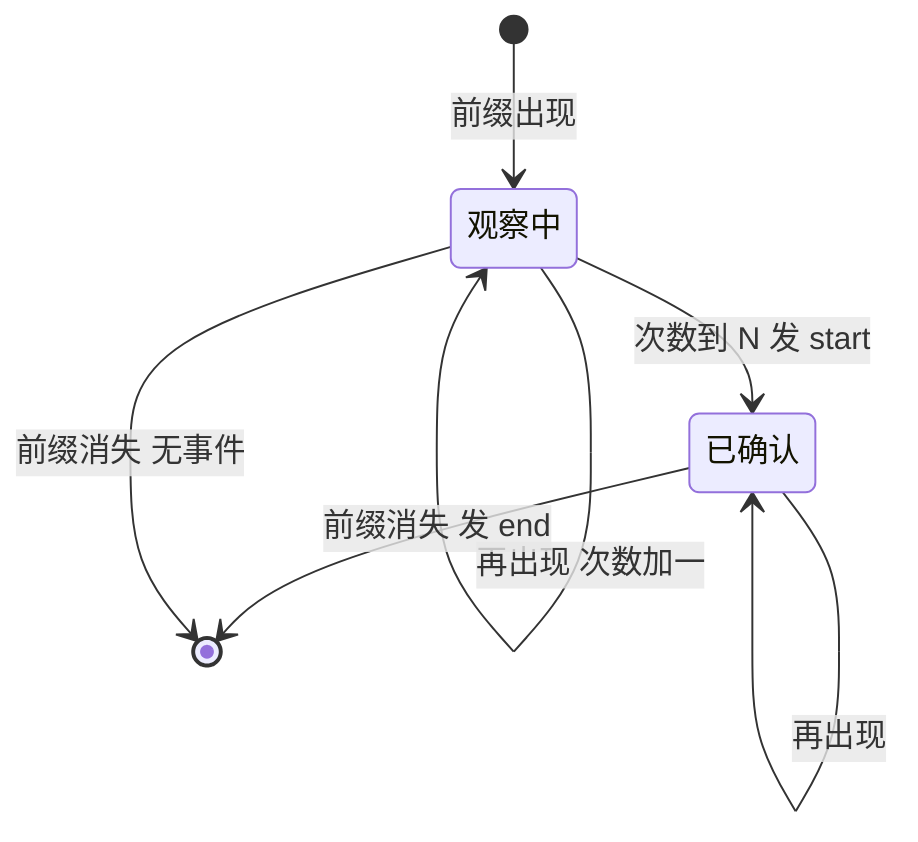

## Q
流式调用栈处理器要在内存有界的前提下，支持"连续 N 次才确认"和从快照续跑，要存哪些状态？哪条不变量最要紧？为什么不单独存一个"这个帧是否已经开始"的标志？

## A
**一个时间戳加两个等长数组：上一个栈，和每层前缀的连续次数**

- **previous**：最后观察到的完整栈，含还没确认的帧
- **streaks**：与 previous 等长，每层是该前缀的连续观察次数，封顶 N
- **已确认 = 次数等于 N**：由次数推出来，不另存标志；合同的快照只有这两个数组，两份状态也就没有机会互相矛盾
- **父层次数不小于子层**：所以已确认的帧恰好是栈的一段前缀，结束事件只要从叶往根数
- **最要紧的不变量**：校验全部通过之后才写状态；状态大小只与栈深有关，与采样个数无关
- **快照就是全部状态**：恢复不需要重放历史；导出与恢复都复制列表，不与调用方共享



```python
def snapshot(self):
    return {"version": 1, "confirmations": self._n, "last_ts": self._last_ts,
            "previous": list(self._previous), "streaks": list(self._streaks)}   # 拷贝，不共享

@classmethod
def from_snapshot(cls, state):
    n, last, previous, streaks = check_snapshot(state)         # 先校验，通过才建对象
    converter = cls(n)
    converter._last_ts, converter._previous, converter._streaks = last, previous, streaks
    return converter
```

<details class="pt"><summary>延伸</summary>快照落库就是一行 JSON；以后加字段就把 version 升到 2，并让旧版本的恢复函数拒绝它，而不是悄悄忽略新字段。N=1 时"观察中"一步即过，直接成为已确认。</details>

**知识点：** 持久化与恢复（Persistence & Resume）、不变量与封装（Invariants）、防御性拷贝（Defensive Copying）
