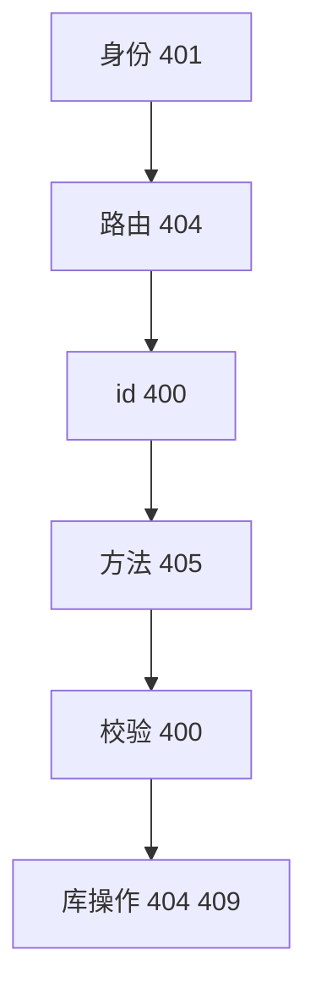

## Q
你接手一个库存 API（Stockroom）：背后是 MongoDB，每个条目属于一个用户。运营反馈：创建成功后条目不见了，更新返回的是旧数据，用户还能读到别人的条目。动手改代码之前，你会先定下哪几条规则？

## A
**先鉴权再校验、查询带 owner、版本在库里比、唯一交给索引、错误按码映射**

- **检查顺序固定**：身份 401 → 路由 404 → id 400 → 方法 405，之后才看 body；同时违规时谁先谁赢要写进测试
- **每个查询都带 owner**：读、改、删全限定在当前用户；别人的条目和不存在的同形，都是 404
- **先校验整个请求，再碰库**：更新是 400 → 404 → 409；数字里 bool 不是数，整数值的 float 与 Decimal 是数
- **版本在库里比**：条件 `owner + id + version` 与 `version + 1` 在同一次更新里；值没变也加一，失败不改任何字段
- **唯一交给唯一索引**：`(owner, sku)` 重复是 409，不先查后插；错误码 11000 → 409、121 → 400、其余 → 503
- **返回库里读出来的**：先写成功才回 201；更新返回改后的文档



```python
def handle(self, method, path, user, body=None):
    signed_in = isinstance(user, str) and bool(trim(user))
    if not signed_in:
        return problem(401, "unauthorized")
    item_id = None
    if path != "/items":
        match = ITEM_PATH.fullmatch(path)
        if match is None:
            return problem(404, "not_found")
        if ITEM_ID.fullmatch(match[1]) is None:
            return problem(400, "invalid_id")
        item_id = match[1].lower()
    handler = routes.get((item_id is not None, method))  # routes：(带 id, 方法) 到处理函数
    return handler(user, item_id, body) if handler else problem(405, "method_not_allowed")
```

<details class="pt"><summary>延伸</summary>库里的模式校验只是最后一道网：它只拦写得进去的坏数据，出错只报一个错误码 121，没有产品语义，所以规则和状态码必须在服务里先写一遍。</details>

**知识点：** 接口的错误契约（Error Contract）、边界校验（Validate at the Boundary）、规格与契约（Specifications）
