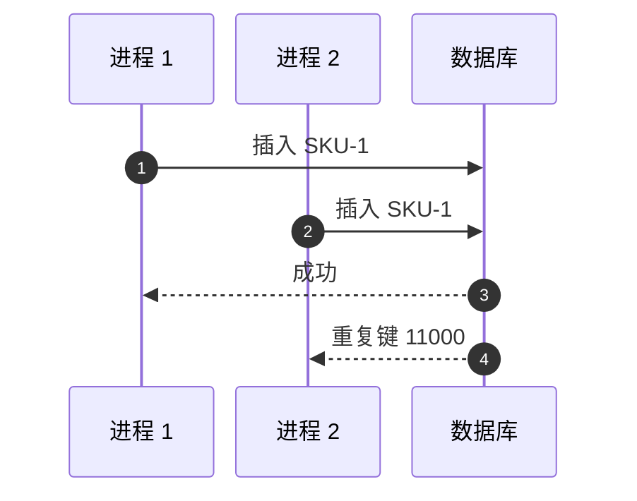

## Q
库存 API（Stockroom）要从一个进程扩成四个进程。现在两个客户端同时用同一个 SKU 创建条目，另两个客户端同时拿版本 5 改数量，结果两边都出现了"两个都成功"。你怎么改，才让每一对里只有一个成功？

## A
**让数据库做裁判：唯一索引裁决创建，带版本条件的更新裁决修改**

- **先查后插必然有缝**：两个进程各自查到"没有"，再各自插入；进程内的锁和 GIL 管不到别的进程
- **唯一索引裁决创建**：`(owner, sku)` 建唯一索引，直接插入，库拒绝第二个（11000）；服务把它翻成 409，不新增条目
- **条件更新裁决修改**：`owner + id + version` 作条件、`version + 1` 作修改，一次库操作；命中 0 行的就是败者
- **败者要分清 404 与 409**：更新没命中后按 owner 再查一次，在就是版本冲突，不在就是不存在
- **索引先于流量**：初始化时创建索引并等它建好，服务拿到的集合必须是已初始化的



```python
def _create(self, user, _item_id, body):
    new = NewItem.parse(body)
    if new is None:
        return problem(400, "invalid_input")
    item_id = secrets.token_hex(12)
    # 不先查：直接插，重复由唯一索引在库里裁决
    self.collection.insert({"id": item_id, "owner": user, "sku": new.sku, "name": new.name,
                            "quantity": new.quantity, "version": 1})
    return self._found(user, item_id, 201)
# handle() 里：except StoreError as e → STORE_ERRORS[e.code] = (409, "sku_conflict")
```

<details class="pt"><summary>延伸</summary>分片集群里唯一索引必须包含分片键；若 SKU 要全局唯一而不是按用户唯一，就要换一个单独的"占位"集合来裁决。</details>

**知识点：** 复合操作（Compound Actions）、线程安全结构的写法（Thread-Safe Structures）、内存持久化（In-Memory Persistence）
