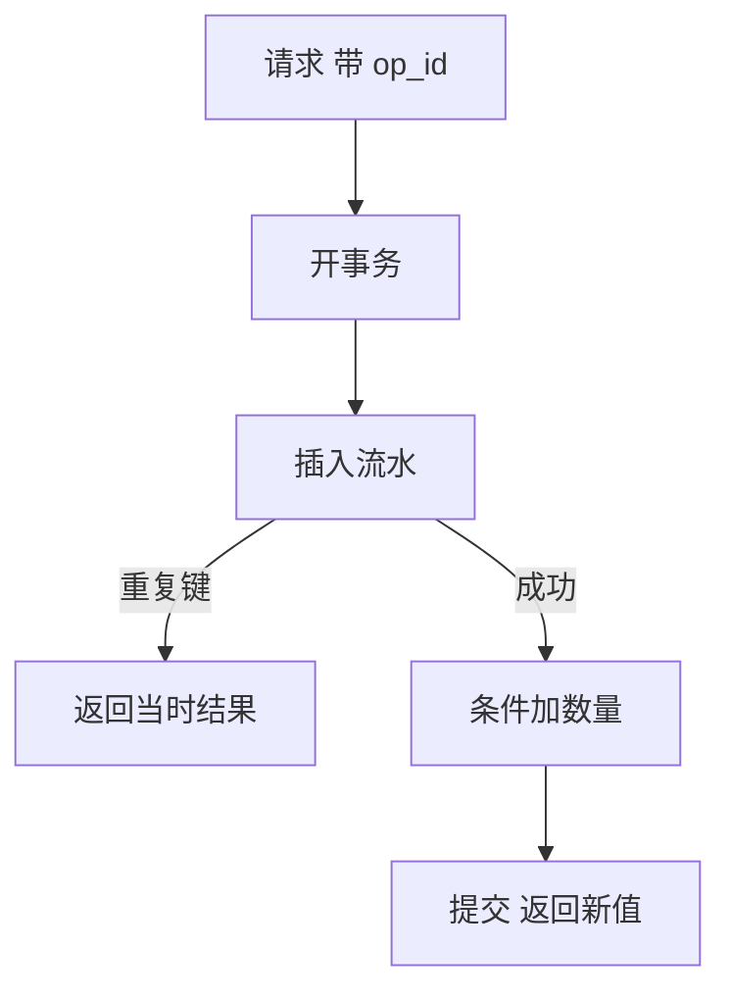

## Q
库存 API（Stockroom）现在只能把数量设成绝对值。仓库工人用手机扫码"入库 5 件"，网络不稳，客户端会重发请求。要新增"按增量调整"的接口，怎样设计才不会因为重试多加或少扣，和设置绝对值有什么本质区别？

## A
**绝对值重放同一结果，增量重放会累加；给每次调整一个操作号，并让库来去重**

- **设置绝对值天然安全**：同一请求重发，结果还是那个数；配合版本，重发的旧版本得 409，不会重复写
- **增量天然不安全**：`quantity + 5` 执行两次就是 10；响应丢了，客户端不知道有没有生效
- **操作号加唯一约束**：每次调整带客户端生成的 `op_id`，流水表对 `(owner, op_id)` 建唯一索引
- **同一事务里记流水并改数量**：插入流水成功才加数；重复键说明已处理，返回当时的结果
- **下限写进条件**：`quantity >= n` 作为更新条件，扣减不会出现负数，不够就整体回滚、不留流水



```python
def adjust(db, owner, item_id, op_id, delta):  # sqlite3 参考写法
    with db:  # 流水与数量在同一个事务里
        try:
            db.execute("INSERT INTO moves (owner, op_id, item_id, delta) VALUES (?, ?, ?, ?)",
                       (owner, op_id, item_id, delta))
        except sqlite3.IntegrityError:
            return replay(db, owner, op_id)  # 已处理过：返回当时的结果
        row = db.execute("UPDATE items SET quantity = quantity + ?, version = version + 1"
                         " WHERE owner = ? AND id = ? AND quantity + ? >= 0 RETURNING *",
                         (delta, owner, item_id, delta)).fetchone()
        if row is None:
            raise Insufficient()  # 回滚，流水也不留
        return row
```

<details class="pt"><summary>延伸</summary>流水表同时就是审计记录；操作号要有保留期，过期后同一个号会被当成新请求。</details>

**知识点：** 重试与退避（Retry & Backoff）、复合操作（Compound Actions）、不变量与封装（Invariants）
