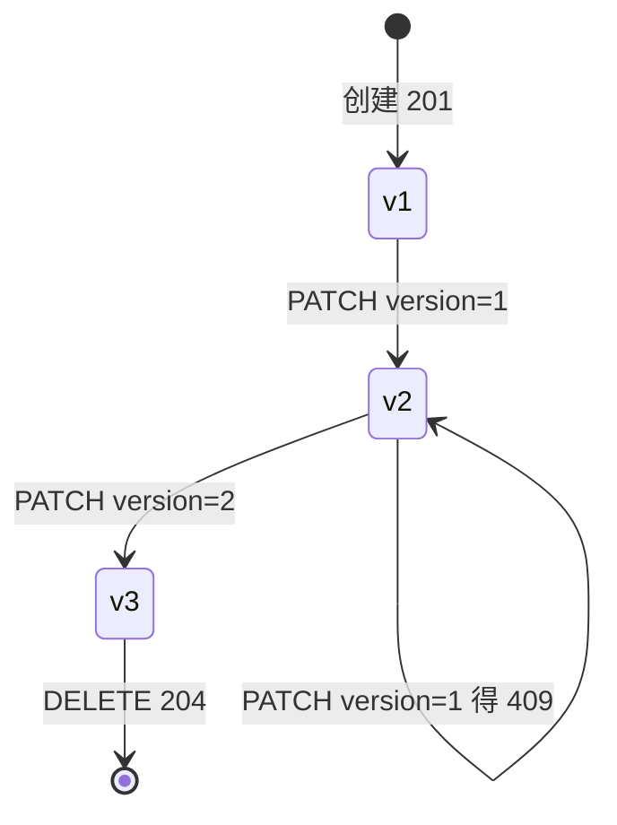

## Q
库存 API（Stockroom）里，一个条目要经历"在内存里拼好字典"、"插入集合"、"更新已存的文档"三步，运营看到的"创建成功却消失""更新返回旧值"都出在这里。服务自己要记什么、库里存什么？哪条不变量最要紧？

## A
**服务不存状态；库里每个条目带版本，任何写都是一次带条件的库操作**

- **拼字典不等于存了**：字典只在内存，没 `insert` 就没有条目；返回的应是库里读出来的那份
- **插入可能被库拒绝**：重复 `(owner, sku)` 抛 11000，模式不合抛 121，所以要先写成功再回 201
- **更新是库里的条件修改**：`owner + id + version` 命中才改，并在同一次操作里加一、返回改后文档；"先读再写"和返回旧文档都是缺陷
- **服务没有状态**：多个实例共用一个集合也成立，所以不能靠进程内的锁或缓存保证唯一与版本
- **版本只增不减**：成功一次恰好加一，失败的更新不改字段也不改版本
- **最要紧的不变量**：同一个版本上的并发写只有一个成功；`(owner, sku)` 永远唯一



```python
def find_one_and_update(self, query, changes):
    where, args = self._where(query)  # owner、id、version 都在条件里
    assignments = ", ".join(f"{column} = ?" for column in changes)
    rows = self._run(
        f"UPDATE items SET {assignments}, version = version + 1 WHERE {where} RETURNING *",
        (*changes.values(), *args),
    )
    return rows[0] if rows else None  # 没命中：不存在、别人的或版本不对
```

<details class="pt"><summary>延伸</summary>MongoDB 保证单个文档的修改是原子的；条目一旦要和别的文档一起改（例如出入库流水），才需要事务。</details>

**知识点：** 不变量与封装（Invariants）、内存持久化（In-Memory Persistence）、复合操作（Compound Actions）
