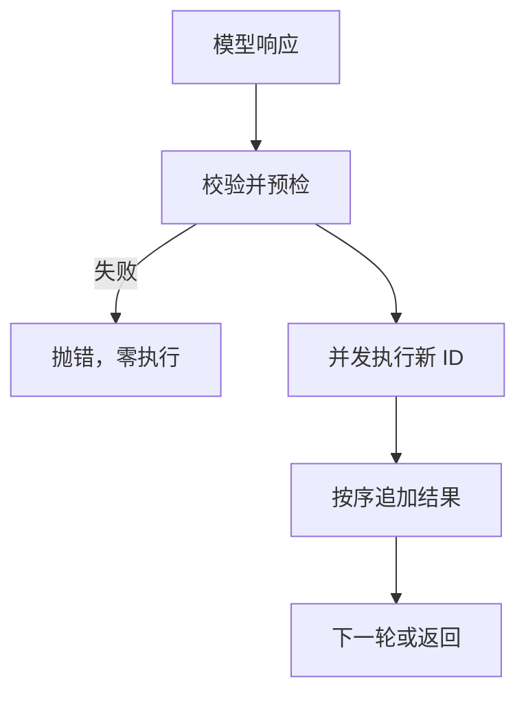

## Q
在「模型与工具交替」的智能体循环里，`run_agent(question, model, tools, …)` 每轮调用模型、并发执行它请求的一批工具、把结果追加回对话，直到模型不再请求工具；调用数和轮数都有预算。开工前你会先定下哪几条规则？

## A
**整个响应先预检再执行；结果按请求顺序；同 ID 只执行一次**

- **先校验、再预检、后执行**：畸形输出、ID 冲突、预算超额都在启动任何线程之前判定，失败时一个工具都没跑
- **结果按请求顺序**：并发只决定谁先完成；每次出现各得一条结果，重复 ID 也一样
- **按 ID 重放**：同 ID 同名同参（排序键的紧凑 JSON 比较）直接给缓存，不执行、不计数；名字或参数不同抛 `ValueError`
- **工具失败是结果**：`unknown_tool`、`tool_error`（含非 JSON 返回），不带异常文本；模型自己的异常原样抛出
- **预算**：新 ID 个数超过剩余额度抛 `tool budget exceeded`；最后一轮仍要工具，先处理完这批再抛 `model budget exceeded`
- **数据归循环所有**：响应、参数、结果、模型看到的快照都深拷贝



```python
fresh = self._cache.admit(calls)             # 同 ID 不同名或参数 → ValueError
if len(fresh) > self._limits.max_tool_calls - len(self._cache):
    raise RuntimeError("tool budget exceeded")   # 这个响应一个都不执行
for call, content in zip(fresh, self._runner.run(fresh)):
    self._cache.store(call, content)
for call in calls:                           # 每次出现一条，按请求顺序
    self._messages.append({"role": "tool", "tool_call_id": call.id, "name": call.name,
                           "content": self._cache.replay(call.id)})
```

<details class="pt"><summary>延伸</summary>预检只看「新 ID 的个数」：缓存命中的重复调用不占预算；未知工具和出错的调用占预算，因为它们也是一次尝试。</details>

**知识点：** 边界校验（Validate at the Boundary）、异常与错误值（Exceptions vs Values）、并发模式
