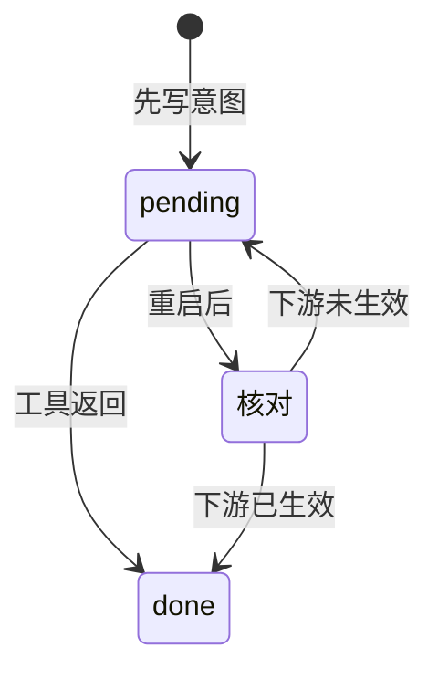

## Q
工具调用智能体里的工具会下单、转账、发邮件，做了就收不回；进程又可能在任何一行崩溃后重启。内存里的重放缓存还够用吗？循环要改哪几处？

## A
**缓存落盘，先写意图再执行，用调用 ID 做幂等键，重启后先核对再重发**

- **内存缓存不够**：重启即丢，同一个 ID 会再执行一次；缓存要落到磁盘或数据库，以调用 ID 为主键
- **先写意图**：执行前写 `pending`，工具返回后写 `done` 和结果；崩溃只可能停在这两步之间
- **`pending` 表示结果未知**：不能直接重跑；先用幂等键问下游「这个 ID 做过没有」，做过就记结果，没做过才重发
- **幂等键**：把调用 ID 作为下游的幂等键（idempotency key）传下去，下游对同一个键只生效一次
- **没有幂等能力的下游**：只能至多一次，宁可报错交给人，不能为了不丢而重发
- **对话记录和计数也落盘**：重启后从最后一条完整消息继续，不重复追加



```python
def execute(self, call):                      # 扩展版：参考解只有内存缓存
    row = self._store.get(call.id)            # 重启后从磁盘恢复
    if row and row.state == "done":
        return row.content                    # 重放
    if row and row.state == "pending":        # 结果未知：先问下游
        found = self._lookup(call.id)
        if found is not None:
            return self._store.finish(call.id, found)
    self._store.begin(call.id, call.signature)    # 先写意图
    value = self._tool(call.name, call.arguments, idempotency_key=call.id)
    return self._store.finish(call.id, value)
```

<details class="pt"><summary>延伸</summary>「至少一次加幂等」等价于「恰好一次」的效果；这个循环的预检、缓存、按序追加都不用动，只是把缓存的存取换成持久化的存储。</details>

**知识点：** 重试与退避（Retry & Backoff）、内存持久化（In-Memory Persistence）、复合操作（Compound Actions）
