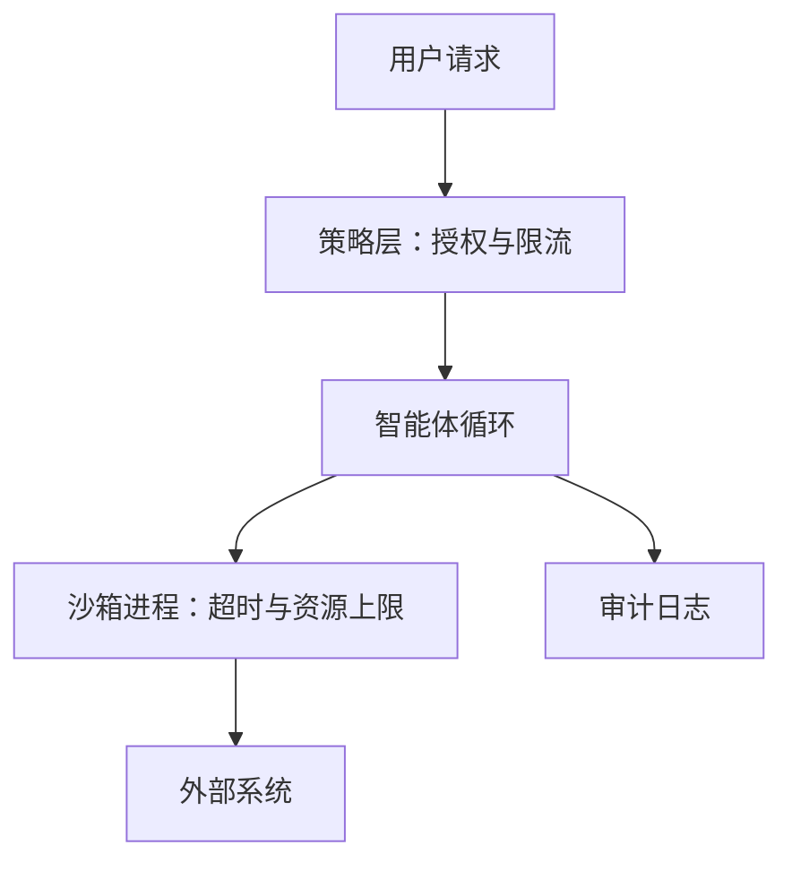

## Q
工具调用智能体的模型和工具都可能不可信：模型会胡乱请求，工具可能卡死、吐出巨量数据、读到不该读的文件。同步循环自己只管协议和预算，哪些保护要放在循环之外？

## A
**循环管协议与预算；隔离、时限、授权、资源上限放在它外面**

- **进程沙箱**：工具跑在受限的子进程或容器里，限制文件、网络、内存、CPU；线程里的工具能碰整个进程
- **墙钟超时**：同步循环等不到卡死的工具，线程也不能被强杀；超时要在进程级，杀掉后记成 `tool_error`
- **按工具授权**：谁能调哪个工具、参数落在什么范围，由循环外的策略层定，不由模型文本定
- **输出上限**：限制单个结果和整段对话的大小；内存要让子进程自己限，读完再查长度来不及
- **密钥隔离**：凭据不进对话记录，也不进工具参数，由工具侧按身份注入
- **限流与审计**：按用户或租户限频、限总预算；每次调用记谁、什么、结果



```python
def sandboxed(name, arguments, timeout_s=5):  # 注册成一个普通工具，循环不用改
    proc = subprocess.run(
        [sys.executable, "-I", "worker.py", name],
        input=json.dumps(arguments), capture_output=True, text=True,
        timeout=timeout_s,                    # 超时会杀掉子进程并抛 TimeoutExpired
    )
    if proc.returncode != 0 or len(proc.stdout) > MAX_OUTPUT:  # 只挡进上下文的量
        raise RuntimeError("tool failed")     # 循环把它变成 tool_error
    return json.loads(proc.stdout)
```

<details class="pt"><summary>延伸</summary>循环里的 `tool_error` 刻意不带异常文本：异常信息可能含路径或密钥，这也是不可信环境下的一道保护。</details>

**知识点：** 风险与权限（Risks & Guardrails）、取消、超时与关闭（Cancellation & Shutdown）、边界校验（Validate at the Boundary）
