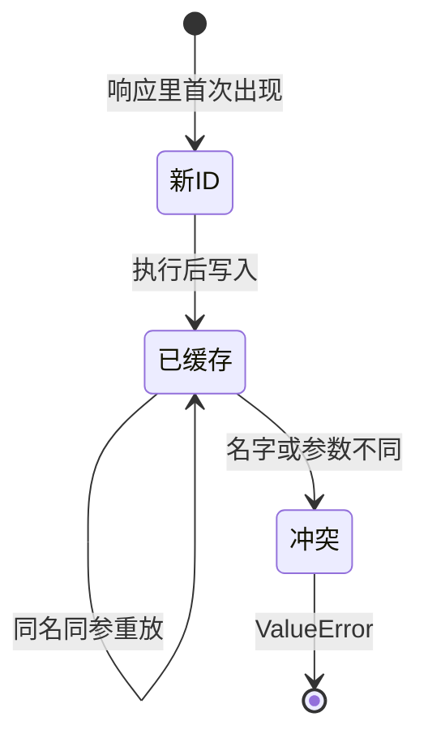

## Q
在工具调用智能体循环里，一次运行要存哪些状态？哪条不变量最要紧，哪些写法会破坏它？

## A
**每个 ID 只有一条缓存，尝试数就是缓存条目数；只有主线程写状态**

- **对话记录**：user、assistant、tool 三种消息，循环独占；模型只拿深拷贝的快照
- **重放缓存**：`ID → (名字, 参数文本, 结果)`；参数文本是排序键的紧凑 JSON，用来判断「是不是同一个调用」
- **尝试数 = 缓存条目数**：未知工具、出错的也占一条，命中缓存不增加；不另设计数器，就不会数错
- **只有主线程写缓存和记录**：工作线程只返回自己那条结果，主线程等整批结束后统一写入、按序追加
- **预算在循环外定死**：构造时校验成精确 `int`，运行中模型文本和工具输出都改不了它
- **先预留再启动**：用新 ID 个数对剩余额度，通过后才创建线程；失败不留下半批结果



```python
def admit(self, calls):
    seen, fresh = {}, []
    for call in calls:
        known = self._entries.get(call.id)
        previous = known[0] if known else seen.get(call.id)
        if previous is not None and previous != call.signature:
            raise ValueError(f"call id {call.id!r} reused")
        if previous is None:                 # 本响应里的重复 ID 只算一次
            seen[call.id] = call.signature
            fresh.append(call)
    return fresh
```

<details class="pt"><summary>延伸</summary>工作线程直接写共享缓存，写入顺序就是完成顺序（反序完成时是 3、2、1、0），还要用锁保护「先查再写」；让线程只返回值，就把并发限制在工具执行这一步，其余仍是单线程逻辑。换成数据库时，缓存表以调用 ID 为主键。</details>

**知识点：** 复合操作（Compound Actions）、不靠锁的线程安全（Immutability & Confinement）、防御性拷贝（Defensive Copying）
