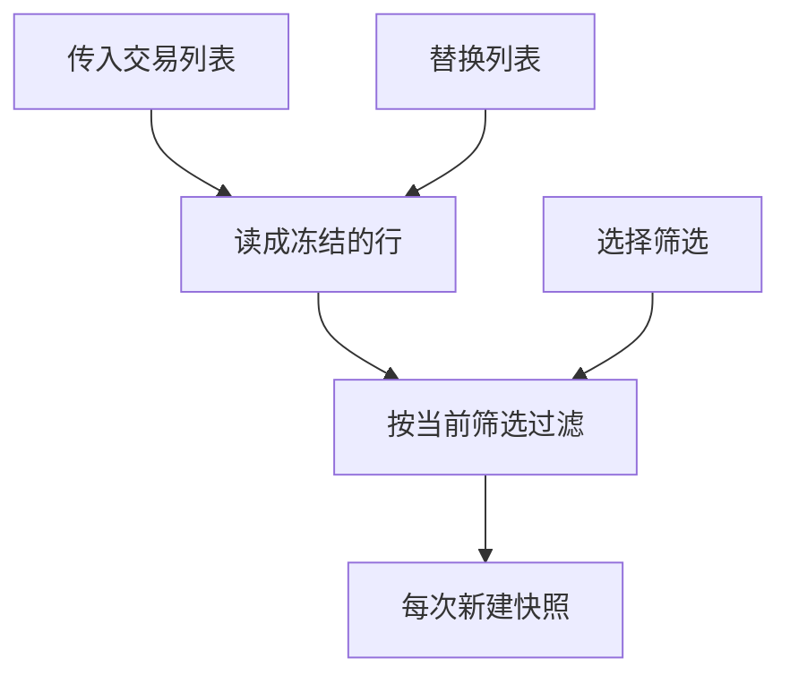

## Q
你要给账单页写一个交易列表视图模型（TransactionsList）：构造时收一份交易，能切换全部、收入、支出三种筛选，能整体换一份新列表，并随时给出界面要显示的快照。动手写之前，你会先定下哪几条规则，使隐藏测试没有可钻的空子？

## A
**六条规则：形状、筛选、投影、换列表、原样、隔离**

- **快照形状**：`filters` 恰好三项、顺序固定 `all`、`credit`、`debit`，`active` 是真布尔，且只有一项为真；`activeFilter` 与它一致
- **展示项**：一条可见交易一项、保持输入顺序；`id` 取交易的 `id`（不是地点的 id），地点的 `zipCode` 不出现
- **没有匹配**：所选筛选照样生效，`items` 为空，不退回「全部」
- **换列表**：整体替换、不追加不合并不排序；当前筛选保持，立刻作用在新列表上；空列表合法
- **字符串原样**：金额与日期是文本，不解析、不去空白、不改格式
- **隔离**：输入不被改，也不被持有；快照随便改也碰不到视图和别的快照；旧快照不被之后的操作改变



```python
def snapshot(self):
    active = self._active
    return ListSnapshot(
        active,
        [FilterState(n, n == active) for n in FILTERS],   # 顺序与布尔都由常量推导
        [r.to_item() for r in self._rows if r.visible_under(active)],  # 保持输入顺序
    )
```

<details class="pt"><summary>延伸</summary>规则越多越要把数字例子变成测试：示例里的三步（选支出、换成一条、换成空）逐字跑一遍；未知筛选名合同没规定，要不要拒绝是自己的决定，不交给编程智能体顺手选。</details>

**知识点：** 规格与契约（Specifications）、防御性拷贝（Defensive Copying）、返回值设计（Return Values）
