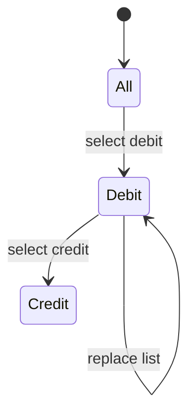

## Q
账单页的交易列表视图模型（TransactionsList）里，用户刚点了「支出」，这时后台推来一份全是收入的新列表，随后用户又点了一次「支出」。页面应该一直停在「支出」且列表为空。你怎么在代码结构上保证这一点，而不是靠测试碰运气？用哪几个测试守住它？

## A
**筛选独立存放，只有 `selectFilter` 写它**

- **结构保证**：`replaceTransactions` 只赋值 `self._rows`，`selectFilter` 只赋值 `self._active`；没有哪个函数同时重置两者，所以不可能漏传
- **重复选择**：`selectFilter` 是幂等的赋值，没有切换（toggle）语义，点两次不会回到别处
- **没有匹配也不退回**：`snapshot` 对空结果照常返回，`activeFilter` 与 `active` 标记来自 `_active`，不看 `items` 是否为空
- **测试一**：选 `debit`、换成只含 `credit` 的列表，断言 `activeFilter == "debit"`、三项标记为 `False, False, True`、`items == []`
- **测试二**：从未选过筛选就换列表，断言仍是 `all`；这条抓住「换列表时写死默认值」的实现
- **测试三**：同一个状态下连续选两次同一个筛选，整份快照相等



```python
def selectFilter(self, filter):
    self._active = filter                  # 只写筛选

def replaceTransactions(self, transactions):
    self._rows = _freeze(transactions)     # 只写列表；先建完整元组再赋值
```

<details class="pt"><summary>延伸</summary>要拒绝未知筛选名时，只在 `selectFilter` 开头加一行校验；换成多个筛选条件（本月、金额范围）时，筛选从名字变成谓词，仍然是一个独立字段。</details>

**知识点：** 状态机（State Machines）、规格与契约（Specifications）、内存持久化（In-Memory Persistence）
