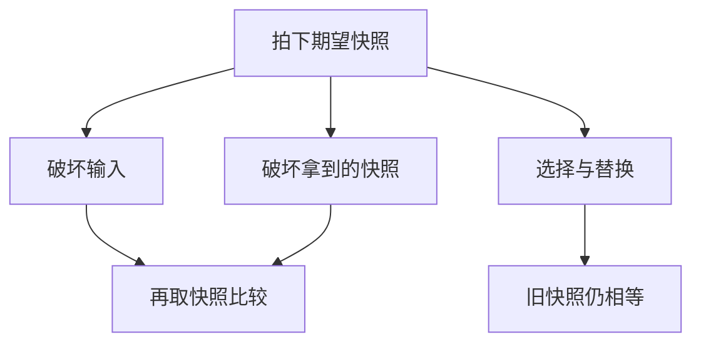

## Q
账单页的交易列表视图模型（TransactionsList）：调用方构造之后把自己的列表清空、又把第一条交易的地址改了；界面层拿到快照后往 `items` 里追加了一项，之后用户又切了筛选、换了列表。你怎么检查视图没被这些操作污染、先前拿到的快照也没变？

## A
**先拍期望快照，破坏后断言整份相等**

- **输入方向**：构造后改嵌套地点、改金额、换掉整个地点对象、清空列表；断言新快照与破坏前逐字段相等（用 `dataclasses.asdict` 比）
- **替换方向**：同一套破坏对准 `replaceTransactions` 传入的列表；还要覆盖「同一个对象放进两次」的情形
- **输出方向**：拿到快照后改字段、增删项、改筛选项、清空列表；再取一次快照，断言和视图原状相等
- **历史方向**：保存旧快照，做选择和替换，断言旧快照的 `asdict` 没变，且两次快照的列表与元素不是同一个对象
- **实例方向**：同一份数据建两个视图，一个选筛选并清空，另一个原样
- **反向验证**：把实现改成保存引用或只做浅拷贝，这些测试应当失败；不会失败的测试什么也没断言



```python
def test_caller_edits_do_not_reach_view():
    rows = [txn(1, "credit"), txn(2, "debit")]
    view = TransactionsList(rows)
    expected = asdict(view.snapshot())
    rows[0].location.address = "edited"      # 改嵌套对象
    rows.clear()                             # 清空容器
    assert asdict(view.snapshot()) == expected
```

<details class="pt"><summary>延伸</summary>结果改成不可变（元组加冻结数据类）后，输出方向的测试变成「改它会抛异常」；规模更大时可以缓存不可变快照，隔离测试不用改。</details>

**知识点：** 防御性拷贝（Defensive Copying）、值对象与不可变性（Value Objects）、返回值设计（Return Values）
