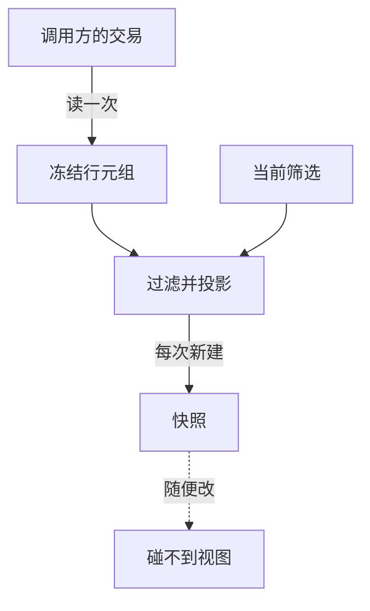

## Q
账单页的交易列表视图模型（TransactionsList）要记住「用户选了哪个筛选」和「当前这份交易」，而调用方传进来的交易和地点都是可变对象，返回的快照也会被界面层随意修改。你会存哪些状态，哪条不变量最要紧，构造和快照怎么写？

## A
**只存两样：一个筛选名和一个冻结行的元组；进口读一次，出口每次新建**

- **状态只有两个字段**：`_active`（三个合法名之一）与 `_rows`（`_Row` 的元组）；不存调用方的任何对象，也不存快照
- **最要紧的不变量**：`_rows` 里每个元素都是冻结的，里面只有字符串和整数；这样视图的内容不可能被外面改到
- **进口只在一处**：`_Row.read` 取交易的六个字段，之后调用方对交易或地点做什么都与视图无关
- **浅拷贝不够**：`list(...)` 只拷贝了容器，里面的交易和地点还是同一批对象，改嵌套地址会穿透进来
- **出口每次现造**：`FilterState` 与 `TransactionItem` 都新建，列表也新建，快照与视图、快照与快照没有共享的可变对象
- **筛选与列表各改各的**：选择只写 `_active`，替换只写 `_rows`，所以「换列表保留筛选」不靠记性



```python
@dataclass(frozen=True, slots=True)
class _Row:
    kind: str
    id: int
    address: str
    city: str
    amount: str
    date: str

    @classmethod
    def read(cls, txn):                       # 唯一读调用方对象的地方
        loc = txn.location
        return cls(txn.txnType, txn.id, loc.address, loc.city, txn.amount, txn.date)
```

<details class="pt"><summary>延伸</summary>规模变大（十万条）时，按类型预先分成两个元组，快照只拷贝要显示的那个；并发时把两个字段合成一个冻结的状态对象，每次整体换掉，读者一次读引用就拿到一致的版本。</details>

**知识点：** 防御性拷贝（Defensive Copying）、值对象与不可变性（Value Objects）、状态机（State Machines）
