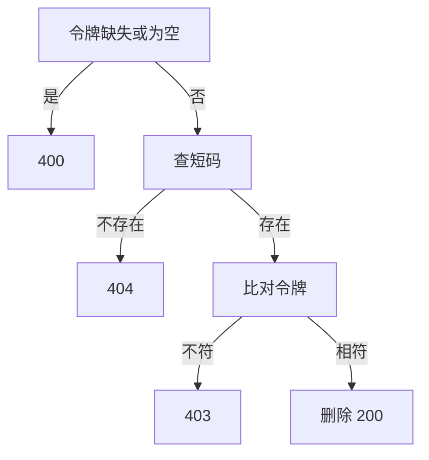

## Q
你要写一个短链服务：SQLite 存储，对外是创建、跳转、查元数据、按所有者删除、统计五个接口，状态码和 JSON 形状都是合同。开工前你会先定下哪几条规则（隐藏测试会逐条卡的那几条）？

## A
**先把"校验、顺序、边界"写成断言，再写代码。**

- **输入校验在最前**：网址去首尾空白后不含空白与控制字符、协议 http 或 https、主机名非空；短码用 `fullmatch`；ttl 排除 bool、NaN、inf
- **冲突与生成**：自定义短码被占用 409；自动短码最多调用五次 `_generate_code`，全撞 500
- **过期是闭区间**：`now >= expires_at` 即过期；过期跳转 410 且不计数；元数据与统计仍包含它
- **删除的判定顺序**：缺令牌 400，再查短码 404，最后比令牌 403（README 没规定先后，本实现这样选）
- **统计排序**：`hit_count` 降序，同分按 `short_code` 升序；元数据不含 `owner_token`
- **错误形状**：所有错误都是 `{"error": ...}`，含坏 JSON 与 405



```python
def delete(self, short_code, owner_token) -> bool:
    if not isinstance(owner_token, str) or not owner_token:
        raise ValidationError("owner_token is required")  # 400
    with self._tx() as conn:
        row = conn.execute("SELECT owner_token FROM links WHERE short_code = ?", (short_code,)).fetchone()
        if row is None:
            return False  # 路由层翻成 404
        if not secrets.compare_digest(row[0].encode(), owner_token.encode()):
            raise PermissionDeniedError("owner_token does not match")  # 403
        conn.execute("DELETE FROM links WHERE short_code = ?", (short_code,))
        return True
```

<details class="pt"><summary>延伸</summary>

同时违反两条规则时谁先赢要先问清并写成测试；令牌改存哈希后，比对变成"哈希后再比"，元数据照样不能带令牌。

</details>

**知识点：** 接口的错误契约（Error Contract）、边界校验（Validate at the Boundary）、规格与契约（Specifications）
