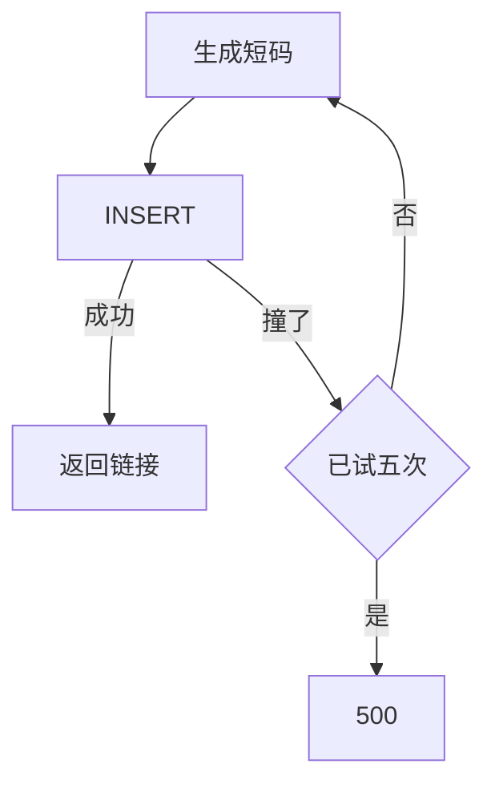

## Q
短链服务里，两个用户在同一时刻用同一个自定义短码创建链接，同时还有大量不带自定义短码的创建在并发进行。怎么保证没有一条链接被覆盖、也不会发出重复的短码？

## A
**让主键约束当裁判：直接插入，撞了再处理，而不是先查再插。**

- **直接插入、接住完整性错误**：先 SELECT 再 INSERT 在两个进程之间有空隙
- **自定义短码撞了就是 409**：不覆盖、不重试，原链接保持不变
- **自动短码撞了就重新生成**：最多调用五次 `_generate_code`，每个码来自一次调用，全撞则 500
- **短码要随机，不能由网址推出**：同一个网址再缩一次必须得到另一条
- **生成器给出的码要核对格式**：不合格直接 `CodeGenerationError`，不入库
- **自动与自定义共用一个命名空间**；与路由重名的 `stats`、`links` 直接拒绝



```python
for _ in range(MAX_GENERATION_ATTEMPTS):
    candidate = self._generate_code(url)
    if not isinstance(candidate, str) or not AUTO_CODE_PATTERN.fullmatch(candidate):
        raise CodeGenerationError("the generator returned an invalid code")
    link = replace(draft, short_code=candidate)
    if self._insert(conn, link):  # IntegrityError 就是撞了
        return link
raise CodeGenerationError("could not find a free short code")
```

<details class="pt"><summary>延伸</summary>

七位字母数字有 3521614606208 种；一百万条链接时单次撞车概率约 2.8e-7，连撞五次约 1.8e-33。规模再大改用发号器加 Base62。

</details>

**知识点：** 复合操作（Compound Actions）、线程安全结构的写法（Thread-Safe Structures）、内存持久化（In-Memory Persistence）
