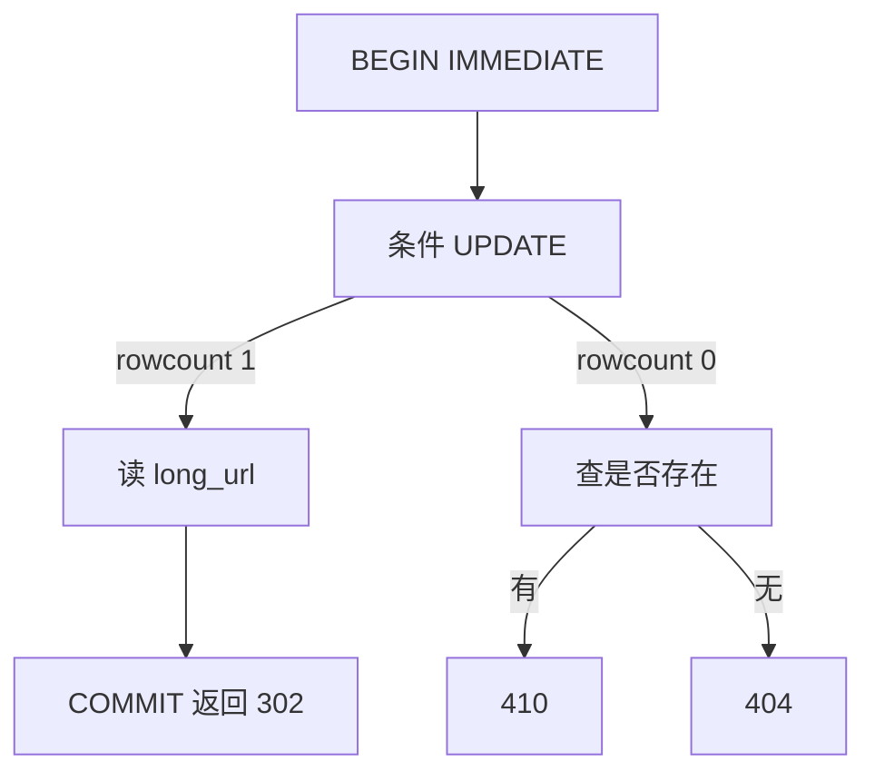

## Q
短链服务里一条热门链接的流量涨了十倍，你把服务开成四个 worker 进程，每个进程里还有多个线程，都连同一个 SQLite 文件。上线后 `hit_count` 比访问日志少，偶尔还有链接过期后仍被计数。哪几步必须原子？怎么做？

## A
**把"判断没过期"和"加一"写进同一条 UPDATE，再让数据库事务串行化写入。**

- **计数用单条 SQL**：`hit_count = hit_count + 1`，不在 Python 里读出再写回
- **过期判断进同一条 WHERE**：`AND (expires_at IS NULL OR ? < expires_at)`，靠 `rowcount` 判断成败
- **进程内的锁不够**：`RLock` 只串行本进程的那条共享连接；跨进程靠 `BEGIN IMMEDIATE` 与 `busy_timeout`
- **同一条连接被多线程共用就要加锁**：否则两个线程的事务会交错
- **失败再分流**：`rowcount` 为 0 时再查存在性，不存在 404，存在就是过期 410



```python
def resolve_redirect(self, short_code):
    with self._tx() as conn:
        now = self._clock()
        hit = conn.execute(
            "UPDATE links SET hit_count = hit_count + 1"
            " WHERE short_code = ? AND (expires_at IS NULL OR ? < expires_at)", (short_code, now))
        if hit.rowcount == 1:
            return conn.execute("SELECT long_url FROM links WHERE short_code = ?", (short_code,)).fetchone()[0]
        exists = conn.execute("SELECT 1 FROM links WHERE short_code = ?", (short_code,)).fetchone()
    raise ExpiredLinkError("expired") if exists else NotFoundError("unknown")
```

<details class="pt"><summary>延伸</summary>

写入成了热点后，把计数先攒在内存或 Redis，定期批量落库，接受崩溃时丢最近几秒；或把计数拆成多行再求和。

</details>

**知识点：** 复合操作（Compound Actions）、线程、进程与协程的选择（Choosing a Model）、测试并发代码（Testing Concurrency）
