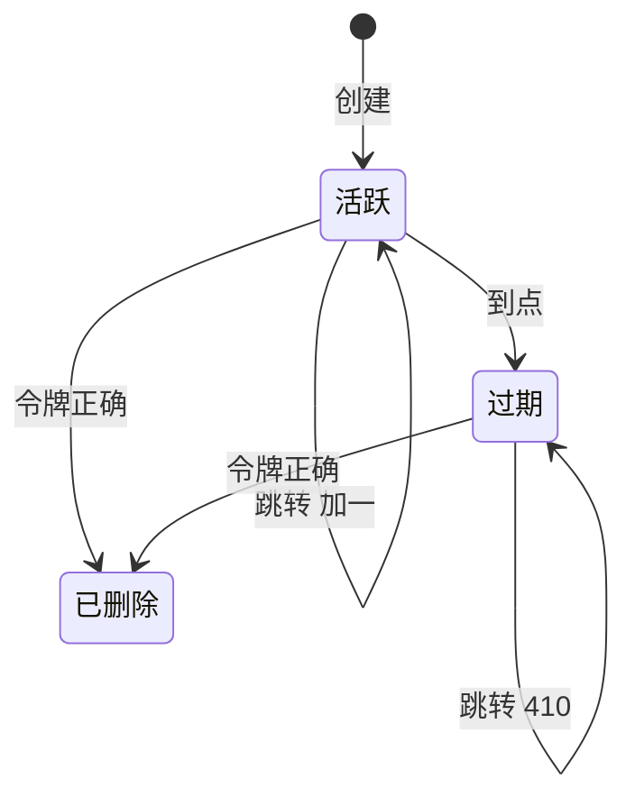

## Q
在短链服务里，你要存哪些状态？哪条不变量最要紧，由谁来守？

## A
**只存一张表；最要紧的不变量是"短码唯一，且点击只在链接未过期时增加"。**

- **一行一条链接**：`short_code`（主键）、`long_url`、`created_at`、`expires_at`（可空）、`hit_count`、`owner_token`
- **唯一性交给主键**：直接插入，撞了由数据库拒绝；不先查再插
- **点击只增不减且只在活跃时增**：用带条件的 UPDATE，`hit_count` 加 `CHECK >= 0`
- **过期不存成列**：由 `expires_at` 与当前时间推出，没有"过期了但没标记"的中间态
- **令牌只在创建时返回**：元数据与统计里都没有
- **删除是真删行**：删后不再出现在读取与统计里，短码可以重建



```python
conn.execute(
    "CREATE TABLE IF NOT EXISTS links ("
    " short_code TEXT PRIMARY KEY,"
    " long_url TEXT NOT NULL,"
    " created_at REAL NOT NULL,"
    " expires_at REAL,"
    " hit_count INTEGER NOT NULL DEFAULT 0 CHECK (hit_count >= 0),"
    " owner_token TEXT NOT NULL)")
```

<details class="pt"><summary>延伸</summary>

链接多了，统计的求和与排序要扫全表：给 `(hit_count, short_code)` 建索引，或另存汇总行；代价是每次点击多维护一份。

</details>

**知识点：** 内存持久化（In-Memory Persistence）、不变量与封装（Invariants）、边界校验（Validate at the Boundary）
