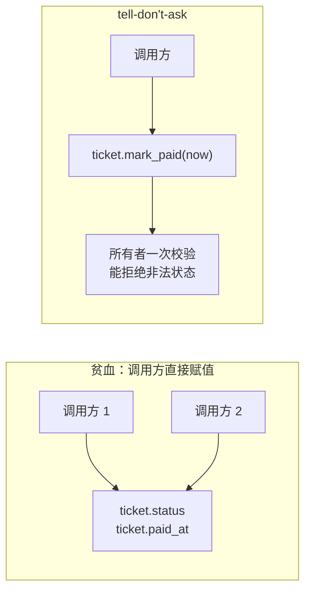

## Q
```python
ticket.status = "PAID"
ticket.paid_at = now
wallet.balance = wallet.balance - fee
```
说出这里的坏味道，以及该怎么重构。

## A
**Anemic domain model（贫血领域模型）**——封装被直接赋值破坏了：不变量（已支付 ⇒ `paid_at` 必须有值；余额不能为负）现在得由每一个调用方各自重新实现一遍，忘记同步某一行就产生一个非法状态。

按 tell-don't-ask 重构：`ticket.mark_paid(now)`、`wallet.debit(fee)`。操作搬到数据的所有者身上，由它一次性校验这次状态转移，并且有能力拒绝非法状态。


