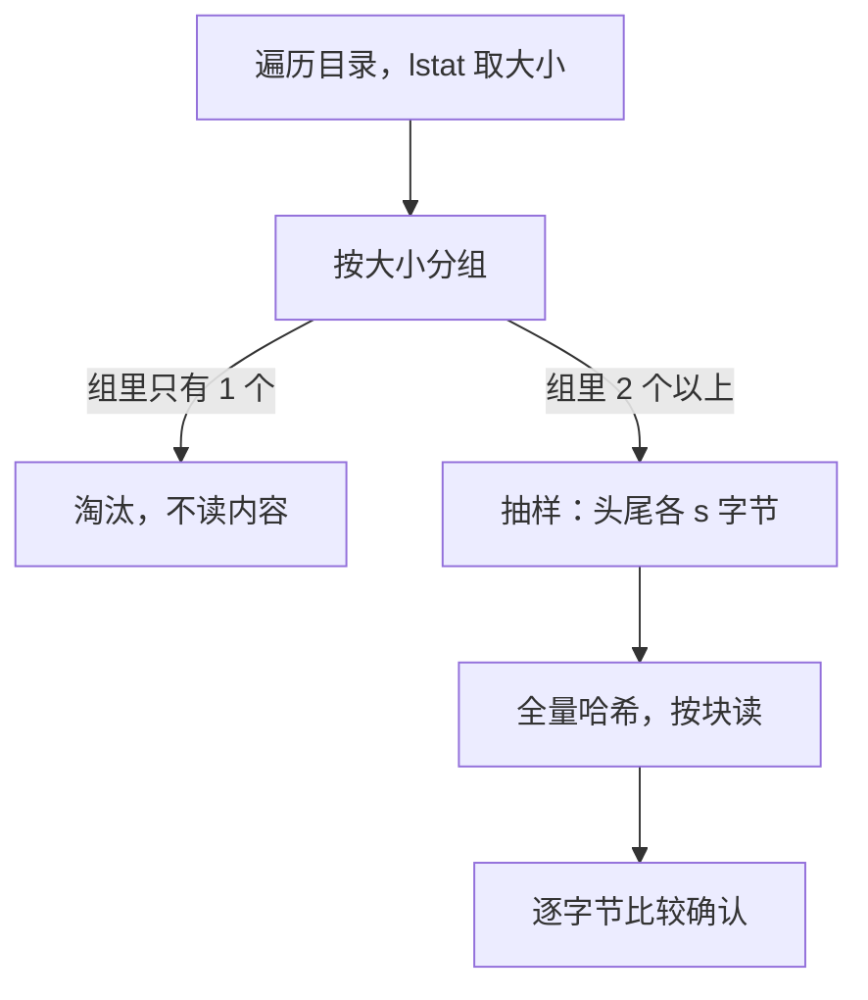

## Q
在一个有几十万个文件的目录树里找内容完全相同的文件。全部算哈希太慢，怎样安排比较的顺序，才能让大部分文件根本不用被读？

## A
**从便宜的判据开始，每一步淘汰一批**

- **大小**：`os.lstat` 取，且不跟随软链接；大小不同的文件一定不同，大小唯一的文件不读、不抽样；
- **抽样**：只读头尾各一小块，成本与文件大小无关，能淘汰绝大多数不同文件；
- **全量哈希**：按块流式读，内存不随文件增大；
- **哈希相等不等于内容相等**：碰撞虽然极少，但「相同」是个会触发删除的判断，最后要逐字节比较；
- **`filecmp.cmp` 默认只看 `os.stat` 签名**：类型、大小、修改时间都一样就返回 True，根本不读内容；要当最终确认，传 `shallow=False`。

延伸

测试时人造碰撞：把摘要函数换成对所有文件返回同一个值，断言最后的分组仍然按字节，证明最后一步不是摆设。

**知识点：**流式处理大文件（Streaming Large Files）
