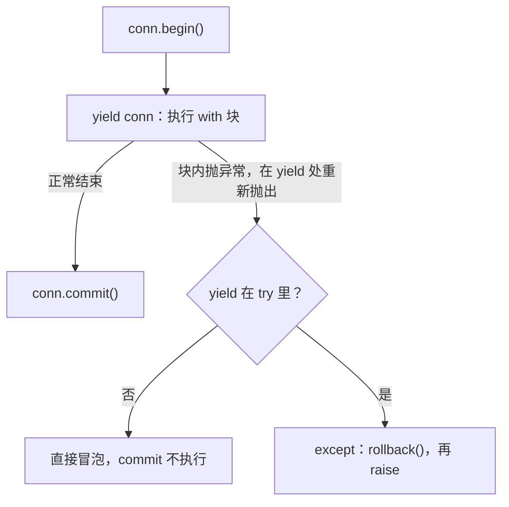

## Q
上一张卡里的 `transaction` 少写了什么，导致 `with` 块内抛异常时行为不对？

## A
少了 `try/finally`。`with` 块内抛出的异常会在生成器的 `yield` 处被**重新抛出**；如果 `yield` 之后的代码（提交事务）不在 `try` 保护范围内，异常会直接从 `yield` 处向外冒泡，`conn.commit()` 根本不会被执行——但如果想要的是“出错就回滚”，需要用 `try/except`/`finally` 显式接住它：
```python
@contextmanager
def transaction(conn):
    conn.begin()
    try:
        yield conn
        conn.commit()
    except Exception:
        conn.rollback()
        raise
```


