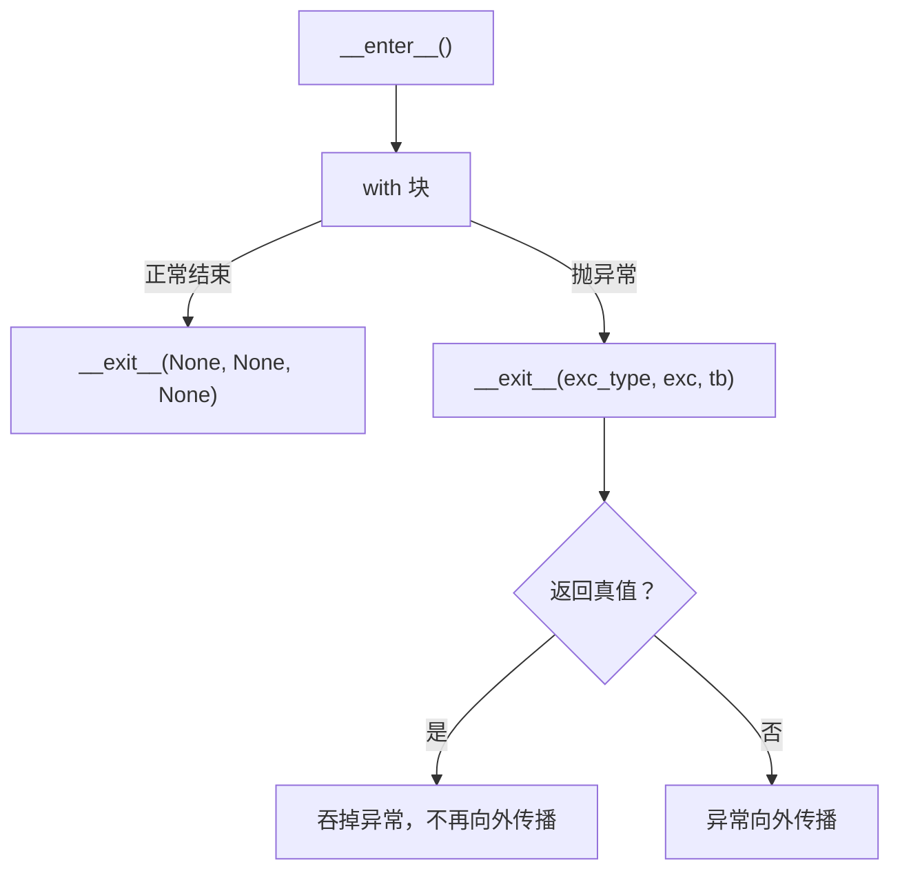

## Q
`with` 语句到底保证了什么？和自己写 `try/finally` 手动调用 `close()` 相比，多了什么？

## A
`with obj:` 保证调用 `obj.__enter__()`，并且**无论 `with` 块正常结束还是抛异常**都会调用 `obj.__exit__(exc_type, exc, tb)`——这正是配对操作（打开/关闭、加锁/解锁、开启事务/提交或回滚）最容易写漏的部分：手写 `try/finally` 每次都要自己记得写全，`with` 把这个责任收进类型本身。额外的是 `__exit__` 的返回值：返回真值（truthy）会**吞掉**块内的异常，让它不再向外传播——这是手动 `try/finally` 默认拿不到的能力。

