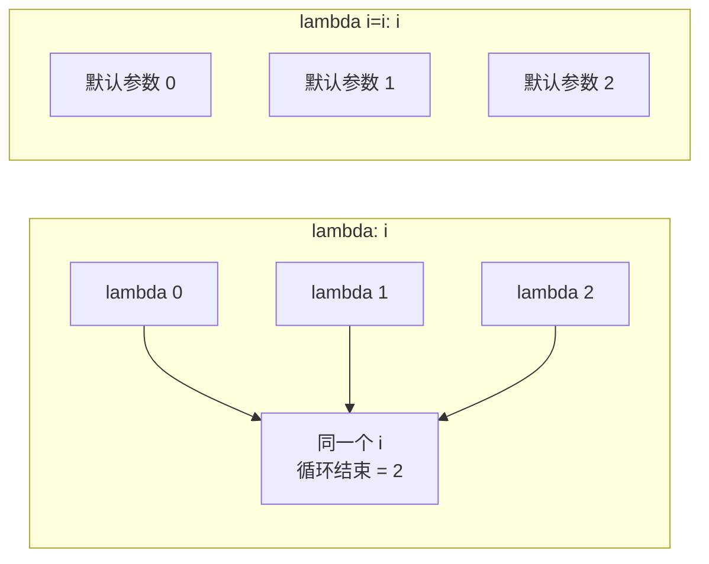

## Q
下面这段代码为什么三次打印出来的都是 `2`，而不是 `0, 1, 2`？
```python
funcs = [lambda: i for i in range(3)]
for f in funcs:
    print(f())
```

## A
闭包（closure）捕获的是变量 `i` 本身（按引用捕获），不是循环当时的值；三个 lambda 共享同一个外层作用域里的 `i`，循环结束时 `i` 的值是 `2`，所以三次调用都读到 `2`——这就是“延迟绑定（late binding）”。修复方式是把当前值作为默认参数在定义时“冻结”进去：`lambda i=i: i`，因为默认参数在函数定义那一刻就求值并绑定了。


