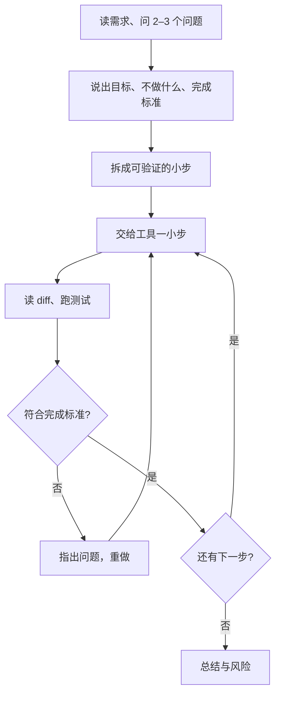

## Q
AI 辅助编码轮（AI-assisted round）考什么、不考什么？为什么第一步是"先把问题框清楚，再交给工具"，具体怎么做？

## A
**这一轮是什么：** 面试允许甚至要求你用 AI 编码助手，即根据你写的文字说明去读代码、生成或修改代码的大模型工具（如 Claude Code、Cursor、GitHub Copilot）。题目通常是：读一个小仓库、给已有服务加一个功能、调查一份运维数据、改进一个开发工具、把一个不完整的需求做成能跑的原型。做完后接着讨论"上生产还缺什么"。

**评分看什么：** 问题定义、给工具的上下文和可验证的小步、验证、能解释和调试生成的代码、测关键行为、知道何时信工具何时顶回去、讲清楚、生产思维。**不看**你用哪种提示词写法。写代码的速度不再稀缺，稀缺的是判断。

**为什么先框问题：** 工具会忠实、快速地解决你描述的问题。描述错了，它会很快地造出一个漂亮的错东西，而你要花更久才能发现。

**框问题的四件事（开口说出来，面试官要听到）：**
- **目标：** 例："找出最不稳定的 5 个测试，以及最近一次回归是哪次提交引入的"。
- **问清歧义：** "不稳定"是指同一提交上有过有不过，还是失败率高？时间范围多大？重跑记录算不算？
- **不做什么：** 不做界面、不处理历史上已删除的测试。
- **完成标准：** 一个能复现的脚本、一张表，外加手工核对过的 2 个样本。

**常见失败：** 读完题直接把整段需求粘给工具、等它吐出几百行，再从结果倒推需求。面试官从第一分钟就在看你有没有掌握方向盘。
