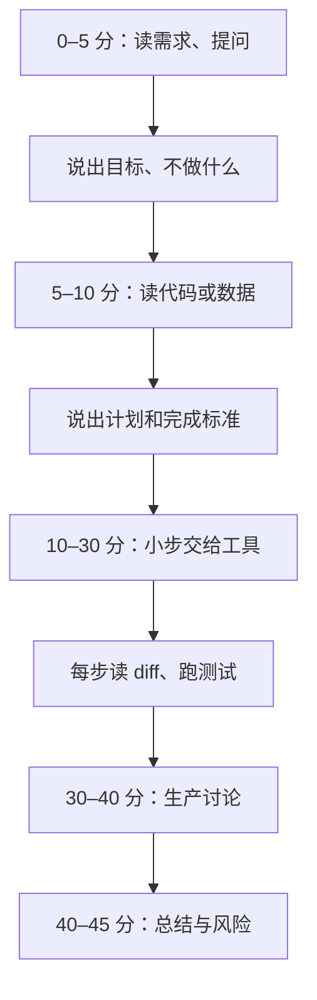

## Q
一场 45 分钟的 AI 辅助编码轮，时间怎么分？怎样自己排练一遍，排练后看什么？

## A
**这一轮：** 允许或要求你用 AI 编码助手（按文字说明读代码、生成或修改代码的大模型工具）完成一个具体任务，再讨论上生产的问题。评分在问题定义、验证和判断，不在打字速度。

**45 分钟的分法：**

- **0–5 分钟：** 问 2–3 个澄清问题，复述目标、不做什么、完成标准。
- **5–10 分钟：** 读入口、数据结构、现有测试；探一遍数据（列、类型、空值、取值）。
- **10–30 分钟：** 每次只交一小步；每步读 diff、跑测试、自己加一个边界用例。超时的步骤先做最小可用版本。
- **30–40 分钟：** 回答改进、上生产、负载、安全隐私、可观测、交接。
- **40–45 分钟：** 说出没交给工具的部分和原因、抓到的工具错误、还剩的风险。

**排练怎么做：**
- **题目：** 一份 CI 测试结果 CSV（提交、测试名、状态、开始时间、耗时），找出最不稳定的 5 个测试，以及最近一次回归由哪次提交引入。自己先造数据，故意放进参数化测试名、`error` 状态、带时区的时间、一个稳定失败的测试。
- **规则：** 计时 45 分钟，全程开口说，录屏。
- **回看清单：**
  - 第一次把任务交给工具前，有没有说出完成标准？
  - 有没有一步 diff 你没读就继续了？
  - 抓到了工具的哪个错误？是靠反例、抽样还是测试？
  - 最后 5 分钟能否说清"哪部分没交给 AI、为什么"？
  - 哪一段沉默超过 1 分钟？那是面试官最难给分的地方。

**多练几种题型：** 加功能、调查数据、改开发工具、从模糊需求做原型，各排练一次。
