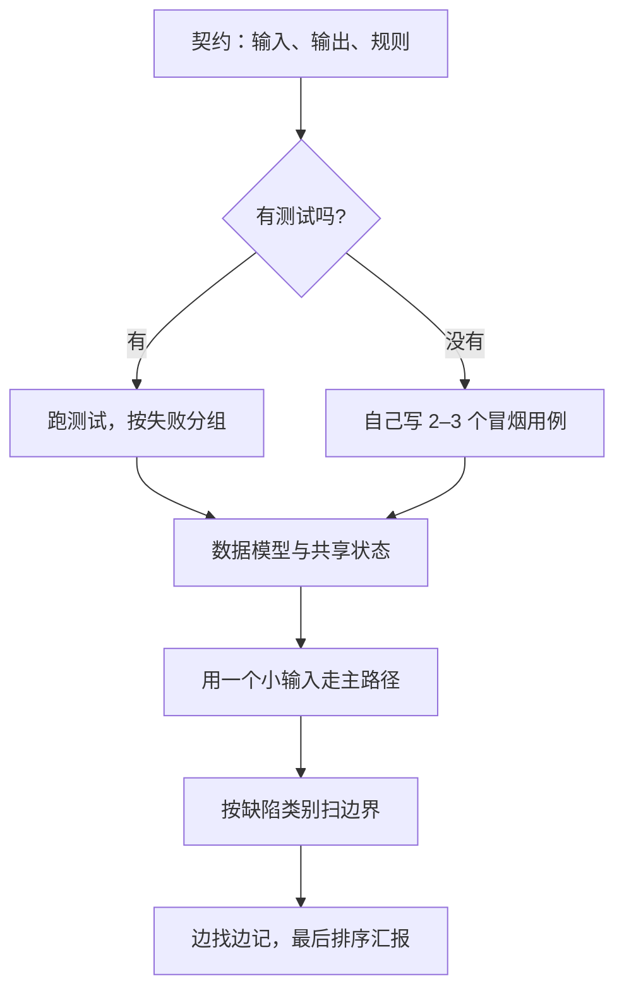

## Q
排错轮（bug bash）给你一段几百行的陌生 Python 代码，让你在 45 分钟内找出尽可能多的缺陷。按什么顺序读？为什么不从第一行读到最后一行？

## A
**核心：先弄清"应该做什么"，再看"实际做了什么"。** 没有契约就没有 bug，只有"我会写得不一样"。从头到尾逐行读，注意力平均分给样板代码和关键逻辑，最容易出错的边界反而读得最匆忙。

**每一步做什么：**
1. **契约（约 5 分钟）：** 读题目说明、文档字符串、函数签名。问清：空输入返回什么？时间用什么时区？出错时抛异常还是返回默认值？
2. **测试（约 5 分钟）：** 有测试先跑：`pytest -q`，再 `pytest --lf -x` 只重跑失败的、停在第一个。按报错类型分组，同一根因常引出多个失败。没有测试就自己写两三个最小用例。
3. **数据模型（约 5 分钟）：** 有哪些类、字段、模块级变量；哪些状态是可变的、被谁共享、在多线程里被谁写。缺陷最常藏在"谁拥有这份状态"说不清的地方。
4. **主路径（约 10 分钟）：** 拿一个 3 行的小输入，在纸上手推一遍，记下每个变量的值。手推比"读懂了"可靠得多。
5. **扫边界（约 15 分钟）：** 按清单逐类过一遍：差一错误、共享可变状态、资源泄漏、吞异常、时间与时区、浮点相等、并发。重点看循环边界、`except`、`open`、`datetime`、`==`、锁。
6. **汇报（约 5 分钟）：** 按严重程度排序，每条给位置、触发输入、根因、修法。

**两个习惯：**
- **边找边记：** 发现一条就记一行，不要立刻动手修，修到一半会忘了刚才还看到什么。
- **说出思路：** 面试官给分看的是方法，沉默地读 10 分钟等于没有过程分。
