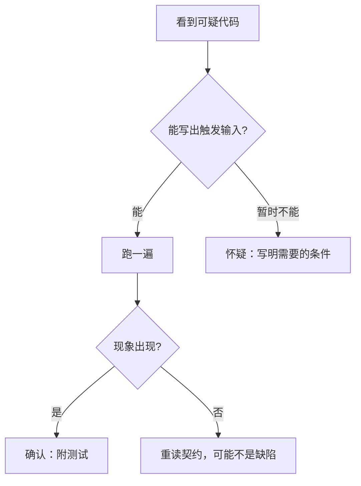

## Q
排错轮里找到一个缺陷后，怎样汇报才算一条好的发现？几条发现怎么排序？"确认"和"怀疑"怎么区分？

## A
**一条发现的六个部分：**
1. **位置：** 文件、函数、行号。
2. **触发条件：** 能复现它的最小输入或操作。
3. **现象：** 实际得到什么，期望得到什么。
4. **根因：** 为什么会这样，一句话讲到机制，不停在现象。
5. **影响：** 谁会被影响、多严重、多常见。
6. **修法和证明：** 怎么改，以及哪个测试修前红、修后绿。

**写出来的样子：**
> `load_runs` 第 4 行，`cache={}` 是可变默认参数。触发：同一进程里两次调用之间结果文件被重写。现象：第二次返回旧结果，期望返回新内容。根因：默认值在函数定义时只创建一次，被所有调用共享。影响：长时间运行的服务和整套测试里结果陈旧，测试之间互相污染，较严重。修法：默认值改为 `None`，函数内新建字典；测试：重写文件后再调一次，断言读到新内容。

**确认还是怀疑：**

- **确认的：** 有一个能跑的复现。
- **怀疑的：** 说清楚"在什么条件下会出问题"，例如"如果两个线程同时调用，计数可能丢失"，并标出还没验证。把两者混在一起汇报，会让面试官怀疑你的所有结论。

**怎么排序：**
- **先报结果错且无声的：** 算错数字、丢数据、吞掉错误。用户不知道出了错，危害最大。
- **再报会崩溃的：** 异常、死锁。至少会被发现。
- **再报压力下才出现的：** 资源泄漏、并发竞争。
- **最后是可维护性：** 命名、重复、风格，一句话带过。

**分清修复与重写：** 每条只做最小修复，不顺手重构；"这段整体可以重写"作为单独一条建议提出。
