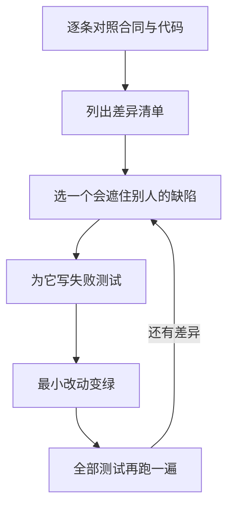

## Q
接手一份有好几处缺陷的代码（解析器、规则、驱动都有问题），合同有十几条。第一步该做什么？为什么不是「读到哪错就改哪」？

## A
**读合同列差异，一个缺陷一个红测试，逐个修**

- **清单先于改动**：先读完再动手，一边读一边改会漏掉没读到的条目，也分不清哪处改动修了哪个现象；
- **遮蔽**：「第 30 天被判过期」会让之后所有边界（已打开且高价值、风险分）都显示成同一个结果；先修它，后面的缺陷才会各自露面；
- **一缺陷一测试**：一个测试里塞多个断言，第一个失败后其余不再执行，看不出还有几处错；
- **每步全跑**：修一处时顺手破坏了起始代码本来做对的地方，只有全量测试能抓到；
- **做对的也要留测试**：起始代码已经正确的规则同样写成测试，防止重写时被放宽。

延伸

清单里每一行写成「现象、位置、期望」三栏；测试名取自「现象」，提交说明取自「位置」。面试里先说这个顺序，比直接开始改代码更能体现你在控制风险。

**知识点：**先写失败的测试（Test First）
