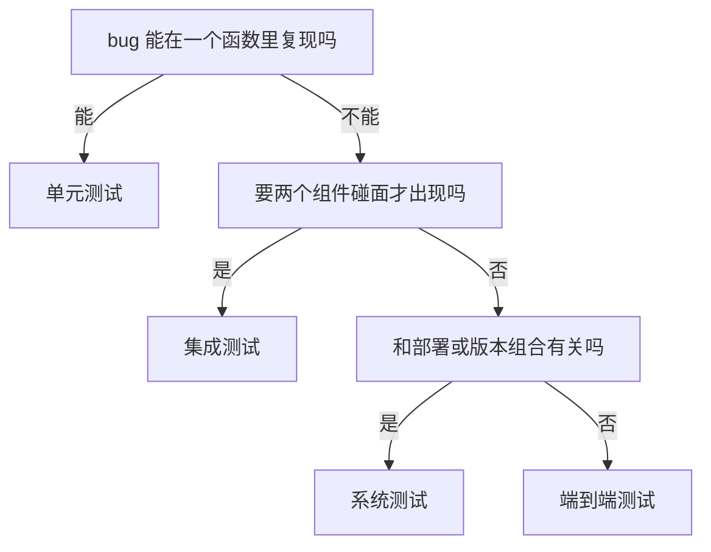

## Q
一个文本生成服务（输入一段文字，服务接着往下写）的请求里有 `stop` 参数：写出其中任何一个字符串就停下。线上出了一个 bug：`stop` 传空列表时，服务没有按默认规则停下，而是一直写到长度上限。修复时要补一个测试，放在哪一层？判断规则是什么？

## A
**规则：放在能稳定复现这个 bug 的最低一层。先试单元测试，单元测试复现不了，再往上走一层。**

- **这个例子：** 根因是解析请求的函数用 `if req.stop is not None` 判断，空列表被当成「用户明确要求不要任何停止规则」，连默认规则也关掉了。这在解析函数上就能复现，所以补一个参数化单元测试：`None`、`[]`、`["\n"]`、`["END", "\n"]` 各一组，断言默认规则始终生效。
- **还要不要加更高层的测试：** 如果 bug 的一半原因在接缝上（比如 SDK 把 `None` 序列化成了 `[]`），再补一个集成测试，只覆盖这条接缝，不覆盖所有组合。
- **为什么不直接写 E2E：** E2E 能复现，但要几分钟、可能偶发失败，失败时也不直接指向那个解析函数。同样的保护，低层测试便宜一百倍。
- **先写失败的测试：** 修之前先让新测试失败一次，证明它真的抓得住这个 bug；修完再看它变绿。
- **顺手查同类：** 其他列表参数（比如 `tags`、`exclude_ids`）有没有同样的「空列表和没传混为一谈」的问题。
