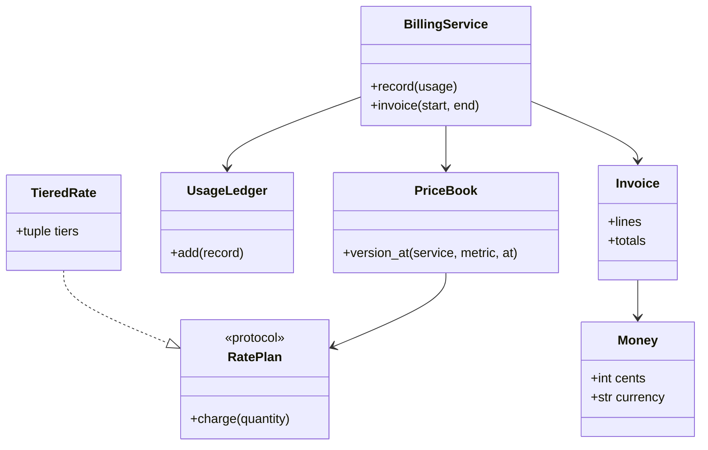

# 设计题解：AWS 账单服务（AWS Billing Service）（low priority）

## 题目与澄清

账单服务做的事很朴素：一个用户在一个月里用了若干云服务，每种服务有自己的用量（比如存储用了多少 GB·月、函数被调用了多少次、虚拟机跑了多少小时）和自己的费率，服务要把这些用量变成一张每一行都能解释的账单。难点不在乘法，而在三件事：费率的形状会变（一口价、阶梯价、先免费一部分），所以计费方式不能写死在一个大函数里；用量是消息队列「至少一次」上报的，同一条记录可能来好几遍，处理不好就是多收客户的钱；钱不能用浮点数，舍入发生在哪里要说得出理由。

面试官这样提出：设计一个 AWS 的账单服务，只考虑单个用户；所有服务的用量和费率都是给定的，要算出这个用户这个月该付多少钱。第一步，每个服务的用量乘以它的费率，汇总成账单。后面的追问会一个接一个来：存储这类服务用量越大单价越低（阶梯价），有的服务每月前一部分免费；用量记录重复上报怎么办；月中途调价怎么办，不同服务用不同币种怎么办。

开场要问的三个澄清问题，每个答案都会改变设计：

1. **费率是一口价，还是会出现阶梯价和免费额度？** 如果只有一口价，计费就是一行乘法；一旦出现阶梯价，就要决定「阶梯是对整月总量生效，还是对每条记录各自生效」，这会改变聚合的位置。设计上直接把费率做成可以互换的对象，一口价只是最简单的一个。
2. **用量是一次性给齐的列表，还是持续上报的流？** 一次性给齐可以直接遍历；持续上报就会遇到重复投递和先后顺序，需要一个按记录编号去重的仓库。下面按持续上报来设计，一次性给齐是它的特例。
3. **价格会在月中变吗？账单只有一种币种吗？** 如果价格固定，每个 (服务, 指标) 只有一个费率；如果会变，用量要按「发生时刻当时生效的价格」计价，价格要有生效时间。币种不同则金额绝不能相加。

范围外内容要主动声明：税费、优惠券、预付额度、多账户合并账单、账单的 PDF 渲染和支付。这些都建立在下面这张「每一行都可解释」的账单之上。

## 需求与分级

| 关 | 需求 | 这一关逼出的设计 |
|---|---|---|
| 第 1 关 | 每个服务的用量乘以费率，汇总成月账单 | 钱的表示（整数分）；按 (服务, 指标) 聚合；账单行与总额 |
| 第 2 关 | 阶梯价（用量越大单价越低）和每月免费额度 | 费率做成可互换的策略对象；边际计价；先聚合再分档 |
| 第 3 关 | 用量记录会重复上报 | 用量仓库按 `usage_id` 去重；内容冲突要报错；重复次数可见 |
| 第 4 关 | 月中调价，多币种；并发上报 | 价格有生效时间的版本；账单按币种分别求和；仓库加锁 |

每一关的新需求落在哪里，是机器编码轮真正评分的地方：第 2 关新增的是费率类，不碰 `BillingService`；第 3 关新增的是 `UsageLedger`，计费代码不知道重复这回事；第 4 关新增的是 `PriceBook` 里的版本，费率类本身不知道自己什么时候生效。

先看第 1 关最容易写出的版本：

```python
def bill(usages, rates):
    total = 0.0
    for service, qty in usages.items():
        total += qty * rates[service]
    return total
```

它有三处会被追问击穿：`float` 的误差让「各行相加不等于总额」；阶梯价一来，`qty * rates[service]` 这一行就要改成 `if` 链；用量一旦重复，没有任何办法发现。设计要做的，是在第 1 关就把这三个缝留好，却不提前写出后面几关的代码。

## 核心对象与职责

账单服务可以用两句话说清：它把一个周期内的用量记录收进一个不会重复记账的仓库；出账单时，按「服务、指标、当时生效的价格」把用量聚合起来，套上对应的费率，每一行算一次钱，再把各行加起来。

- `Money`：整数分的值对象（frozen dataclass）。不变量：金额运算永远是整数运算；币种不同的两个 `Money` 相加直接抛错。比例和费率用 `Decimal`，只有在账单行的最后才变成 `Money`。
- `RatePlan`（协议）：「给我一个周期内的总用量，我返回未舍入的金额」。实现有 `FlatRate`、`TieredRate`、`FreeTierThen`，都是不可变的 dataclass，可以互相嵌套（免费额度后面接阶梯价）。它只有一个方法，所以用 `Protocol` 而不是抽象基类。
- `UsageRecord`：一条用量，带 `usage_id`（幂等键）、服务、指标、数量和发生时间。
- `UsageLedger`：用量仓库。不变量：同一个 `usage_id` 最多入账一次；数量不为负；同一编号但内容不同是错误，不是覆盖。
- `PriceBook`：每个 (服务, 指标) 一串按生效时间排序的价格版本。不变量：任意时刻至多有一个版本生效。
- `BillingService`：把仓库、价格本和出账单的流程串起来。它拥有的规则是「先聚合再分档、每行舍入一次」。
- `Invoice`：账单，由若干 `InvoiceLine` 组成。不变量：总额等于各行金额之和；多币种时按币种分别求和。



所有权很直白：`BillingService` 持有 `PriceBook` 和 `UsageLedger`，一张 `Invoice` 是每次出账单时现算出来的，不被谁长期持有。`Money` 的设计和购物车折扣是同一个思路，详见 [[solution-amz-discount-engine]]；这里不再重复讲为什么钱用整数分，只讲账单特有的：费率是亚分级别的（每次请求 0.0000004 美元），所以费率必须用 `Decimal`，不能先变成分。

## 关键设计决策

### 决策一：阶梯价是「边际」，而且要先聚合再分档

问题：存储这类服务用量越大单价越低，例如前 51,200 GB 每 GB 0.023 美元，之后每 GB 0.022 美元（示例费率）。有两个陷阱，都会多收或少收客户的钱。

陷阱一，档位的解释。**整体解释**是「总量落在哪一档，全部按那一档的价」；**边际解释**是「每一档只对落在这一档里的那部分用量收这一档的价」，和个人所得税的税率档同理。AWS 这类账单用的是边际解释。102,400 GB 的结果是 51,200 × 0.023 + 51,200 × 0.022 = 1177.60 + 1126.40 = 2304.00。整体解释会得到 102,400 × 0.022 = 2252.80，差了 51.20。这一点要在开场就问清，因为它决定 `TieredRate.charge` 怎么写。

陷阱二，聚合的位置。一个月里有很多条用量记录。选项甲：逐条记录各自套阶梯；选项乙：先把同一个 (服务, 指标) 的用量加起来，再套一次阶梯。两条各 30,000 GB 的记录，甲方案每条都当作「第一档」，各 690.00，共 1380.00；乙方案聚合成 60,000 GB，51,200 × 0.023 + 8,800 × 0.022 = 1177.60 + 193.60 = 1371.20。因为单价随用量递减，甲方案**系统性地多收客户的钱**。免费额度同理：免费的是整月的前 N 个单位，不是每条记录的前 N 个。

选择：乙。`BillingService.invoice` 先按 key 聚合，`RatePlan.charge` 只接收「一个周期内的总量」。

模式：这是策略模式（Strategy）：一类算法（怎么把用量变成钱）做成对象，统一接口，运行时可以互换。拒绝的做法是在 `invoice` 里写 `if plan_type == "tiered"`：每加一种计费方式就要改核心流程，而且无法单独测试一种费率。`FreeTierThen` 包着另一个 `RatePlan`，是装饰器（Decorator）的形状，但它没有单独的抽象层，就是一个持有 `inner` 的 dataclass，这里不需要更多。

### 决策二：舍入——每行舍入一次，总额等于各行之和

问题：费率是亚分的，300 万次请求乘以 0.0000004 才是 1.20 美元。什么时候把 `Decimal` 变成分？

- **选项甲，每一步都舍入**：每条记录算出一个金额就舍入，再相加。亚分误差一条条累积，而且和聚合后分档的结果对不上。
- **选项乙，只在最后对总额舍入一次**：总额精确，但账单上每一行都是舍入后显示的，客户拿计算器把各行加起来可能和总额差 1 分，无法解释。
- **选项丙，每个账单行舍入一次，总额是各行之和**：客户看到的每一行都是最终金额，各行相加恰好等于总额，可以审计。

具体差别：三个服务各算出 0.004 美元。丙方案三行都是 0.00，总额 0.00；乙方案总额是 0.012，舍入成 0.01，而三行显示的都是 0.00。用户看到「三行 0.00，总额 0.01」会打电话投诉。

选择：丙。`RatePlan.charge` 返回未舍入的 `Decimal`，`Money.from_decimal` 在构造账单行时用 half-up（四舍五入）舍入一次。舍入方式本身没有对错，说出选了哪一种、为什么，就是满分回答；金融场景有的法规要求银行家舍入（half-even），那只需要改 `from_decimal` 里的一个参数。

### 决策三：重复上报——用量仓库按 `usage_id` 去重，而不是在计费时猜

问题：用量通常经消息队列上报，队列保证「至少一次」投递：网络抖动、消费者重启都会让同一条记录到达多次。不处理，客户就会被重复计费。

- **选项甲，计费时去重**：`invoice` 里遍历时维护一个 `seen` 集合。能用，但每次出账单都重新去重一遍，而且「重复」这个概念泄漏进了计费逻辑；出两次账单也要分别去重。
- **选项乙，入账时去重**：`UsageLedger.add` 用字典 `usage_id → 记录` 保证同一编号只存一条。计费代码看到的永远是干净的数据。

选择：乙。还有一个细节决定设计的诚实程度：同一个 `usage_id` 带着**不同内容**再来，怎么办？悄悄覆盖会丢账，悄悄忽略会算错，所以抛 `InvalidUsage`，让上游去查。内容完全相同才算重复，返回 `False` 并计数，账单上的 `duplicates_ignored` 让运维看得见去重确实发生了。

这里没有用任何模式：一个字典加一把锁就够了。把 `UsageLedger` 做成接口、再配一个 Redis 实现，在面试里是「为了扩展而扩展」；要换存储，是第 4 关之后的事。

### 决策四：月中调价——价格带生效时间，用量按发生时刻取价

问题：10 月 16 日起 EC2 每小时从 1 元涨到 2 元。10 月 10 日产生的用量该按 1 元，20 日的按 2 元。

- **选项甲，改 `RatePlan` 的字段**：直接把费率改掉。之前的用量会被追溯改价，同一张账单重新生成就变了。
- **选项乙，每个 (服务, 指标) 保存按生效时间排序的价格版本**：`PriceBook.version_at(service, metric, at)` 用二分查找取 `at` 时刻生效的版本；账单按 (服务, 指标, 版本) 聚合，一个版本一行。

选择：乙。费率类保持不可变，不知道自己什么时候生效；「什么时候生效」是价格本的事。取价用 `bisect_right` 而不是线性扫描：版本数很少时二者没差别，但 `bisect_right` 的含义（最后一个生效时间不晚于 `at` 的版本）正好是需求本身，写出来比一个 `for` 加 `break` 更不容易错。

有一个必须说出口的约定：**阶梯价在每个价格版本内分别重新计量**。10 月 1–15 日用的 30,000 GB 和 16–31 日用的 30,000 GB 各自按各自的版本分档，而不是接着累加。如果业务要求整月累计，就要让 `charge` 接收「已经用掉的量」，这是更大的改动，应当作为澄清问题抛给面试官。币种同理：每个价格版本带币种，`Invoice.totals` 按币种分别求和，`Money` 之间币种不同就抛错，从根上杜绝把美元和欧元相加。

## 代码走读

下面是完整的参考解，约 160 行有效代码，全部经过测试。

%% code:begin solution.py %%
```python
"""AWS 账单服务：一个账户，一个计费周期，按服务用量和费率出账单。

设计五行：
1. 钱用整数分（`Money`），费率和用量用 `Decimal`；只在账单行的最后舍入一次。
2. 费率是策略对象（`RatePlan`）：一口价、阶梯价、免费额度后再计费，互相可以嵌套。
3. 用量记录进 `UsageLedger`：按 `usage_id` 去重，重复投递不会多收钱。
4. `PriceBook` 按生效时间保存每个 (服务, 指标) 的价格版本，月中调价只是多一个版本。
5. `BillingService` 先聚合再分档，每行舍入一次，总额等于各行之和。
"""

from __future__ import annotations

import threading
from bisect import bisect_right
from collections import defaultdict
from dataclasses import dataclass, field
from datetime import datetime
from decimal import ROUND_HALF_UP, Decimal
from typing import Protocol


class BillingError(Exception):
    """账单领域错误的基类。"""


class InvalidUsage(BillingError):
    """用量为负数，或同一个 usage_id 带着不同内容再次出现。"""


class UnknownServiceError(BillingError, LookupError):
    """没有为该 (服务, 指标) 在该时刻登记价格。"""


@dataclass(frozen=True, order=True)
class Money:
    """整数分的值对象。币种不同的运算直接报错，不会悄悄相加。"""

    cents: int
    currency: str = "USD"

    @staticmethod
    def from_decimal(amount: Decimal, currency: str = "USD") -> Money:
        """把以「元」为单位的 Decimal 舍入到分，四舍五入（half-up）。"""
        return Money(int((amount * 100).quantize(Decimal(1), rounding=ROUND_HALF_UP)), currency)

    def __add__(self, other: Money) -> Money:
        if self.currency != other.currency:
            raise BillingError(f"币种不同：{self.currency} 与 {other.currency}")
        return Money(self.cents + other.cents, self.currency)

    def __str__(self) -> str:
        sign = "-" if self.cents < 0 else ""
        return f"{sign}{abs(self.cents) // 100}.{abs(self.cents) % 100:02d} {self.currency}"


class RatePlan(Protocol):
    """一种计费方式：输入一个周期内的总用量，返回未舍入的金额（元）。"""

    def charge(self, quantity: Decimal) -> Decimal: ...


@dataclass(frozen=True)
class FlatRate:
    """一口价：每单位 `rate`。"""

    rate: Decimal

    def charge(self, quantity: Decimal) -> Decimal:
        return quantity * self.rate


@dataclass(frozen=True)
class Tier:
    up_to: Decimal | None  # 本档的累计上限；None 表示没有上限
    rate: Decimal


@dataclass(frozen=True)
class TieredRate:
    """阶梯价：每一档只对落在本档内的那部分用量收本档的价（边际，不是整体）。"""

    tiers: tuple[Tier, ...]

    def charge(self, quantity: Decimal) -> Decimal:
        total, lower = Decimal(0), Decimal(0)
        for tier in self.tiers:
            upper = quantity if tier.up_to is None else min(quantity, tier.up_to)
            if upper > lower:
                total += (upper - lower) * tier.rate
                lower = upper
            if tier.up_to is None or quantity <= tier.up_to:
                break
        return total


@dataclass(frozen=True)
class FreeTierThen:
    """每个周期先免费 `free_units` 个单位，超出的部分交给 `inner` 计费。"""

    free_units: Decimal
    inner: RatePlan

    def charge(self, quantity: Decimal) -> Decimal:
        return self.inner.charge(max(Decimal(0), quantity - self.free_units))


@dataclass(frozen=True)
class UsageRecord:
    usage_id: str  # 幂等键：同一次用量无论上报几遍，只算一次
    service: str
    metric: str
    quantity: Decimal
    at: datetime


@dataclass(frozen=True)
class PriceVersion:
    effective_from: datetime
    plan: RatePlan
    currency: str


class PriceBook:
    """每个 (服务, 指标) 一串按生效时间排序的价格版本；用量按发生时刻取当时生效的版本。"""

    def __init__(self) -> None:
        self._versions: dict[tuple[str, str], list[PriceVersion]] = {}

    def set_price(self, service: str, metric: str, plan: RatePlan,
                  effective_from: datetime, currency: str = "USD") -> None:
        versions = self._versions.setdefault((service, metric), [])
        versions.append(PriceVersion(effective_from, plan, currency))
        versions.sort(key=lambda v: v.effective_from)

    def version_at(self, service: str, metric: str, at: datetime) -> PriceVersion:
        versions = self._versions.get((service, metric), [])
        i = bisect_right([v.effective_from for v in versions], at) - 1
        if i < 0:
            raise UnknownServiceError(f"{service}/{metric} 在 {at} 没有价格")
        return versions[i]


class UsageLedger:
    """用量记录的去重仓库。上报是「至少一次」投递，所以同一个 usage_id 可能来很多遍。"""

    def __init__(self) -> None:
        self._records: dict[str, UsageRecord] = {}
        self._duplicates = 0
        self._lock = threading.Lock()

    def add(self, record: UsageRecord) -> bool:
        """记入一条用量。新记录返回 True；内容相同的重复投递返回 False；同 id 不同内容抛错。"""
        if record.quantity < 0:
            raise InvalidUsage(f"用量不能为负：{record.usage_id}")
        with self._lock:
            old = self._records.get(record.usage_id)
            if old is None:
                self._records[record.usage_id] = record
                return True
            if old != record:
                raise InvalidUsage(f"usage_id {record.usage_id} 的内容与之前不同")
            self._duplicates += 1
            return False

    @property
    def duplicates_ignored(self) -> int:
        with self._lock:
            return self._duplicates

    def between(self, start: datetime, end: datetime) -> tuple[UsageRecord, ...]:
        """[start, end) 内的记录快照。"""
        with self._lock:
            return tuple(r for r in self._records.values() if start <= r.at < end)


@dataclass(frozen=True)
class InvoiceLine:
    service: str
    metric: str
    quantity: Decimal
    price_from: datetime  # 本行用的是哪一个价格版本
    amount: Money


@dataclass(frozen=True)
class Invoice:
    lines: tuple[InvoiceLine, ...]
    duplicates_ignored: int = 0

    @property
    def totals(self) -> dict[str, Money]:
        """按币种分别求和；账单永远不跨币种相加。"""
        out: dict[str, Money] = {}
        for line in self.lines:
            cur = line.amount.currency
            out[cur] = out[cur] + line.amount if cur in out else line.amount
        return out

    @property
    def total(self) -> Money:
        """只有一种币种时的总额；多币种时请用 `totals`。"""
        if len(self.totals) != 1:
            raise BillingError("账单有零种或多种币种，请用 totals")
        return next(iter(self.totals.values()))


@dataclass
class BillingService:
    """记录用量、出账单。流程：取周期内记录 → 按价格版本聚合 → 套费率 → 每行舍入一次。"""

    prices: PriceBook
    ledger: UsageLedger = field(default_factory=UsageLedger)

    def record(self, usage: UsageRecord) -> bool:
        return self.ledger.add(usage)

    def invoice(self, start: datetime, end: datetime) -> Invoice:
        totals: dict[tuple[str, str, datetime], Decimal] = defaultdict(Decimal)
        versions: dict[tuple[str, str, datetime], PriceVersion] = {}
        for rec in self.ledger.between(start, end):
            version = self.prices.version_at(rec.service, rec.metric, rec.at)
            key = (rec.service, rec.metric, version.effective_from)
            totals[key] += rec.quantity
            versions[key] = version
        lines = tuple(
            InvoiceLine(service, metric, totals[key], since,
                        Money.from_decimal(versions[key].plan.charge(totals[key]), versions[key].currency))
            for key in sorted(totals)
            for service, metric, since in [key]
        )
        return Invoice(lines, self.ledger.duplicates_ignored)


if __name__ == "__main__":
    d = Decimal
    book = PriceBook()
    start = datetime(2026, 10, 1)
    book.set_price("s3", "gb-month", TieredRate((Tier(d("51200"), d("0.023")), Tier(None, d("0.022")))), start)
    svc = BillingService(book)
    svc.record(UsageRecord("u1", "s3", "gb-month", d("30000"), datetime(2026, 10, 2)))
    svc.record(UsageRecord("u2", "s3", "gb-month", d("30000"), datetime(2026, 10, 9)))
    svc.record(UsageRecord("u2", "s3", "gb-month", d("30000"), datetime(2026, 10, 9)))  # 重复投递
    bill = svc.invoice(start, datetime(2026, 11, 1))
    print(bill.total, bill.duplicates_ignored)
```
%% code:end %%

三个值得停下来看的地方：

**第一处：`TieredRate.charge`。** 循环里 `upper = min(quantity, tier.up_to)`，`(upper - lower) * tier.rate` 就是落在本档内的那部分。`lower` 在每一档结束时推进到 `upper`，当 `quantity` 没超过本档上限就 `break`。边界上的数量（正好 10）会在第一档结束，不会漏进第二档，也不会多算空档。读代码时用 102,400 手算一遍两档，应当得到 2304.00。

**第二处：`UsageLedger.add` 的三个分支。** 新记录入账、相同记录计数后返回 `False`、不同内容抛错。整个检查和写入在同一把锁里，否则两个线程同时上报同一个 `usage_id`，会同时看到「还没有」而各写一次。`duplicates_ignored` 也在锁里读。`between` 返回的是元组快照，调用方拿到后仓库继续增长不会影响它。

**第三处：`BillingService.invoice`。** 先用 `version_at` 给每条记录找价格版本，按 `(服务, 指标, 版本生效时间)` 聚合，再对每个 key 调一次 `plan.charge` 并舍入。出账单是纯计算：同一批记录、同一个周期，调用多少次结果都相同（测试里有一条断言）。

## 测试与自检

测试按四关分组，全部走公开方法：

- 第 1 关：一口价的账单金额；多个服务各一行且总额等于各行之和；同一服务的多条用量先求和；空周期给空账单；周期是左闭右开；没有价格的服务抛 `UnknownServiceError`；负数用量被拒绝且不入账。
- 第 2 关：阶梯价是边际的（102,400 GB 得 2304.000）；三档与正好落在档位边界的数量；两条各 30,000 GB 聚合后得 1371.20 而不是 1380.00；免费额度扣在月度总量上；免费额度内的用量也有一行金额为零；免费额度可以嵌套在阶梯价前面。
- 第 3 关：重复投递被忽略并计数；同编号不同内容报错；出两次账单结果相同；8 个线程用一个屏障同时上报同一个编号，恰好一个成功。
- 第 4 关：月中调价各用量按各自时刻取价；价格乱序登记也能按生效时间正确排列；两种币种有各自的总额，直接取 `total` 会报错；仓库返回快照。

自检时的两分钟演示：登记一个阶梯价的存储服务和一个带免费额度的函数服务，上报三条用量（其中一条重复），打印账单行与总额，再说一句「重复被丢掉了一条，账单上写着」。面试官最容易追问的是「你怎么知道 1371.20 是对的」：手算 51,200 × 0.023 + 8,800 × 0.022，并指出测试里写的就是这个式子。

## 扩展与追问

### 新需求

- **新增一种计费方式（比如按峰值计费）**：新增一个实现 `charge` 的 dataclass；`BillingService`、`PriceBook`、`Invoice` 不动。如果新方式需要的不只是总量（比如需要每小时的明细），`RatePlan` 的输入要变，这时才应该改接口，并在面试里直说这是代价。
- **税费与折扣**：账单行之后再加「调整项」：一个按顺序执行的规则列表，和购物车折扣是同一个形状，见 [[solution-amz-discount-engine]]。它们作用在已经舍入的行上还是未舍入的合计上，是要先问清的业务规则。
- **多币种**：已经支持分别求和；要折算成一种币种，需要汇率和一个明确的折算时刻，折算在账单行之后做，不进入 `RatePlan`。
- **整月累计的阶梯价（跨价格版本）**：`charge` 需要「本周期之前已经用掉的量」。改动集中在 `BillingService` 的聚合方式和 `RatePlan` 的签名，这是诚实地说「这个需求会改接口」的地方。

### 并发与线程安全

用量上报是并发的，所以写入在 `UsageLedger` 的锁里。GIL（全局解释器锁）只保证单条字节码原子，「检查编号是否存在，再写入」是两步，必须整体加锁。`PriceBook` 在这里是启动时配置、之后只读；如果价格要在运行中修改，`set_price` 里「追加再排序」同样需要锁，或者改成每次生成新的不可变列表再整体替换引用。

### 持久化与规模

一个月内十亿条用量不能放进一个字典。做法是仓库按 `(账户, 周期)` 分区，`usage_id` 上建唯一索引，去重交给数据库的「插入时冲突则忽略」；聚合变成按 (服务, 指标, 价格版本) 的 `GROUP BY SUM`，在存储层完成，`RatePlan.charge` 只处理聚合后的几十个数。因为分档本来就只依赖总量，这个换法不需要改费率类。

## 常见错误

1. **用 `float` 存钱或费率**：`0.1 + 0.2 == 0.30000000000000004`，加一百行账单误差就能显出来。修法：金额用整数分，费率用 `Decimal`，并且用字符串构造（`Decimal("0.023")`，不是 `Decimal(0.023)`）。
2. **逐条记录各自分档**：两条各 30,000 GB 得到 1380.00，应为 1371.20。修法：先聚合，再套阶梯。
3. **把阶梯价写成整体解释**：总量落在哪档就全部按那档的价。102,400 GB 得到 2252.80，应为 2304.00。
4. **免费额度扣在每条记录上**：每条记录都免费前 N 个，整月免费了 N 的很多倍。免费额度属于整月总量。
5. **总额只舍入一次，而各行也各自显示舍入后的值**：三个 0.004 的行显示三个 0.00，总额却是 0.01。每行舍入一次，总额取各行之和。
6. **去重靠 `set` 却没有锁**：两个线程同时上报同一个编号会重复入账。检查和写入必须在同一个临界区。
7. **同编号不同内容悄悄覆盖**：丢掉了更正，或者保留了错的那条。应该显式报错。
8. **Java 习惯**：`getRate()` / `setRate()`、给 `RatePlan` 配一个只有一个实现的接口层、把 `BillingService` 做成单例。这里 `RatePlan` 有三个真实的实现，所以协议有用；其余都不需要。
9. **直接返回内部列表**：`UsageLedger.between` 返回仓库里的列表，调用方一改就破坏了不变量。返回元组快照。

## 45 分钟怎么分配

| 分钟 | 做什么 | 口头要说的话 |
|---|---|---|
| 0–5 | 三个澄清问题：费率形状、用量来源、调价与币种；写下范围外内容 | 「阶梯价我按边际理解，先聚合再分档，请确认。」 |
| 5–10 | 画出 `Money`、`RatePlan`、`UsageLedger`、`BillingService` 四个框 | 「钱用整数分，费率用 Decimal，只在账单行舍入一次。」 |
| 10–25 | 写第 1 关：`Money`、`FlatRate`、`BillingService.invoice` 的聚合与求和 | 边写边说为什么按 (服务, 指标) 聚合 |
| 25–35 | 写第 2 关：`TieredRate`、`FreeTierThen` | 「新费率只是新增一个类，invoice 不动。」手算 102,400 GB |
| 35–42 | 第 3 关：`UsageLedger` 去重；写两三个测试名 | 「队列是至少一次投递，所以入账时按 usage_id 去重。」 |
| 42–45 | 口述第 4 关：价格版本与币种；并发加锁 | 「调价就是价格本里多一个版本，费率类不知道自己何时生效。」 |

时间不够时先砍：`PriceBook` 的版本（口述：按生效时间排序，二分取价）；再砍多币种的 `totals`（口述：币种不同的金额不能相加）；保住 `TieredRate` 和 `UsageLedger` 的完整代码，因为阶梯价与去重是追问最密的两处。

## 延伸阅读

- [Python 标准库 decimal](https://docs.python.org/3/library/decimal.html)：为什么用字符串构造 `Decimal`，以及 `ROUND_HALF_UP` 与 `ROUND_HALF_EVEN` 的区别。
- [Python 标准库 bisect](https://docs.python.org/3/library/bisect.html)：`bisect_right` 返回的位置的含义，价格版本的取价靠它。
- [Marginal tax rate（Wikipedia）](https://en.wikipedia.org/wiki/Tax_rate#Marginal)：边际税率的计算方式，与阶梯计价同理。
- 概念：[[patterns.strategy|策略模式与可替换算法（Strategy）]]、[[oop.values|值对象与不可变性（Value Objects）]]；钱的值对象与折扣规则：[[solution-amz-discount-engine]]。
