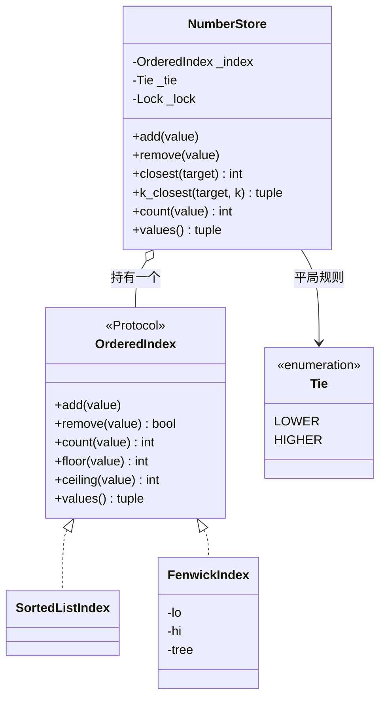

# 设计题解：增删查最近值（Add / Remove / Closest）

## 题目与澄清

这是一个「数字的集合」：你可以往里放整数、拿走整数，还可以问「集合里哪个数离我给的 target 最近」。用它的人是任何需要按数值就近匹配的程序，比如按价格找最接近的档位。难点不在算法本身，而在三件事：最近的数只可能是 target 的前驱（predecessor，不大于 target 的最大值）或后继（successor，不小于 target 的最小值）；存储要能在「值有已知范围」这个新条件出现时整体更换；一次查询要读前驱和后继两次，两次必须读到同一个版本的集合。

面试官这样提出：先给你一批数，让你排好序后回答「离 target 最近的数是哪个」；接着要求能随时 add（放入）、remove（拿走）；再告诉你所有的值都落在一个已知的值域（range constraint）里。它被当作 OOD（面向对象设计，Object-Oriented Design）来问，所以面试官真正看的是：数据结构选得对不对、接口是否清晰、需求变化（增删、值域、并发）来了之后代码改动是否小。具体的 API、平局怎么办、有没有重复值、值域多大，题目没有说，下面的取舍是一套自洽的默认约定，面试时一定要向面试官确认。

开场应该问的三个澄清问题，以及每个答案怎么改变设计：

1. **「最近」平局怎么办？** 比如集合是 {10, 20}，target 是 15，两个数一样近。答案可能是「取较小的」「取较大的」或「全部返回」。它决定 closest 的返回类型和比较规则；下面的实现把它做成一个 `Tie` 枚举，默认取较小的（和 LeetCode 658 的约定一致）。
2. **允许重复值吗？** 如果允许，`remove(x)` 删一个副本还是全部副本，`k_closest` 里重复值各算一个还是合并。下面的实现选「多重集合（multiset，同一个值可以出现多次）」：允许重复，`remove` 每次删一个副本。这个选择直接决定存储是「列表里重复出现」还是「值 → 个数」。
3. **值有没有范围？数据量有多大？** 这是最关键的一问。面试官迟早会给出值域约束（range constraint），所以要主动问。值域很小（比如 0 到 10 的六次方）时，可以用「按值下标」的结构，增删查都是 O(log R)；值域不限时，只能用有序结构。这个答案决定了该选哪个索引（见「关键设计决策」）。

没有问到、但要主动声明的范围外内容：持久化；浮点数（浮点的「最近」涉及精度，只做整数）；返回下标而不是值；分布式。

## 需求与分级

| 关 | 需求 | 本关逼出的设计 |
|---|---|---|
| 第 1 关 | 排序一次，然后给 target，返回集合里最近的数 | 有序数组 + 二分（`bisect`）。关键是想到「最近的数只可能是 target 的前驱或后继两个候选」 |
| 第 2 关 | 随时可以插入、删除；删除不存在的值要有明确行为 | 排序一次不够了，必须每次插入都保持有序；删除失败要用异常表达；重复值要有语义 |
| 第 3 关 | 所有的值都落在已知的有限值域 [lo, hi] 里 | 把「有序结构」做成一条可替换的接缝，值域有界时换成树状数组（Fenwick tree），复杂度从 O(n) 的搬移降到 O(log R) |
| 第 4 关 | 多线程同时增删查；返回最近的 k 个 | 一把锁保证「读前驱、读后继」是同一个版本；k 个最近值从两侧向外归并 |

第 1 关是整个设计的骨架，也是 20 分钟内必须写完的东西。第 2 关加的是「状态」；第 3 关检验你的存储是不是可以被换掉而不动门面；第 4 关检验你有没有想过并发读的一致性。

## 核心对象与职责

门面 `NumberStore` 负责：校验输入是不是整数（`bool` 虽然是 `int` 的子类，但 `True` 不应被当作数字 1 存进去）、决定平局规则、持有那把锁。它的不变量是：**一次 `closest` 看到的前驱和后继来自同一个版本的集合**。

存储 `OrderedIndex` 是一条协议（`typing.Protocol`）形式的接缝，它只回答几个问题：`add`、`remove`、`count`、`floor`（不大于 x 的最大值）、`ceiling`（不小于 x 的最小值）、`values`（升序快照）。它就是这个设计里的「接缝（seam）」：一处两种实现可以互换、而调用方代码不用改的位置。它有两个真实现，所以协议不是为了「将来可能」：

- `SortedListIndex`：一个升序的 `list[int]`，重复值就在列表里重复出现。不变量：列表永远升序。
- `FenwickIndex(lo, hi)`：树状数组加一个「每个值的个数」数组。不变量：`tree` 里每个节点存的是它负责区间的个数之和，`_total` 等于所有个数之和。

异常是一个小家族：`NumberStoreError` 为根，`InvalidValueError`（输入不是整数、k 为负）、`OutOfRangeError`（超出有界索引的值域）、`ValueNotFoundError` 和 `EmptyStoreError`。后两个同时继承 `LookupError`，调用方用 `except LookupError` 就能捕获「查不到」类的失败。



关系上，`NumberStore` 对索引是组合（composition）般的所有权：索引由门面独占使用，外面拿不到索引的引用就改不了集合——这正是锁能成立的前提。如果让调用方把索引也拿在手里，锁就形同虚设。

## 关键设计决策

### 决策一：用什么结构存「一组随时增删的有序数」

问题要说得尖锐：`closest` 要在 O(log n) 内找到前驱与后继，同时 `add` 与 `remove` 不能每次都重新排序（O(n log n)）。有四条路：

**方案 A：排序一次 + 每次增删后重新排序。** 第 1 关的答案，也是面试里最容易先说的。每次 `add` 付出 O(n log n)，一百万个数时是灾难。它只适合「一次建好、只读」的第 1 关，应当在第 2 关立刻被替换。

**方案 B：有序列表 + `bisect.insort`。** 查是 O(log n)，增删是 O(log n) 次比较加一次 O(n) 的内存搬移（`list` 的元素搬移是 C 层的 `memmove`）。在 Python 3.12、随机整数上实测：10 万个数时每次插入平均约 3.2 微秒，100 万个数时每次插入平均约 33 微秒（搬移长度随 n 增长）；`floor` 查询约 0.4 到 0.6 微秒。它有一个重要优势：**不需要知道值域**，值可以是任意整数。

**方案 C：值域分桶 / 树状数组。** 值域是 [lo, hi] 时，下标直接用「值 − lo + 1」。树状数组（Fenwick tree，又叫 binary indexed tree）用一个长度 R+1 的数组，让「前缀个数」和「改一个值的个数」都只要 O(log R)。要找前驱，先求前缀个数 k，再在树上做「第 k 小」的倍增下降；要找后继，求 `prefix(x−1)+1` 的第 k 小。R = 100 万时，log2 R 约为 20 步；实测每次插入约 0.7 微秒、每次 `floor` 约 1.9 微秒，与 n 无关（n = 10 万与 100 万时数字一样）。代价：必须知道值域，内存是 O(R) 而不是 O(n)。

**方案 D：自己写平衡树（红黑树、跳表）。** 渐近复杂度最好且不需要值域，但 45 分钟里写一棵正确的平衡树既耗时又容易出错，且 Python 里每个节点都是对象，常数比方案 B 大得多。面试官要看的是设计，不是旋转。除非面试官明确要求，不选。

**选择：两个都要，做成同一条接缝的两种实现。** 默认用 B（不需要任何前提，几十行），把值域约束理解成「出现了一个可以利用的新前提」，于是引入 C 作为第二个实现。这里**不用工厂、不用依赖注入框架**：构造 `NumberStore(FenwickIndex(0, 10**6))` 就是全部。模式上这是策略模式（Strategy）——算法族（怎么存、怎么找前驱）可互换——但在 Python 里它是一个 `Protocol` 加两个类，不需要抽象工厂。

### 决策二：接缝放在哪里，以及为什么只有这一条接缝

问题：如果把「怎么存」写在 `NumberStore` 里，值域约束一来就要重写门面；如果把一切都抽象成接口（比如把「平局规则」也做成 `TieBreaker` 接口，把「校验」也做成 `Validator` 接口），类会比逻辑还多。

方案一：门面里写 `if self._bounded: ...`。每增加一种存储，每个方法都要多一个分支，是典型的「开闭原则」违例。方案二：每个变化点一个接口。方案三：**只对「真有两个实现」的地方开接缝**。

选择方案三。存储有两个实现，所以是接口；平局规则只有两个取值，是一个 `Enum`，在 `_prefers_lower` 里用一行比较表达，不需要策略类；输入校验只有「是不是整数」这一条规则，是一个静态方法。**这是一个明确拒绝模式的地方**：`Tie` 如果做成 `TieBreaker` 抽象类加 `LowerTieBreaker`、`HigherTieBreaker` 两个子类，就是用三个类做了一个布尔值的事。

### 决策三：`remove` 一个不存在的值，是抛异常、返回布尔值还是静默？

面试官几乎一定会问到。三个选项：

- 静默忽略：调用方发现不了 bug，计数悄悄错位，不选。
- 索引的 `remove` 返回 `bool`、门面的 `remove` 抛 `ValueNotFoundError`：**选这个，两层各司其职**。索引是内部存储，只报告「删了没有」；门面是公开 API，把「没删成」翻译成调用方能 `except` 的领域异常，并保证失败时集合不变。
- 门面也返回布尔值：调用方容易忘记检查。Python 的习惯是失败用异常，成功才什么都不返回。

另一个看似小、实际常出错的点：**索引的 `remove` 失败时不能改任何状态**。树状数组的删除如果不先检查个数就减 1，会把某个值的个数变成 −1，之后的 `floor` 就会返回一个不存在的值。所以 `FenwickIndex.remove` 先判断 `_cnt` 是否为零再动手，测试 `test_remove_missing_value_raises_and_changes_nothing` 钉住这个不变量。

### 决策四：线程安全用什么粒度

问题：`closest` 要读 `floor(target)` 和 `ceiling(target)` 两次。若在两次读之间另一个线程删掉了其中一个，你会得到一个「从来没有同时存在过」的答案。在 CPython 里，每条字节码是原子的，但「两次读」不是一个字节码，GIL（全局解释器锁）并不保护它；如果存储是树状数组，一次 `_bump` 要更新 O(log R) 个节点，读到一半被切走，就会看到半成品的树。

方案一：读写锁（允许多个读者）。Python 标准库没有，要自己写，还要处理写者饥饿，而这里每次查询只要微秒级，读者并行的收益远小于实现成本。方案二：不可变快照（每次写都复制），写入变成 O(n)，违背了整个第 2 关的目的。方案三：**一把 `threading.Lock`，门面的每个公开方法进来就持有**。

选方案三。持锁时间是微秒级，对这个体量的集合足够。需要注意的是 `k_closest` 里的生成器是在持锁期间被消费完的，不能把生成器返回到锁外再遍历——那就等于读到了无锁状态。测试里用 `Barrier` 同时放行 12 个线程去删同一个值的 5 个副本，断言恰好成功 5 次、失败 7 次，这是「不超卖」型的不变量，不依赖时序。

## 代码走读

%% code:begin solution.py %%
```python
"""增删查最近值（Add / Remove / Closest）参考解。

设计五句话：
1. NumberStore 是门面：校验输入、定平局规则、持有一把锁，保证「查两侧邻居」是一次原子读。
2. 真正存数据的是 OrderedIndex（有序索引）这条接缝，只回答 floor / ceiling / count 三个问题。
3. SortedListIndex：有序列表加二分，无值域限制，插入删除 O(n) 的内存搬移但常数极小。
4. FenwickIndex：值域有界时用树状数组（Fenwick tree）存每个值的个数，增删查都是 O(log R)。
5. 最近值 = 比较 floor(target) 与 ceiling(target) 两个候选；k 个最近值 = 从两侧向外归并。
"""

from __future__ import annotations

import bisect
import enum
import threading
from collections.abc import Iterator
from typing import Protocol

MAX_SPAN = 5_000_000  # 树状数组允许的最大值域宽度，超过请改用 SortedListIndex


class NumberStoreError(Exception):
    """本模块所有异常的根。"""


class InvalidValueError(NumberStoreError, ValueError):
    """输入不是整数（bool 也不算），或 k 为负。"""


class OutOfRangeError(InvalidValueError):
    """值落在有界索引的值域之外。"""


class ValueNotFoundError(NumberStoreError, LookupError):
    """删除一个不存在的值。"""


class EmptyStoreError(NumberStoreError, LookupError):
    """在空集合里查最近值。"""


class Tie(enum.Enum):
    """离 target 一样近的两个值，取哪一个。"""

    LOWER = "lower"
    HIGHER = "higher"


class OrderedIndex(Protocol):
    """有序多重集合（multiset）的存储接缝：只要能回答这几个问题就能被 NumberStore 使用。"""

    def __len__(self) -> int: ...

    def add(self, value: int) -> None: ...

    def remove(self, value: int) -> bool:
        """删掉一个副本；原本就没有则返回 False，不改变状态。"""
        ...

    def count(self, value: int) -> int: ...

    def floor(self, value: int) -> int | None:
        """不大于 value 的最大值；没有则 None。"""
        ...

    def ceiling(self, value: int) -> int | None:
        """不小于 value 的最小值；没有则 None。"""
        ...

    def values(self) -> tuple[int, ...]:
        """升序快照（含重复）。"""
        ...


class SortedListIndex:
    """有序列表 + bisect：重复值就在列表里重复出现。"""

    def __init__(self) -> None:
        self._xs: list[int] = []

    def __len__(self) -> int:
        return len(self._xs)

    def add(self, value: int) -> None:
        bisect.insort(self._xs, value)

    def remove(self, value: int) -> bool:
        i = bisect.bisect_left(self._xs, value)
        if i == len(self._xs) or self._xs[i] != value:
            return False
        del self._xs[i]
        return True

    def count(self, value: int) -> int:
        return bisect.bisect_right(self._xs, value) - bisect.bisect_left(self._xs, value)

    def floor(self, value: int) -> int | None:
        i = bisect.bisect_right(self._xs, value)
        return self._xs[i - 1] if i else None

    def ceiling(self, value: int) -> int | None:
        i = bisect.bisect_left(self._xs, value)
        return self._xs[i] if i < len(self._xs) else None

    def values(self) -> tuple[int, ...]:
        return tuple(self._xs)


class FenwickIndex:
    """值域 [lo, hi] 内的树状数组：下标是「值 - lo + 1」，节点存一段区间内的个数。"""

    def __init__(self, lo: int, hi: int) -> None:
        if hi < lo or hi - lo + 1 > MAX_SPAN:
            raise InvalidValueError(f"值域 [{lo}, {hi}] 必须非空且宽度不超过 {MAX_SPAN}")
        self._lo, self._hi = lo, hi
        self._n = hi - lo + 1
        self._tree = [0] * (self._n + 1)
        self._cnt = [0] * (self._n + 1)  # 每个值的个数，count() 因此是 O(1)
        self._total = 0
        self._top = 1 << (self._n.bit_length() - 1)  # 不超过 n 的最大 2 的幂，kth 的起步步长

    def __len__(self) -> int:
        return self._total

    def _bump(self, value: int, delta: int) -> None:
        pos = value - self._lo + 1
        self._cnt[pos] += delta
        self._total += delta
        while pos <= self._n:
            self._tree[pos] += delta
            pos += pos & -pos

    def _prefix(self, pos: int) -> int:
        """下标 1..pos 的个数之和。"""
        total = 0
        while pos > 0:
            total += self._tree[pos]
            pos -= pos & -pos
        return total

    def _kth(self, k: int) -> int:
        """按升序第 k 个（1 起）元素的值：在树上倍增下降，O(log R)。"""
        pos, step = 0, self._top
        while step:
            nxt = pos + step
            if nxt <= self._n and self._tree[nxt] < k:
                pos = nxt
                k -= self._tree[nxt]
            step >>= 1
        return self._lo + pos

    def add(self, value: int) -> None:
        if not self._lo <= value <= self._hi:
            raise OutOfRangeError(f"{value} 不在 [{self._lo}, {self._hi}] 内")
        self._bump(value, 1)

    def remove(self, value: int) -> bool:
        if not self._lo <= value <= self._hi or self._cnt[value - self._lo + 1] == 0:
            return False
        self._bump(value, -1)
        return True

    def count(self, value: int) -> int:
        return self._cnt[value - self._lo + 1] if self._lo <= value <= self._hi else 0

    def floor(self, value: int) -> int | None:
        if value < self._lo:
            return None
        k = self._prefix(min(value, self._hi) - self._lo + 1)
        return self._kth(k) if k else None

    def ceiling(self, value: int) -> int | None:
        if value > self._hi:
            return None
        k = self._prefix(max(value, self._lo) - self._lo) + 1
        return self._kth(k) if k <= self._total else None

    def values(self) -> tuple[int, ...]:
        return tuple(self._lo + i - 1 for i in range(1, self._n + 1) for _ in range(self._cnt[i]))


class NumberStore:
    """对外的门面：整数多重集合，支持增、删、查离 target 最近的值。"""

    def __init__(self, index: OrderedIndex | None = None, tie: Tie = Tie.LOWER) -> None:
        self._index: OrderedIndex = index if index is not None else SortedListIndex()
        self._tie = tie
        self._lock = threading.Lock()  # 一次查询要读 floor 与 ceiling 两次，必须是同一个版本

    @staticmethod
    def _check(value: int) -> None:
        if isinstance(value, bool) or not isinstance(value, int):
            raise InvalidValueError(f"需要整数，得到 {value!r}")

    def add(self, value: int) -> None:
        self._check(value)
        with self._lock:
            self._index.add(value)

    def remove(self, value: int) -> None:
        self._check(value)
        with self._lock:
            if not self._index.remove(value):
                raise ValueNotFoundError(value)

    def count(self, value: int) -> int:
        with self._lock:
            return self._index.count(value)

    def __contains__(self, value: object) -> bool:
        return isinstance(value, int) and self.count(value) > 0

    def __len__(self) -> int:
        with self._lock:
            return len(self._index)

    def values(self) -> tuple[int, ...]:
        with self._lock:
            return self._index.values()

    def _prefers_lower(self, target: int, lower: int, higher: int) -> bool:
        gap_lo, gap_hi = target - lower, higher - target
        return gap_lo < gap_hi or (gap_lo == gap_hi and self._tie is Tie.LOWER)

    def closest(self, target: int) -> int:
        """离 target 最近的值；一样近时按 tie 规则。空集合抛 EmptyStoreError。"""
        self._check(target)
        with self._lock:
            lower, higher = self._index.floor(target), self._index.ceiling(target)
        if lower is None and higher is None:
            raise EmptyStoreError("集合为空")
        if lower is None or higher is None:
            return lower if higher is None else higher  # type: ignore[return-value]
        return lower if self._prefers_lower(target, lower, higher) else higher

    def k_closest(self, target: int, k: int) -> tuple[int, ...]:
        """最近的 k 个值（重复值各算一个），升序返回；不足 k 个就全返回。"""
        self._check(target)
        if isinstance(k, bool) or not isinstance(k, int) or k < 0:
            raise InvalidValueError(f"k 必须是非负整数，得到 {k!r}")
        chosen: list[int] = []
        with self._lock:
            down, up = self._runs_down(target), self._runs_up(target + 1)
            a, b = next(down, None), next(up, None)
            while len(chosen) < k and (a or b):
                from_lower = b is None or (a is not None and self._prefers_lower(target, a[0], b[0]))
                value, copies = a if from_lower else b  # type: ignore[misc]
                chosen.extend([value] * min(copies, k - len(chosen)))
                if from_lower:
                    a = next(down, None)
                else:
                    b = next(up, None)
        return tuple(sorted(chosen))

    def _runs_down(self, start: int) -> Iterator[tuple[int, int]]:
        """从 start 往下，逐个不同的值与它的个数。"""
        value = self._index.floor(start)
        while value is not None:
            yield value, self._index.count(value)
            value = self._index.floor(value - 1)

    def _runs_up(self, start: int) -> Iterator[tuple[int, int]]:
        value = self._index.ceiling(start)
        while value is not None:
            yield value, self._index.count(value)
            value = self._index.ceiling(value + 1)


if __name__ == "__main__":
    store = NumberStore(FenwickIndex(0, 100))
    for v in (5, 20, 20, 42):
        store.add(v)
    print(store.closest(30), store.k_closest(21, 3))
```
%% code:end %%

**第一处：`floor` 与 `ceiling` 就是整道题。** 「最近的数只可能是 target 的前驱和后继」这句话是第 1 关的全部洞察：`SortedListIndex.floor` 是 `bisect_right(x) − 1`，`ceiling` 是 `bisect_left(x)`。注意一个常见的错位：用 `bisect_left` 去找前驱，遇到 `x` 恰好在集合里的情况会取到 `x` 左边那个值，而不是 `x` 自己。

**第二处：`FenwickIndex._kth` 的倍增下降。** 以值域 [1, 8]、插入 2、3、3、7 为例，`tree` 的内容（下标 1 到 8）是 `[0, 1, 2, 3, 0, 0, 1, 4]`：`tree[2]` 管下标 1 到 2，里面有一个 2；`tree[4]` 管 1 到 4，共 3 个；`tree[8]` 管全部，共 4 个。查 `floor(5)`：`prefix(5) = tree[5] + tree[4] = 3`，所以前驱是第 3 小的数；`_kth(3)` 从步长 8 开始，`tree[8] = 4` 不小于 3，不走；步长 4，`tree[4] = 3` 不小于 3，不走；步长 2，`tree[2] = 1 < 3`，走过去，k 变成 2；步长 1，`tree[3] = 2` 不小于 2，不走；最后位置 2 的下一格就是答案，值为 lo + 2 = 3。查 `ceiling(5)`：`prefix(4) + 1 = 4`，第 4 小的数是 7，结果为 7。`ceiling(8)` 超出所有数，返回 `None`。

**第三处：`closest` 只做比较，不碰存储细节。** 取两个候选、算两个距离、平局时看 `Tie`。对 `None` 的处理分三种：两边都没有（空集合，抛 `EmptyStoreError`）；只有一边（返回那一边）；两边都有（比较）。`type: ignore` 只出现在两处「已经判断过不是 None」但类型检查器看不出的地方，不是在掩盖问题。

**第四处：`k_closest` 的归并。** 两个生成器 `_runs_down`（从 target 向下，逐个不同的值和它的个数）与 `_runs_up`（从 target+1 向上）各产出一串「值、个数」；循环里每次比较两个队首谁更近，取那一个，把它所有的副本（最多取到还缺的数量）放入结果。这是归并两个有序序列的老套路。复杂度是 O(t log R)，t 是访问过的不同值的个数。注意向上遍历是从 `target + 1` 开始，这样 target 本身只会被向下那一路统计一次。

## 测试与自检

测试按关分段，所有断言都通过公开方法，`IMPL` 环境变量选择是参考解还是你的 `starter`。要点：

- 两个索引实现共用同一套行为测试（pytest 夹具参数化），这是接缝是否真的可替换的证据。
- 随机对拍：用一个永远正确的暴力实现（线性扫描取最小距离）和两个索引对比 300 步的随机增删查，种子固定。暴力实现是测试里的「预言」（oracle），不是被测物。
- 边界：空集合、target 在所有数的下方与上方、target 恰好在集合里、平局、重复值、值域只有一个值。
- 失败路径：删除不存在的值后集合不变；非整数（包括 `True`）被拒绝；越界的值被树状数组拒绝，但越界的 target 查询仍可回答。
- 并发：八个线程各加二十个互不重叠的数，断言总数与内容；十二个线程抢着删五个副本，恰好五个成功。

两分钟演示：打开 `__main__` 里的例子。放入 5、20、20、42，`closest(30)` 返回 20（距离 10，对比 42 的距离 12）；`k_closest(21, 3)` 返回 `(5, 20, 20)`（两个 20 距离都是 1，5 距离 16，42 距离 21）。

## 扩展与追问

**新需求**

- 求某个区间 [a, b] 里有多少个数：`FenwickIndex` 里是 `prefix(b) − prefix(a−1)`，需要给协议加一个 `count_in_range`；`SortedListIndex` 用两次 `bisect`。门面只加一个方法，已有方法不动。
- 求第 k 小的数（order statistic）：树状数组已经有 `_kth`，暴露出来即可。
- 浮点数：换成「离散化」（先把可能的值排序编号）或直接用 `SortedListIndex`；树状数组不再适用，因为没有整数下标。
- 返回最近值的同时返回距离：返回一个 `@dataclass(frozen=True)` 的结果对象，只改 `closest` 一个方法。

**并发与线程安全**

- 读多写少、写入频繁时单锁成为瓶颈：先把索引分片（按值域切成几段，每段一把锁），但跨段查询要按固定顺序加锁防死锁；只在数据证明有瓶颈后才做。
- 想不阻塞读者：写时复制（copy-on-write）加不可变快照，代价是写入 O(n)，适合几乎只读的场景。

**持久化与规模**

- 数据放不进内存：值域分桶落盘，每个桶一个文件，桶内用 `SortedListIndex`；`OrderedIndex` 接缝不变，加一个 `BucketedFileIndex`。
- 在没有值域约束但 n 很大时，`SortedListIndex` 的 O(n) 搬移会成为瓶颈：改成「分块有序列表」（把一个大列表拆成若干个有上限长度的小列表，类似 `sortedcontainers.SortedList` 的做法），插入变成 O(√n) 左右。接缝不变，只多一个实现。

## 常见错误

1. **在第 1 关就把数据结构写死成「排序后的数组 + 每次增删重排」**，第 2 关来了只能重写。
2. **只比较一个候选**：只看 `bisect_left` 返回位置的元素，漏掉它的左邻居。例如集合 {10, 20}，target 为 11，`bisect_left` 指向 20，必须同时看 10。
3. **`bool` 当整数**：`add(True)` 悄悄存成 1，面试官会指出。
4. **树状数组删除不检查个数**：`remove(7)` 时 7 不在集合里，计数变成 −1，之后所有查询都乱。
5. **空集合没有明确行为**：返回 `None` 还是抛异常要说清楚；这里选抛 `EmptyStoreError`，因为 `None` 容易被当作有效结果继续传递。
6. **Java 习惯**：写 `getClosest()`、`setValues()`，或者返回内部的列表让调用方可以直接改。这里 `values()` 返回的是元组快照。
7. **线程安全只锁了 `add` 和 `remove`，`closest` 没锁**：读到半个更新就是错的。
8. **平局规则写在注释里而不是参数里**：面试官一问「那取较大的呢」就得改代码。

## 45 分钟怎么分配

| 分钟 | 做什么 | 口头要说的话 |
|---|---|---|
| 0–5 | 三个澄清问题：平局、重复值、值域与规模；写下范围外的内容 | 「我先确认三件事：一样近怎么办，能不能有重复，值域多大。」 |
| 5–10 | 画 `NumberStore` 和 `OrderedIndex` 两个框；说明最近值只可能是前驱或后继 | 「核心洞察是最近的数一定是 target 的前驱或后继。」 |
| 10–25 | 写第 1、2 关：`SortedListIndex` 与 `NumberStore.add / remove / closest` | 边写边说复杂度：增删 O(n) 搬移，查 O(log n) |
| 25–35 | 面试官抛出值域：解释为什么换树状数组，写 `FenwickIndex`（先写 `add` 与 `floor`） | 「值域有界，我把存储换成树状数组，门面和测试不动。」 |
| 35–42 | 加锁；写两三个测试名，如 `test_remove_missing_value_leaves_store_unchanged` | 「一次查询读两次，必须在同一把锁里。」 |
| 42–45 | 追问：k 个最近、持久化 | 说清「改哪个类、哪些类不动」 |

时间不够时的取舍：砍掉树状数组的完整实现，口述 `prefix` 与 `kth` 两个函数的作用和复杂度；砍掉 `k_closest`；保住第 1、2 关的完整代码和异常设计。

## 延伸阅读

- [Python 标准库 bisect](https://docs.python.org/3/library/bisect.html)：`bisect_left` 与 `bisect_right` 的差别、`insort` 的复杂度（比较 O(log n)，插入 O(n)）；文档里还有「用 bisect 做按键查找」的食谱。
- [LeetCode 658 Find K Closest Elements](https://leetcode.com/problems/find-k-closest-elements/)：静态数组上的 k 个最近值，平局取较小的；默认平局规则与它一致。
- [Fenwick tree（Wikipedia）](https://en.wikipedia.org/wiki/Fenwick_tree)：树状数组与下标运算 `i & -i`；「在树上二分」求第 k 小见 [cp-algorithms 的 Fenwick 条目](https://cp-algorithms.com/data_structures/fenwick.html)。
- [sortedcontainers](https://github.com/grantjenks/python-sortedcontainers)：纯 Python 的分块有序列表，说明为什么它常常比平衡树快（面试里不能 import）。
- 概念：[[python.data-model|数据模型与特殊方法（Data Model）]]、[[oop.interfaces|接口与抽象基类]]。
