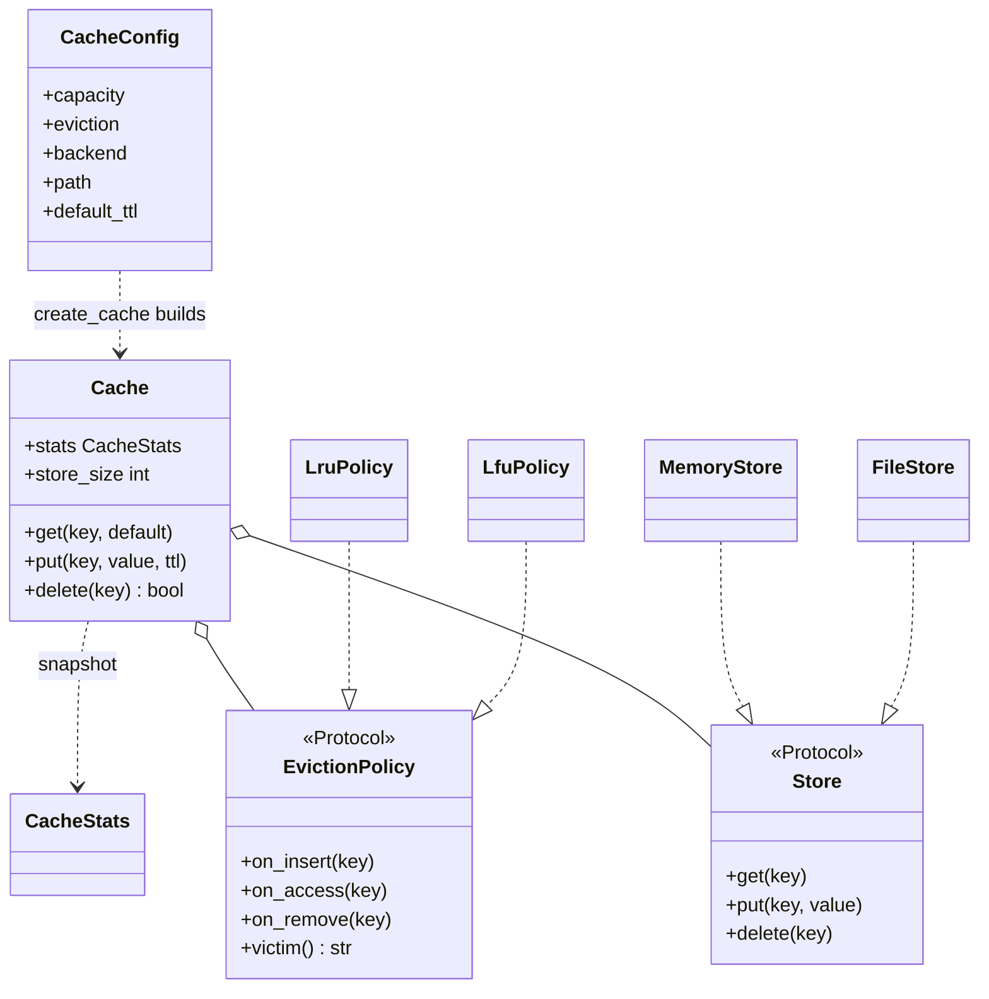

# 设计题解：可配置缓存（Configurable Cache）

## 题目与澄清

候选人报告的原话（Hello Interview 社区题库，Amazon，2026-09-20 中级与 2026-10-01 资深各一份，见文末来源）：

> 设计一个可配置的缓存系统，支持可插拔的淘汰策略（如 LRU、LFU）和可互换的存储后端（如内存、文件系统、heap、stack）。

另一条线索来自一亩三分地 2026-09-18 的 SDE II 电面报告：第一道题是 LRU 缓存。所以可以放心地假设：这道题的起点是大家都做过的 LRU 缓存，面试官想看的是你能不能把它**拆开**——哪一部分会变，哪一部分不会变。以下哪些是报告里的、哪些是我们补的：报告里只有「淘汰策略可插拔」「存储后端可互换」这两句话；**过期时间（TTL）、统计、线程安全、配置对象、后端失败时怎么办，全部是（reconstructed，重建）**，是我们按 Amazon 面试官惯常的追问方式补上的，读者若有原文，以原文为准。「heap、stack」这两个词报告没有解释：我们按「存储介质」理解，题解里的后端只做内存和文件两种，另外两种当作面试官的口头说法，开场第一分钟就应当问清。

先把几个词讲清楚，后面反复用到：

- **缓存（cache）**：一块容量有限的快速存储，把最近、最常用的数据留在手边，满了就得扔掉一条旧的。
- **淘汰策略（eviction policy）**：缓存满了以后「扔谁」的规则。LRU（最近最少使用，Least Recently Used）扔最久没被碰过的；LFU（最不经常使用，Least Frequently Used）扔被访问次数最少的。
- **存储后端（storage backend）**：数据真正放的地方。内存后端就是一个 Python 字典；文件后端把每条数据写成磁盘上的一个文件，进程重启也不会无故丢，代价是慢、会失败（磁盘满了、权限不够）。
- **命中（hit）与未命中（miss）**：要的 key 在缓存里就是命中，不在就是未命中。

值得问的澄清问题，以及每个答案会改变什么：

- **策略和后端是创建缓存时选定，还是运行时可以切换？** 创建时选定，换策略等于新建一个缓存，这是最简单的做法，也是我们采用的；运行时切换意味着要把旧策略里记下的使用历史迁移给新策略，复杂得多，除非面试官明确要求，不做。
- **缓存里的值是什么类型？** 如果是任意 Python 对象，文件后端就必须决定怎么序列化（serialize，把对象变成可写入磁盘的字节）。我们要求值能被 JSON 表示，不能的话直接抛 `StoreError`；这个约束要在开场说出来，而不是写到一半才发现。
- **key 是什么类型？** 我们规定 key 是字符串。文件后端要把 key 变成文件名，key 里带 `/` 或 `../` 是一个安全问题（路径穿越），答案是用哈希值做文件名。
- **要不要过期时间、统计、线程安全？** 这三样各自是一层可以后加的东西。能不能「后加而不重写」就是面试官在打分的「可扩展」。
- **后端写入失败怎么办？** 这是区分普通答案和好答案的一问：策略与后端是两份各自记账的状态，一边成功一边失败，两边就对不上了。第 5 个关键设计决策专门讲它。

**范围之外**：分布式缓存与一致性哈希、缓存与数据库之间的写穿透（write-through）和写回（write-back）、按字节数而不是条目数限制容量、进程重启后从磁盘恢复缓存内容（我们要求文件后端的目录在创建缓存时必须是空的）。第 7 节会说它们落在哪里。

LRU 与 LFU 的链表、频率桶如何做到 O(1)，[[solution-lru-cache]] 已经完整讲过，带过期时间的缓存见 [[solution-ttl-cache]]。本文**不重新教它们**，只讲这道题新增的部分：怎么把「淘汰」和「存储」拆成两个互不认识的部件，以及拆开之后哪里会出问题。

## 需求与分级

Amazon 的这一轮是 45 分钟的机器编码，面试官陆续追加需求。下面是我们按报告和惯常追问排出的四关，每一关写明这部分设计是为了谁存在。

**第 1 关（约 20 分钟，对应报告里的第一问）**：`Cache(capacity, policy, store)`，`get` / `put` / `delete`。先只做内存后端和 LRU。这一关要立住的是整个设计的骨架：`Cache` 编排，`EvictionPolicy` 只回答「扔谁」，`Store` 只负责存取值。覆盖已有 key 不算新增，不涨容量。

**第 2 关（约 15 分钟，报告里的「LRU、LFU」）**：加 LFU 策略，加一个 `CacheConfig` 和 `create_cache`，用字符串 `"lru"`、`"lfu"` 选择策略。这一关检验骨架：如果加 LFU 需要改 `Cache`，说明第 1 关的接口画错了。

**第 3 关（约 15 分钟，报告里的「内存、文件系统」）**：加文件后端。这一关第一次出现**会失败的存储**，于是必须回答：写文件失败时缓存处于什么状态？先动策略还是先动后端？这一关也是「两条独立变化的轴」第一次被真正使用：两种策略乘以两种后端必须全部可用，而且不能写 4 个组合类。

**第 4 关（选做，重建）**：TTL（注入时钟）、命中 / 未命中 / 淘汰 / 过期统计、线程安全。这些全是「骨架之上加一层」的练习：TTL 只在 `Cache` 里多一张表，统计是一个冻结的快照对象，线程安全是一把锁。

每一关结束时都问自己一句：我这一关改了前面哪个类？理想答案是「一个都没改，只新增了类，外加注册表里一行」。

## 核心对象与职责

一句话说清这个系统：它是一个有容量上限的键值表，往里放新数据时如果满了，就由「淘汰策略」决定踢走哪一条，而数据本身存在可替换的「存储后端」里。策略只认 key，后端只认值，中间的 `Cache` 负责按固定顺序指挥这两个部件。

| 类 | 唯一职责 | 它守住的不变量 |
|---|---|---|
| `Cache` | 编排一次读写：查、写后端、选受害者、登记；容量、过期、统计、锁 | `len(policy) <= capacity`；policy 与 store 的 key 集合一致；失败时两边都停在操作之前 |
| `EvictionPolicy`（协议）及 `LruPolicy` / `LfuPolicy` | 只记 key 的使用顺序或次数，回答「扔谁」 | 不持有值；空了就立刻释放自己的内部结构 |
| `Store`（协议）及 `MemoryStore` / `FileStore` | 只按 key 存取值 | 写入要么完整成功要么旧值原封不动；删除不存在的 key 是空操作 |
| `CacheConfig` | 一份冻结的配置：容量、策略名、后端名、目录、默认 TTL | 不可变 |
| `CacheStats` | 命中、未命中、淘汰、过期的冻结快照 | 拿到后不会被后续操作改动 |

关系：`Cache` **持有**（组合，composition）一个策略对象和一个后端对象，三者的生命周期一致；策略与后端互相不引用，也都不引用 `Cache`。`CacheConfig` 与 `create_cache` 是装配点，把名字翻成对象，装配完就退出，运行期不再出现。



有两个对象**故意没有**写成类：一个是工厂（Factory）——名字到对象的映射用两张字典 `POLICIES` 和 `BACKENDS` 就够了；另一个是「条目」（`Entry(key, value, expire_at)`）——值在后端里，使用顺序在策略里，过期时间在 `Cache` 的一张表里，三份信息分属三个责任方，合成一个条目对象反而把它们绑回去了。

## 关键设计决策

### 决策一：两条独立变化的轴，用组合而不是子类

**问题**：淘汰策略有 LRU、LFU，存储有内存、文件，两条轴各自还会增长（FIFO、随机；Redis、数据库）。要让任意策略搭配任意后端。

**选项 A：为每个组合写一个类。** `LruMemoryCache`、`LruFileCache`、`LfuMemoryCache`、`LfuFileCache`。2 乘 2 是 4 个类，再加一种后端就是 6 个，加一种策略和一种后端是 9 个。更坏的是 LRU 的逻辑被复制到每个后端的子类里，修一个 bug 要改好几处。

**选项 B：组合。** `Cache` 持有一个策略对象和一个后端对象，两者通过窄接口协作。策略 2 个类、后端 2 个类、`Cache` 1 个类，共 5 个；加一种后端是 1 个新类，加一种策略也是 1 个。

**选择 B。** 判断标准很朴素：两个会独立变化的维度，不要用继承把它们焊在一起。这就是桥接模式（Bridge：把「抽象」和「实现」分成两条各自演化的层次，用持有关系连接，参见 [[patterns.structural|结构型模式（Structural）]]）；策略这一侧同时也是策略模式（Strategy：把一族可互换的算法放到同一个接口后面，参见 [[patterns.strategy|策略模式与可替换算法（Strategy）]]）。面试里不必念出模式的名字，要说得出**为什么不用继承**：因为 4 个组合类里有 3 份重复。

接口怎么写：用 `typing.Protocol` 而不是 `abc.ABC`。两个接口都只描述「需要哪几个方法」，实现类不必继承它们，测试里的 `FlakyStore` 也只是一个有同名方法的普通类；Protocol 没有运行期开销，也不要求实现类知道接口的存在。

### 决策二：策略接口多宽——只传 key 的四个钩子

**问题**：经典的 LRU 实现把值和顺序放在同一个结构里（一个 `OrderedDict`，值就是字典的值）。一旦后端可以替换，值就不一定在内存里了，这个结构必须拆开。拆在哪里？

**选项 A：策略自己存值。** 策略接口变成 `get(key)` / `put(key, value)`，LRU 内部就是 `OrderedDict[key, value]`。文件后端怎么办？只能在策略外再包一层，或者让每种策略各自适配每种后端，回到决策一里的组合爆炸。

**选项 B：策略只记元数据。** 策略看不见值，只收到四个通知：`on_insert(key)` 新 key 进来了，`on_access(key)` 被读或被覆盖了，`on_remove(key)` 这个 key 没了，再加一个查询 `victim()` 问「现在该扔谁」，外加 `__len__` 与 `__contains__`。使用顺序（LRU）或次数（LFU）就是它需要的全部信息。

**选择 B。** 它的代价是：缓存里的 key 在策略和后端各登记一份，两份必须同步，这正是决策三要处理的风险。收益是策略完全不依赖后端，也能脱离后端单独测试（`test_lfu_*` 直接对 `LfuPolicy` 调 `on_insert` 和 `victim`）。

策略接口宽度的另一个判断：为什么不是一个函数 `choose_victim(keys, ...)`？因为 LRU 需要「每次访问都更新顺序」，LFU 需要「每次访问都升一级」，策略必须**有状态并且被通知**。一个只有一个方法、不带状态的策略才适合写成普通函数；这里不是，所以写成类。FIFO 是最简单的一种：访问通知什么也不做，它在卡片里是一个十行的类，而且不需要改 `Cache` 的任何一行。

### 决策三：后端会失败，操作的顺序就是正确性

**问题**：策略和后端是两份各自记账的状态。把一个新 key 放进已满的缓存要做三件事：写后端、淘汰一个旧 key（后端删除加策略移除）、策略登记新 key。后端的任何一步都可能抛异常。如果顺序排错，两边就会对不上。

**选项 A：先动策略，再动后端。** 先让策略淘汰旧 key、登记新 key，最后写后端。容量 2 的文件缓存里存着 a、b，`put("c", {1, 2})`：策略已经淘汰了 b、登记了 c，这时文件后端发现集合 `{1, 2}` 不能转成 JSON，抛 `StoreError`。结果：b 白白丢了，c 在策略里「存在」，后端里却没有，之后 `get("c")` 的行为未定义。

**选项 B：先动会失败的一方。** 先写后端，成功后才动策略。写失败时抛异常，策略一行没动，缓存与操作前完全一致（实际运行：写 `{1, 2}` 失败之后，a、b 仍然都能取到，`len` 仍是 2）。写成功后才让策略淘汰：选出受害者，**先删后端**，删成功才让策略忘记它。如果删后端也失败了怎么办？此时新值已经写进后端，必须把它撤回（`self._store.delete(new_key)`）再把异常抛出去，这样 `get(a)` 仍然是旧值、`get(b)` 是 None，两边仍然一致。测试 `test_failed_eviction_rolls_back_the_new_value` 就是这个场景。

**选择 B**，并且把规则写成一句话放在 `Cache` 的文档里：「先动会失败的一方，成功后才动另一方」。诚实的局限：如果撤回新值的那次删除本身也失败，两边仍会不一致；要做到真正的原子性需要预写日志（write-ahead log）或两阶段提交，那是持久化与规模一节的话题，不属于 45 分钟的范围。面试时把这个边界说出来，比假装它不存在更能拿分。

### 决策四：过期时间放在 `Cache` 里，拒绝装饰器

**问题**：TTL（time to live，存活时间）：每条数据可以带一个期限，到期后读它等于未命中。它应该放在哪里？

**选项 A：装饰器（Decorator）。** 写一个 `TtlCache(Cache)` 包装类，内部再套一层。[[solution-lru-cache]] 里的 TTL 就是这么做的。问题在这里：过期的 key 必须同时从后端和策略里删除，包装类够不到策略的内部，要么给策略加一个「按条件删除」的接口，要么每次删除都走一遍 `Cache` 的公开 `delete`，层与层之间来回调用。

**选项 B：`Cache` 里加一张 `key -> 截止时刻` 的字典。** 读写时顺手检查，过期的当场用同一个 `_drop` 清掉；`put` 带 `ttl` 参数，`CacheConfig.default_ttl` 提供默认值。时钟从构造函数注入（`Callable[[], float]`，默认 `time.monotonic`），测试里换成假时钟，整套测试没有 `sleep`。

**选择 B，拒绝装饰器。** 这是本题里一个「更简单的答案才对」的地方：这里的 TTL 不是一条独立的横切关注点，它要和淘汰共用「删除一个 key」这一个动作，放在同一个类里反而少了一条接缝。代价是 `Cache` 多了十几行；如果将来 TTL 逻辑变复杂（滑动过期、后台清扫），再把它抽成一个对象不迟。注意过期的语义：到点即过期（`now >= deadline`），过期的 key 对 `get`、`delete`、`put` 都等同于不存在，因此覆盖一个已过期的 key 走「新增」分支，会占用新的位置而不是原位覆盖。后台线程定期清扫这个话题 [[solution-ttl-cache]] 讲得更完整，这里只做惰性过期：没人读的过期数据会一直占着一个位置，直到被读到或被淘汰。

### 决策五：配置用字典注册表，不要工厂类层级

**问题**：「可配置」要落到代码上：从一个配置对象得到一个装配好的缓存。

**选项 A：抽象工厂（Abstract Factory）。** `CacheFactory` 基类，`LruMemoryFactory`、`LfuFileFactory` 子类。又回到了 4 个组合类。

**选项 B：配置加两张注册表。** `CacheConfig` 是一个冻结数据类；`POLICIES = {"lru": LruPolicy, "lfu": LfuPolicy}`、`BACKENDS = {"memory": ..., "file": ...}` 两张字典；`create_cache(config)` 查表、装配、认不得的名字抛 `ConfigError`，并在错误信息里列出已知的名字。加一种策略就是写一个类、往字典里加一行，之前的代码一行不改。

**选择 B**，因为这里没有「一族相关对象需要一起创建」的结构，只有两个独立的查表。工厂模式在这里是为了模式而模式。

### 决策六：线程安全——一把粗锁，读也要锁

**问题**：多个线程同时使用同一个缓存。

**选项 A：一把锁包住每个公开操作。** 简单、正确，缺点是文件读写也在锁里，吞吐受限于最慢的一次磁盘操作。**选项 B：按 key 分片，每片一套策略、后端和锁。** 吞吐高，但「容量」变成每片的容量，全局淘汰不再精确，且代码量翻倍。

**选择 A。** 理由不只是简单：`get` 在缓存里是**写操作**——LRU 要把 key 挪到队尾，LFU 要把 key 升一级；而 `put` 的「查有没有空位 -> 淘汰 -> 登记」是多步复合操作。Python 的 GIL（全局解释器锁，同一时刻只有一个线程执行字节码）只保证单个字节码不被打断，不保证这三步连在一起；容量 1 的缓存里两个线程同时看到「还有空位」，缓存就会有两条。所以锁要包住整个操作，包括读。分片留作规模追问。

## 代码走读

%% code:begin solution.py %%
```python
"""可配置缓存（Configurable Cache）：淘汰策略与存储后端是两条互相独立的变化轴。
设计：`Cache` 只管"一次读写的流程、容量上限、过期时间、统计、锁"，它不知道谁被淘汰，也不知道数据放哪。
"淘汰谁"交给 `EvictionPolicy`（`LruPolicy` / `LfuPolicy`，只记元数据、不存值），"数据放哪"交给 `Store`
（`MemoryStore` / `FileStore`，只存值、不懂顺序）。两个接口互不引用，所以 2 种策略 x 2 种后端只写
4 个小类，而不是 4 个组合类；`CacheConfig` + `create_cache` 把名字（"lru"、"file"）翻译成对象。
一致性规则：先写存储（会失败的那一步），成功之后才动策略；淘汰同理，存储删除成功才让策略忘记。
"""

from __future__ import annotations

import hashlib
import json
import os
import tempfile
import threading
import time
from collections import OrderedDict
from collections.abc import Callable
from dataclasses import dataclass
from pathlib import Path
from typing import Any, Protocol

Clock = Callable[[], float]


class CacheError(Exception):
    """本组件所有失败的共同基类。"""


class ConfigError(CacheError, ValueError):
    """配置不合法：容量非正、名字不认识、文件后端没给目录、目录里已有数据。"""


class StoreError(CacheError):
    """存储后端读写失败（磁盘错误、值不能序列化、文件损坏）。缓存把它原样抛给调用方。"""


class EmptyPolicyError(CacheError, LookupError):
    """策略里一个 key 都没有时问"该淘汰谁"。"""


# ---------------------------------------------------------------- 淘汰策略


class EvictionPolicy(Protocol):
    """淘汰策略只维护"key 的使用顺序 / 次数"，从不持有值。四个动作足以表达 LRU、LFU、FIFO。"""

    def __len__(self) -> int: ...
    def __contains__(self, key: object) -> bool: ...
    def on_insert(self, key: str) -> None: ...
    def on_access(self, key: str) -> None: ...
    def on_remove(self, key: str) -> None: ...
    def victim(self) -> str: ...


class LruPolicy:
    """最近最少使用：OrderedDict 的顺序就是使用顺序，队首是最久没用的，所有操作 O(1)。"""

    def __init__(self) -> None:
        self._order: OrderedDict[str, None] = OrderedDict()

    def __len__(self) -> int:
        return len(self._order)

    def __contains__(self, key: object) -> bool:
        return key in self._order

    def on_insert(self, key: str) -> None:
        self._order[key] = None
        self._order.move_to_end(key)

    def on_access(self, key: str) -> None:
        self._order.move_to_end(key)

    def on_remove(self, key: str) -> None:
        self._order.pop(key, None)

    def victim(self) -> str:
        if not self._order:
            raise EmptyPolicyError("no key to evict")
        return next(iter(self._order))


class LfuPolicy:
    """最不经常使用：按访问次数分桶，桶内按插入先后；同频时淘汰最久没动的（退化为 LRU）。

    `_min` 指向最小的非空桶（0 表示"刚被删空、还没重算"），所以 victim 通常是 O(1)；淘汰之后紧跟着插入，
    `_min` 立刻回到 1，重算只会在过期删除之后遇到。桶一旦空了立即删除——否则桶表会无限增长。
    """

    def __init__(self) -> None:
        self._freq: dict[str, int] = {}
        self._buckets: dict[int, OrderedDict[str, None]] = {}
        self._min = 0

    def __len__(self) -> int:
        return len(self._freq)

    def __contains__(self, key: object) -> bool:
        return key in self._freq

    @property
    def bucket_count(self) -> int:
        """当前非空频率桶的个数（回归测试用：空桶必须被回收）。"""
        return len(self._buckets)

    def _detach(self, key: str) -> int:
        """把 key 从它当前的频率桶里摘出来，空桶当场删除；返回它原来的频率。"""
        freq = self._freq[key]
        bucket = self._buckets[freq]
        del bucket[key]
        if not bucket:
            del self._buckets[freq]
        return freq

    def _attach(self, key: str, freq: int) -> None:
        self._freq[key] = freq
        self._buckets.setdefault(freq, OrderedDict())[key] = None

    def on_insert(self, key: str) -> None:
        self.on_remove(key)
        self._attach(key, 1)
        self._min = 1

    def on_access(self, key: str) -> None:
        freq = self._detach(key)
        self._attach(key, freq + 1)
        if freq == self._min and freq not in self._buckets:
            self._min = freq + 1             # 刚摘空的就是最小桶：新桶 freq+1 顶上

    def on_remove(self, key: str) -> None:
        if key not in self._freq:
            return
        freq = self._detach(key)
        del self._freq[key]
        if freq == self._min and freq not in self._buckets:
            self._min = 0                    # 最小桶空了：先标记"未知"，真被问到受害者时再找

    def victim(self) -> str:
        if not self._freq:
            raise EmptyPolicyError("no key to evict")
        if not self._min:
            self._min = min(self._buckets)   # 只在"删除之后、插入之前"被问到才会走到这里
        return next(iter(self._buckets[self._min]))


# ---------------------------------------------------------------- 存储后端


class Store(Protocol):
    """存储后端只负责"按 key 存取值"，不知道容量、顺序和过期。`delete` 对不存在的 key 是空操作。"""

    def __len__(self) -> int: ...
    def get(self, key: str) -> Any: ...
    def put(self, key: str, value: Any) -> None: ...
    def delete(self, key: str) -> None: ...


class MemoryStore:
    """内存后端：一个 dict。get 缺 key 抛 KeyError。"""

    def __init__(self) -> None:
        self._data: dict[str, Any] = {}

    def __len__(self) -> int:
        return len(self._data)

    def get(self, key: str) -> Any:
        return self._data[key]

    def put(self, key: str, value: Any) -> None:
        self._data[key] = value

    def delete(self, key: str) -> None:
        self._data.pop(key, None)


class FileStore:
    """文件后端：目录里一个 key 一个 JSON 文件，文件名是 key 的 sha256（key 里的 `/`、`..` 无法逃出目录）。

    写入先写临时文件再 `os.replace`：失败时旧文件原封不动，不会留下写了一半的值。
    值必须能被 JSON 序列化；不能的话在碰磁盘之前就抛 StoreError。
    """

    def __init__(self, directory: Path) -> None:
        self._dir = Path(directory)
        self._dir.mkdir(parents=True, exist_ok=True)

    def _path(self, key: str) -> Path:
        return self._dir / (hashlib.sha256(key.encode()).hexdigest() + ".json")

    def __len__(self) -> int:
        return sum(1 for _ in self._dir.glob("*.json"))

    def get(self, key: str) -> Any:
        try:
            return json.loads(self._path(key).read_text(encoding="utf-8"))["value"]
        except FileNotFoundError:
            raise KeyError(key) from None
        except (OSError, ValueError, KeyError) as exc:
            raise StoreError(f"cannot read {key!r}: {exc}") from exc

    def put(self, key: str, value: Any) -> None:
        try:
            body = json.dumps({"key": key, "value": value})
        except (TypeError, ValueError) as exc:
            raise StoreError(f"value for {key!r} is not JSON-serialisable: {exc}") from exc
        try:
            fd, tmp = tempfile.mkstemp(dir=self._dir, suffix=".tmp")
            with os.fdopen(fd, "w", encoding="utf-8") as fh:
                fh.write(body)
            os.replace(tmp, self._path(key))
        except OSError as exc:
            raise StoreError(f"cannot write {key!r}: {exc}") from exc

    def delete(self, key: str) -> None:
        try:
            self._path(key).unlink(missing_ok=True)
        except OSError as exc:
            raise StoreError(f"cannot delete {key!r}: {exc}") from exc


# ---------------------------------------------------------------- 配置与工厂


@dataclass(frozen=True, slots=True)
class CacheConfig:
    """一份缓存的全部旋钮。`eviction` / `backend` 是注册表里的名字；`path` 只有文件后端用。"""

    capacity: int
    eviction: str = "lru"
    backend: str = "memory"
    path: Path | None = None
    default_ttl: float | None = None


POLICIES: dict[str, Callable[[], EvictionPolicy]] = {"lru": LruPolicy, "lfu": LfuPolicy}
BACKENDS: dict[str, Callable[[CacheConfig], Store]] = {
    "memory": lambda cfg: MemoryStore(),
    "file": lambda cfg: FileStore(_need_path(cfg)),
}


def _need_path(cfg: CacheConfig) -> Path:
    if cfg.path is None:
        raise ConfigError("file backend needs a path")
    return cfg.path


@dataclass(frozen=True, slots=True)
class CacheStats:
    """某一时刻的计数快照（冻结，调用方拿到后不会被后续操作改动）。"""

    hits: int = 0
    misses: int = 0
    evictions: int = 0
    expirations: int = 0

    @property
    def hit_rate(self) -> float:
        total = self.hits + self.misses
        return self.hits / total if total else 0.0


# ---------------------------------------------------------------- 缓存本体


class Cache:
    """缓存：编排策略与后端，自己只守三条不变量。

    1. `len(policy) <= capacity`，且 policy 里的 key 集合 == store 里的 key 集合（每次操作返回时成立）。
    2. 先动会失败的一方（store），成功后才动 policy；失败时两边都停在操作之前的状态。
    3. 过期的 key 对外等同于不存在：读到就当场清掉，并计入 expirations。
    一把粗粒度锁包住每个公开操作——文件 IO 也在锁内，吞吐换正确性（见题解"并发"一节）。
    """

    def __init__(self, capacity: int, policy: EvictionPolicy, store: Store,
                 clock: Clock = time.monotonic, default_ttl: float | None = None) -> None:
        if capacity <= 0:
            raise ConfigError(f"capacity must be positive, got {capacity}")
        if len(store) != 0:
            raise ConfigError("store must be empty: the policy cannot know keys it never saw")
        self._capacity = capacity
        self._policy = policy
        self._store = store
        self._clock = clock
        self._default_ttl = default_ttl
        self._expires: dict[str, float] = {}
        self._hits = self._misses = self._evictions = self._expirations = 0
        self._lock = threading.Lock()

    def __len__(self) -> int:
        with self._lock:
            return len(self._policy)

    @property
    def store_size(self) -> int:
        """存储后端里实际有多少条（不变量检查用：必须等于 len(cache)）。"""
        with self._lock:
            return len(self._store)

    @property
    def stats(self) -> CacheStats:
        with self._lock:
            return CacheStats(self._hits, self._misses, self._evictions, self._expirations)

    def _drop(self, key: str) -> None:
        """删除一个 key：先删存储（可能失败），成功后策略与过期表才忘记它。"""
        self._store.delete(key)
        self._policy.on_remove(key)
        self._expires.pop(key, None)

    def _live(self, key: str) -> bool:
        """key 是否存在且未过期；过期的当场清掉。"""
        if key not in self._policy:
            return False
        deadline = self._expires.get(key)
        if deadline is not None and self._clock() >= deadline:
            self._drop(key)
            self._expirations += 1
            return False
        return True

    def get(self, key: str, default: Any = None) -> Any:
        with self._lock:
            if not self._live(key):
                self._misses += 1
                return default
            value = self._store.get(key)
            self._policy.on_access(key)
            self._hits += 1
            return value

    def put(self, key: str, value: Any, ttl: float | None = None) -> None:
        ttl = self._default_ttl if ttl is None else ttl
        with self._lock:
            exists = self._live(key)
            self._store.put(key, value)             # 会失败的一步放最前：失败则什么都没变
            if exists:
                self._policy.on_access(key)
            else:
                self._make_room(key)
                self._policy.on_insert(key)
            if ttl is None:
                self._expires.pop(key, None)
            else:
                self._expires[key] = self._clock() + ttl

    def _make_room(self, new_key: str) -> None:
        """容量已满时淘汰一个。此时新值已写进 store，所以删旧值失败要把新值也撤回。"""
        if len(self._policy) < self._capacity:
            return
        victim = self._policy.victim()
        try:
            self._drop(victim)
        except StoreError:
            self._store.delete(new_key)
            raise
        self._evictions += 1

    def delete(self, key: str) -> bool:
        with self._lock:
            if not self._live(key):
                return False
            self._drop(key)
            return True


def create_cache(config: CacheConfig, clock: Clock = time.monotonic) -> Cache:
    """按配置组装：名字查注册表，找不到就报 ConfigError。新增一种策略或后端只改注册表。"""
    if config.eviction not in POLICIES:
        raise ConfigError(f"unknown eviction policy {config.eviction!r}; known: {sorted(POLICIES)}")
    if config.backend not in BACKENDS:
        raise ConfigError(f"unknown backend {config.backend!r}; known: {sorted(BACKENDS)}")
    return Cache(config.capacity, POLICIES[config.eviction](), BACKENDS[config.backend](config),
                 clock, config.default_ttl)


if __name__ == "__main__":
    cache = create_cache(CacheConfig(capacity=2, eviction="lfu"))
    cache.put("a", 1)
    cache.put("b", 2)
    cache.get("a")
    cache.put("c", 3)                      # 满了：a 被用了 2 次，b 只有 1 次 -> 淘汰 b
    print(cache.get("a"), cache.get("b"), cache.get("c"), cache.stats)
```
%% code:end %%

挑四处看设计决策在代码里的样子：

**一、`Cache.put` 与 `_make_room`（决策三）。** 看 `put` 的顺序：`self._store.put(key, value)` 在最前面，它之前没有任何状态变更。接着是覆盖分支（`on_access`）或新增分支（`_make_room` 然后 `on_insert`）。`_make_room` 里 `victim()` 先于 `on_insert` 被问，所以受害者只会是已有的 key，这同时避免了 LFU 的经典错误：新 key 的频率是 1，最小，如果先登记再选，刚写进去的 key 会被当场淘汰。`try / except StoreError` 里撤回新值，是上面「删旧值失败」场景的实现。

**二、`LfuPolicy` 的桶（决策二的收益）。** `_freq` 记每个 key 的次数，`_buckets` 把「次数相同的 key」放在同一个 `OrderedDict` 里，保持插入先后；`_min` 指向最小的非空桶。`on_access` 把 key 从 f 桶挪到 f+1 桶；`_detach` 里桶一空就 `del`，所以对一个 key 连续访问 50 次之后，桶表里只剩一个桶（`bucket_count == 1`），不会留下 50 个空桶。`_min` 的维护是这个类里最容易写错的地方：刚被摘空的恰好是最小桶时，下一个最小桶一定是 `freq + 1`（因为这个 key 刚刚升到了那里）；而因为删除（过期）清空最小桶时，新最小值要重新找，我们先把 `_min` 置为 0 表示「未知」，等真的被问到 `victim()` 才重算，所以常规的「淘汰一个再插入一个」路径始终是 O(1)。

**三、`FileStore.put`（后端的契约）。** 先 `json.dumps`：序列化失败在碰磁盘**之前**就抛 `StoreError`；再写临时文件，最后 `os.replace` 换名。换名在同一个文件系统内是原子的，所以写到一半断电或抛异常，旧文件原封不动，不会留下半个值。文件名是 key 的 sha256（64 个十六进制字符），`../../evil` 这样的 key 被哈希掉，无法跑出目录——测试 `test_file_backend_keys_cannot_escape_the_directory` 就是断言这一点。

**四、`create_cache` 与注册表（决策五）。** 两行字典查表，错误信息里列出已知名字。注意 `Cache.__init__` 里的检查：存储不是空的就拒绝创建。因为策略不知道「它从没见过的 key」，一个预先装着数据的目录会让策略与后端从第一天起就对不上。

## 测试与自检

测试文件对 `solution` 和 `starter` 两种实现各跑一遍，只用公开接口（`len(cache)`、`store_size`、`stats`、`LfuPolicy.bucket_count`），不碰任何下划线属性。它们钉住的东西：

- **第 1 关**：命中与未命中、LRU 的淘汰顺序（容量 2：put a、put b、get a、put c，被淘汰的是 b）、覆盖不淘汰且刷新新旧度、`delete` 的返回值。
- **第 2 关**：LFU 的频率淘汰与同频按先后（容量 2 的 LFU：put a、put b、get a、put c 淘汰 b；再 put d 淘汰 c 而不是刚进来的 d）；新 key 不能被自己淘汰；空桶被回收（对同一个 key 访问 50 次，`bucket_count` 仍是 1）；最小频率指针在中间删除之后重新找到正确的桶。
- **第 3 关**：文件后端的往返读写与淘汰后文件被真正删除；两种策略乘以两种后端的全部四种组合都满足「容量不超、两边数量一致、淘汰了 7 次」（容量 3 的缓存连续写 10 个不同 key，淘汰次数是 10 - 3 = 7）；key 带 `../` 不能跑出目录；配置错误（未知策略、未知后端、文件后端没给目录、容量非正、目录里已有数据）。
- **失败路径**：写不能序列化的值时没有人因此被淘汰；覆盖失败保留旧值；淘汰时删旧值失败会撤回新值；损坏的文件抛 `StoreError`，缺失的 key 抛 `KeyError`。
- **第 4 关**：TTL 到点即过期、过期腾出位置所以没有多余的淘汰；覆盖重新计时；统计是快照；六个线程各自写、读、删，最后断言容量不超、策略与后端数量一致、磁盘上的文件数等于缓存条数。

测试里的 `FlakyStore` 值得一提：它包住一个内存后端，可以让 `put` 失败、让**指定的 key** 删不掉。让所有删除都失败是不现实的，也会把「撤回」本身搞坏；故障要窄到刚好复现想测的场景。

**两分钟演示**：创建 `create_cache(CacheConfig(capacity=2, eviction="lfu"))`，put a、put b、get a、put c，然后 `get("b")` 得到 `None`、`stats` 显示一次淘汰；把 `eviction` 改成 `"lru"`、`backend` 改成 `"file"` 再跑一遍，其它代码不变。这就是在向面试官证明「可配置」。

## 扩展与追问

**新需求**

- *再加一种淘汰策略（FIFO、随机、LRU-K）*：新增一个实现四个钩子的类，在 `POLICIES` 里登记一行。`Cache`、其他策略、所有后端不动。FIFO 的 `on_access` 什么也不做，只有十行。
- *再加一种后端（数据库、Redis、堆上的二叉堆、栈）*：新增一个实现 `get` / `put` / `delete` / `__len__` 的类并登记。注意后端是否能保证「写入要么完整成功要么旧值不变」，这是 `Cache` 的一致性规则对后端提的唯一要求。
- *运行时切换策略*：新建目标策略，把现有 key 依序 `on_insert`，再原子地替换。LRU 的历史顺序与 LFU 的次数没法互相转换，信息会丢，所以这是一个要和面试官确认语义的追问。
- *缓存未命中时自动回源（read-through）*：在 `get` 外加一个 `loader` 回调，未命中时调用并 `put`。单飞（同一个 key 只回源一次）见 [[solution-ttl-cache]]。

**并发与线程安全**

- *吞吐不够*：按 key 的哈希分片，每片一套策略、后端、锁；代价是容量变成每片的容量，全局不再严格 LRU。
- *文件 IO 不能在锁里*：把「选受害者与登记」留在锁内，把慢的文件读写移到锁外，需要给每个 key 加一个「进行中」状态，复杂度明显上升，除非面试官明确要求，不做。

**持久化与规模**

- *重启后恢复*：文件后端自己带着 key（文件内容里存了原始 key），启动时可以扫描目录重建策略，但使用顺序和次数丢失；这就是 `Cache` 现在拒绝非空目录的原因。
- *更强的原子性*：预写日志，或者先写临时位置再统一提交。

## 常见错误

- **先登记新 key 再选受害者**（LFU 里尤其致命）：新 key 的频率最低，刚写进去就被淘汰。容量 1，put a、get a、put b，`get("b")` 应该是 b 的值而不是 None。
- **用继承表达两条轴**：`LruFileCache` 这类类名一出现，就说明轴没有拆开。
- **策略里保存值**：策略一旦持有值，就和后端绑死，换文件后端时要重写策略。
- **只给 `put` 加锁，`get` 不加**：`get` 会改变顺序，是写操作。
- **先动策略后写后端**：后端抛异常时，策略里留下一个没有数据的 key，或者白白淘汰了一个有数据的 key。
- **空桶不删**（LFU）：被频繁访问过的 key 每升一级就留下一个空桶，桶表无限增长，一个本应有界的组件悄悄变成了内存泄漏。
- **文件名直接用 key**：`../../etc/passwd` 这样的 key 会写到目录之外。
- **Java 习惯**：为 `Cache` 写 `getCapacity()` / `setCapacity()`；为只有一个实现的东西先写一个接口；写一个只持有 `main` 的 `Main` 类。Python 里用属性、协议和模块级函数。
- **在 `get` 里返回内部字典或列表的引用**：调用方改了返回值就改了缓存。这里值经过后端（文件后端每次都是新对象），内存后端在需要时应由调用方负责拷贝，面试时要说出这条约定。

## 45 分钟怎么分配

- **0 到 5 分钟，澄清**：复述报告里那一句，然后问三件事——策略和后端创建时选还是运行时换；值与 key 的类型；要不要 TTL、统计、线程安全。把答案写成 3 到 5 条需求加一条「不做什么」，让面试官点头。
- **5 到 10 分钟，对象**：画出 `Cache`、`EvictionPolicy`、`Store` 三块，一人一句职责；强调策略只认 key、后端只认值。
- **10 到 25 分钟，第 1、2 关**：写 `LruPolicy`（`OrderedDict`）和 `MemoryStore`，写 `Cache.put` / `get`，口头走一遍「容量 2：put a、put b、get a、put c」。然后加 `LfuPolicy`，只讲桶和最小频率指针，细节指向 [[solution-lru-cache]]。
- **25 到 35 分钟，第 3 关**：写 `FileStore`（哈希文件名、临时文件加 `os.replace`），然后讲失败顺序：先写后端，成功后才动策略。这是整场最能拿分的一段，不要省。
- **35 到 42 分钟，测试与追问**：用一个假的失败后端写一个测试，演示「失败后缓存不变」；回答 FIFO 怎么加。
- **42 到 45 分钟，收尾**：说出局限（撤回本身失败、粗锁、惰性过期），不要等面试官问。

时间不够时先砍：统计、TTL、`CacheConfig`；绝对不砍：策略与后端的拆分，以及失败顺序。

## 来源与延伸

- Hello Interview 社区题库的 Amazon 题目页：https://www.hellointerview.com/community/questions?company=Amazon ——题目原话和两份报告（中级、资深）的来源；页面只给出题目一句话，没有解法。我们没有可对照的完整解答，所以本文的四关分级、TTL、统计和失败顺序都是自己补的，并在开头标为重建。商业站点，只链接不引用。
- 一亩三分地 2026-09-18 SDE II 电面报告：https://www.1point3acres.com/bbs/thread-1189999-1-1.html ——第一道题是 LRU 缓存，说明起点是 LRU，可配置是追问。正文需要积分，我们只依赖这一个事实。
- Python 官方文档 `collections.OrderedDict`：https://docs.python.org/3/library/collections.html#collections.OrderedDict ——`move_to_end` 与 `popitem(last=False)` 都是 O(1)，文档里有一个 LRU 范例；与它不同的是，本文把「顺序」和「值」拆开了，因为值可能在文件里。
- Python 官方文档 `typing.Protocol`：https://docs.python.org/3/library/typing.html#typing.Protocol ——解释了为什么策略与后端的接口用结构化子类型而不是抽象基类。
- 题库里的相关题解：[[solution-lru-cache]]（LRU/LFU 的链表与频率桶、装饰器式 TTL）、[[solution-ttl-cache]]（惰性与主动过期、单飞回源）。本文与前者的主要分歧：前者的 TTL 与线程安全是装饰器，本文把 TTL 放进 `Cache`（见决策四）；前者的策略自带值，本文只记 key。
- 概念：[[patterns.strategy|策略模式与可替换算法（Strategy）]]、[[patterns.structural|结构型模式（Structural）]]。
