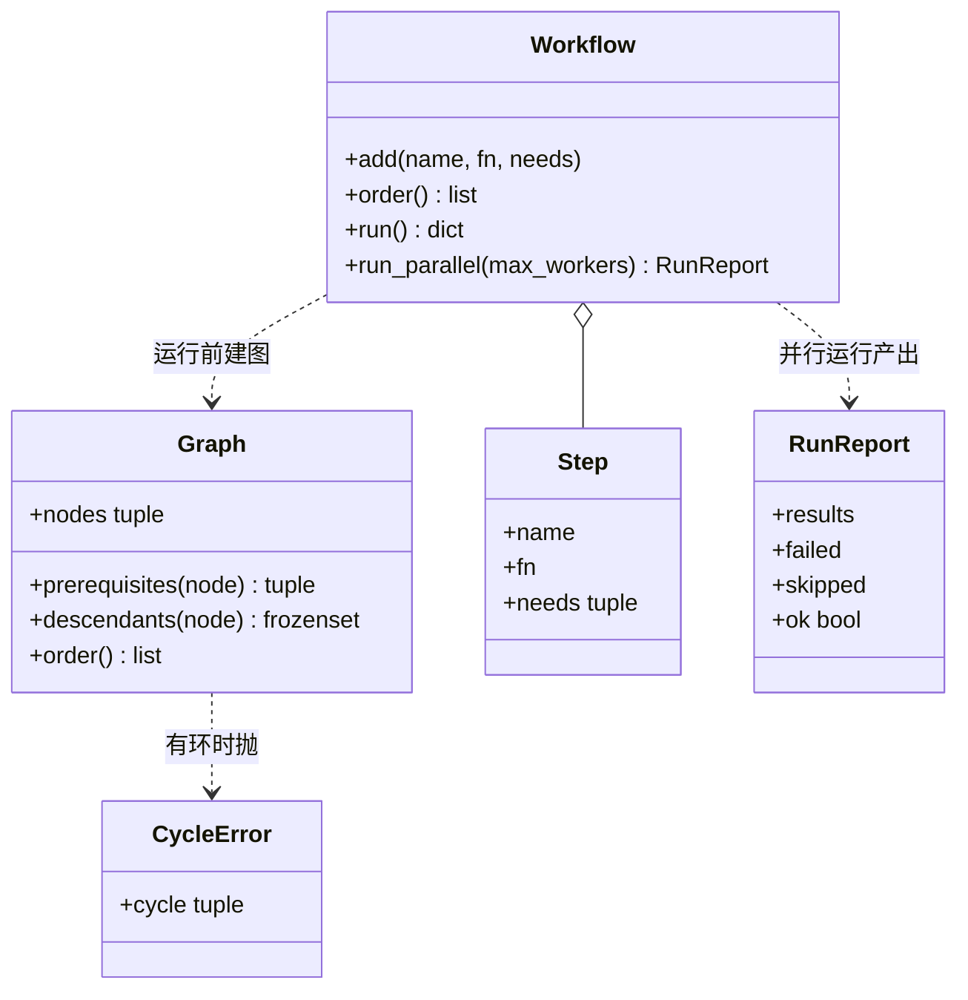

# 设计题解：DAG 执行器与依赖安装（DAG Runner）

## 题目与澄清

DAG 执行器要解决的是依赖排序：有一批任务（或软件包），其中一些必须等另一些做完才能开始；系统要算出一个能依次做完它们的顺序，发现「A 等 B、B 又等 A」这种死结（环，cycle）就报错，再进一步把互不相关的任务同时跑起来，并让结果从上游流到下游。这样的图叫有向无环图（DAG，Directed Acyclic Graph）：边有方向，沿着边走不会绕回出发点。包管理器装软件、构建系统编译、工作流引擎调度步骤，都是这个结构。

面试官通常这样提出：先给你一份依赖邻接表（adjacency list，每个名字对应它依赖的名字列表），要求返回安装顺序、有环就抛异常；接着给一段计算执行顺序的 Python 代码，让你找出并修好其中的 bug（代码评审形态）；再追问让每个节点成为一个函数、上游结果传给下游，以及独立节点并行执行。输入输出的细节没有给定，下面是一套自洽的默认约定，面试时以面试官当场给出的为准。

先用两句话说清系统：有一批任务（或软件包），其中一些必须等另一些做完才能开始；系统要算出一个能依次做完它们的顺序，发现「A 等 B、B 又等 A」这种死结就报错，再进一步把互不相关的任务同时跑起来，并让结果从上游流到下游。

开场该问的三个澄清问题：

1. **输入的方向是什么：`deps["a"] = ["b"]` 是「a 依赖 b」还是「a 之后要做 b」？** 方向反了，整个顺序就倒过来。下面约定 `deps[x]` 是 x 的前置依赖（必须先于 x）。再问：只出现在依赖列表里、自己没有一行的名字（例如 `{"a": ["b"]}` 里的 b）算不算节点？应当算，否则 b 永远装不上。
2. **有环时要什么：只抛异常，还是要说出环是哪几个？** 只抛异常最省事，但一个能说出 `a -> b -> c -> a` 的异常才是评审者想看到的，因为调用方可以直接告诉用户该改哪一条依赖。下面的 `CycleError` 带着环本身。
3. **多个合法顺序时，要哪一个？** 拓扑序一般不唯一。如果面试官要求确定性（同样的输入每次同样的输出），就必须规定平局规则。下面按「首次出现的先后」，这样测试可以断言整个列表而不只是「合法」。

范围外：版本约束与可选依赖、增量安装与缓存、持久化的任务状态、重试与超时、跨机器调度。

## 需求与分级

| 关 | 需求 | 本关逼出的设计 |
|---|---|---|
| 第 1 关 | 依赖邻接表 -> 安装顺序；有环抛异常并指出环 | `Graph`：边去重、Kahn 算法、从卡住的节点里找出具体的环 |
| 第 2 关 | 读一段有 bug 的执行顺序代码，找出并修好 | 不新增代码：`buggy_runner.py` 三个 bug 各对应第 1 关的一条不变量 |
| 第 3 关 | 每个节点是一个函数，按依赖顺序执行，上游的结果传给下游 | `Step`、`Workflow.run`：入参是 `{依赖名: 结果}`，失败就停 |
| 第 4 关 | 独立节点用线程池并行；一个失败只取消它的后代 | `Workflow.run_parallel`、`RunReport`：调度状态只由调用线程持有 |

注意第 2 关不是「写新功能」，而是「读别人的代码」。它考的是你有没有一份清单：入度怎么数、孤立的被依赖节点怎么办、排完以后是否检查数量。第 1 关写对了，这份清单就是你自己写代码时的自检表。

## 核心对象与职责

- `Graph`：一张不可变的依赖图。拥有「节点 -> 前置依赖集合」和「节点 -> 后继集合」两张表。不变量：边是去重后的（同一条依赖声明两次只算一条）；`prerequisites` 与 `descendants` 是由这两张表推出的快照。它知道怎么排序、怎么找环，但不知道什么是「执行」。
- `install_order`：第 1 关的函数入口，就是 `Graph(deps).order()`。一个函数一行，保留它是因为面试的第一问就是写一个函数。
- `CycleError`：异常，带着 `cycle` 元组。不变量：`cycle` 里每个名字依赖它后面那个，最后一个依赖第一个。
- `Step`：冻结的数据类，包含名字、函数、依赖名。函数的入参是 `{依赖名: 依赖的结果}`。
- `Workflow`：步骤的登记处，也是执行入口。拥有所有 `Step`。不变量：同名步骤不能重复登记；运行前统一检查环和未登记的依赖。
- `RunReport`：并行运行的结局。不变量：每个步骤恰好落在 `results`、`failed`、`skipped` 之一。



所有权很简单：`Workflow` 持有 `Step`，每次运行时现建一张 `Graph`（图很小，建图是 O(V+E)，且这样永远不会和 `Step` 集合不一致）。`Graph` 对 `Workflow` 一无所知，所以第 1 关的函数可以单独拿去用。

## 关键设计决策

### 决策一：怎么排序——Kahn 算法还是 DFS 后序

问题：给定依赖图，产出一个合法顺序，并且在有环时能报告。

**方案 A：DFS 后序。** 访问一个节点前先递归访问它的依赖，访问完把它追加到结果里；用「正在访问」的颜色标记检测环（遇到灰色节点就是环）。代码很短，环也能顺手从递归栈里截出来。代价：Python 的递归深度默认只有 1000，一条长 5000 的依赖链会 `RecursionError`，要改成显式栈就失去了简短；而且 DFS 的结果顺序依赖遍历顺序，不容易规定平局规则。

**方案 B：Kahn 算法（入度为 0 的节点反复出队）。** 迭代，没有递归深度问题；每一轮「哪些节点此刻可以做」本来就是并行执行需要的概念，第 4 关可以直接复用同一套入度表。环的检测是副产品：排完以后数一数，数量不够说明剩下的有环。

**选择：B。** 理由不只是栈深度。第 4 关的并行调度器本质上就是「一边执行、一边把完成的节点从入度表里划掉」，与 Kahn 同构，两关共用一个思路。平局规则也好定：就绪节点放进小根堆，键是首次出现的序号。

代价和陷阱：Kahn 排完后你只知道「有环」，不知道「环是谁」。下一个决策处理它。

### 决策二：环怎么报——沿着前置依赖一直走

问题：Kahn 卡住之后，剩下的节点包括环上的节点和「挂在环下面」的节点（依赖环的节点）。要给用户的是环本身，不是一堆无关节点。

**方案 A：把剩下的节点全报出来。** 实现零成本，但对 `{"app": ["x"], "x": ["y"], "y": ["x"]}`，剩下的是 `app, x, y`，其中 `app` 没有错，只是被环拖住了。

**方案 B：再对剩下的节点跑一次 DFS 找环。** 正确，但又回到了递归或者显式栈。

**方案 C：沿前置依赖一直走。** 关键事实：Kahn 卡住时，每个剩下的节点入度都大于 0，也就是它至少还有一个同样剩下的前置依赖。所以从任意一个剩下的节点出发，不断跳到它的一个剩下的前置依赖，路径不可能走到尽头，只能重复。第一次重复的位置到末尾，就是一个环。整个过程不超过剩余节点数步，O(V)。

**选择：C。** 代码是 `_find_cycle` 里的一个 `while` 循环加一张「名字 -> 路径位置」的字典。它给出的是一个环（可能图里不止一个），对于「告诉用户改哪里」已经足够；挂在环下面的 `app` 不会出现在里面，测试 `test_cycle_report_excludes_nodes_that_merely_hang_off_it` 钉住了这一点。这是一个朴素的选择：没有用任何设计模式，只是对问题结构的一个观察。

### 决策三：入度怎么数——按去重后的边

问题：`{"a": ["b", "b"]}` 里 a 依赖 b 两次。入度该是 2 还是 1？

两个表要对得上：**入度**（a 还在等几个前置）和**后继表**（b 完成时要通知谁、通知几次）。如果入度按列表长度数得 2，而后继表因为用集合只记一次，b 完成时只减一次，a 的入度永远停在 1，永远不会就绪，被悄悄丢掉。反过来，如果后继表用列表、b 通知两次，入度按去重后的数得 1，则会减成 0 之后再减成 -1，节点可能被重复入队。

**选择：建图时就用集合去重，入度等于 `len(前置依赖集合)`。** 这样入度和后继表来自同一份去重后的数据，不可能不一致。这正是第 2 关 `buggy_runner.py` 里 bug 二的根源。

### 决策四：并行调度由谁持有状态——调用线程独占，worker 只跑函数

问题：第 4 关要在线程池里并行执行。入度表、结果字典、跳过集合都被多个完成事件修改，怎么保证不出竞态？

**方案 A：每个 worker 完成后自己去减后继的入度并提交后继。** 看起来很"并行"，但入度表、结果字典要加锁，而且 `ThreadPoolExecutor.submit` 在回调里调用，还要小心池关闭时机和异常吞没。

**方案 B：调用线程是唯一的调度者。** 它提交所有入度为 0 的步骤，然后循环 `concurrent.futures.wait(running, FIRST_COMPLETED)`；每个 future 完成，就由调用线程更新入度表、结果字典、跳过集合，并提交新就绪的步骤。worker 线程只做一件事：运行 `fn(inputs)` 并返回。所有可变的调度状态只有一个线程碰，所以不需要锁。

**选择：B。** 这里的"不加锁"不是靠 GIL 的运气，而是靠所有权：状态只属于调用线程。传给 worker 的 `inputs` 是提交时从结果字典里拷出来的快照，worker 之后不会去读那个字典。代价：调度的吞吐受限于调用线程的循环，但每次循环只做字典运算，相对于步骤本身的耗时可以忽略。模式上它是线程池加「单一写者」（single writer），而不是观察者或回调链。可以和 [[solution-thread-pool]] 对照：那里要自己造池，这里直接用标准库的池，难点转移到了调度状态。

### 决策五（简单者胜出）：不做 Node 类层次，也不做 Visitor

很容易把"节点"做成 `Node` 基类，再派生 `InstallNode`、`TaskNode`、`ParallelNode`、`ChoiceNode`。但这里所有节点的行为是同一个：等依赖、跑函数、交出结果。变化的只是函数本身，而函数是一等公民。所以 `Step` 就是一个冻结的数据类，不是类层次。真实的 Step Functions 还有 Choice（条件分支）和 Parallel（并行块）两种状态，那是另一个模型（状态机，而不是依赖图）：要做的话，是在 `Workflow` 外面再包一层，而不是把 `Step` 变成继承树。这里没有做它们，在 `## 扩展与追问` 里说明落在哪里。

## 代码走读

%% code:begin solution.py %%
```python
"""DAG 执行器：依赖安装顺序 -> 带结果传递的步骤执行 -> 线程池并行与失败传播。

设计五行：
1. `Graph` 是不可变的依赖图：只负责去重边、拓扑序、找环、求后代，不知道"执行"。
2. `install_order` 是第 1 关的纯函数；环用 `CycleError` 报出具体的环（a -> b -> a）。
3. `Workflow` 持有 `Step`（函数 + 依赖），按拓扑序执行，把依赖的结果当作入参传给下游（第 3 关）。
4. `run_parallel` 由调用线程独占调度状态，worker 线程只跑 `fn`；一个步骤失败只让它的后代 SKIPPED（第 4 关）。
5. 顺序全部确定：同一时刻可执行的节点按"首次出现"的先后排，测试不依赖线程时序。
"""
from __future__ import annotations

import heapq
from collections.abc import Callable, Iterable, Mapping
from concurrent.futures import FIRST_COMPLETED, Future, ThreadPoolExecutor, wait
from dataclasses import dataclass, field
from typing import Any


class DagError(Exception):
    """本模块所有失败的基类。"""


class CycleError(DagError):
    """依赖里有环。`cycle` 按"前一个依赖后一个"的顺序给出，最后一个再依赖第一个。"""

    def __init__(self, cycle: tuple[str, ...]) -> None:
        self.cycle = cycle
        super().__init__(" -> ".join((*cycle, cycle[0])))


class DuplicateStepError(DagError):
    """同名步骤被重复登记。"""


class StepError(DagError):
    """顺序执行时某一步抛了异常；`step` 是出错的步骤名，原始异常在 `__cause__`。"""

    def __init__(self, step: str) -> None:
        self.step = step
        super().__init__(f"step {step!r} failed")


class Graph:
    """依赖图。`deps[x]` 是 x 的前置依赖（必须先于 x）；只出现在依赖里的名字也算节点。"""

    def __init__(self, deps: Mapping[str, Iterable[str]]) -> None:
        index: dict[str, int] = {}  # 名字 -> 首次出现的序号，用来稳定地排序
        prereqs: dict[str, set[str]] = {}
        for node, ds in deps.items():
            index.setdefault(node, len(index))
            prereqs.setdefault(node, set())
            for d in ds:
                index.setdefault(d, len(index))
                prereqs.setdefault(d, set())
                prereqs[node].add(d)  # set：重复声明同一条依赖只算一条边
        self._index = index
        self._prereqs = prereqs
        self._dependents: dict[str, set[str]] = {n: set() for n in index}
        for node, ds in prereqs.items():
            for d in ds:
                self._dependents[d].add(node)

    @property
    def nodes(self) -> tuple[str, ...]:
        return tuple(self._index)

    def prerequisites(self, node: str) -> tuple[str, ...]:
        return tuple(sorted(self._prereqs[node], key=self._index.__getitem__))

    def descendants(self, node: str) -> frozenset[str]:
        """所有直接或间接依赖 node 的节点（不含自己）。"""
        seen: set[str] = set()
        stack = [node]
        while stack:
            for nxt in self._dependents[stack.pop()]:
                if nxt not in seen:
                    seen.add(nxt)
                    stack.append(nxt)
        return frozenset(seen)

    def order(self) -> list[str]:
        """Kahn 算法。有环抛 CycleError。同时可选的节点按首次出现的先后。"""
        waiting = {n: len(p) for n, p in self._prereqs.items()}  # 入度按去重后的边数
        ready = [self._index[n] for n, c in waiting.items() if c == 0]
        heapq.heapify(ready)
        names = self.nodes
        out: list[str] = []
        while ready:
            node = names[heapq.heappop(ready)]
            out.append(node)
            for nxt in self._dependents[node]:
                waiting[nxt] -= 1
                if waiting[nxt] == 0:
                    heapq.heappush(ready, self._index[nxt])
        if len(out) != len(names):  # 没排完 = 剩下的里一定有环
            stuck = {n for n, c in waiting.items() if c > 0}
            raise CycleError(self._find_cycle(stuck))
        return out

    def _find_cycle(self, stuck: set[str]) -> tuple[str, ...]:
        """stuck 里的每个节点至少还有一个 stuck 前置依赖：沿它一直走，必然撞上走过的点。"""
        node = min(stuck, key=self._index.__getitem__)
        path: list[str] = []
        pos: dict[str, int] = {}
        while node not in pos:
            pos[node] = len(path)
            path.append(node)
            node = next(d for d in self.prerequisites(node) if d in stuck)
        return tuple(path[pos[node]:])


def install_order(deps: Mapping[str, Iterable[str]]) -> list[str]:
    """第 1 关：返回一个合法安装顺序；有环抛 CycleError。"""
    return Graph(deps).order()


@dataclass(frozen=True, slots=True)
class Step:
    name: str
    fn: Callable[[dict[str, Any]], Any]  # 入参：{依赖名: 依赖的结果}
    needs: tuple[str, ...] = ()


@dataclass(frozen=True, slots=True)
class RunReport:
    """一次并行运行的结局：每个步骤恰好在 results / failed / skipped 之一。"""

    results: Mapping[str, Any] = field(default_factory=dict)
    failed: Mapping[str, BaseException] = field(default_factory=dict)
    skipped: frozenset[str] = frozenset()

    @property
    def ok(self) -> bool:
        return not self.failed


class Workflow:
    """步骤集合。登记时不检查环，运行前由 Graph 统一检查。"""

    def __init__(self) -> None:
        self._steps: dict[str, Step] = {}

    def add(self, name: str, fn: Callable[[dict[str, Any]], Any], needs: Iterable[str] = ()) -> None:
        if name in self._steps:
            raise DuplicateStepError(name)
        self._steps[name] = Step(name, fn, tuple(needs))

    def _graph(self) -> Graph:
        graph = Graph({s.name: s.needs for s in self._steps.values()})
        missing = [n for n in graph.nodes if n not in self._steps]
        if missing:
            raise KeyError(f"unknown step(s): {', '.join(missing)}")
        return graph

    def order(self) -> list[str]:
        return self._graph().order()

    def run(self) -> dict[str, Any]:
        """第 3 关：按拓扑序顺序执行，依赖的结果传给下游；任一步失败就停（fail-fast）。"""
        results: dict[str, Any] = {}
        for name in self._graph().order():
            step = self._steps[name]
            try:
                results[name] = step.fn({d: results[d] for d in step.needs})
            except Exception as exc:
                raise StepError(name) from exc
        return results

    def run_parallel(self, max_workers: int = 4) -> RunReport:
        """第 4 关：互不依赖的步骤同时跑；失败只让后代 SKIPPED，别的分支照常完成。"""
        graph = self._graph()
        order = graph.order()  # 先检查环：有环直接抛，不启动任何线程
        waiting = {n: len(graph.prerequisites(n)) for n in order}
        results: dict[str, Any] = {}
        failed: dict[str, BaseException] = {}
        skipped: set[str] = set()
        running: dict[Future[Any], str] = {}
        with ThreadPoolExecutor(max_workers=max_workers) as pool:
            def submit(name: str) -> None:
                step = self._steps[name]
                inputs = {d: results[d] for d in step.needs}  # 此刻依赖都已完成，快照入参
                running[pool.submit(step.fn, inputs)] = name

            for name in order:
                if waiting[name] == 0:
                    submit(name)
            while running:
                done, _ = wait(running, return_when=FIRST_COMPLETED)
                for fut in sorted(done, key=lambda f: order.index(running[f])):
                    name = running.pop(fut)
                    exc = fut.exception()
                    if exc is not None:
                        failed[name] = exc
                        skipped |= graph.descendants(name)
                        continue
                    results[name] = fut.result()
                    for nxt in sorted(graph._dependents[name], key=order.index):
                        waiting[nxt] -= 1
                        if waiting[nxt] == 0 and nxt not in skipped:
                            submit(nxt)
        return RunReport(results, failed, frozenset(skipped))


if __name__ == "__main__":
    print(install_order({"app": ["web", "db"], "web": ["lib"], "db": ["lib"]}))
    try:
        install_order({"a": ["b"], "b": ["c"], "c": ["a"]})
    except CycleError as err:
        print("cycle:", err)
```
%% code:end %%

**第一处：`Graph.__init__` 里的 `prereqs[node].add(d)`。** 一个 `set.add` 同时完成去重和"只出现在依赖里的名字也要登记成节点"（前面的 `index.setdefault(d, ...)` 与 `prereqs.setdefault(d, set())`）。之后的入度完全由 `len(prereqs[n])` 得到，不会和后继表脱节。

**第二处：`Graph.order` 的收尾。** `if len(out) != len(names)` 这一行是对 bug 三的修复：Kahn 排完不等于排对了，必须检查产出数量和节点数量一致。随后 `stuck` 是入度仍大于 0 的节点，交给 `_find_cycle`。

**第三处：`_find_cycle` 的 while 循环。** `next(d for d in self.prerequisites(node) if d in stuck)` 依赖前面那个事实：卡住的节点一定还有卡住的前置依赖，所以 `next` 不会耗尽。路径记在 `path`，位置记在 `pos`，撞上已走过的点就截 `path[pos[node]:]`。

**第四处：`run_parallel` 的主循环。** `wait(running, return_when=FIRST_COMPLETED)` 之后，`for fut in sorted(done, key=...)` 按拓扑序处理同时完成的 future，保证即使两个步骤同时完成，报告的内容也不依赖线程调度。失败时只有一行：`skipped |= graph.descendants(name)`，之后后代的入度即使被别的分支减到 0，也会被 `nxt not in skipped` 挡住，不会提交。

## 测试与自检

测试按四关分组，全部通过公开方法断言：

- 第 1 关：`{"app": ["web","db"], "web": ["lib"], "db": ["lib"]}` 的顺序恰好是 `lib, web, db, app`；`{"a": ["b"]}` 得到 `b, a`（只出现在依赖里的名字也被装上）；`{"a": ["b","b"], "b": []}` 得到 `b, a`；空输入返回 `[]`；输入字典不被修改。
- 环：`a -> b -> c -> a` 的 `cycle == ("a","b","c")` 且消息是 `a -> b -> c -> a`；挂在环下的 `app` 不进入环；自依赖 `{"a": ["a"]}` 是长度为 1 的环。
- 第 2 关：对三个 bug 各有一个最小输入：`{"a": ["b"]}`、`{"a": ["b","b"], "b": []}`、`{"a": ["b"], "b": ["a"]}`。每一个都断言 `buggy_runner` 的输出不等于期望，而修复后的实现等于期望；另有一个断言说明 bug 版在普通输入上是对的，所以这类 bug 只靠"跑一遍示例"是发现不了的。
- 第 3 关：结果沿依赖流动（`join` 得到 `double + shift`）；乱序登记也按依赖序执行；每个步骤只看到自己声明的依赖；失败时 `StepError.step` 指出出错步骤，后继没有运行；环、重名、未登记依赖各有异常。
- 第 4 关：用 `threading.Barrier(3)` 让三个独立步骤必须同时在场才能继续——如果实现是串行的，屏障会超时，测试失败，而不是靠 `sleep` 去测量耗时；用 `Event` 证明依赖者不会早于前置步骤启动；失败只让 `child`、`grandchild`、以及一个依赖由失败与成功混合而成的 `mixed` 被跳过，`good` 分支照常完成；每个步骤恰好落在一个桶里；有环则一个线程都不启动；`max_workers=2` 时同时在场的步骤数恰好是 2。

两分钟演示：先跑 `python solution.py`，看到 `['lib', 'web', 'db', 'app']` 和 `cycle: a -> b -> c -> a`；然后只讲三句话——"入度按去重边数"、"排完要核对数量"、"并行时调度状态只有调用线程碰"。

## 扩展与追问

**新需求**
- **Step Functions 的 Choice**：按上游结果选择走哪条分支。落点：给 `Step` 加一个可选的 `when: Callable[[dict], bool]`，在调度器把步骤提交前评估，为假就把它和它独占的后代记为 skipped。`Graph` 不变。
- **带超时或重试**：重试是 `fn` 的包装（装饰器），不碰调度；超时需要 `future.result(timeout)` 或者在 `fn` 内部配合，注意线程池里的线程不能被强制中断。
- **优先级**：就绪堆的键从"首次出现序号"换成 `(优先级, 序号)`，只改一处。
- **增量安装**：先从 `Graph` 求出需要重装的节点的 `descendants`，只在这个子集上跑。`descendants` 已经存在，这是它的第二个用途。

**并发与线程安全**
- **失败后要不要取消正在运行的兄弟分支？** 当前选择是让它们跑完（线程池里的线程无法安全中断），只是不再启动新的、受影响的步骤。要做硬取消，需要给 `fn` 传一个取消事件（`threading.Event`）并要求步骤协作检查。
- **步骤本身不是线程安全的怎么办？** 调度器不会同时运行同一个步骤两次，依赖关系保证有先后；但无依赖关系的两个步骤如果共享可变状态，正确性要由步骤自己负责。可以讨论按资源加锁，或把共享状态改成通过结果传递。
- **`max_workers` 怎么选？** I/O 密集的步骤可以大于核数；CPU 密集的纯 Python 步骤受 GIL 限制，换 `ProcessPoolExecutor`，此时 `fn` 和结果必须可序列化。

**持久化与规模**
- **崩溃后续跑**：把 `results` 持久化，重启时把已完成的步骤从图里去掉，再对剩下的跑同样的算法。
- **图很大（百万节点）**：Kahn 是 O(V+E)，内存瓶颈在两张字典，可以换成整数下标加数组；调用线程循环的开销会成为瓶颈，这时用多个调度分片，但这是另一个设计题了。
- **标准库能做吗**：`graphlib.TopologicalSorter` 提供 `prepare / get_ready / done`，本质上就是第 4 关的调度接口，遇到环抛 `graphlib.CycleError`。面试时说出它的存在是加分；但被要求手写时必须能写出 Kahn，也要能讲清它的 cycle 信息与这里 `CycleError.cycle` 的区别。

## 常见错误

- **入度按列表长度数，却按集合通知。** 见决策三与下面的 bug 二。
- **只遍历邻接表的键。** `for n in deps` 漏掉只出现在依赖里的节点；它们既不入队，依赖它们的节点也永远等不到。
- **Kahn 排完不检查数量。** 有环时悄悄返回一个不完整的列表，调用方以为"这些就是要装的全部"。
- **用 `list.pop(0)` 当队列。** 每次 O(n)，整体 O(V²)。要用 `collections.deque` 或堆。
- **递归 DFS 不设递归深度。** 长依赖链触发 `RecursionError`，是线上才会出现的 bug。
- **并行时用共享字典，worker 直接写。** 对不同键的写入在 CPython 里碰巧不会损坏字典，但"读入度、减一、判断为零"不是原子的，会重复提交或漏提交。
- **一个步骤失败就整个取消。** 题目要求的是只取消后代。把兄弟分支也拖死，会让一个无关的失败浪费已经完成的工作。
- **用 `sleep` 写并行测试。** 测试变慢又不稳定。用 `Barrier` 与 `Event`，把"必须同时在场"写成同步条件。
- **Java 味：给每种节点建子类、给图建 `GraphBuilder`。** 这里没有多种行为，只有多个函数。

### 代码评审：`buggy_runner.py` 的三个 bug

这一小节对应第 2 关。先自己读 `problems/amz-dag-runner/buggy_runner.py`（约 20 行），不看下面的答案，写出每个 bug 的最小输入。

**Bug 一：只给"有一行"的节点算入度，被依赖却没有自己一行的节点永远不入队。** 入度表是 `{n: len(ds) for n, ds in deps.items()}`，只有字典的键。输入 `{"a": ["b"]}`：`b` 不在入度表里，起始队列里没有它，`a` 的入度是 1 且永远等不到 `b`。实际输出 `[]`，期望 `["b", "a"]`。修法：建图时把依赖里出现的名字也登记成节点（`Graph.__init__` 的 `setdefault`）。

**Bug 二：入度数重复边，后继表却是集合。** 入度用 `len(ds)`，所以 `["b","b"]` 得 2；后继表用 `set(ds)`，b 完成时只减一次。输入 `{"a": ["b","b"], "b": []}`：a 的入度从 2 减到 1 停住。实际输出 `['b']`，期望 `['b', 'a']`。修法：入度也按去重后的集合数。

**Bug 三：不检查排完的数量，环被悄悄吞掉。** 输入 `{"a": ["b"], "b": ["a"]}`：没有入度为 0 的节点，循环一次也不进，返回 `[]`，没有任何错误。期望抛 `CycleError`。修法：循环后比较 `len(order)` 与节点数；这三个 bug 在"普通"输入上都不会出现，所以靠跑一遍示例发现不了，需要的是清单。

评审时的口径：先说你看到的症状输入和实际输出，再指出行号，再给最小修复；不要一上来就重写整个函数。

## 45 分钟怎么分配

- **0–5 分钟（澄清）**：问清依赖方向、只出现在依赖里的节点、有环要不要说出环、确定性。说出口："我先假设 `deps[x]` 是 x 的前置依赖。"
- **5–10 分钟（接口与样例）**：写 `install_order(deps) -> list[str]` 与 `CycleError`；用 `{"app": ["web","db"], ...}` 手推一遍期望输出，同时说明你的平局规则。
- **10–25 分钟（第 1 关代码）**：先建图（去重、登记所有节点），再写 Kahn，最后写找环。说一句复杂度：建图 O(V+E)，排序 O(V log V + E)（堆），找环 O(V)。
- **25–32 分钟（第 2 关，若是评审形态）**：按三个问题过一遍别人的代码："所有节点都在表里吗？重复边怎么数？排完查数了吗？"每找到一个就给最小输入。
- **32–42 分钟（第 3、4 关）**：先把 `Step` 与顺序执行写出来（8 行主循环）；再口述并行：调用线程独占状态、worker 只跑函数、失败只跳过后代。时间不够就只写第 3 关，把第 4 关画成流程。
- **42–45 分钟（自检）**：讲三个测试：环、重复边、失败只影响后代。

时间紧时砍的顺序：先砍找环（只抛 `CycleError` 不带环），再砍并行，最后才砍测试。

## 延伸阅读

- [Python 文档：graphlib.TopologicalSorter](https://docs.python.org/3/library/graphlib.html)：标准库拓扑排序，`prepare()` 有环时抛 `graphlib.CycleError`，`get_ready()` / `done()` 是并行调度的接口；工作中优先用它。
- [LeetCode 210 Course Schedule II](https://leetcode.com/problems/course-schedule-ii/) 与 [LeetCode 207 Course Schedule](https://leetcode.com/problems/course-schedule/)：拓扑排序的基本形态；207 只问能不能排完，这里要产出顺序并报出环。
- 相关：[[solution-task-scheduler]]（调度与优先级）、[[solution-thread-pool]]（自己实现线程池）、[[concurrency.patterns|并发模式]]。
