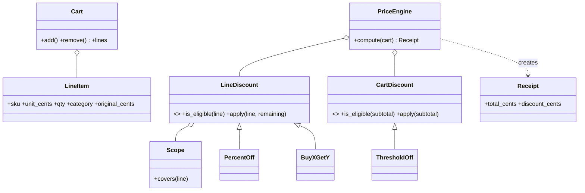

# 设计题解：购物车折扣引擎（Checkout Price Engine）

## 题目与澄清

> 一位 Amazon VO 一轮 OOD 的候选人（一亩三分地，2026-10-02）记下的要求：「抽象一个 Discount 基类，isEligible 判断商品是否适用该折扣，apply 返回折扣金额。」 https://www.1point3acres.com/bbs/thread-1191754-1-1.html
>
同一份报告还转述了主流程：PriceEngine 拿到购物车后遍历每一行，对每行依次检查所有折扣、累加减免再从原价里扣；BUY_X_GET_Y 的特殊在于它不直接减钱，而是用赠品数量乘以单价折成减免。

> 另一位候选人（2026-09-23，同站）：「店面 OOD：模拟购物车」。 https://www.1point3acres.com/bbs/thread-1190571-1-1.html

另有一条欧洲区的报告（2026-09）提到购物车价格计算器 API，追问包括全场折扣、满额翻倍、买三送一、热销商品折扣。

以上是可见报告里的全部原话。**下面哪些部分是 (reconstructed)**：报告只点名了 BUY_X_GET_Y 和“三种折扣”，所以我们补的另外两种——百分比折扣、满减（满 X 减 Y）——以及“折扣的叠加顺序”“同时有多个折扣时是叠加还是只取最大”，都是推断。

先用两句话说清这个系统是干什么的：**顾客把若干商品放进购物车，商家有一批促销规则；折扣引擎读购物车和规则，算出每件商品实际该付多少钱，并列出每一笔减免的来源。** 它没有数据库、没有支付，核心是一个函数：购物车 + 规则 → 账单。

开场的三个澄清问题，和每个答案会改变什么：

1. **“同一件商品能同时享受多个折扣吗？先算哪个？”** 答“能叠加”，则折扣之间有先后，后一个看到的是前一个减完后的价格，需要决定顺序的语义；答“只取最划算的一个”，则引擎要多一条“选最大”的策略。我们两种都支持，用一个枚举参数切换（决策三）。
2. **“折扣只看单件商品，还是也有看整个购物车的（比如满 100 减 10）？”** 答案决定折扣要不要分成两层。报告里的“遍历每一行、逐个检查所有折扣”只适合行级折扣；满减的门槛依赖整车金额，不能塞进“每行一次”的循环里（决策二）。
3. **“钱用什么表示？有没有多币种？”** 答“美元，两位小数”，我们用整数分，全程不出现浮点数；多币种不在范围内。

此外三件明确不做的事：税费和运费、优惠券码的发放与核销（用户账户相关）、库存扣减。它们都发生在“算价格”之前或之后，不改变这个引擎的形状。

## 需求与分级

机器编码轮会一关一关地加需求。这道题通常这样展开：

- **第 1 关：算出总价。** 购物车里有若干行（SKU、单价、数量）；先不打折，`compute` 返回原价合计。然后加第一种折扣——百分比折扣（`PercentOff`，如 10% off），并且只对指定商品或品类生效。这一关为 `LineItem`、`Cart`、`LineDiscount` 基类与 `PriceEngine` 的主循环而存在。**报告里的“主流程”就是这一关**：遍历每行 → 对每个折扣问 `is_eligible` → 把 `apply` 返回的金额累加 → 从原价里扣。
- **第 2 关：买 X 送 Y 与满减。** `BuyXGetY` 是第二个行级折扣：它不直接给出一个金额，而是先算“送了几件”，再折成钱。满减（`ThresholdOff`）需要整车金额，所以引入第二层 `CartDiscount`。这一关为“行级和购物车级是两种东西”而存在。
- **第 3 关：叠加规则。** 两个折扣同时命中同一行时怎么办？顺序、钳位（折扣永远不能把价格减成负数）、“只取最大”。这一关为 `Stacking` 枚举和 `_bounded` 而存在（推断：报告没有明说，但“依次检查所有 discount、accumulate”必然会遇到这个问题）。
- **第 4 关：账单可解释与并发。** 返回的不只是一个数字，而是一张 `Receipt`：每一笔减免带标签；购物车被多线程同时修改、引擎被多线程共享时不出错。这一关为不可变的 `Receipt` 和 `Cart` 里的锁而存在（推断）。

## 核心对象与职责

**一句话地图：** 购物车是数据，折扣是规则，引擎是把两者按顺序拼起来的流水线，账单是流水线的产物。

- `LineItem`：一行商品（SKU、单价、数量、品类），不可变值对象（[[oop.values|值对象与不可变性（Value Objects）]]）。它拥有的不变量是“数量为正、单价非负”，构造时就拒绝坏数据。
- `Cart`：可变的容器，同一个 SKU 只占一行（再次加入时数量合并，价格不同则报错）。它拥有“合并”这个不变量，对外只吐出快照 `lines`（元组），不暴露内部字典。
- `Scope`：折扣适用于哪些行（按 SKU 集合、按品类，或全场）。“全场折扣”和“热销商品折扣”只是 `Scope` 的不同取值，不是不同的类。
- `LineDiscount`（抽象基类）：两个方法——`is_eligible(line)` 回答“这行能不能用”，`apply(line, remaining_cents)` 回答“在剩余价格上减多少”。具体子类 `PercentOff`、`BuyXGetY` 各自拥有自己的舍入规则。
- `CartDiscount`（抽象基类）与 `ThresholdOff`：只看折后总额，回答“满足门槛吗、减多少”。
- `PriceEngine`：持有规则（不可变元组）和叠加策略，`compute(cart)` 是纯函数。它的职责只有：遍历、钳位、记账。它不认识任何具体折扣类。
- `Adjustment` / `LineResult` / `Receipt`：不可变的账单。`Receipt.total_cents` 永远等于“原价合计 − 全部减免”，这是整个设计最重要的可检验的不变量。



关系上，`PriceEngine` 持有折扣但不拥有它们的生命周期（折扣可以被多个引擎共用，聚合），`Cart` 拥有它的 `LineItem`（组合）。一个重要的“没有”：折扣不持有购物车，也不修改购物车；引擎读购物车的快照，算完就丢。

## 关键设计决策

### 决策一：钱用什么表示——整数分，不用浮点数

问题：价格要相加、乘数量、按比例打折。**选项 A：`float`。** 写起来最顺手，但 `0.1 + 0.2` 在 Python 里等于 `0.30000000000000004`，`19.99 * 100` 是 `1998.9999999999998`，`int(19.99 * 100)` 得到 `1998`——少了一分钱。每次相加都累积误差，对账时永远差几分。**选项 B：`decimal.Decimal`。** 十进制精确，但每一步都要想舍入模式，且对象比整数重。**选项 C：整数分。** 加法精确，比较精确，没有舍入问题，直到你需要“按比例”——这时才需要舍入。

选择：**金额存整数分，比例存整数基点（万分之一），只有一个舍入点**：每条折扣在自己的 `apply` 里用整数运算 `(2*分子 + 分母) // (2*分母)` 做一次半进位除法。例：199 分打 8.5% 折，`199 × 850 / 10000 = 16.915`，半进位得 17 分；105 分得 8.925，进位得 9 分。字符串 "19.99" 经 `Decimal` 精确转成 1999 分，永远不经过 `float`。

是哪种模式？不是模式，是值对象的纪律。同时我们**拒绝**了一个 `Money` 类：本题单一币种，一个只包着 `int` 的类会让每个折扣都多一层拆装箱；多币种的追问来了再引入，改动局限在 `LineItem` 和 `Adjustment` 上。

### 决策二：折扣是“按行”还是“按整车”——BUY_X_GET_Y 住在哪一层

问题：报告里的主流程是“遍历每行，对每个折扣检查适用性并 `apply`”。如果所有折扣都是 `apply(line)`，那“满 100 减 10”怎么办？它的门槛是整车金额。**选项 A：一个统一的 `Discount.apply(cart, line)`**，让所有折扣都能看到整车。灵活，但每个折扣都要自己决定“我是对每行执行一次还是对整车执行一次”，引擎无法在不理解折扣的情况下保证钳位和记账——一个满减被每行各执行一次就多减了钱。**选项 B：两层接口。** `LineDiscount` 只看一行，`CartDiscount` 只看折后总额。引擎先逐行处理行级折扣，再对折后小计处理购物车级折扣。

选择：B。判据是**折扣依赖的数据范围**：只依赖一行（百分比、买 X 送 Y）的放在行级；依赖整车的放在购物车级。买 X 送 Y 放在行级的理由是——在报告的描述里它按“赠品数量 × 单价”算，只需要这一行的数量和单价。如果面试官追问“买 A 送 B”（跨商品赠品），它就必须上升到购物车级，这是预期的扩展点，见后面的追问。

购物车级折扣的门槛按**折后小计**判断（推断：与 Amazon 优惠券“满 X”的常见口径一致）：原价 120 的商品先打八折得 96，不满 100，满减不触发；原价 130 打八折得 104，触发，再减 10 得 94。如果面试官要求按原价判断，改的是 `PriceEngine.compute` 里传给 `is_eligible` 的那个数，一行。

### 决策三：多个折扣同时命中时——叠加还是只取最大，用枚举而不是第二个引擎

问题：一行商品同时命中“九折”和“买 2 送 1”。**选项 A：全部叠加**，按列表顺序，后一个看到前一个减完后的剩余价格；**选项 B：只取减免最大的一个**。真实的促销系统两种都有（“不可与其他优惠同享”就是 B）。

选择：引擎的构造参数 `stacking: Stacking`，默认 `STACK`，可选 `BEST_ONLY`。叠加时折扣的顺序是规则列表的顺序，这是显式约定而不是巧合：`PercentOff("八折") → BuyXGetY(买2送1)` 在 1000 分 × 3 件上，先减 600，剩 2400，送出的那一件按剩余价格的 1/3 折算，减 800，总价 1600。反过来先送后折，是 1000 + 400，总价同样 1600——**这个例子里总价与顺序无关，但每条减免的金额与标签不同，账单展示给顾客的内容不同**，所以顺序仍然要定死并写进文档。`BuyXGetY.apply` 用“剩余价格 × 送出件数 // 总数量”而不是“单价 × 送出件数”，原因就是前面已有折扣时，送出的那一件不该再按原价抵扣，否则总减免会超过实际价格。

为什么不为 `BEST_ONLY` 写 `BestOnlyEngine` 子类？两种策略共享 90% 的流程，差别只是“把候选列表筛成一个”那一行。这里**拒绝了继承和策略模式**：一个枚举加一个 `if` 比一个新类轻得多；等到出现第三种叠加语义（比如“互斥分组”）再抽成策略对象。

### 决策四：折扣的“是否适用”和“减多少”分成两个方法，还是合成一个

问题：`apply` 返回 0 不就等于不适用吗？**选项 A：只有一个 `apply`，不适用就返回 0。** 少一个方法，但“不适用”和“适用但算出 0”分不开：账单上会出现一堆 0 元的减免行，`BEST_ONLY` 也无法区分“没资格”和“资格有但没省钱”。**选项 B：保留报告里的 `is_eligible` + `apply` 两个方法。** 适用性是便宜的布尔判断（品类、数量门槛），金额可能涉及舍入与除法；分开之后引擎可以先过滤、再计算，账单只记录真的发生了的减免。选 B，这是这道题里“照面试官给的词来设计”的地方，不要自作聪明合并。

### 决策五：折扣用类还是用函数

一个折扣只有一个行为方法，按 Python 的习惯似乎该用函数。但这里折扣**带状态**（百分比的基点、买几送几、作用范围、标签），并且有两个方法（`is_eligible`、`apply`）。有状态且多方法，就用类；如果只剩一个无状态的计算，`Callable[[LineItem, int], int]` 就够。**这是一个“拒绝模式”的决策**：我们没有写 `DiscountFactory`、`DiscountRegistry`——折扣就是普通对象，由调用方构造后传给引擎。需要从配置加载折扣时，写一个 20 行的 `dict[str, type]` 解析函数，而不是工厂类层次。

## 代码走读

%% code:begin solution.py %%
```python
"""购物车折扣引擎（Checkout Price Engine）：购物车 + 一组可插拔折扣 → 一张可审计的账单。

设计五行：
1. 钱一律是整数分（`int`），比例用整数基点（万分之一）；舍入只发生在每条折扣自己的 `apply` 里，一次、半进位。
2. 折扣分两层：`LineDiscount` 只看一行（百分比、买 X 送 Y），`CartDiscount` 只看折后总额（满减）。
3. 引擎 `PriceEngine` 只做三件事：按顺序遍历、把每笔减免钳在剩余价格以内、记账；它不认识任何具体折扣。
4. 结果 `Receipt` 带解释：每笔减免都有标签和金额，原价 - 全部减免 = 应付，永不为负。
5. 叠加策略是引擎的一个枚举参数（全叠加 / 每行只取最大一条），不是第二个引擎类。
"""

from __future__ import annotations

from abc import ABC, abstractmethod
from collections.abc import Sequence
from dataclasses import dataclass
from decimal import ROUND_HALF_UP, Decimal
from enum import Enum
from threading import Lock


class PricingError(Exception):
    """本模块所有可预期失败的基类。"""


class InvalidCartError(PricingError):
    """购物车内容不合法：数量非正、同一 SKU 价格冲突。"""


class InvalidRuleError(PricingError):
    """折扣配置不合法，或某条折扣算出了负数（会凭空造钱）。"""


def to_cents(text: str) -> int:
    """把 "19.99" 这样的十进制字符串精确转成分；绝不经过 float。"""
    return int((Decimal(text) * 100).quantize(Decimal(1), rounding=ROUND_HALF_UP))


def format_cents(cents: int) -> str:
    sign = "-" if cents < 0 else ""
    return f"{sign}{abs(cents) // 100}.{abs(cents) % 100:02d}"


def _div_half_up(numerator: int, denominator: int) -> int:
    """非负整数的四舍五入除法，纯整数运算。"""
    return (2 * numerator + denominator) // (2 * denominator)


# ───────────────────────────── 购物车 ─────────────────────────────

@dataclass(frozen=True, slots=True)
class LineItem:
    """一行商品：同一个 SKU 一行，数量合并。不可变，所以可以放心交给折扣去读。"""
    sku: str
    unit_cents: int
    qty: int
    category: str = ""

    def __post_init__(self) -> None:
        if self.qty <= 0 or self.unit_cents < 0:
            raise InvalidCartError(f"{self.sku}: 数量必须为正、单价不能为负")

    @property
    def original_cents(self) -> int:
        return self.unit_cents * self.qty


class Cart:
    """购物车：可变，但对外只给快照。"""

    def __init__(self) -> None:
        self._lines: dict[str, LineItem] = {}
        self._lock = Lock()

    def add(self, sku: str, unit_cents: int, qty: int = 1, category: str = "") -> None:
        with self._lock:
            old = self._lines.get(sku)
            if old is not None and old.unit_cents != unit_cents:
                raise InvalidCartError(f"{sku}: 同一 SKU 不能有两个单价")
            total = qty + (old.qty if old else 0)
            self._lines[sku] = LineItem(sku, unit_cents, total, category)

    def remove(self, sku: str) -> None:
        with self._lock:
            if self._lines.pop(sku, None) is None:
                raise InvalidCartError(f"{sku}: 不在购物车里")

    @property
    def lines(self) -> tuple[LineItem, ...]:
        with self._lock:
            return tuple(self._lines.values())


# ───────────────────────────── 折扣 ─────────────────────────────

@dataclass(frozen=True, slots=True)
class Scope:
    """折扣适用哪些行：None 表示不限；两个条件同时给出则都要满足。全场折扣就是默认的 Scope()。"""
    skus: frozenset[str] | None = None
    categories: frozenset[str] | None = None

    def covers(self, line: LineItem) -> bool:
        return ((self.skus is None or line.sku in self.skus)
                and (self.categories is None or line.category in self.categories))


class LineDiscount(ABC):
    """行级折扣：先问 `is_eligible`，再问 `apply` 减多少。`remaining_cents` 是前面折扣减完后这一行还剩的价格。"""

    def __init__(self, label: str, scope: Scope = Scope()) -> None:
        self.label = label
        self.scope = scope

    def is_eligible(self, line: LineItem) -> bool:
        return self.scope.covers(line)

    @abstractmethod
    def apply(self, line: LineItem, remaining_cents: int) -> int:
        """返回减免的分；不得为负，超过剩余价格的部分由引擎钳掉。"""


class PercentOff(LineDiscount):
    def __init__(self, label: str, percent: str, scope: Scope = Scope()) -> None:
        super().__init__(label, scope)
        value = Decimal(percent)
        if not 0 < value <= 100:
            raise InvalidRuleError(f"{label}: 百分比必须在 (0, 100]")
        self._bps = int(value * 100)             # 基点：万分之一，8.5% → 850

    def apply(self, line: LineItem, remaining_cents: int) -> int:
        return _div_half_up(remaining_cents * self._bps, 10_000)


class BuyXGetY(LineDiscount):
    """买 buy 送 free：每凑满 buy+free 件，其中 free 件免费。它不直接减钱，而是算出送了几件，再折成这一行的价。"""

    def __init__(self, label: str, buy: int, free: int, scope: Scope = Scope()) -> None:
        super().__init__(label, scope)
        if buy <= 0 or free <= 0:
            raise InvalidRuleError(f"{label}: buy 和 free 都必须为正")
        self.buy, self.free = buy, free

    def is_eligible(self, line: LineItem) -> bool:
        return super().is_eligible(line) and line.qty >= self.buy + self.free

    def apply(self, line: LineItem, remaining_cents: int) -> int:
        free_units = line.qty // (self.buy + self.free) * self.free
        # 按“剩余价格的份额”折算：前面已有折扣时，送出的那几件也是折后价，而不是原价
        return remaining_cents * free_units // line.qty


class CartDiscount(ABC):
    """购物车级折扣：只看行级折扣之后的总额。"""

    def __init__(self, label: str) -> None:
        self.label = label

    @abstractmethod
    def is_eligible(self, subtotal_cents: int) -> bool: ...

    @abstractmethod
    def apply(self, subtotal_cents: int) -> int: ...


class ThresholdOff(CartDiscount):
    """满 threshold 减 off：门槛按折后小计判断（推断：与 Amazon 优惠券“满 X”的常见口径一致）。"""

    def __init__(self, label: str, threshold_cents: int, off_cents: int) -> None:
        super().__init__(label)
        if threshold_cents <= 0 or off_cents <= 0:
            raise InvalidRuleError(f"{label}: 门槛和减免都必须为正")
        self.threshold_cents, self.off_cents = threshold_cents, off_cents

    def is_eligible(self, subtotal_cents: int) -> bool:
        return subtotal_cents >= self.threshold_cents

    def apply(self, subtotal_cents: int) -> int:
        return self.off_cents


# ───────────────────────────── 账单与引擎 ─────────────────────────────

@dataclass(frozen=True, slots=True)
class Adjustment:
    label: str
    cents: int                                    # 正数 = 减免的金额


@dataclass(frozen=True, slots=True)
class LineResult:
    line: LineItem
    adjustments: tuple[Adjustment, ...]

    @property
    def final_cents(self) -> int:
        return self.line.original_cents - sum(a.cents for a in self.adjustments)


@dataclass(frozen=True, slots=True)
class Receipt:
    lines: tuple[LineResult, ...]
    cart_adjustments: tuple[Adjustment, ...]

    @property
    def subtotal_cents(self) -> int:
        return sum(r.line.original_cents for r in self.lines)

    @property
    def discount_cents(self) -> int:
        return (sum(a.cents for r in self.lines for a in r.adjustments)
                + sum(a.cents for a in self.cart_adjustments))

    @property
    def total_cents(self) -> int:
        return self.subtotal_cents - self.discount_cents


class Stacking(Enum):
    STACK = "stack"                               # 所有适用折扣按顺序叠加
    BEST_ONLY = "best_only"                       # 每行（和购物车级）只取减免最大的一条


class PriceEngine:
    """不可变的规则集 + 纯函数 `compute`：同一个购物车算多少次都得到同一张账单，可以被多线程共享。"""

    def __init__(self, line_discounts: Sequence[LineDiscount] = (),
                 cart_discounts: Sequence[CartDiscount] = (),
                 stacking: Stacking = Stacking.STACK) -> None:
        self._line_discounts = tuple(line_discounts)
        self._cart_discounts = tuple(cart_discounts)
        self._stacking = stacking

    @staticmethod
    def _bounded(amount: int, remaining: int, label: str) -> int:
        if amount < 0:
            raise InvalidRuleError(f"{label}: 折扣算出了负数 {amount}，会让总价变高")
        return min(amount, remaining)             # 折扣永远不会把价格减到负数

    def _price_line(self, line: LineItem) -> LineResult:
        original = line.original_cents
        eligible = [d for d in self._line_discounts if d.is_eligible(line)]
        if self._stacking is Stacking.BEST_ONLY and eligible:
            eligible = [max(eligible, key=lambda d: self._bounded(d.apply(line, original), original, d.label))]
        remaining, adjustments = original, []
        for discount in eligible:                 # 叠加时后一条看到的是前一条减完后的剩余价格
            amount = self._bounded(discount.apply(line, remaining), remaining, discount.label)
            if amount > 0:
                adjustments.append(Adjustment(discount.label, amount))
                remaining -= amount
        return LineResult(line, tuple(adjustments))

    def compute(self, cart: Cart) -> Receipt:
        results = tuple(self._price_line(line) for line in cart.lines)
        subtotal = sum(r.final_cents for r in results)
        eligible = [d for d in self._cart_discounts if d.is_eligible(subtotal)]
        if self._stacking is Stacking.BEST_ONLY and eligible:
            eligible = [max(eligible, key=lambda d: self._bounded(d.apply(subtotal), subtotal, d.label))]
        remaining, cart_adjustments = subtotal, []
        for discount in eligible:
            if not discount.is_eligible(remaining):
                continue                          # 前一条把小计压到门槛以下，这一条就不再适用
            amount = self._bounded(discount.apply(remaining), remaining, discount.label)
            if amount > 0:
                cart_adjustments.append(Adjustment(discount.label, amount))
                remaining -= amount
        return Receipt(results, tuple(cart_adjustments))


if __name__ == "__main__":
    cart = Cart()
    cart.add("pen", to_cents("2.50"), 6, "stationery")
    cart.add("book", to_cents("30.00"), 2, "books")
    engine = PriceEngine(
        [BuyXGetY("买2送1", 2, 1, Scope(frozenset({"pen"}))), PercentOff("图书九折", "10", Scope(categories=frozenset({"books"})))],
        [ThresholdOff("满60减5", to_cents("60"), to_cents("5"))],
    )
    receipt = engine.compute(cart)
    print(format_cents(receipt.subtotal_cents), "->", format_cents(receipt.total_cents))
```
%% code:end %%

看四个位置：

1. **`PriceEngine._price_line`**：这就是报告里的“主流程”。`eligible` 先筛，再逐个 `apply`；每次 `apply` 拿到的是 `remaining`（前面减完后的剩余价格），算出的金额经 `_bounded` 钳到剩余价格以内，再进入账单。`BEST_ONLY` 的实现就是在循环前把 `eligible` 换成只含最大那一条的列表。
2. **`_bounded`**：同时承担两件事。负数直接抛 `InvalidRuleError`——一条写坏的折扣不能凭空让总价变高，这是**安全不变量**，所以是异常而不是 `assert`（`python -O` 会剥掉 `assert`）；超过剩余价格则钳到剩余价格，总价最少为 0。
3. **`BuyXGetY.apply`**：`line.qty // (buy + free) * free` 是送出的件数；7 支笔、买 2 送 1，每 3 支送 1 支，`7 // 3 = 2` 支免费。再折成钱。`is_eligible` 要求数量至少 `buy + free`，所以只买 2 支不会触发。
4. **`PriceEngine.compute` 的购物车层**：先把所有行算完，得到折后小计，再用小计问每个 `CartDiscount`。叠加时每减一次都重新问一遍 `is_eligible`——前一条满减把小计压到门槛以下，后一条就不再适用。

## 测试与自检

测试固定的是行为：

- **账单自洽**（性质测试，种子固定，60 个种子 × 两种叠加策略，共 120 张随机购物车）：`0 ≤ total ≤ subtotal`，`subtotal − discount = total`，每行 `final ≥ 0`，每笔减免为正。这条不变量让我们敢于相信其他所有细节。
- **舍入点唯一**：199 分 × 8.5% = 17，105 分 × 8.5% = 9，测试里直接写出手算值。
- **叠加顺序**：两个九折叠在 10000 分上，减免是 `[1000, 900]`，不是 `[1000, 1000]`。
- **钳位与失败路径**：全免之后再九折不会得到负数；写坏的折扣返回 −100 抛 `InvalidRuleError`；数量为 0、同 SKU 两个价格、百分比为 0 或 120，全部抛出对应异常。
- **新折扣只加一个类**：测试里现场定义“每件减 1 元”的子类，引擎没有任何改动。
- **并发**：8 个线程、屏障对齐，各自 200 次 `add` 加 `compute`，最后数量恰好 1600——不丢更新；`compute` 在 `Cart.lines` 快照上工作，所以不会读到半个修改。

两分钟演示：构造 6 支 2.50 元的笔和 2 本 30 元的书，规则是“笔买 2 送 1”“图书九折”“满 60 减 5”。笔 15.00 − 5.00 = 10.00，书 60.00 − 6.00 = 54.00，小计 64.00 ≥ 60，再减 5.00，应付 59.00，原价 75.00。把这张账单读给面试官听。

## 扩展与追问

**新需求**

- *全场折扣 / 热销商品折扣：* 只是 `Scope` 的取值不同（`Scope()` 与 `Scope(skus=frozenset({...}))`），无需新类。
- *满额翻倍（超过 100 欧元折扣翻倍）：* 加一个 `CartDiscount` 子类，或者构造两条 `ThresholdOff`（门槛 100，减 X；门槛 200，减 2X）并用 `BEST_ONLY`。`PriceEngine` 不动。
- *买 A 送 B（跨商品赠品）：* 这是 `BuyXGetY` 的真正边界——它必须看两行。新写一个 `CartDiscount` 子类，在购物车级读两行的数量；行级接口不动。
- *每件减 1 元、限购 N 件：* 一个新的 `LineDiscount` 子类，`Scope`、引擎、账单都不变。
- *优惠券：* 优惠券码是“用户给出的开关”，做成一个 `Scope` 之外的资格条件：折扣构造时带上 `required_code`，`is_eligible` 里检查（推断，非报告原话）。

**并发与线程安全**

`PriceEngine` 构造后只含元组，`compute` 是纯函数，可以被任意多个线程共享，不需要锁。`Cart` 内部有一把 `threading.Lock`，保护“合并数量”这个读-改-写；`lines` 在锁内复制成元组。诚实地说：GIL 保证单个字节码原子，但 `dict.get` 再 `dict.__setitem__` 之间可以被切换线程，所以合并数量必须加锁。更严格的做法（结算时对价格“冻结”）是在 `compute` 之前取一次快照，之后只用快照。

**持久化与规模**

规则很多（上千条）时，每行遍历全部折扣是 O(行数 × 规则数)。可以按 `Scope` 建倒排索引：SKU → 折扣列表、品类 → 折扣列表，另加一个全场列表，查询时只合并三份。`Scope` 已经把“适用于谁”变成数据，这就是这么做的前提。规则存数据库时，折扣对象序列化成 `{type, label, params}`，用一个 `dict[str, type]` 反序列化。

## 常见错误

- **用 `float` 存钱。** 例：`int(19.99 * 100)` 是 1998。修复：整数分，`Decimal` 做一次精确转换。
- **每个折扣都在原价上算。** 两个 10% 变成 20%，比业务口径多送钱；或者买 X 送 Y 按原价抵扣，叠加后总减免超过实际价格。修复：`apply` 吃“剩余价格”。
- **满减在每行里执行。** 三行商品，满减被扣三次。修复：购物车级折扣只在小计上执行一次。
- **没有钳位。** 100% 折扣再叠一个满减，总价变成负数，系统倒贴钱。修复：`_bounded` 钳到剩余价格。
- **每一步都舍入。** 先对每件商品舍入再乘数量，与先乘再舍入差几分钱。修复：舍入只在每条折扣的 `apply` 里发生一次，且发生在“行”这个粒度上，口径写进文档。
- **Java 习惯：** 写 `getPrice()`/`setPrice()`；写 `DiscountFactory`、`PriceEngineSingleton`；让 `Discount` 持有 `Cart` 并直接修改它。Python 里用属性、普通构造函数和显式传参。
- **折扣修改购物车。** `apply` 里改了 `line.qty` 作为“赠品”，下一次 `compute` 就算错。`LineItem` 是冻结的，就是为了让这种错误写不出来。

## 45 分钟怎么分配

- **0–5 分钟：澄清。** 问上面的三个问题；把答案写在白板上：整数分、叠加按列表顺序、门槛按折后小计。
- **5–10 分钟：对象与接口。** 画 `LineItem / Cart / LineDiscount / PriceEngine / Receipt`。大声说：“引擎不认识任何具体折扣。”
- **10–25 分钟：第 1 关。** 先写 `LineItem`、`Cart.add`，再写 `PercentOff` 和 `PriceEngine._price_line`，跑通“一件商品、一个九折”。写完先口算一个例子给面试官。
- **25–35 分钟：第 2、3 关。** 加 `BuyXGetY`（强调它先算送几件再折钱），再加 `CartDiscount` 与钳位。如果时间只够一个，先做钳位——它是正确性，满减是功能。
- **35–42 分钟：测试与演示。** 现场写三个断言：无折扣总价、叠加顺序、钳位。
- **42–45 分钟：说扩展。** 点名 `Scope`、`Stacking`、跨商品赠品要升到购物车级。
- **时间不够时先砍：** `Stacking.BEST_ONLY`、`Receipt` 的标签、线程锁，保住 `is_eligible/apply` 主流程和整数分。

## 来源与延伸

- 一亩三分地 1191754（2026-10-02，Amazon VO 一轮 OOD）：https://www.1point3acres.com/bbs/thread-1191754-1-1.html ——本题的 `isEligible` / `apply` / BUY_X_GET_Y 描述来自这里。本文与它的差别：报告的遍历是“每行 × 每个折扣”，我们把整车折扣拆成第二层，并且让 `apply` 接收剩余价格，避免叠加时多减。
- 一亩三分地 1190571（2026-09-23）：https://www.1point3acres.com/bbs/thread-1190571-1-1.html ——只有“模拟购物车”一句话，用来说明这类题在 Amazon 店面轮也会出现。
- Python 官方文档 `decimal`：https://docs.python.org/3/library/decimal.html ——精确的十进制算术与舍入模式；本文用它做“字符串 → 分”的单次转换，其余全部用整数。
- 题库里相邻的 [[solution-online-shopping]]：它讲完整的下单流程（库存、支付、订单状态）；本题把定价抽出来单独做深。
- 概念：[[patterns.strategy|策略模式与可替换算法（Strategy）]]、[[oop.values|值对象与不可变性（Value Objects）]]。
