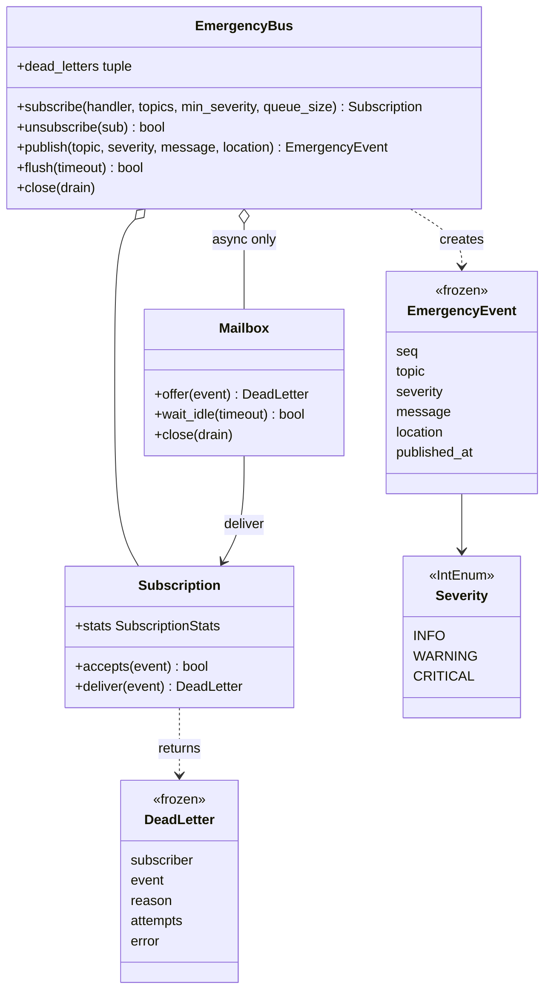

# 设计题解：应急事件发布订阅（Emergency Pub/Sub）

## 题目与澄清

你要设计一个应急响应系统里的发布订阅组件：一些组件订阅（监听）应急事件，另一些组件发布（通知）这些事件。请实现处理发布与订阅逻辑的类。一个硬要求是：**失败的订阅者不能阻塞其他订阅者**。事件类型与严重度、按类型过滤、重试与死信、异步信箱与优先级，是围绕「应急」这个场景自然长出来的追问，下面按关逐个展开。

先把词讲清楚：

- **发布订阅（publish / subscribe，简称 pub/sub）**：一方（发布者）把一件事广播出去，不关心谁在听；另一方（订阅者）事先登记「我想听这类事」，事发时被通知。两边互相不认识，只通过中间的「总线」（bus）打交道。
- **处理函数（handler）**：订阅者登记时给出的一个函数，事件来了就调用它。
- **死信（dead letter）**：一条事件没能送到某个订阅者（处理函数一直抛异常，或者信箱满了被挤掉）时留下的一条记录，方便事后排查，而不是悄悄吞掉。
- **背压（backpressure）**：下游处理不过来时，上游怎么办——等、丢、还是报错。

值得问的澄清问题，以及每个答案改变什么：

- **同步送，还是异步送？** 同步：`publish` 在发布线程里依次调用处理函数，实现最简单，但慢的订阅者会拖住发布者；异步：每个订阅者自带一个队列和一个线程，发布者只入队就返回。我们从同步起步，第 4 关加异步，同一个订阅类两种送法。
- **订阅者出错怎么办？** 这是最基本的要求：一个出错不能影响别人。答案决定了异常处理放在哪一层。
- **订阅者可以只听某些事件吗？** 应急场景几乎必然：消防队只要火灾，指挥中心只要最严重的。按事件类型（topic）和最低严重度过滤即可，通配符（`fire.*`）不做，[[solution-pub-sub]] 讲过。
- **紧急事件要不要优先送？** 只有排队存在时才有"先后"的问题，所以优先级只出现在异步信箱里。
- **要不要持久化、重放、跨进程？** 不要。这是一个进程内的组件。

**范围之外**：跨进程消息、消息持久化与重放、分布式一致性、精确一次（exactly-once）语义。这里给的是尽力而为（best-effort）的进程内投递，加上"至少尝试 N 次再进死信"。通用的主题日志、游标、重放，见 [[solution-pub-sub]]；这里不重新教它，只讲新增的：**失败隔离、严重度优先、慢订阅者**。

## 需求与分级

**第 1 关（约 20 分钟）**：`subscribe(handler)`、`unsubscribe(sub)`、`publish(topic, severity, message)`。事件是一个冻结的数据对象，带一个由总线分配的递增编号和发布时间（时钟注入）。同步送给所有订阅者。

**第 2 关（约 15 分钟，对应"失败不能阻塞其他订阅者"）**：订阅者可以按 topic 和最低严重度过滤；一个订阅者抛异常，其他订阅者必须照常收到；出错的订阅者可以配置重试次数，仍失败就记一条死信；死信列表有上限。这一关是整道题的分水岭。

**第 3 关（约 15 分钟）**：处理函数里可以再发布事件（"火灾"触发"疏散"）或者退订自己，不能死锁；`publish` 持锁的范围要想清楚。

**第 4 关（选做，对应"慢事件"）**：异步订阅者。每人一个有界信箱加一个工作线程，严重度高的先出队，同级先进先出，满了挤掉最不重要且最旧的一条并记死信；`flush` 等待送完，`close` 关闭总线。判分点：第 1 到 3 关的类一行不改，只是同一个订阅者多了一种送法。

每一关结束时问自己：这一关改了前面哪个类？理想答案是"没改，只新增"。

## 核心对象与职责

一句话说清这个系统：发布者调用 `publish` 把一条应急事件交给总线，总线按每个订阅者登记的条件挑出该收的人，再把事件交给他们的处理函数；某个人的处理函数出了错，只影响他自己，错误被记成一条死信。

| 类 | 唯一职责 | 它守住的不变量 |
|---|---|---|
| `EmergencyBus` | 注册表、给事件编号、路由、记死信 | `publish` 不持锁调用任何订阅者代码；路由用持锁时拍下的订阅快照 |
| `Subscription` | 一个订阅者的"怎么接"：过滤条件、重试次数、计数 | `deliver` 绝不让 `Exception` 逃出去，只返回 `None` 或一条死信 |
| `Mailbox` | 异步订阅者的"何时接"：有界优先队列加一个工作线程 | 队列长度不超过容量；出队顺序是严重度降序、同级编号升序 |
| `EmergencyEvent` | 发生了什么：冻结快照 | 不可变，所以可以同时交给任意多个订阅者 |
| `DeadLetter` | 一次没送到的记录：谁、哪条、为什么、试了几次 | 不可变 |
| `Severity` | 严重度：`INFO` < `WARNING` < `CRITICAL` | 是 `IntEnum`，可以直接比较 |

关系：`EmergencyBus` 持有注册表 `dict[Subscription, Mailbox | None]`——同步订阅者的值是 `None`，异步订阅者的值是它的信箱。信箱持有订阅者（它要调用 `deliver`）和一个"出了死信往哪报"的回调，**不持有总线**，所以依赖是单向的：总线 -> 信箱 -> 订阅者。



没有写成类的：**过滤器**。`topics` 和 `min_severity` 是 `Subscription` 的两个字段，`accepts` 是一个三行的方法；不需要 `Filter` 接口加 `TopicFilter`、`SeverityFilter`、`AndFilter` 的层级——只有一种过滤规则，模式不该先于第二种规则出现。

## 关键设计决策

### 决策一：失败隔离的边界放在 `Subscription.deliver` 一处

**问题**：最核心的需求：一个订阅者出错，其他订阅者照常收到。异常处理写在哪？

**选项 A：`publish` 的整个循环外包一层 `try`。** 第一个出错的订阅者之后的所有人都收不到。这是最常见的错误，也恰好是面试官设的陷阱。

**选项 B：循环体里逐个 `try/except`。** 正确，但同步路径、异步信箱的工作线程各要写一遍，重试与死信的逻辑也要写两遍，很快就不一致。

**选项 C：要求订阅者自己保证不抛异常。** 靠约定，一个 bug 就破坏全局；而应急系统恰恰是 bug 最不能蔓延的地方。

**选择 B 的改进版：把边界做成 `Subscription.deliver` 这一个方法。** 它最多尝试 `max_attempts` 次，任何 `Exception` 都被捕获，最终要么返回 `None`（送到了），要么返回一条 `DeadLetter`。同步路径在发布线程里调用它，异步路径在信箱线程里调用它，**边界只有一处**。具体例子：A、B、C 依次订阅火灾事件，B 总是抛 `ZeroDivisionError`，`max_attempts=2`；发布一条火灾事件后 A 和 C 各收到一次、`publish` 正常返回，死信列表里多一条 `DeadLetter(subscriber="B", reason=HANDLER_FAILED, attempts=2, error="ZeroDivisionError: …")`。

细节：只捕获 `Exception`，不捕获 `BaseException`。`KeyboardInterrupt` 和 `SystemExit` 是"进程该停了"的信号，吞掉它们会让进程停不下来；测试 `test_base_exceptions_are_not_swallowed` 钉住这一点。重试是**立即重试**，没有退避等待——等待要么阻塞发布者，要么需要定时器，都属于追问，在"扩展与追问"里讲。这也是观察者模式（Observer，见 [[patterns.observer|观察者与事件（Observer）]]）里最容易被忽略的一条：被观察者必须能抵御观察者的 bug。

### 决策二：慢订阅者——每人一个信箱，而不是共享队列

**问题**：同步送时，一个慢的订阅者（比如调用外部寻呼系统）会拖住发布者，也拖住排在它后面的订阅者。

**选项 A：线程池。** `publish` 把每个"事件乘订阅者"的投递任务丢进共享线程池。简单，但慢订阅者会占满池子里的线程，把别人的投递也饿死；而且同一个订阅者的两条事件可能被不同线程并行处理，顺序乱掉。

**选项 B：一个共享队列加一个分发线程。** 一个慢的就堵住整个队列，回到最初的问题。

**选项 C：每个异步订阅者自己的信箱和线程。** 慢的只堵自己的信箱；同一订阅者的事件由同一个线程按队列顺序处理，天然有序；线程数等于异步订阅者数，在"几十个订阅者"的规模下可以接受。

**选择 C。** 代价要说出来：订阅者很多（几千个）时线程太多，要改成事件循环（`asyncio`）或共享线程池按订阅者分区。`Mailbox` 的存在把"何时接"从 `Subscription` 里分了出来：`Subscription.deliver` 完全不知道自己是在发布线程里还是信箱线程里被调用，所以第 1 到 3 关的代码一行没改。

### 决策三：持锁只拍快照，处理函数在锁外调用

**问题**：处理函数是外部代码。它可能再调用 `bus.publish`（火灾触发疏散）、`bus.subscribe`、`bus.unsubscribe`（订阅者做完事退订自己）。

**选项 A：持有总线的锁遍历订阅者并调用处理函数。** 总线的锁是 `threading.Lock`，不可重入；处理函数里再 `publish` 就在同一线程上第二次拿锁，死锁。换成 `RLock` 能躲过死锁，却让一个慢的处理函数持着总线锁，整个总线停摆，其他线程的 `publish` 全部等待。

**选项 B：持锁只做三件事——编号、构造事件、拍订阅快照（一个列表），然后释放锁，在锁外逐个调用。** 并发的订阅、退订不会让这次发布看到半个列表；处理函数里可以随便再调总线。测试 `test_handler_may_publish_and_unsubscribe_reentrantly` 就是这个场景：订阅者 A 收到 `fire` 后发布 `evacuate`、并退订自己；排在 A 之后的订阅者 R 先收到 `evacuate`、后收到 `fire`，因为嵌套的发布先送完。

**选择 B。** 这条规则一般化为："不要在持锁时调用你不控制的代码"。代价：退订之后，已经拍下快照的那次发布仍然可能把事件送给刚退订的订阅者一次。要严格"退订即停止"需要订阅者自己带一个 `active` 标志；对应急通知，多收一次比漏收一次安全。

### 决策四：过滤用两个字段，拒绝过滤器类层级

**问题**：订阅者要按事件类型和最低严重度过滤。

**选项 A：规格模式（Specification）。** `Filter` 接口，`TopicFilter`、`SeverityFilter`、`AndFilter`、`OrFilter`，订阅者持有一个过滤器对象。表达力强，可以任意组合。

**选项 B：`Subscription` 上两个字段，`accepts` 一个方法。** `event.severity >= self._min_severity and (self._topics is None or event.topic in self._topics)`。`Severity` 是 `IntEnum`，"至少 WARNING"就是一个比较。

**选择 B，拒绝模式。** 需求里只有两种条件，且永远是"与"的关系；真有了第三种、需要"或"的时候，把 `accepts` 换成一个 `Callable[[EmergencyEvent], bool]` 就够了，不必先搭好一个类层级等它来。这是"更简单的答案才对"的地方。另一个相关选择：事件类型用字符串而不是枚举，新增一种应急类型不需要改任何类；代价是拼写错误不会被发现，可以在发布者一侧另外做一份常量。

### 决策五：信箱满了——挤掉最不重要且最旧的一条

**问题**：异步订阅者处理得比事件到达慢，信箱如果无界，内存会无限增长；有界则满了必须处理。

**选项 A：阻塞发布者。** 一条一条都不丢，但一个慢订阅者能把所有发布者卡住，应急系统里最不能接受的就是"报警发不出去"。

**选项 B：拒绝新事件。** 满了就让新来的失败，对紧急事件最糟：最新、最紧急的反而被丢。

**选项 C：按严重度挤掉最不重要的。** 在信箱里的事件和新来的这一条里，丢掉严重度最低的；同级丢最旧的（旧的信息更可能已经过时）。丢掉的每一条都记一条 `QUEUE_FULL` 死信，不是悄悄消失。具体例子（容量 2）：信箱里是 `i1`（INFO）、`w1`（WARNING），来了 `c1`（CRITICAL）：挤掉 `i1`；再来一条 `i2`（INFO）：它比信箱里任何一条都不重要，被直接丢掉。

**选择 C。** 副作用要说清：`CRITICAL` 只会在信箱里全是 `CRITICAL` 时才被更晚到的 `CRITICAL` 挤掉，可以靠加大信箱容量避免；实现上挤掉需要在堆上找最小重要性的元素，是一次 O(n) 扫描加 `heapify`，n 不超过信箱容量，只发生在已经满了的路径上，应急场景下可以接受。

### 决策六：同级先进先出，靠堆里的序号

信箱出队顺序由小根堆（heap）决定，元素是 `(-severity, seq, event)`：严重度取负号让大的先出；严重度相同时比较编号 `seq`，小的（先发布的）先出。序号还有第二个作用：两个元素前两项相同时，堆会去比较第三项 `event`，而事件没有定义大小比较，会抛 `TypeError`；有了唯一的 `seq`，永远不会比较到事件本身（Python 标准库文档的优先队列说明里也是这么建议的）。具体例子：信箱里依次排着 `i1, c1, w1, c2, i2`，出队顺序是 `c1, c2, w1, i1, i2`。

## 代码走读

%% code:begin solution.py %%
```python
"""应急事件发布订阅：组件订阅应急事件，另一些组件发布；一个订阅者出事不能拖累其他人。
设计：`EmergencyBus` 只管注册表与路由（谁订了什么、给事件编号、记死信）；`Subscription` 拥有"我怎么接收"
——过滤条件、重试次数、计数，一次 `deliver` 把重试和失败都吞在自己里面；`Mailbox` 只在异步订阅者身上出现，
拥有"我什么时候接收"——一条有界优先队列加一个工作线程，严重度高的先出队，慢订阅者只堵自己的信箱。
同步与异步是同一个 `Subscription` 的两种送法，发布路径一行没变；通用的主题日志 / 游标见 [[solution-pub-sub]]。
"""

from __future__ import annotations

import heapq
import threading
from collections import deque
from collections.abc import Callable, Collection
from dataclasses import dataclass
from datetime import datetime, timezone
from enum import Enum, IntEnum

Clock = Callable[[], datetime]


def utc_now() -> datetime:
    """默认时钟，带时区；测试里换成固定时钟。"""
    return datetime.now(timezone.utc)


class EmergencyError(Exception):
    """本组件所有失败的共同基类。"""


class BusClosedError(EmergencyError):
    """总线关闭之后再发布或订阅。"""


class Severity(IntEnum):
    """严重度。用 IntEnum 是因为"至少 WARNING"要能直接比较，这也是优先队列的排序依据。"""

    INFO = 1
    WARNING = 2
    CRITICAL = 3


@dataclass(frozen=True, slots=True)
class EmergencyEvent:
    """发生了什么：冻结的快照，可以同时交给任意多个订阅者、跨线程传递而不加锁。`seq` 由总线编号。"""

    seq: int
    topic: str
    severity: Severity
    message: str
    location: str
    published_at: datetime


Handler = Callable[[EmergencyEvent], None]


class DeadReason(Enum):
    HANDLER_FAILED = "handler_failed"   # 重试用完仍然抛异常
    QUEUE_FULL = "queue_full"           # 异步信箱满了，这条事件被挤掉


@dataclass(frozen=True, slots=True)
class DeadLetter:
    """一次没送到的记录：谁、哪条事件、为什么。运维靠它回看，而不是靠订阅者自己吞掉异常。"""

    subscriber: str
    event: EmergencyEvent
    reason: DeadReason
    attempts: int
    error: str = ""


@dataclass(frozen=True, slots=True)
class SubscriptionStats:
    delivered: int = 0
    failed: int = 0
    dropped: int = 0


class Subscription:
    """一个订阅者：处理函数 + 过滤条件 + 重试次数 + 计数。

    它拥有"一次投递"的全部语义：`deliver` 最多尝试 `max_attempts` 次，任何 `Exception` 都被吞下并
    换成一条 DeadLetter 返回——调用方（发布线程或信箱线程）因此永远不会被订阅者的 bug 打断。
    """

    def __init__(self, name: str, handler: Handler, topics: Collection[str] | None,
                 min_severity: Severity, max_attempts: int) -> None:
        self.name = name
        self._handler = handler
        self._topics = None if topics is None else frozenset(topics)
        self._min_severity = min_severity
        self._max_attempts = max_attempts
        self._delivered = self._failed = self._dropped = 0
        self._lock = threading.Lock()

    def accepts(self, event: EmergencyEvent) -> bool:
        """主题在订阅列表里（None 表示全部），且严重度不低于下限。"""
        return event.severity >= self._min_severity and (self._topics is None or event.topic in self._topics)

    @property
    def stats(self) -> SubscriptionStats:
        with self._lock:
            return SubscriptionStats(self._delivered, self._failed, self._dropped)

    def deliver(self, event: EmergencyEvent) -> DeadLetter | None:
        error = ""
        for _ in range(self._max_attempts):
            try:
                self._handler(event)
            except Exception as exc:          # 订阅者的任何异常都不许逃出去；BaseException 仍然放行
                error = f"{type(exc).__name__}: {exc}"
                continue
            with self._lock:
                self._delivered += 1
            return None
        with self._lock:
            self._failed += 1
        return DeadLetter(self.name, event, DeadReason.HANDLER_FAILED, self._max_attempts, error)

    def note_dropped(self, event: EmergencyEvent) -> DeadLetter:
        with self._lock:
            self._dropped += 1
        return DeadLetter(self.name, event, DeadReason.QUEUE_FULL, 0)


class Mailbox:
    """异步订阅者的信箱：有界优先队列 + 一个工作线程。

    出队顺序是 (严重度高者优先, 先发布者优先)。满了就挤掉"最不重要且最旧"的那条——可能是新来的
    那条自己；所以 CRITICAL 只会被更晚到的 CRITICAL 挤掉，且只有信箱里全是 CRITICAL 时才会发生。
    `pending` = 排队中 + 正在处理的 1 条，`wait_idle` 靠它回答"现在送完了吗"。
    """

    def __init__(self, sub: Subscription, capacity: int, on_dead: Callable[[DeadLetter], None]) -> None:
        self._sub = sub
        self._capacity = capacity
        self._on_dead = on_dead
        self._heap: list[tuple[int, int, EmergencyEvent]] = []   # (-severity, seq, event)
        self._in_flight = 0
        self._closed = False
        self._cond = threading.Condition()
        self._thread = threading.Thread(target=self._run, name=f"mailbox-{sub.name}", daemon=True)
        self._thread.start()

    @property
    def pending(self) -> int:
        with self._cond:
            return len(self._heap) + self._in_flight

    def offer(self, event: EmergencyEvent) -> DeadLetter | None:
        """入队；信箱已满时返回被挤掉那条事件的 DeadLetter。"""
        with self._cond:
            if self._closed:
                return None
            dead: DeadLetter | None = None
            if len(self._heap) >= self._capacity:
                worst = max(self._heap, key=lambda item: (item[0], -item[1]))
                if (worst[0], -worst[1]) < (-event.severity, -event.seq):
                    return self._sub.note_dropped(event)         # 新来的就是最不重要的
                self._heap.remove(worst)
                heapq.heapify(self._heap)
                dead = self._sub.note_dropped(worst[2])
            heapq.heappush(self._heap, (-event.severity, event.seq, event))
            self._cond.notify_all()
            return dead

    def _run(self) -> None:
        while True:
            with self._cond:
                while not self._heap and not self._closed:
                    self._cond.wait()
                if not self._heap:
                    return
                _, _, event = heapq.heappop(self._heap)
                self._in_flight = 1
            dead = self._sub.deliver(event)                      # 在锁外：慢处理不挡 offer
            if dead is not None:
                self._on_dead(dead)
            with self._cond:
                self._in_flight = 0
                self._cond.notify_all()

    def wait_idle(self, timeout: float) -> bool:
        with self._cond:
            return self._cond.wait_for(lambda: not self._heap and not self._in_flight, timeout)

    def close(self, drain: bool) -> None:
        with self._cond:
            self._closed = True
            if not drain:
                self._heap.clear()
            self._cond.notify_all()
        if drain and threading.current_thread() is not self._thread:
            self._thread.join(timeout=5)         # 只有"送完再关"才值得等；丢弃式关闭立即返回


class EmergencyBus:
    """总线：注册表、事件编号、路由、死信。它不知道处理函数做什么，也不关心送得多快。

    不变量：`publish` 不持锁调用任何订阅者代码（处理函数可以在里面再发布、订阅或退订而不死锁）；
    路由用的是持锁时拍下的订阅快照，所以并发订阅 / 退订不会让一次发布看到半个列表。
    """

    def __init__(self, clock: Clock = utc_now, dead_letter_limit: int = 1000) -> None:
        self._clock = clock
        self._subs: dict[Subscription, Mailbox | None] = {}
        self._dead: deque[DeadLetter] = deque(maxlen=dead_letter_limit)
        self._seq = 0
        self._counter = 0
        self._closed = False
        self._lock = threading.Lock()

    def subscribe(self, handler: Handler, *, topics: Collection[str] | None = None,
                  min_severity: Severity = Severity.INFO, name: str | None = None,
                  max_attempts: int = 1, queue_size: int | None = None) -> Subscription:
        """订阅。`queue_size` 给了就是异步订阅者（自带信箱和线程），不给就在发布线程里同步送。"""
        if max_attempts < 1 or (queue_size is not None and queue_size < 1):
            raise ValueError("max_attempts and queue_size must be at least 1")
        with self._lock:
            if self._closed:
                raise BusClosedError("bus is closed")
            self._counter += 1
            sub = Subscription(name or f"sub-{self._counter}", handler, topics, min_severity, max_attempts)
            self._subs[sub] = None if queue_size is None else Mailbox(sub, queue_size, self._record_dead)
            return sub

    def unsubscribe(self, sub: Subscription) -> bool:
        """退订。信箱里还没送的事件被丢弃（要送完请先 `flush`）。返回之前是否订着。"""
        with self._lock:
            if sub not in self._subs:
                return False
            box = self._subs.pop(sub)
        if box is not None:
            box.close(drain=False)
        return True

    def publish(self, topic: str, severity: Severity, message: str, location: str = "") -> EmergencyEvent:
        """编号、拍快照、路由。返回发布出去的事件；订阅者的失败不会变成这里的异常。"""
        if not topic:
            raise ValueError("topic must not be empty")
        with self._lock:
            if self._closed:
                raise BusClosedError("bus is closed")
            self._seq += 1
            event = EmergencyEvent(self._seq, topic, severity, message, location, self._clock())
            targets = [(sub, box) for sub, box in self._subs.items() if sub.accepts(event)]
        for sub, box in targets:
            dead = sub.deliver(event) if box is None else box.offer(event)
            if dead is not None:
                self._record_dead(dead)
        return event

    def _record_dead(self, dead: DeadLetter) -> None:
        with self._lock:
            self._dead.append(dead)

    @property
    def dead_letters(self) -> tuple[DeadLetter, ...]:
        """死信快照（元组）；只保留最近 `dead_letter_limit` 条，内存有上界。"""
        with self._lock:
            return tuple(self._dead)

    @property
    def subscriber_count(self) -> int:
        with self._lock:
            return len(self._subs)

    def flush(self, timeout: float = 5.0) -> bool:
        """等所有异步信箱送完；超时返回 False。同步订阅者在 publish 返回时已经送完。"""
        with self._lock:
            boxes = [box for box in self._subs.values() if box is not None]
        return all(box.wait_idle(timeout) for box in boxes)

    def close(self, drain: bool = True) -> None:
        """关闭：之后不能再发布 / 订阅；`drain=True` 先把信箱里的送完。可重复调用。"""
        with self._lock:
            self._closed = True
            boxes = [box for box in self._subs.values() if box is not None]
        for box in boxes:
            box.close(drain)


if __name__ == "__main__":
    bus = EmergencyBus()
    bus.subscribe(lambda e: print("消防队收到", e.topic, e.severity.name), topics={"fire"}, name="fire-dept")
    bus.subscribe(lambda e: 1 / 0, name="buggy")                       # 它出错，不影响别人
    bus.subscribe(lambda e: print("指挥中心收到", e.message), min_severity=Severity.CRITICAL, name="hq")
    bus.publish("fire", Severity.CRITICAL, "三号楼起火", "B3")
    print([d.subscriber for d in bus.dead_letters])
```
%% code:end %%

挑四处看决策在代码里的样子：

**一、`Subscription.deliver`（决策一）。** 循环最多 `max_attempts` 次；`try` 里只有一行调用处理函数，`except Exception` 记下错误信息然后 `continue`；成功时计数加一并返回 `None`；循环耗尽返回 `DeadLetter`。它不抛任何东西，所以调用它的发布线程或信箱线程不需要自己的 `try`。计数由 `Subscription` 自己的小锁保护，因为同步订阅者可能被多个发布线程同时调用。

**二、`EmergencyBus.publish`（决策三）。** `with self._lock:` 块里只有四件事：检查是否已关闭、编号、构造事件、拍快照 `targets`。块之后的 `for` 循环里没有锁：同步订阅者 `sub.deliver(event)`，异步订阅者 `box.offer(event)`，拿到的死信交给 `_record_dead`（它自己再拿锁，只做一次 `append`）。

**三、`Mailbox.offer` 与 `_run`（决策二、五、六）。** `offer` 在条件变量保护下，满了就用 `max(..., key=...)` 找出最不重要且最旧的那条，与新来的比较，决定丢谁。`_run` 是工作线程的循环：等待有事件，`heappop`，把 `_in_flight` 置 1，**释放锁**，调用 `deliver`（慢处理在锁外，所以不堵 `offer`），再拿锁清 `_in_flight` 并 `notify_all`。`pending`（排队加在处理的）让 `wait_idle` 能回答"现在送完了吗"，`flush` 靠它。

**四、`close` 与 `unsubscribe`。** 关闭有两种语义：`drain=True` 等工作线程把信箱送完再返回；`drain=False` 清空信箱立即返回，不等线程（线程是守护线程，处理完当前那条就退出）。退订用后者，所以一个卡在慢处理上的订阅者不会让 `unsubscribe` 阻塞。

## 测试与自检

测试对 `solution` 和 `starter` 各跑一遍，只用公开接口（`publish`、`subscribe`、`flush`、`dead_letters`、`stats`、`subscriber_count`），不碰下划线属性。慢订阅者用 `threading.Event` 卡住而不是 `sleep`，所以断言的是顺序和计数，不是时间。它们钉住的东西：

- **第 1 关**：事件是冻结快照、编号从 1 递增、没有订阅者也不报错；退订返回"之前是否订着"；非法参数抛 `ValueError`。
- **第 2 关**：topic 与严重度过滤的组合；出错的订阅者前后的订阅者都收到事件、`publish` 不抛；重试第三次成功时没有死信；重试用完进死信并记录次数和错误；死信列表有上限且返回的是快照（元组），后续发布不会改动旧快照；`KeyboardInterrupt` 不被吞。
- **第 3 关**：处理函数里再发布并退订自己；慢的异步订阅者不阻塞发布者和同步订阅者（慢的卡在 `Event` 上，同步订阅者已经收到了两条）。
- **第 4 关**：信箱按严重度再按先后出队（卡住第一条后依次发 `i1, c1, w1, c2, i2`，出队 `c1, c2, w1, i1, i2`）；满了挤掉最不重要的并记 `QUEUE_FULL`；异步失败同样被隔离并进死信；退订丢弃排队的、不卡在慢处理上；关闭后发布和订阅都抛 `BusClosedError`，重复关闭无害；`drain=True` 送完所有排队的事件。
- **并发**：8 个线程各发布 50 条，同步订阅者和异步订阅者都恰好收到编号 1 到 400 各一次，不丢不重。

**两分钟演示**：订阅三个人——消防队（只听 `fire`）、一个会抛 `ZeroDivisionError` 的订阅者、指挥中心（只听 `CRITICAL`）；发布一条 `fire / CRITICAL`；消防队和指挥中心都收到，`dead_letters` 里是那个出错的订阅者。

## 扩展与追问

**新需求**

- *退避重试*：把立即重试换成"每次失败后等待更久"。同步订阅者不能在发布线程里睡，所以只对异步订阅者开放：在 `Mailbox` 里把失败的事件带着"下次可投递时间"放回堆，改动在 `Mailbox`，`Subscription` 与总线不动。
- *通配主题*（`fire.*`）：把 `event.topic in self._topics` 换成模式匹配，见 [[solution-pub-sub]]；总线不动。
- *批量投递*：`Mailbox` 一次取出最多 N 条交给批处理函数；`Subscription.deliver` 的参数由单条事件变为事件列表。
- *订阅者优先级*：同一条事件先送给高优先级订阅者。同步路径下就是快照按优先级排序；异步路径下各自信箱互不相干，无需处理。
- *死信重放*：运维取出死信列表，对某个订阅者重新 `deliver`。

**并发与线程安全**

- *同一订阅者的事件顺序*：异步订阅者靠"一个信箱、一个线程"保证按严重度和编号处理；同步订阅者在多个发布线程并发时，到达顺序不保证等于编号顺序，因为编号是持锁分配的，投递在锁外。若要严格按编号送，需要对每个订阅者再加一把锁或改为异步。
- *订阅者数量很大*：线程数等于异步订阅者数，改为 `asyncio` 或线程池按订阅者分区。

**持久化与规模**

- *进程崩溃不能丢事件*：信箱换成落盘的队列（先写日志再入队），那就进入 [[solution-pub-sub]] 讲的日志与位点的设计。
- *跨进程*：总线换成消息中间件的客户端；`Subscription` 的重试和死信逻辑原样保留。

## 常见错误

- **整个循环外包一层 `try`**：第一个出错者之后的订阅者全收不到。
- **持锁调用处理函数**：处理函数里再发布就死锁；换 `RLock` 只是把死锁换成停摆。
- **捕获 `BaseException`（或裸 `except:`）**：把 `KeyboardInterrupt` 吞掉，进程停不下来。
- **异步队列无界**：慢订阅者让内存无限增长，一个应急组件在事故时先自己死掉。
- **优先队列里不放序号**：同级事件的顺序不确定，甚至在比较事件对象时抛 `TypeError`。
- **把内部列表直接返回**：`dead_letters` 返回内部 `deque` 或列表，调用方改了它就改了总线的状态；应该返回元组快照。
- **事件是可变对象，订阅者回头去总线里查状态**：事件应当携带"发生了什么"，订阅者靠事件自己更新，不要回头读总线没锁的存储。
- **Java 习惯**：为每种应急事件写一个 `Event` 子类加一个 `Listener` 接口；写 `getSubscribers()` 返回内部列表；只有一个实现的接口。这里一个冻结数据类、一个 `Callable` 就够了。
- **死信悄悄消失**：丢弃事件而不留记录，出事后没人知道发生了什么。

## 45 分钟怎么分配

- **0 到 5 分钟，澄清**：复述题目那句话，然后问三件事——同步还是异步；订阅者出错怎么办；能不能过滤、紧急事件要不要优先。把答案写成 3 到 5 条需求加"不做什么"。
- **5 到 10 分钟，对象**：画出 `EmergencyBus`、`Subscription`、`EmergencyEvent`，一人一句职责；强调总线不知道处理函数做什么。
- **10 到 22 分钟，第 1、2 关**：写事件数据类、`Subscription.deliver`（重试与死信）、`EmergencyBus.subscribe` / `publish`。然后口头走一遍"A、B、C 三个订阅者，B 抛异常"的例子，这是整场最能拿分的地方。
- **22 到 32 分钟，第 3 关**：讲清"持锁只拍快照"，并写出 `test_handler_may_publish...` 这个重入测试。
- **32 到 42 分钟，第 4 关（时间够再做）**：写 `Mailbox`：堆、条件变量、工作线程；讲清满了怎么办。
- **42 到 45 分钟，收尾**：说出局限（立即重试、退订后可能多收一次、同步路径的顺序），不要等面试官问。

时间不够时先砍：第 4 关的信箱（口头讲结构），其次是死信上限；绝对不砍：失败隔离的边界与持锁规则。

## 来源与延伸

- 题目来源：Hello Interview 社区题库的 Amazon 题目页：https://www.hellointerview.com/community/questions?company=Amazon ——题目原话（publish-subscribe-system，2026-10-01 中级报告）：应急响应系统里一些组件订阅应急事件、另一些发布，实现处理发布与订阅逻辑的类。页面只给出这一句话，没有解答；商业站点，只链接不引用。另一条更早的线索来自面试论坛一份 SDE II 的报告（事件转发框架）：要支持批量、考虑慢事件、失败的订阅者不能阻塞其他订阅者。
- 哪些是报告的、哪些是补的：第 1 关与「失败隔离」「慢事件」来自报告；事件类型与严重度、按类型过滤、重试与死信、异步信箱与优先级是重建（reconstructed）的追问，没有可对照的完整解答。
- Python 官方文档 `heapq`：https://docs.python.org/3/library/heapq.html ——优先队列的 `(优先级, 序号, 任务)` 写法和同级先进先出、避免比较任务对象的理由；文档没讲有界队列满了挤掉最不重要元素，这里用一次扫描加 `heapify` 实现并说明了代价。
- Python 官方文档 `threading.Condition`：https://docs.python.org/3/library/threading.html#condition-objects ——`wait_for` 与 `notify_all` 的语义，信箱的"等事件"和 `flush` 的"等送完"都建立在它上面。
- 题库里的相关题解：[[solution-pub-sub]]（通用的有界主题日志、游标、通配订阅、死信主题）。主要分歧：它选"拉"模型，订阅者各有游标，可以重放；这里选"推"加每人一个信箱，因为应急通知是"当下立刻要送到"，不需要重放，代价是不能回头读已经送过的事件。
- 概念：[[patterns.observer|观察者与事件（Observer）]]。
