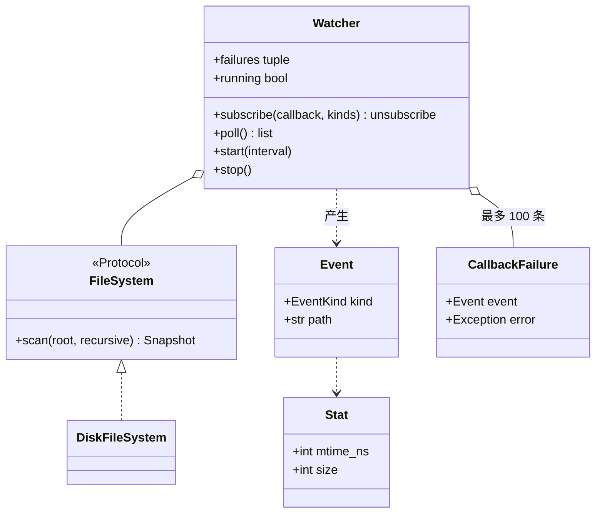

# 设计题解：文件监听器（File Watcher）

## 题目与澄清

文件监听器（file watcher）是一个后台小工具：你告诉它一个目录，它就盯着这个目录，一旦里面有文件被新建、被修改或被删除，就调用你登记的回调函数（callback，事先交给它的一个函数）告诉你；它可以在后台一直跑，也可以被停下。IDE 的自动刷新、热重载、日志采集都靠这类组件。难点有三个：怎么发现变化（系统通知还是自己去看）；一个坏回调不能拖垮监听；后台线程怎么安全地停。

面试官的提法通常只有一个名字，再加追问：先让你设计「file watcher system」，再追问多个订阅者、去抖、停止。监听什么、报哪几种事件、用轮询还是系统通知、要不要去抖，都没有给定，下面是一套自洽的默认约定，面试时要开口问，不要把它当成面试官的规则。每一关的需求都在「需求与分级」里列明。

开场该问的三个澄清问题：

1. **事件靠什么得到——系统通知，还是自己定期去看？** 操作系统有专门的通知机制（Linux 的 inotify、macOS 的 FSEvents、Windows 的 ReadDirectoryChangesW），事件是推来的，不耗 CPU，但每个平台 API 不同。自己定期扫描目录、和上次的结果比对（轮询，polling）只依赖标准库，在任何平台上行为一致，代价是有延迟、要扫描。面试里在白板上写代码，几乎都选轮询；但要说出另一条路，并把「读文件系统」藏在一个接口后面，换实现时不改上层。下面选轮询。
2. **要不要看子目录？要不要过滤文件？** 递归与否是一个布尔参数；过滤（只看 `.py`）如果做成「一个谓词函数」，可以直接复用同类题（Linux find 文件搜索）里的过滤条件。
3. **「改名」算什么？「写到一半」的文件怎么办？** 轮询只能看见前后两张快照：改名在快照里是「一个文件消失、另一个出现」，所以会得到一个 DELETED 加一个 CREATED；编辑器保存大文件时会连续写好几次，不处理的话订阅者会收到一串半截的 MODIFIED，这就是去抖（debounce）要解决的问题。

范围外：符号链接指向的内容、文件内容的 diff、权限变化、跨机器的网络文件系统、事件持久化。

## 需求与分级

| 关 | 需求 | 本关逼出的设计 |
|---|---|---|
| 第 1 关 | 监听一个目录，文件新建 / 修改 / 删除时回调 | 快照 `路径 → 指纹`；纯函数 `diff`；`poll()`；第一次只建立基线 |
| 第 2 关 | 多个订阅者、按事件种类订阅、可取消；递归目录；按文件名过滤 | 订阅表；读文件系统的接口 `FileSystem`（便于换假实现）；`recursive`、`include` |
| 第 3 关 | 去抖：写到一半的文件不要报半截事件；一个回调出错不能拖垮监听 | 「连续两轮相同才算数」；回调异常记录而不传播 |
| 第 4 关 | 后台线程按间隔轮询；`stop()`；回调很慢或回调里调用 `stop()` 怎么办 | 守护线程 + `threading.Event`；回调在锁外；不 join 自己 |

第 1 关最容易写歪的是把「读磁盘」「比对」「回调」三件事写在同一个循环里：`while True: for f in os.listdir(...): ... callback(...)`。这样既没法测试（要真的创建文件、真的等时间），也没法在第 4 关加线程。下面的切分让比对是纯函数、推进是一个方法、线程只是反复调用那个方法。

## 核心对象与职责

- `Stat`：一个文件的指纹——修改时间（纳秒）和大小，frozen dataclass。只用修改时间会漏掉粒度内的第二次修改，所以加上大小。
- `Snapshot`：`dict[str, Stat]`，键是相对根目录、用 `/` 分隔的路径。它只是个别名，不是类。
- `Event`：一次变化——种类（`EventKind`：CREATED / MODIFIED / DELETED）与路径。订阅者靠它更新自己，不必回头读监听器。
- `FileSystem`（协议）：监听器需要的唯一能力 `scan(root, recursive) -> Snapshot`。有两个实现：`DiskFileSystem`（真实磁盘，`os.scandir`）和测试里的内存假实现。
- `diff(old, new)`：纯函数，两张快照进、事件列表出，按路径排序，结果确定。
- `Watcher`：持有「订阅者已经知道的世界」（`_committed`）、订阅表、失败记录、后台线程；唯一的推进动作是 `poll()`。不变量：事件只由「已提交的世界」与「这一刻看到的世界」的差产生，所以同一个变化只会产生一次事件。
- `CallbackFailure`：一次回调失败的记录（事件、异常），保存在一个有上限的队列里。



所有权上，`Watcher` 引用一个 `FileSystem`，但不拥有磁盘；它拥有的是「订阅者已知的世界」这份快照。后台线程属于 `Watcher`，生命周期由 `start()` 与 `stop()` 管理。`Event` 只含种类和路径，订阅者不能通过它改到监听器的内部状态。

## 关键设计决策

### 决策一：怎么发现变化——轮询比对快照，还是系统通知

问题：「文件变了」这个事实，要么由操作系统告诉你，要么由你自己去看。

**方案 A：系统通知（inotify / FSEvents / ReadDirectoryChangesW）。** 事件是推来的，延迟低、不耗 CPU。但三个平台三套接口，语义有细微差别（同一次保存在不同平台可能是 1 个或 3 个事件），Python 标准库里没有，需要第三方包；也不可能在面试白板上手写。

**方案 B：定期扫描，把「路径 → (mtime_ns, size)」的快照和上一次比对。** 只用标准库，任何平台行为一致；延迟等于轮询间隔；每次要遍历目录。

**选择：B，但把「读磁盘」藏在 `FileSystem.scan` 后面。** 这样 A 将来可以作为另一个实现挂上去：`Watcher` 的比对逻辑、订阅、去抖都不用变——唯一要改的是让它从「拉」变成「推」，那是一个新类。同样重要的是，B 把「检测变化」变成一个纯函数 `diff(old, new)`，一眼就能测。

**代价和陷阱：指纹为什么不只是 mtime。** 文件系统的修改时间有粒度：有的是 1 秒、有的是 2 秒，一些系统写入后很短时间内不更新时间。如果一个文件在同一个粒度内被改了两次，第二次的 mtime 和第一次相同，只比 mtime 就看不到变化。加上 size 能抓住大多数这类修改（测试里 mtime 都是 100、size 从 10 变到 25，得到 MODIFIED 事件）；但「同一时间粒度内、改成了同样长度的内容」依然会漏，真实工具要用 inode、ctime 或内容哈希补。这个盲区要在面试里主动说出来，而不是等面试官发现。

### 决策二：谁来调用 `poll()`——监听器自己的线程，还是调用方

问题：监听需要「反复做某件事」，通常的反应是立刻起一个线程。

**方案 A：`Watcher` 构造时就起一条线程，永远在后台跑。** 构造函数有副作用，测试里要等时间，第 1–3 关的所有逻辑都被绑在线程上。

**方案 B：`poll()` 是一个普通同步方法，做一轮扫描、比对、回调；后台线程是可选的 `start(interval)`，只做 `while not stopped: poll(); wait(interval)`。**

**选择：B。** 这里的线程只是一个循环，所以其余 21 条测试完全不开线程：测试自己改假文件系统、自己调 `poll()`，立刻得到确定的结果。只有第 4 关的几条测试用真实线程，并且用 `threading.Event` 等「回调被调用了」，而不是睡眠加断言。这也是整个设计里「简单者胜出」的一处：不为「将来也许要异步」而引入事件循环或线程池。

### 决策三：去抖怎么做——要时钟吗

问题：编辑器保存一个文件，可能在几十毫秒内写好几次。每次轮询看到的都是不同的 mtime 和 size，于是订阅者收到一串 MODIFIED，最后一个才是对的。

**方案 A：计时去抖。** 每个路径记最后一次变化的时间，安静了 N 毫秒才发出事件。需要注入时钟，需要一个「待定事件」表，还要在没有轮询发生时也能触发。

**方案 B：稳定性去抖。** 一个路径的状态只有在**连续两次轮询里都一样**才被采纳；还在变就沿用订阅者已知的旧状态。不需要时钟，轮询间隔本身就是「安静窗口」。

**选择：B。** 实现只有一个函数 `_settled_view`：对每个路径，如果这次看到的状态等于上一次看到的，就采纳它；否则保留已提交的旧状态；然后正常 `diff(已提交, 采纳后)`。看一个具体时间线（开启 `settle=True`）：基线之后，第 1 轮文件 `big.bin` 出现（大小 10）——没有事件，因为上一轮没看到它；第 2 轮它变成大小 500——没有事件，状态还在变；第 3 轮它还是大小 500——与上一轮相同，报告一个 CREATED。一个文件出现又在下一轮前消失，则一个事件也不会有；一次连写 6 次，只会得到最后一个 MODIFIED。

代价：事件延迟增加一个轮询间隔；一个持续被写入的文件（日志）永远不稳定，永远不会有事件。这是去抖的固有取舍，按文件种类开关即可，所以默认关闭。

### 决策四：回调在哪个线程、持锁与否——慢回调和 `stop()`

问题：订阅者的回调是别人写的代码，可能很慢、可能抛异常、可能在里面又订阅、取消订阅甚至调用 `stop()`。

**方案 A：回调在锁内调用。** 简单，但回调里再调用 `subscribe` 或 `poll` 就会死锁（`threading.Lock` 不可重入）。

**方案 B：先在锁内把事件和订阅者列表复制出来，释放锁之后再依次调用回调。** 回调里可以做任何事，因为这时没有任何锁被持有。

**选择：B。** 配套三条规矩。第一，一个回调抛出的异常被捕获、记进 `CallbackFailure`（队列上限 100 条，防止无限增长），其他订阅者和下一轮轮询照常进行——一个坏订阅者不能让监听器停摆。第二，回调在轮询线程上执行，所以慢回调会推迟下一轮扫描；这里选择最简单的语义，并明说：想要隔离，把回调改成往 `queue.Queue` 里放，由另一个消费线程处理。第三，`stop()` 用 `threading.Event` 通知循环退出，并 `join` 线程；但如果 `stop()` 就是在回调（即轮询线程自己）里被调用的，`join` 当前线程会抛 `RuntimeError`，所以代码里先判断 `thread is not threading.current_thread()`。测试 `test_stop_called_from_inside_a_callback_neither_hangs_nor_fails` 断言它既不卡住也没有失败记录。

### 决策五（简单者胜出）：不要观察者基类，也不要事件总线

订阅者就是一个 `Callable[[Event], None]`。不需要 `Listener` 抽象基类，更不需要「事件总线」：只有一个发布者、一种事件，订阅表就是一个字典。`subscribe` 返回一个取消订阅的函数，而不是返回令牌再让调用方传回来。这是观察者模式（Observer）在 Python 里最轻的形态；如果将来有多个发布者、多种主题，再引入总线，改动局限在 `Watcher` 的订阅部分。

## 代码走读

下面是完整的、被测试过的参考解。

%% code:begin solution.py %%
```python
"""文件监听器（File Watcher）参考解。

设计五句话：
1. 监听 = 反复「拍快照 + 比对」：快照是 `路径 -> Stat(mtime_ns, size)` 的字典，比对是一个纯函数 `diff`，产出 CREATED / MODIFIED / DELETED 事件。
2. 读磁盘被藏在 `FileSystem` 协议后面（只有一个方法 `scan`）：真实实现 `DiskFileSystem` 用 os.scandir，测试换成内存里的假实现，不碰真实磁盘和真实时间。
3. `Watcher.poll()` 是唯一的推进动作：谁调用（手动、后台线程）都一样，所以几乎所有行为都能不开线程地测。
4. 去抖（debounce）不用时钟：一个路径的变化必须在连续两次轮询里「看到同一个状态」才算数，写到一半的文件不会报半截事件。
5. 订阅者在轮询线程上被回调，但永远在锁外；一个回调抛异常只被记录、不影响别人；`stop()` 靠 `threading.Event`，在回调里调用也不会死锁。
"""

from __future__ import annotations

import os
import threading
from collections import deque
from collections.abc import Callable, Iterable
from dataclasses import dataclass
from enum import Enum
from typing import Protocol


class WatchError(Exception):
    """本模块所有异常的根。"""


class RootNotFoundError(WatchError, FileNotFoundError):
    """被监听的根目录不存在。"""


@dataclass(frozen=True, slots=True)
class Stat:
    """一个文件在某一刻的指纹。只用 mtime 会漏掉同一时间粒度内的第二次修改，所以再加 size。"""

    mtime_ns: int
    size: int


Snapshot = dict[str, Stat]  # 相对根目录、用 "/" 分隔的路径 -> 指纹


class EventKind(Enum):
    CREATED = "created"
    MODIFIED = "modified"
    DELETED = "deleted"


@dataclass(frozen=True, slots=True)
class Event:
    """发生了什么：订阅者只靠它就能更新自己。"""

    kind: EventKind
    path: str


class FileSystem(Protocol):
    """监听器需要从文件系统得到的唯一能力：给我这个目录下所有文件的指纹。"""

    def scan(self, root: str, recursive: bool) -> Snapshot: ...


class DiskFileSystem:
    """真实磁盘：os.scandir 遍历，不跟随符号链接（避免目录环），遍历中途消失的文件直接跳过。"""

    def scan(self, root: str, recursive: bool) -> Snapshot:
        if not os.path.isdir(root):
            raise RootNotFoundError(root)
        found: Snapshot = {}
        pending = [""]
        while pending:
            rel_dir = pending.pop()
            try:
                entries = list(os.scandir(os.path.join(root, rel_dir)))
            except FileNotFoundError:  # 目录在遍历途中被删了
                continue
            for entry in entries:
                rel = f"{rel_dir}/{entry.name}" if rel_dir else entry.name
                try:
                    if entry.is_dir(follow_symlinks=False):
                        if recursive:
                            pending.append(rel)
                    elif entry.is_file(follow_symlinks=False):
                        st = entry.stat(follow_symlinks=False)
                        found[rel] = Stat(st.st_mtime_ns, st.st_size)
                except FileNotFoundError:  # 文件在 scandir 与 stat 之间消失
                    continue
        return found


def diff(old: Snapshot, new: Snapshot) -> list[Event]:
    """两张快照的差：新增、变化、消失。按路径排序，结果是确定的。"""
    events = [Event(EventKind.CREATED, p) for p in new.keys() - old.keys()]
    events += [Event(EventKind.DELETED, p) for p in old.keys() - new.keys()]
    events += [Event(EventKind.MODIFIED, p) for p in old.keys() & new.keys() if old[p] != new[p]]
    return sorted(events, key=lambda e: (e.path, e.kind.value))


Callback = Callable[[Event], None]


@dataclass(frozen=True, slots=True)
class CallbackFailure:
    """一次回调失败的记录：哪个事件、什么异常。"""

    event: Event
    error: Exception


class Watcher:
    """监听一个目录。`poll()` 推进一次；`start()` 再开一条后台线程按间隔反复调用它。"""

    def __init__(
        self,
        fs: FileSystem,
        root: str,
        *,
        recursive: bool = True,
        include: Callable[[str], bool] = lambda path: True,
        settle: bool = False,
    ) -> None:
        self._fs, self._root, self._recursive = fs, root, recursive
        self._include = include
        self._settle = settle
        self._committed: Snapshot | None = None  # 订阅者已经知道的世界；None = 还没拍过基线
        self._last: Snapshot = {}  # 上一次轮询看到的原始世界，去抖用
        self._subs: dict[int, tuple[Callback, frozenset[EventKind] | None]] = {}
        self._next_sub = 0
        self._failures: deque[CallbackFailure] = deque(maxlen=100)
        self._lock = threading.Lock()
        self._stop = threading.Event()
        self._thread: threading.Thread | None = None

    # ---- 订阅 ----
    def subscribe(self, callback: Callback, kinds: Iterable[EventKind] | None = None) -> Callable[[], None]:
        """登记回调；返回一个取消订阅的函数。kinds 为 None 表示三种事件都要。"""
        with self._lock:
            token = self._next_sub
            self._next_sub += 1
            self._subs[token] = (callback, None if kinds is None else frozenset(kinds))

        def unsubscribe() -> None:
            with self._lock:
                self._subs.pop(token, None)

        return unsubscribe

    @property
    def failures(self) -> tuple[CallbackFailure, ...]:
        with self._lock:
            return tuple(self._failures)

    @property
    def running(self) -> bool:
        thread = self._thread
        return thread is not None and thread.is_alive()

    # ---- 推进 ----
    def poll(self) -> list[Event]:
        """拍一次快照，和已提交的世界比对，把事件交给订阅者，并返回这些事件。

        第一次调用只建立基线（监听开始前就存在的文件不算「新建」），返回空列表。"""
        raw = {p: s for p, s in self._fs.scan(self._root, self._recursive).items() if self._include(p)}
        with self._lock:
            if self._committed is None:
                self._committed, self._last = raw, raw
                return []
            view = self._settled_view(raw) if self._settle else raw
            events = diff(self._committed, view)
            self._committed, self._last = view, raw
            targets = list(self._subs.values())
        self._dispatch(events, targets)
        return events

    def _settled_view(self, raw: Snapshot) -> Snapshot:
        """一个路径的状态只有在连续两次轮询里相同才被采纳；否则沿用订阅者已知的旧状态。"""
        assert self._committed is not None
        view: Snapshot = {}
        for path in raw.keys() | self._committed.keys():
            now = raw.get(path)
            state = now if now == self._last.get(path) else self._committed.get(path)
            if state is not None:
                view[path] = state
        return view

    def _dispatch(self, events: list[Event], targets: list[tuple[Callback, frozenset[EventKind] | None]]) -> None:
        """在锁外调用回调：回调里可以订阅、取消订阅甚至 stop() 而不死锁；一个回调出错不影响别人。"""
        for event in events:
            for callback, kinds in targets:
                if kinds is not None and event.kind not in kinds:
                    continue
                try:
                    callback(event)
                except Exception as exc:
                    with self._lock:
                        self._failures.append(CallbackFailure(event, exc))

    # ---- 后台线程 ----
    def start(self, interval: float) -> None:
        """开一条守护线程，每隔 interval 秒 poll() 一次；已在运行则忽略。"""
        with self._lock:
            if self.running:
                return
            self._stop.clear()
            self._thread = threading.Thread(target=self._loop, args=(interval,), name="file-watcher", daemon=True)
            self._thread.start()

    def _loop(self, interval: float) -> None:
        while not self._stop.is_set():
            try:
                self.poll()
            except OSError:  # 根目录暂时不见等：这一轮跳过，下一轮再试
                pass
            if self._stop.wait(interval):
                return

    def stop(self, timeout: float | None = 5.0) -> None:
        """请求停止并等待线程退出。在回调（即轮询线程自己）里调用时不 join，否则会等自己。"""
        self._stop.set()
        thread = self._thread
        if thread is not None and thread is not threading.current_thread():
            thread.join(timeout)


if __name__ == "__main__":
    import tempfile

    with tempfile.TemporaryDirectory() as tmp:
        watcher = Watcher(DiskFileSystem(), tmp)
        watcher.subscribe(print)
        watcher.poll()  # 基线
        with open(os.path.join(tmp, "a.txt"), "w") as f:
            f.write("hello")
        watcher.poll()
```
%% code:end %%

看四个地方：

1. **`diff`**：三类事件各一行集合运算——新路径是 CREATED，消失的是 DELETED，两边都有而指纹不同的是 MODIFIED。排序使结果确定，测试可以直接比较列表。
2. **`poll` 的第一次调用**：`_committed is None` 时只拍基线、不报事件。监听开始前就存在的文件不算「新建」，这是个需要在面试里讲明的约定。
3. **`_settled_view`**：去抖的全部逻辑，一个循环。注意被删除的文件：`now` 是 `None`，要连续两轮都是 `None` 才会让该路径从视图里消失。
4. **`_dispatch` 与 `stop`**：回调在锁外调用；每个回调单独 `try/except`；`stop()` 不 join 自己。

`DiskFileSystem.scan` 值得单独看两点：用 `entry.is_dir(follow_symlinks=False)`，所以符号链接指向祖先目录的环不会让遍历无限进行（测试里造了一个环，只得到一个文件）；扫描途中文件消失（`scandir` 之后、`stat` 之前被删）不是错误，直接跳过，下一轮自然会报告它的删除。

## 测试与自检

共 25 条测试，没有任何一条靠睡眠等时间：

- 纯函数：`diff` 对一对手写的快照给出确定的事件列表。
- 第 1 关（用内存里的假文件系统 `FakeFS`，mtime 与 size 由测试写死）：首次 `poll` 只建基线；CREATED、MODIFIED、DELETED 各报一次；没变化时没有事件；mtime 相同但 size 变了仍被发现；改名表现为 DELETED 加 CREATED；根目录不存在时抛 `RootNotFoundError`。
- 第 2 关：按种类订阅与取消订阅（重复取消无害）；`include` 过滤；`recursive` 开关；坏回调被记录而其他回调照常；失败记录有上限；回调里订阅不死锁。
- 第 3 关：`settle` 要两轮一致；一串连写合并成一个 MODIFIED；出现又消失的文件没有事件；删除要保持一轮才发出事件。
- 真实磁盘（`tmp_path`）：显式 `os.utime` 设置 mtime，再显式 `poll()`，所以结果不依赖时间流逝；符号链接环；根目录不存在。
- 第 4 关：用真实线程，但用 `threading.Event` 同步，等的是「回调被调用了」，不是睡眠；`start` 两次无害，`stop` 之后能再 `start`；回调里调用 `stop()`；根目录暂时消失时线程不会死。

两分钟演示：创建一个临时目录，`Watcher(DiskFileSystem(), tmp)`，订阅 `print`，先 `poll()` 拍基线，再写一个文件，再 `poll()`，屏幕上打印出 `Event(kind=CREATED, path='a.txt')`。

## 扩展与追问

**新需求**

- 改名检测：快照里再记 inode（或文件 id），`diff` 里把「同一个 inode 的 DELETED + CREATED」合成 MOVED；`Stat` 多一个字段，`FileSystem` 与 `Watcher` 不动。
- 内容变化而 mtime 与 size 都没变：`Stat` 多一个内容哈希字段，由 `DiskFileSystem` 计算（只对 mtime 变了的文件重算，避免每轮读全盘）。
- 复用「文件过滤」：`include` 就是一个 `Callable[[str], bool]`，Linux find 题里的 AND / OR / NOT 过滤对象只要带 `__call__` 就能直接传进来。
- 只关心某些事件：已经有 `kinds`。

**并发与线程安全**

- `poll()` 里只有「读已提交世界、算 diff、更新已提交世界」在锁内；回调在锁外。这里要诚实说明 GIL：它不保证这三步合在一起的原子性，所以锁是必要的。
- 两个线程同时 `poll()`（手动加后台）：状态不会坏，但事件的投递顺序可能交错。要严格有序，就让所有 `poll()` 只发生在一条线程上。
- 慢回调：见决策四，改成「回调只入队、另一个线程消费」。

**持久化与规模**

- 目录很大（几十万文件）：全量扫描每轮要遍历全树。优先改用系统通知实现作为另一个 `FileSystem`/推送源，轮询退化为兜底的定期全量校对。
- 重启后不丢事件：把 `_committed` 快照落盘，启动时载入，第一次 `poll()` 就会补报停机期间的变化。

## 常见错误

1. **把扫描、比对、回调写在同一个 `while True` 里**：无法测试，也无法停。
2. **第一次扫描就把所有已有文件报成 CREATED**：订阅者被一堆「新建」淹没。基线要单独约定。
3. **只比较 mtime**：同一时间粒度内的第二次修改被漏掉。加 size，并说清剩余盲区。
4. **在 `__init__` 里启动线程**：构造有副作用，测试无法控制。
5. **用 `time.sleep(1)` 加断言来测**：慢且偶尔失败。注入假文件系统，显式调用 `poll()`；线程测试用 `Event` 同步。
6. **回调在锁内调用，或一个回调抛异常就让监听线程退出**：前者会死锁，后者让一个坏订阅者拖垮所有人。
7. **`stop()` 在回调里 join 自己**：`RuntimeError`，或者更糟，永远等下去。
8. **跟随符号链接遍历**：链接指向祖先目录时无限递归。用 `follow_symlinks=False`。
9. **失败记录用无界列表**：一个一直抛异常的订阅者让内存一直涨。用有上限的队列。
10. **Java 习惯**：`FileWatcherListener` 接口加 `FileWatcherListenerImpl`、`WatcherFactory`、`getInstance()`。这里函数、一个类、一个协议就够了。

## 45 分钟怎么分配

| 分钟 | 做什么 | 口头要说的话 |
|---|---|---|
| 0–5 | 三个澄清问题：通知还是轮询、递归与过滤、改名与半截文件；声明范围外 | 「我先按轮询设计，并把读文件系统藏在一个接口后面，将来能换成系统通知。」 |
| 5–10 | 画 `Watcher`、`FileSystem`、`Event`；写出快照的类型 | 「快照是路径到指纹的字典，检测变化是个纯函数。」 |
| 10–25 | 写第 1 关：`Stat`、`diff`、`poll`，第一次只拍基线 | 边写边说为什么指纹是 (mtime, size)，盲区是什么 |
| 25–33 | 第 2 关：订阅、取消、`kinds`、`recursive`、`include` | 「过滤是个谓词函数，可以和文件搜索题的过滤复用。」 |
| 33–40 | 第 3 关：回调异常隔离；去抖口述或写 `_settled_view` | 「连续两轮相同才算数，不用时钟。」 |
| 40–45 | 第 4 关口述：后台线程、`Event` 停止、回调在锁外、不 join 自己 | 「慢回调会拖慢下一轮；想隔离就入队。」 |

时间不够时的取舍：先砍 `settle` 与 `DiskFileSystem` 的符号链接处理（口述）；再砍 `kinds` 过滤；保住 `diff`、`poll` 和回调异常隔离。

## 延伸阅读

- [Python os.scandir](https://docs.python.org/3/library/os.html#os.scandir)：`DirEntry` 的 `is_dir(follow_symlinks=False)` 与缓存的 `stat()`。
- [Python threading.Event](https://docs.python.org/3/library/threading.html#event-objects)：`Event.wait(timeout)` 既是可中断的睡眠，也是停止信号。
- [Linux inotify(7)](https://man7.org/linux/man-pages/man7/inotify.7.html)：系统通知那条路，包括队列溢出、改名事件（`IN_MOVED_FROM` / `IN_MOVED_TO`）。
- 相关题解：[[solution-in-memory-file-system]]、[[solution-amz-linux-find]]（树遍历与可组合的过滤器）。
- 概念：[[patterns.observer|观察者与事件（Observer）]]、[[concurrency.primitives|同步原语（threading）]]。
