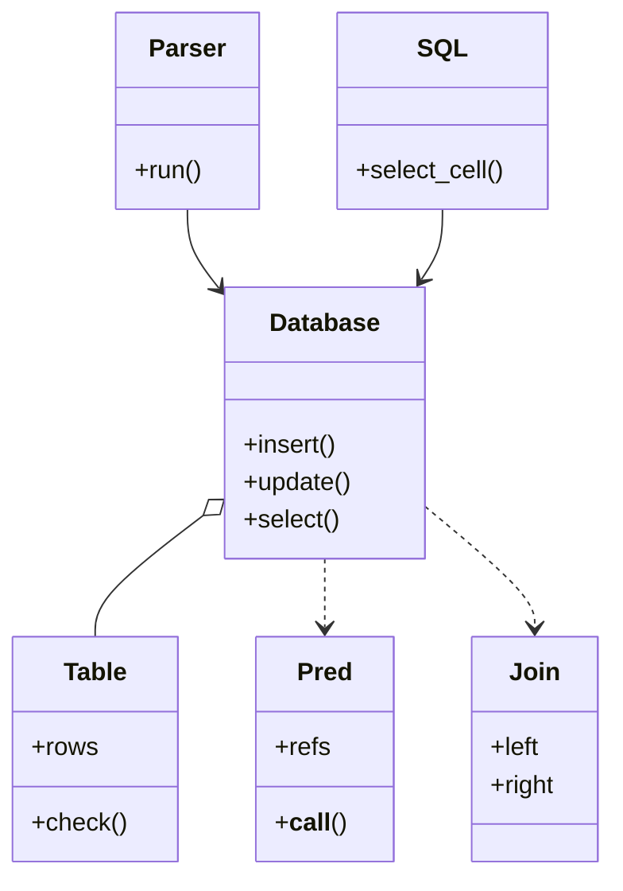

# 设计题解：内存数据库（In-Memory Database）

## 题目与澄清

这是要你在内存里写一个迷你数据库：能建表、插入、删除、按条件查询，面试官一步步往上加——先是最朴素的「按行号存取」，然后列有类型、查询有条件和排序，然后两张表连接（JOIN），最后甚至要你把一条 SQL 文本解析出来执行。它没有磁盘、没有网络，核心是三件事：数据怎么存、一次查询按什么顺序处理数据、条件里碰到「没有值」（NULL）怎么办。

面试官这样提出（第一关的原型是一道经典的编码题）：

> 实现一个 `SQL` 类。构造时给出若干张表的名字和各自的列数。`insertRow(表名, 一行字符串)` 在表尾追加一行，行号从 1 开始自增；`deleteRow(表名, 行号)` 删掉那一行，**之后插入的行号不回退**；`selectCell(表名, 行号, 列号)` 返回那一格的值。

之后的追问依次是：列要有类型、能按条件（WHERE）筛选和排序（ORDER BY）；两张表按一个键连接；输入变成 SQL 文本；加索引、加事务。

开场的三个澄清问题，和每个答案会改变什么：

1. **「列有类型吗？类型不对要报错还是自动转换？」** 答「有类型、报错」，表就要保存每列的类型，写入时检查（决策一里的 `Table.check`）。答「没有类型，都是字符串」，第一关就够了，类型检查可以整个省掉。
2. **「条件里遇到 NULL 怎么算？`age <> 2` 会选中 age 为 NULL 的行吗？」** 这是整道题里最容易被忽略、最容易在面试官追问时翻车的地方。按 SQL 标准，和 NULL 的比较结果是「未知」（UNKNOWN），WHERE 只留结果为「真」的行，所以不会选中。这个答案决定谓词的返回值不能是 `bool`，而要有第三个值（决策二）。
3. **「JOIN 要支持哪几种？键是等值还是任意条件？数据规模多大？」** 只要等值连接，才可以用哈希连接；规模小可以直接两层循环。内连接（INNER）和左连接（LEFT）是最常被问的两种。

此外明确不做的事：磁盘持久化、网络协议、并发控制（放在追问里说方案）、查询优化器、子查询、聚合函数（GROUP BY 放在追问里说方案）。

## 需求与分级

机器编码轮会一关一关地加需求：

- **第 1 关：按行号存取。** 表是「行号 → 一行字符串」；插入返回自增行号，删除后行号不回退，读一个格子。要点是行号从一个**只增不减**的计数器来，而不是「当前行数 + 1」——否则删掉最后一行再插入会复用行号。这一关为 `Table.next_id` 和 `Table.rows` 而存在，solution 里的 `SQL` 类只是 `Database` 的一个薄壳。
- **第 2 关：类型化的列、增删改查、WHERE 与 ORDER BY。** 列有类型，写入时检查；更新要么全改要么不改；WHERE 里有比较、`IN`、`IS NULL`、`AND` / `OR` / `NOT`，并且遵守三值逻辑；排序支持多个键、升降序混合。这一关为 `Table.check`、谓词类和 `select` 里的排序而存在。
- **第 3 关：JOIN。** 两张表按键连接，先写成嵌套循环，再改成哈希连接；内连接和左连接；列名重复时要用「表别名.列名」限定。这一关为 `Join` 和 `_hash_join` 而存在。
- **第 4 关：SQL 文本前端。** 输入 `SELECT u.name FROM users u WHERE u.age > 20 ORDER BY u.name LIMIT 5`，输出查询结果。要点是分词（tokenizer）和递归下降（recursive descent）解析，运算符优先级 NOT > AND > OR 靠方法的调用层次表达。这一关为 `tokenize` 和 `Parser` 而存在。索引、事务、聚合作为追问，在「扩展与追问」里给方案和片段。

## 核心对象与职责

**一句话地图：** 表只管存，谓词只管判断一行，`Database` 把它们按固定顺序拼成一次查询，解析器只把文本翻译成这些调用。

- `Table`：一张表的存储。列名到类型的映射、主键列、`{主键: 行}` 字典、自增计数器。它拥有的不变量是「表里每一行的每个值都符合列的类型，主键唯一且非空」，`check` 是唯一的入口。
- `Pred`（谓词）及其子类 `Cmp`、`In`、`IsNull`、`And`、`Or`、`Not`：不可变的小对象，`pred(row)` 返回 `True`、`False` 或 `None`（未知）。`refs` 属性列出它引用了哪些列，让数据库在**执行前**就能报「没有这一列」，即使表是空的。
- `Join`：一个不可变的描述：连哪张表、用哪两列、内连接还是左连接、别名是什么。
- `Database`：表的集合，拥有写操作的原子性和 `select` 的流水线。它不认识 SQL 文本。
- `Parser`（以及 `tokenize`）：把 SQL 文本翻译成对 `Database` 的调用。它不碰存储，所以可以单独测试，也可以整个替换。
- `SQL`：第 1 关的接口，一个把行号映射成自增主键的薄壳。



关系上：`Database` 拥有它的 `Table`（表随数据库建立、随数据库消失）；`Pred` 和 `Join` 是调用时传入的参数，数据库不保存它们；`Parser` 和 `SQL` 都只依赖 `Database` 的公开方法。

## 关键设计决策

### 决策一：行存成什么样——`{主键: 行}` 字典，还是行的列表

**问题。** 第 1 关要按行号删除和读取；第 2 关要按条件扫描。表里的行用什么装？

**选项一：`list[Row]`，按插入顺序。** 追加 O(1)，全表扫描方便。代价：按主键删除要先找到再 `pop`，O(n)；用下标当行号的话，删除后下标全部移位，行号就变了——这正是第 1 关禁止的。

**选项二（选择）：`dict[主键, Row]`。** Python 的字典保持插入顺序，所以全表扫描仍然是插入顺序；按主键读取、删除都是 O(1)；行号就是主键，删除不影响别的行。代价：主键必须唯一且非空（这本来就是主键的定义），更新主键要先删旧键再写新键，并且要检查新键有没有冲突（`update` 里专门处理）。

对应的另一个小决策是自增计数器：`next_id` 是一个只增不减的整数，插入后设为 `max(next_id, pk + 1)`，所以显式给出较大的主键之后，自增会从它后面继续，而删除永远不会让它回退。例：先插入得到 1、2、3，再显式插入主键 10，再自增得到 11；删掉 11，再自增得到 12，而不是 11。

### 决策二：NULL 怎么算——用 Python 的 `None` 直接比较，还是三值逻辑

**问题。** 表 `t` 有五行，列 `a` 的值依次是 1、2、NULL、4、NULL。`WHERE a <> 2` 应该选出哪几行？

**选项一：直接用 Python 的比较。** `None != 2` 是 `True`，所以会选出 id 为 1、3、4、5 的行，包括两个 NULL。写起来最简单。代价：与 SQL 的行为不一致，也与大多数人的直觉相反——对「不知道的东西」问「它不等于 2 吗」，答案应该是「不知道」，而不是「是」。更危险的是 `NOT IN`：`a NOT IN (1, NULL)` 在 Python 里会选出一堆行，在 SQL 里**一行都选不出来**。

**选项二（选择）：三值逻辑。** 谓词返回 `True`、`False` 或 `None`（未知）。规则只有几条：

- 任何和 NULL 的比较结果是未知，包括 `NULL = NULL`。
- `AND`：只要有一个假就是假；否则只要有一个未知就是未知；否则真。
- `OR`：只要有一个真就是真；否则只要有一个未知就是未知；否则假。
- `NOT 未知` 还是未知。
- `x IN (...)`：命中就真；没命中但列表里有 NULL 就是未知；否则假。
- `IS NULL` 是唯一永远不会是未知的谓词。
- **WHERE 只保留结果 `is True` 的行**，未知和假一样被丢掉。

按这些规则，`a <> 2` 选出 id 为 1、4 的行；`NOT (a = 2)` 同样是 1、4；`a NOT IN (1, NULL)` 一行都没有；`a = NULL` 一行都没有，必须写 `a IS NULL`，得到 3、5。这五个结果都在测试里逐一断言了。代价：谓词的返回类型从 `bool` 变成 `bool | None`，所以代码里一律写 `where(row) is True`，而不是 `if where(row):`——后者会把 `None` 当成假，碰巧对 WHERE 是对的，但在 `NOT` 里就错了。

### 决策三：JOIN 用嵌套循环，还是哈希连接

**问题。** 把 `users` 和 `orders` 按 `users.id = orders.user_id` 连起来。

**选项一：嵌套循环。** 对左表每一行，扫右表所有行，匹配就输出。代码最短，不需要任何辅助结构。代价：O(|L| × |R|)；两张各一千行的表就是一百万次比较，一万行就是一亿次。

**选项二（选择）：哈希连接。** 先扫一遍右表，按连接键放进字典 `键 → 行的列表`（构建阶段，O(|R|)）；再扫左表，对每一行用键去字典里取匹配的行（探测阶段，O(|L| + 输出行数)）。代价：多占 O(|R|) 的内存；只能处理等值条件（`>`、`BETWEEN` 之类的连接条件要退回嵌套循环）。

几个必须说出来的细节：**NULL 键不匹配任何东西**（`NULL = NULL` 是未知），所以构建时跳过键为 NULL 的右表行，探测时键为 NULL 的左表行不查字典；**左连接**在没有匹配时仍保留这一行，右侧所有列补 NULL；**重复的键**是一对多，字典的值是列表，输出的行数可以多于左表；**多个 JOIN** 就是把上一步的结果当成新的左表，循环地做。测试里用嵌套循环写了一个对照实现，在随机数据上检查两者的结果完全相同——这就是你可以向面试官展示的「为什么我相信它是对的」。

### 决策四：查询流水线是一个函数，还是一棵算子树

**问题。** `select` 要依次做：取表 → 连接 → 过滤 → 排序 → 截断 → 投影。要不要把每一步做成一个算子对象（`Scan`、`Join`、`Filter`、`Sort`、`Limit`，各有 `next()`），像真正的数据库那样组成一棵树？

**选项一：算子树（Volcano 模型）。** 每个算子只做一件事，可以任意组合，易于插入优化（谓词下推、换连接算法）。代价：五六个新类，加上它们之间的协议；在 45 分钟里这些代码几乎全是脚手架，而面试官要看的是 NULL 语义和 JOIN。

**选项二（选择）：`Database.select` 里按逻辑顺序写成一个直线函数。** 每一步一个局部变量接下一步的结果。顺序本身就是文档：**WHERE 在 JOIN 之后、ORDER BY 在 WHERE 之后、LIMIT 在 ORDER BY 之后**，调换任何一对都会得到错误答案（例如先 LIMIT 再排序，取到的就不是最大的几行）。

这里拒绝了一个看起来「更面向对象」的设计。什么时候升级成算子树？当你需要两种以上可互换的执行计划时——比如加了索引，`Scan` 要能换成 `IndexScan`。到那时再把对应的那一步抽出来，而不是提前把每一步都抽象。

### 决策五：写操作先校验、后动手

**问题。** `UPDATE users SET id = 2 WHERE city = 'sf'` 命中两行，把两行的主键都改成 2。如果边改边检查，第一行改成功了，第二行才发现冲突，表就停在一个「一半改了」的状态。

**选择：先在副本上算出所有新行，校验全部通过，再统一落盘。** `update` 先收集命中的行（`targets`），对每个赋值调用 `Table.check`，再构造 `new_rows`（旧行与改动合并后的副本）；如果改了主键，检查新键之间不重复、也不与不在本次修改范围内的旧键冲突；全部通过后才删除旧行、写入新行。失败时抛 `ConstraintError`，表里一个字节都没变（测试逐项断言）。`insert` 同理：类型检查和主键检查都在写入字典之前完成。

### 决策六：SQL 文本怎么解析——正则切字符串，还是递归下降

**问题。** 把 `SELECT name FROM users WHERE age > 20 AND city = 'sf' OR age IS NULL` 变成一个谓词对象。

**选项一：`split()` 加正则。** 对简单的语句能工作。代价：字符串里可以有空格和引号（`'o''neil'`），括号可以嵌套，`AND` 和 `OR` 有优先级——这些用正则一个一个补丁，很快变成一团。

**选项二（选择）：先分词，再递归下降。** 分词器用一个正则把文本切成 `(kind, value)` 的列表：数字、字符串、标识符（含 `t.col`）、关键字、运算符。解析器每条文法规则一个方法：`expr` 处理 `OR`，调用 `and_expr`；`and_expr` 处理 `AND`，调用 `not_expr`；`not_expr` 处理 `NOT`，调用 `atom`。**优先级就是调用层次**：越晚被调用的越先结合，所以 `a = 1 OR a = 2 AND b = 'y'` 自然解析成 `a = 1 OR (a = 2 AND b = 'y')`。错误统一抛 `SQLSyntaxError`，信息里带上遇到了什么，而不是抛出 `IndexError` 之类的内部错误。

没有用解析器生成器或表达式树的访问者（Visitor）：文法只有十几条规则，手写的递归下降一百来行，读得懂也改得动。

## 代码走读

下面是完整的、经过测试的参考实现（含 SQL 文本前端和第 1 关的 `SQL` 类）。

%% code:begin solution.py %%
```python
"""内存数据库（In-Memory Database）：类型化的表 → CRUD → WHERE（三值逻辑）→ ORDER BY → 哈希连接 → 迷你 SQL 解析器。

设计五行：
1. `Table` 只管存储：`{主键: 行}` 的字典 + 列类型；`Database` 管表的集合和 `select` 的流水线 FROM → JOIN → WHERE → ORDER BY → LIMIT → 投影。
2. 谓词是小对象，调用后返回 True / False / None（None 即 UNKNOWN）；WHERE 只留结果 `is True` 的行，NULL 因此不会被误选。
3. JOIN 用哈希连接：给右表建桶（O(|R|)），逐行探测左表（O(|L| + 输出)）；NULL 键永不匹配。
4. 所有写操作先校验、后动手：失败的 `insert` / `update` 不留下半成品。
5. SQL 文本是另一层：分词器 + 递归下降解析器只负责把文本翻译成上面的 Python 调用，不碰存储。
"""

from __future__ import annotations

import operator
import re
from abc import ABC, abstractmethod
from collections import Counter, defaultdict
from collections.abc import Callable, Sequence
from dataclasses import dataclass
from typing import Any

Row = dict[str, Any]
Tri = bool | None                                 # 三值逻辑：True / False / None(UNKNOWN)


class DBError(Exception):
    """本模块所有可预期失败的基类。"""


class SchemaError(DBError):
    """表、列不存在或已存在，列名有歧义，类型比较不合法。"""


class ConstraintError(DBError):
    """值违反约束：类型不符、主键重复或为 NULL。"""


class SQLSyntaxError(DBError):
    """SQL 文本不合文法。"""


# ───────────────────────────── 谓词（三值逻辑） ─────────────────────────────

@dataclass(frozen=True)
class Col:
    """比较里的列引用（区别于字面量）。"""
    name: str


def _val(operand: Any, row: Row) -> Any:
    return row[operand.name] if isinstance(operand, Col) else operand


class Pred(ABC):
    """谓词：`pred(row)` 返回 True / False / None。`refs` 列出它引用的列名，供执行前统一校验。"""

    @property
    @abstractmethod
    def refs(self) -> frozenset[str]: ...

    @abstractmethod
    def __call__(self, row: Row) -> Tri: ...


_OPS: dict[str, Callable[[Any, Any], bool]] = {
    "=": operator.eq, "<>": operator.ne, "<": operator.lt, "<=": operator.le, ">": operator.gt, ">=": operator.ge}


@dataclass(frozen=True)
class Cmp(Pred):
    left: Any
    op: str
    right: Any

    @property
    def refs(self) -> frozenset[str]:
        return frozenset(x.name for x in (self.left, self.right) if isinstance(x, Col))

    def __call__(self, row: Row) -> Tri:
        a, b = _val(self.left, row), _val(self.right, row)
        if a is None or b is None:
            return None                           # 和 NULL 比较永远是 UNKNOWN，包括 NULL = NULL
        try:
            return _OPS[self.op](a, b)
        except TypeError:
            raise SchemaError(f"不能比较 {a!r} {self.op} {b!r}") from None


@dataclass(frozen=True)
class In(Pred):
    col: str
    values: tuple[Any, ...]

    @property
    def refs(self) -> frozenset[str]:
        return frozenset({self.col})

    def __call__(self, row: Row) -> Tri:
        a = row[self.col]
        if a is None:
            return None
        if any(v is not None and a == v for v in self.values):
            return True
        return None if None in self.values else False    # 没命中但列表里有 NULL → UNKNOWN


@dataclass(frozen=True)
class IsNull(Pred):
    col: str

    @property
    def refs(self) -> frozenset[str]:
        return frozenset({self.col})

    def __call__(self, row: Row) -> Tri:
        return row[self.col] is None              # 唯一永远不会是 UNKNOWN 的谓词


@dataclass(frozen=True)
class And(Pred):
    parts: tuple[Pred, ...]

    @property
    def refs(self) -> frozenset[str]:
        return frozenset().union(*(p.refs for p in self.parts))

    def __call__(self, row: Row) -> Tri:
        vals = [p(row) for p in self.parts]
        return False if False in vals else (None if None in vals else True)


@dataclass(frozen=True)
class Or(Pred):
    parts: tuple[Pred, ...]

    @property
    def refs(self) -> frozenset[str]:
        return frozenset().union(*(p.refs for p in self.parts))

    def __call__(self, row: Row) -> Tri:
        vals = [p(row) for p in self.parts]
        return True if True in vals else (None if None in vals else False)


@dataclass(frozen=True)
class Not(Pred):
    part: Pred

    @property
    def refs(self) -> frozenset[str]:
        return self.part.refs

    def __call__(self, row: Row) -> Tri:
        v = self.part(row)
        return None if v is None else not v       # NOT UNKNOWN 仍是 UNKNOWN


# ───────────────────────────── 存储 ─────────────────────────────

class Table:
    """一张表：列名 → 类型、主键列、`{主键: 行}`。整数主键自增，删除不回退。"""

    def __init__(self, name: str, columns: dict[str, type], pk: str) -> None:
        if pk not in columns:
            raise SchemaError(f"主键 {pk!r} 不是表 {name!r} 的列")
        self.name, self.columns, self.pk = name, dict(columns), pk
        self.rows: dict[Any, Row] = {}
        self.next_id = 1

    def check(self, col: str, value: Any) -> Any:
        if col not in self.columns:
            raise SchemaError(f"表 {self.name!r} 没有列 {col!r}")
        if value is None:
            if col == self.pk:
                raise ConstraintError("主键不能为 NULL")
            return None
        if type(value) is not self.columns[col]:  # 精确比较：True 不能混进 int 列
            raise ConstraintError(f"列 {col!r} 需要 {self.columns[col].__name__}，得到 {value!r}")
        return value

    @property
    def row_count(self) -> int:
        return len(self.rows)


@dataclass(frozen=True)
class Join:
    table: str
    left: str                                     # 已有行里的列，如 "u.id"
    right: str                                    # 新表里的列，如 "o.user_id"
    kind: str = "inner"                           # "inner" | "left"
    alias: str | None = None


class Database:
    def __init__(self) -> None:
        self._tables: dict[str, Table] = {}

    def _table(self, name: str) -> Table:
        if name not in self._tables:
            raise SchemaError(f"没有表 {name!r}")
        return self._tables[name]

    def create_table(self, name: str, columns: dict[str, type], primary_key: str) -> None:
        if name in self._tables:
            raise SchemaError(f"表 {name!r} 已存在")
        self._tables[name] = Table(name, columns, primary_key)

    def count(self, table: str) -> int:
        return self._table(table).row_count

    def columns(self, table: str) -> list[str]:
        return list(self._table(table).columns)

    def insert(self, table: str, values: Row) -> Any:
        t = self._table(table)
        row = {c: values.get(c) for c in t.columns}
        for c in values:
            t.check(c, values[c])                 # 未知列在这里报错
        if row[t.pk] is None and t.columns[t.pk] is int:
            row[t.pk] = t.next_id                 # 自增
        row = {c: t.check(c, v) for c, v in row.items()}
        pk = row[t.pk]
        if pk in t.rows:
            raise ConstraintError(f"主键 {pk!r} 重复")
        t.rows[pk] = row
        if t.columns[t.pk] is int:
            t.next_id = max(t.next_id, pk + 1)
        return pk

    def _matching(self, t: Table, where: Pred | None) -> list[Row]:
        if where is not None:
            self._check_refs(where.refs, {c: c for c in t.columns})
        return [r for r in t.rows.values() if where is None or where(r) is True]

    def update(self, table: str, assignments: Row, where: Pred | None = None) -> int:
        t = self._table(table)
        targets = self._matching(t, where)
        changes = {c: t.check(c, v) for c, v in assignments.items()}
        new_rows = [{**r, **changes} for r in targets]             # 先在副本上改，校验全过再落盘
        if t.pk in changes:
            old = {r[t.pk] for r in targets}
            keys = [r[t.pk] for r in new_rows]
            if len(set(keys)) != len(keys) or any(k in t.rows and k not in old for k in keys):
                raise ConstraintError("主键重复")
        for r in targets:
            del t.rows[r[t.pk]]
        for r in new_rows:
            t.rows[r[t.pk]] = r
        return len(targets)

    def delete(self, table: str, where: Pred | None = None) -> int:
        t = self._table(table)
        targets = self._matching(t, where)
        for r in targets:
            del t.rows[r[t.pk]]
        return len(targets)

    # ── SELECT ──

    @staticmethod
    def _check_refs(refs: frozenset[str], scope: dict[str, Any]) -> None:
        for name in refs:
            if name not in scope:
                raise SchemaError(f"未知或有歧义的列 {name!r}")

    def select(self, table: str, columns: Sequence[str] | None = None, where: Pred | None = None,
               order_by: Sequence[str | tuple[str, str]] | None = None, limit: int | None = None,
               joins: Sequence[Join] = (), alias: str | None = None) -> list[Row]:
        """逻辑顺序：FROM → JOIN → WHERE → ORDER BY → LIMIT → 投影。`columns=None` 即 `*`。"""
        members = [(alias or table, self._table(table))]
        rows = [{f"{members[0][0]}.{c}": v for c, v in r.items()} for r in members[0][1].rows.values()]
        for j in joins:
            name, right = j.alias or j.table, self._table(j.table)
            if any(name == a for a, _ in members):
                raise SchemaError(f"别名 {name!r} 重复")
            members.append((name, right))
            scope = self._scope(members)
            self._check_refs(frozenset({j.left, j.right}), scope)
            rows = self._hash_join(rows, scope[j.left], right, name, scope[j.right], j.kind)
        scope = self._scope(members)
        for r in rows:                            # 不重名的列也可以不带限定符
            r.update({plain: r[q] for plain, q in scope.items() if "." not in plain})
        keys = [(k, False) if isinstance(k, str) else (k[0], k[1].upper() == "DESC") for k in order_by or ()]
        wanted = list(columns) if columns is not None else None
        self._check_refs(frozenset(k for k, _ in keys) | frozenset(wanted or ()), scope)
        if where is not None:
            self._check_refs(where.refs, scope)
            rows = [r for r in rows if where(r) is True]
        for col, desc in reversed(keys):          # 稳定排序：从最后一个键往前各排一遍；NULL 最小
            rows.sort(key=lambda r, c=col: (r[c] is not None, r[c]), reverse=desc)
        rows = rows[:limit]
        if wanted is None:
            wanted = [c for c in members[0][1].columns] if not joins else [
                f"{a}.{c}" for a, t in members for c in t.columns]
        return [{c: r[c] for c in wanted} for r in rows]

    @staticmethod
    def _scope(members: list[tuple[str, Table]]) -> dict[str, str]:
        """可用的列名 → 行里的限定键。不重名的列同时可以不带限定符，重名的必须限定。"""
        counts = Counter(c for _, t in members for c in t.columns)
        scope = {f"{a}.{c}": f"{a}.{c}" for a, t in members for c in t.columns}
        scope.update({c: f"{a}.{c}" for a, t in members for c in t.columns if counts[c] == 1})
        return scope

    @staticmethod
    def _hash_join(left: list[Row], left_key: str, right: Table, alias: str, right_key: str, kind: str) -> list[Row]:
        """build 右表（O(|R|)），probe 左表（O(|L| + 输出)）。NULL 键不匹配任何东西。"""
        buckets: dict[Any, list[Row]] = defaultdict(list)
        for r in right.rows.values():
            q = {f"{alias}.{c}": v for c, v in r.items()}
            if q[right_key] is not None:
                buckets[q[right_key]].append(q)
        nulls = {f"{alias}.{c}": None for c in right.columns}
        out: list[Row] = []
        for l in left:
            matches = buckets.get(l[left_key], []) if l[left_key] is not None else []
            out.extend({**l, **m} for m in matches)
            if not matches and kind == "left":    # LEFT JOIN：没匹配也保留，右侧补 NULL
                out.append({**l, **nulls})
        return out

    def execute(self, sql: str) -> list[Row] | int | None:
        """执行一条 SQL：SELECT 返回行，INSERT / UPDATE / DELETE 返回主键或影响的行数，CREATE 返回 None。"""
        return Parser(self, sql).run()


# ───────────────────────────── SQL 文本前端 ─────────────────────────────
# 文法（关键字不分大小写）：
#   select := SELECT ('*' | colref {',' colref}) FROM ident [ident] {[INNER|LEFT] JOIN ident [ident] ON colref '=' colref}
#             [WHERE expr] [ORDER BY colref [ASC|DESC] {',' ...}] [LIMIT int]
#   expr   := and {OR and};  and := not {AND not};  not := NOT not | atom
#   atom   := '(' expr ')' | operand cmp operand | colref IS [NOT] NULL | colref [NOT] IN '(' literal {',' literal} ')'

KEYWORDS = {"SELECT", "FROM", "WHERE", "JOIN", "INNER", "LEFT", "ON", "AND", "OR", "NOT", "IN", "IS", "NULL", "ORDER",
            "BY", "ASC", "DESC", "LIMIT", "INSERT", "INTO", "VALUES", "UPDATE", "SET", "DELETE", "CREATE", "TABLE",
            "PRIMARY", "KEY", "TRUE", "FALSE"}
SQL_TYPES = {"INT": int, "TEXT": str, "REAL": float, "BOOL": bool}
_TOKEN = re.compile(r"\s*(?:(?P<num>\d+\.\d+|\d+)|(?P<str>'(?:[^']|'')*')|(?P<id>[A-Za-z_]\w*(?:\.[A-Za-z_]\w*)?)"
                    r"|(?P<op><=|>=|<>|!=|[=<>(),*;-]))")


def tokenize(sql: str) -> list[tuple[str, Any]]:
    """文本 → [(kind, value)]，kind ∈ lit / kw / id / op / eof。"""
    out: list[tuple[str, Any]] = []
    pos = 0
    while sql[pos:].strip():
        m = _TOKEN.match(sql, pos)
        if not m:
            raise SQLSyntaxError(f"位置 {pos} 附近有无法识别的字符 {sql[pos:].strip()[0]!r}")
        kind, text = m.lastgroup or "", m.group(m.lastgroup or "")
        if kind == "num":
            out.append(("lit", float(text) if "." in text else int(text)))
        elif kind == "str":
            out.append(("lit", text[1:-1].replace("''", "'")))
        elif kind == "id":
            out.append(("kw", text.upper()) if text.upper() in KEYWORDS else ("id", text))
        else:
            out.append(("op", "<>" if text == "!=" else text))
        pos = m.end()
    return out + [("eof", None)]


class Parser:
    """递归下降：每条文法规则一个方法；优先级 OR < AND < NOT < 比较，靠方法的调用层次表达。"""

    def __init__(self, db: Database, sql: str) -> None:
        self.db, self.toks, self.i = db, tokenize(sql), 0

    def error(self, message: str) -> SQLSyntaxError:
        kind, value = self.toks[self.i]
        return SQLSyntaxError(f"{message}（遇到 {'输入结束' if kind == 'eof' else repr(value)}）")

    def accept(self, *words: str) -> str | None:
        kind, value = self.toks[self.i]
        if kind in ("kw", "op") and value in words:
            self.i += 1
            return value
        return None

    def expect(self, word: str) -> None:
        if not self.accept(word):
            raise self.error(f"需要 {word}")

    def ident(self) -> str:
        kind, value = self.toks[self.i]
        if kind != "id":
            raise self.error("需要标识符")
        self.i += 1
        return value

    def literal(self) -> Any:
        kind, value = self.toks[self.i]
        if kind == "lit":
            self.i += 1
            return value
        if self.accept("NULL", "TRUE", "FALSE"):
            return {"NULL": None, "TRUE": True, "FALSE": False}[self.toks[self.i - 1][1]]
        if self.accept("-") and self.toks[self.i][0] == "lit" and not isinstance(self.toks[self.i][1], str):
            self.i += 1
            return -self.toks[self.i - 1][1]
        raise self.error("需要字面量")

    def run(self) -> list[Row] | int | None:
        handlers = {"SELECT": self.select, "INSERT": self.insert, "UPDATE": self.update,
                    "DELETE": self.delete, "CREATE": self.create}
        word = self.accept(*handlers)
        if word is None:
            raise self.error("需要 SELECT / INSERT / UPDATE / DELETE / CREATE")
        result = handlers[word]()
        self.accept(";")
        if self.toks[self.i][0] != "eof":
            raise self.error("语句后有多余内容")
        return result

    # ── 语句 ──
    def select(self) -> list[Row]:
        cols: list[str] | None = None
        if not self.accept("*"):
            cols = [self.ident()]
            while self.accept(","):
                cols.append(self.ident())
        self.expect("FROM")
        table = self.ident()
        alias = self.ident() if self.toks[self.i][0] == "id" else None
        joins: list[Join] = []
        while (kind := self.accept("INNER", "LEFT", "JOIN")) is not None:
            if kind != "JOIN":
                self.expect("JOIN")
            name = self.ident()
            j_alias = self.ident() if self.toks[self.i][0] == "id" else None
            self.expect("ON")
            left = self.ident()
            self.expect("=")
            joins.append(Join(name, left, self.ident(), "left" if kind == "LEFT" else "inner", j_alias))
        where = self.expr() if self.accept("WHERE") else None
        order: list[tuple[str, str]] = []
        if self.accept("ORDER"):
            self.expect("BY")
            while True:
                order.append((self.ident(), self.accept("ASC", "DESC") or "ASC"))
                if not self.accept(","):
                    break
        limit = None
        if self.accept("LIMIT"):
            limit = self.literal()
            if not isinstance(limit, int) or limit < 0:
                raise self.error("LIMIT 需要非负整数")
        # 左连接的 ON 左列是“已有行”的列，右列属于新表；这与 Join 的字段含义一致
        return self.db.select(table, cols, where, order, limit, joins, alias)

    def insert(self) -> Any:
        self.expect("INTO")
        table = self.ident()
        names: list[str] = []
        if self.accept("("):
            names.append(self.ident())
            while self.accept(","):
                names.append(self.ident())
            self.expect(")")
        self.expect("VALUES")
        self.expect("(")
        values = [self.literal()]
        while self.accept(","):
            values.append(self.literal())
        self.expect(")")
        if not names:
            names = self.db.columns(table)
        if len(names) != len(values):
            raise self.error("列数和值数不一致")
        return self.db.insert(table, dict(zip(names, values)))

    def update(self) -> int:
        table = self.ident()
        self.expect("SET")
        sets: Row = {}
        while True:
            col = self.ident()
            self.expect("=")
            sets[col] = self.literal()
            if not self.accept(","):
                break
        return self.db.update(table, sets, self.expr() if self.accept("WHERE") else None)

    def delete(self) -> int:
        self.expect("FROM")
        table = self.ident()
        return self.db.delete(table, self.expr() if self.accept("WHERE") else None)

    def create(self) -> None:
        self.expect("TABLE")
        name = self.ident()
        self.expect("(")
        columns: dict[str, type] = {}
        pk: str | None = None
        while True:
            col, tname = self.ident(), self.ident().upper()
            if tname not in SQL_TYPES:
                raise self.error(f"不支持的类型 {tname}")
            columns[col] = SQL_TYPES[tname]
            if self.accept("PRIMARY"):
                self.expect("KEY")
                pk = col
            if not self.accept(","):
                break
        self.expect(")")
        if pk is None:
            raise self.error("需要 PRIMARY KEY")
        self.db.create_table(name, columns, pk)

    # ── 表达式：OR < AND < NOT < 比较 ──
    def expr(self) -> Pred:
        parts = [self.and_expr()]
        while self.accept("OR"):
            parts.append(self.and_expr())
        return parts[0] if len(parts) == 1 else Or(tuple(parts))

    def and_expr(self) -> Pred:
        parts = [self.not_expr()]
        while self.accept("AND"):
            parts.append(self.not_expr())
        return parts[0] if len(parts) == 1 else And(tuple(parts))

    def not_expr(self) -> Pred:
        return Not(self.not_expr()) if self.accept("NOT") else self.atom()

    def operand(self) -> Any:
        return Col(self.ident()) if self.toks[self.i][0] == "id" else self.literal()

    def atom(self) -> Pred:
        if self.accept("("):
            inner = self.expr()
            self.expect(")")
            return inner
        left = self.operand()
        if isinstance(left, Col):
            if self.accept("IS"):
                negate = bool(self.accept("NOT"))
                self.expect("NULL")
                return Not(IsNull(left.name)) if negate else IsNull(left.name)
            negate = bool(self.accept("NOT"))
            if self.accept("IN"):
                self.expect("(")
                values = [self.literal()]
                while self.accept(","):
                    values.append(self.literal())
                self.expect(")")
                return Not(In(left.name, tuple(values))) if negate else In(left.name, tuple(values))
            if negate:
                raise self.error("NOT 后需要 IN")
        op = self.accept("=", "<>", "<", "<=", ">", ">=")
        if op is None:
            raise self.error("需要比较运算符")
        return Cmp(left, op, self.operand())


# ───────────────────────────── 第 1 关：LeetCode 的 SQL 类 ─────────────────────────────

class SQL:
    """只有“表 + 按行号增删查”的最小接口，是上面 `Database` 的一个特例：所有列都是 str，行号就是自增主键。"""

    def __init__(self, names: list[str], columns: list[int]) -> None:
        self._db = Database()
        for name, n in zip(names, columns):
            self._db.create_table(name, {"id": int, **{f"c{i}": str for i in range(1, n + 1)}}, "id")

    def insert_row(self, name: str, row: list[str]) -> None:
        self._db.insert(name, {f"c{i}": v for i, v in enumerate(row, 1)})

    def delete_row(self, name: str, row_id: int) -> None:
        self._db.delete(name, Cmp(Col("id"), "=", row_id))

    def select_cell(self, name: str, row_id: int, column_id: int) -> str:
        rows = self._db.select(name, [f"c{column_id}"], Cmp(Col("id"), "=", row_id))
        if not rows:
            raise SchemaError(f"表 {name!r} 没有行 {row_id}")
        return rows[0][f"c{column_id}"]


if __name__ == "__main__":
    db = Database()
    db.execute("CREATE TABLE users (id INT PRIMARY KEY, name TEXT, age INT)")
    db.execute("CREATE TABLE orders (id INT PRIMARY KEY, user_id INT, amount INT)")
    for sql in ["INSERT INTO users (name, age) VALUES ('ann', 30)", "INSERT INTO users (name, age) VALUES ('bob', NULL)",
                "INSERT INTO orders (user_id, amount) VALUES (1, 50)", "INSERT INTO orders (user_id, amount) VALUES (1, 20)"]:
        db.execute(sql)
    print(db.execute("SELECT u.name, o.amount FROM users u LEFT JOIN orders o ON u.id = o.user_id ORDER BY o.amount DESC"))
```
%% code:end %%

走读几个设计落在代码里的地方：

1. **`Table.check`**：`type(value) is not self.columns[col]` 用的是精确比较，而不是 `isinstance`。`True` 是 `int` 的子类，用 `isinstance` 会让布尔值悄悄混进整数列。写入前的所有检查（未知列、类型、主键非空）都从这一个方法进出。
2. **`And.__call__` / `Or.__call__` / `Not.__call__`**：三值逻辑的真值表直接写成 `False in vals` / `True in vals` / `None in vals` 三个判断，不需要枚举所有组合。
3. **`Database.select` 的行表示**：每一行在内存里是一个字典，键同时包含「别名.列」和（不重名时的）「列」。这样谓词和排序都只需要 `row[name]`，不关心有没有 JOIN；`_scope` 在执行前一次性算出哪些名字合法，重名的列只有限定的写法，所以 `SELECT id FROM users JOIN orders ...` 会在执行前抛 `SchemaError`，而不是悄悄选了某一张表的 `id`。
4. **排序**：`rows.sort(key=lambda r: (r[c] is not None, r[c]))`，NULL 被排成最小；多个键时从最后一个键开始，每个键各排一遍，利用 Python 排序的稳定性，得到「先按第一个键、相等再按第二个键」。每个键可以单独升降序，这是「各排一遍」比「拼一个大元组」灵活的地方。
5. **`Parser.atom`**：先看是不是括号，再读一个操作数；如果它是列，才有可能后面跟着 `IS [NOT] NULL` 或 `[NOT] IN (...)`；否则必须是比较运算符。`NOT IN` 和 `IS NOT NULL` 都是用 `Not` 包一层得到的，没有新的谓词类。
6. **`SQL` 类**：所有列都是字符串，行号就是自增主键，`delete_row` 是 `WHERE id = ?` 的删除，`select_cell` 是带条件的投影。第 1 关不需要任何新机制。

## 测试与自检

测试固定的是行为，不是形状：

- **第 1 关**：`SQL(["one", "two"], [2, 3])`，在 `two` 里插入两行，读第 1 行第 3 列得到 `"third"`；删掉第 1 行，再插入，新行号是 3，不是 1 或 2；读已删除的行抛 `DBError`。
- **CRUD**：自增与显式主键混用（1–4，显式 10，自增 11，删掉 11，再自增 12）；四种坏行（主键重复、类型不符、布尔进整数列、未知列）都抛异常，并且表的行数不变；未知表、未知列（出现在 SELECT、WHERE、ORDER BY 里）抛 `SchemaError`；更新的原子性——类型错、主键冲突、两行改成同一个键，失败后数据完全没变。
- **三值逻辑**：五行表上，`a <> 2` 得到 1、4；`a = NULL` 为空；`IS NULL` 得到 3、5；`NOT (a = 2)` 得到 1、4；`a IN (1, NULL)` 得到 1；`NOT (a IN (1, NULL))` 为空；列与列比较；不同类型的比较（字符串 `<` 整数）抛 `SchemaError`，而不是 `TypeError`。
- **排序**：六行数据，单键升序 `[5, 2, 4, 1, 6, 3]`（NULL 最小，相等的保持插入顺序）、降序、`dept` 升序加 `sal` 降序、`LIMIT 2` 与 `LIMIT 0`。
- **JOIN**：内连接与左连接的行数与内容；没有订单的用户在左连接里右侧为 NULL，再用 `IS NULL` 过滤就得到「没有订单的用户」；自连接（员工与经理）；重名列不限定时报错；`SELECT *` 的列顺序。
- **SQL 文本**：建表、插入（含引号转义的字符串、`NULL`、负数）、带 `LEFT JOIN` 的查询、`UPDATE`、`DELETE`；优先级（`NOT` > `AND` > `OR`，括号改变结合）；十七条坏 SQL 都抛 `DBError`，不是 `IndexError`。
- **与 SQLite 对拍**：随机生成 40 组表和数据，每组 8 条随机嵌套的 WHERE（含 `IN`、`NOT IN`、`IS NULL`、`AND`、`OR`、`NOT`）加随机排序，另外内连接和左连接各一条，把本实现的结果与标准库 `sqlite3` 逐行比较。这是验证三值逻辑最省力的办法：不必自己手算每一个真值表。
- **哈希连接对嵌套循环**：随机数据（含 NULL 键与重复键）上，哈希连接的结果与测试里手写的嵌套循环完全一致。

两分钟演示：建 `users`（ann 30 岁、bob 的年龄是 NULL）和 `orders`（ann 有两单，50 和 20）；执行 `SELECT u.name, o.amount FROM users u LEFT JOIN orders o ON u.id = o.user_id ORDER BY o.amount DESC`，得到 ann/50、ann/20、bob/NULL 三行。向面试官解释：bob 没有订单所以右侧是 NULL；降序时 NULL 排在最后，因为 NULL 被当作最小。

## 扩展与追问

**新需求**

- *NOT NULL、UNIQUE 约束：* 在 `Table.__init__` 里加两个集合（非空列、唯一列），`check` 里多一个判断；唯一列需要一个 `值 → 主键` 的字典来 O(1) 判重，写操作要同步维护它。`Database` 的流程不变。
- *聚合与 GROUP BY：* 在 `select` 的投影之前插入一步：先排序，再用 `itertools.groupby` 按分组键切段，每段做 `sum` / `count` / `min` / `max`。例如按 `uid` 求订单金额之和：

```python
from itertools import groupby

rows = db.select("orders", ["uid", "amount"], order_by=["uid"])
totals = {k: sum(r["amount"] for r in g) for k, g in groupby(rows, key=lambda r: r["uid"])}
# 50 + 20 的用户 1 → 70；用户 2 只有一单 70 → {1: 70, 2: 70}
```

  注意：`COUNT(*)` 数所有行，`COUNT(col)` 不数 NULL，`SUM` 在全是 NULL 时是 NULL，不是 0；要么在分组前过滤，要么在聚合函数里显式处理，不要靠 Python 的 `sum` 默默把 `None` 当作错误抛出去。
- *非等值连接、多个 ON 条件：* 哈希连接只能处理等值；其余条件作为连接后的二次过滤（先按等值哈希，再用谓词筛），或者直接退回嵌套循环。`Join` 加一个可选的 `extra: Pred`。
- *更多类型（日期、小数）：* `SQL_TYPES` 里加映射；`Table.check` 的精确类型比较保持不变；比较日期用 `datetime.date` 的自然顺序。钱用整数分或 `Decimal`，不要用 `float`。

**索引与查询计划**

没有索引时，`WHERE id = 7` 要扫全表，O(n)。哈希索引是一个「列值 → 主键集合」的字典，等值查询 O(1)：

```python
from collections import defaultdict

class HashIndex:
    def __init__(self, col):
        self.col, self.buckets = col, defaultdict(set)

    def add(self, pk, row):
        if row[self.col] is not None:          # NULL 不进索引：它不等于任何值
            self.buckets[row[self.col]].add(pk)

    def remove(self, pk, row):
        bucket = self.buckets.get(row[self.col])
        if bucket is not None:
            bucket.discard(pk)
            if not bucket:                      # 空桶要删掉，否则索引只增不减
                del self.buckets[row[self.col]]

    def lookup(self, value):
        return self.buckets.get(value, set())
```

三条规则：**每个写操作（`insert`、`update`、`delete`）都要同步维护所有索引**，`update` 要先 `remove` 旧值再 `add` 新值；**空桶要删除**，否则索引随着数据的变化无界增长；**计划器只做一件事**——WHERE 是 `AND` 的若干项时，找出其中一项是「有索引的列 = 常量」，用 `lookup` 取出候选主键，再对候选行应用完整的 WHERE（剩余条件照常判断）。范围查询（`<`、`BETWEEN`）要用有序索引：一个排好序的 `(值, 主键)` 列表，用 `bisect` 找到边界，插入 O(n)（用 `insort`）。索引会让写变慢、占内存，所以是按列声明的，而不是默认全建。

**事务**

最简单的正确做法是快照回滚：`begin` 时深拷贝所有表，`rollback` 时换回去，`commit` 时丢掉快照。

```python
import copy

class TxDatabase(Database):
    def __init__(self):
        super().__init__()
        self._snapshot = None

    def begin(self):
        if self._snapshot is not None:
            raise DBError("事务已开始")
        self._snapshot = copy.deepcopy(self._tables)

    def commit(self):
        self._snapshot = None

    def rollback(self):
        if self._snapshot is None:
            raise DBError("没有进行中的事务")
        self._tables, self._snapshot = self._snapshot, None
```

代价是 `begin` 是 O(数据量)。更好的做法是**撤销日志**：每次写操作把「怎么撤销」（比如被删的整行、被改行的旧值）追加到日志里，`rollback` 时倒序执行；代价是每种写操作都要写它的逆操作，且索引也要一起撤销。两种都只在 `Database` 的写入口改，`Table` 和谓词不动。

**并发与线程安全**

最简单的正确方案是一把粗粒度的可重入锁（`threading.RLock`），包住 `Database` 的每个公开方法：写操作互斥，读也要拿锁，因为 `select` 遍历字典时若别的线程在插入，会抛 `RuntimeError: dictionary changed size during iteration`。诚实地说：GIL 保证单个字节码原子，但「检查主键再写入」和「读取自增计数器再写回」都是多步操作，必须成组加锁。要提高读并发，可以让读操作先在锁内复制 `rows.values()` 的快照，再在锁外过滤和排序；更细的粒度（每张表一把锁）要小心 JOIN 同时碰两张表时的加锁顺序，否则会死锁（[[concurrency.hazards|死锁及其亲戚]]）。

**持久化与规模**

内存数据库的持久化常用「快照 + 预写日志（WAL）」：每个写操作先追加一行到日志文件再改内存，定期把整库序列化成快照并截断日志；启动时加载快照、重放日志。因为 `Database` 的写操作都经过四个入口（`create_table`、`insert`、`update`、`delete`），日志只需要挂在这四个地方。规模上，全表扫描和排序是 O(n) 与 O(n log n)；超过内存时要换成磁盘上的 B 树，那是另一个题目了。

## 常见错误

- **用 Python 的 `None` 直接比较。** `a <> 2` 选出 NULL 行，`NOT IN` 含 NULL 时选出一堆行，而标准 SQL 一行都不选。修复：谓词返回三个值，WHERE 只留 `is True`（决策二）。
- **行号用「当前行数 + 1」。** 删掉最后一行再插入，行号被复用，之前拿着旧行号的调用方读到了别人的数据。修复：只增不减的计数器（决策一）。
- **更新边改边检查。** 第二行冲突时第一行已经改了，表停在一半。修复：先在副本上算完、校验完，再统一落盘（决策五）。
- **布尔值混进整数列。** `isinstance(True, int)` 是 `True`。修复：`type(value) is column_type`。
- **JOIN 用两层循环就算完成。** 面试官问「一万行乘一万行呢」，答不出来。修复：说出哈希连接的构建与探测，以及它只适用于等值条件。
- **左连接丢行。** 没有匹配时直接跳过，写成了内连接。修复：没有匹配时输出左行加右侧全 NULL。
- **NULL 键参与匹配。** 把 `None` 放进哈希桶，两个 NULL 键的行被连起来。修复：构建与探测都跳过 NULL 键。
- **先 LIMIT 再 ORDER BY。** 取到的是前几行再排序，不是排序后的前几行。修复：按逻辑顺序 FROM → JOIN → WHERE → ORDER BY → LIMIT → 投影。
- **解析器遇到坏输入抛 `IndexError`。** 用下标直接读 token，输入结束时越界。修复：末尾加一个 `eof` token，所有错误都抛 `SQLSyntaxError` 并说明遇到了什么。
- **运算符优先级写反。** `a = 1 OR a = 2 AND b = 'y'` 被解析成 `(a = 1 OR a = 2) AND b = 'y'`。修复：`OR` 在最外层方法，`AND` 在里一层，`NOT` 最里。
- **Java 习惯：** 写 `getRow()` / `setRow()`；每条 SQL 语句一个 `Command` 类加工厂；`Database` 做成单例。Python 里用普通方法与显式传参，一个 `Database` 实例就是一个数据库。

## 45 分钟怎么分配

- **0–5 分钟：澄清。** 问上面三个问题，把答案写在白板上：列有类型并报错、NULL 按三值逻辑、等值连接、先不做事务与索引。
- **5–10 分钟：对象与接口。** 画 `Table / Database / Pred / Join`。大声说：「存储、判断、查询顺序、SQL 文本，各是一层。」
- **10–20 分钟：第 1、2 关的存储与 CRUD。** 先写 `Table`、`Database.create_table / insert / delete`，用 `{主键: 行}` 和自增计数器；口算一个例子：插入、删除、再插入，行号不回退。
- **20–32 分钟：谓词与 select。** 写 `Cmp`、`And`、`Or`、`Not`、`IsNull`，然后写 `select` 的流水线与排序。先口头说出「和 NULL 比较是未知，WHERE 只留真」，再写代码。如果时间只够一个，先写三值逻辑——它是正确性，排序是功能。
- **32–40 分钟：JOIN。** 先说嵌套循环的复杂度，再写哈希连接；说出 NULL 键与左连接的处理。
- **40–45 分钟：说扩展。** SQL 解析器只讲结构（分词 + 递归下降，优先级靠调用层次）；索引、事务、并发各用两句话说方案，点名它们改 `Database` 的哪个入口。
- **时间不够时先砍：** SQL 文本前端、左连接、多键排序，保住「类型化的表 + 原子写 + 三值逻辑的 WHERE」。

## 延伸阅读

- [Python 官方文档 `sqlite3`](https://docs.python.org/3/library/sqlite3.html)：标准库自带的内存数据库，对拍测试的参照物。
- [SQLite：NULL 处理](https://www.sqlite.org/nulls.html)：不同数据库对 NULL 的处理差异与三值逻辑的真值表。
- [Python 官方文档 `itertools.groupby`](https://docs.python.org/3/library/itertools.html#itertools.groupby)：聚合与 GROUP BY 的切段方式。
- 相关题解：[[solution-kv-store]]（键值存储的存取、过期与持久化）、[[solution-in-memory-file-system]]（另一种内存里的结构化存储）。
- 概念：[[patterns.structural|结构型模式（Structural）]]、[[concurrency.hazards|死锁及其亲戚]]。
