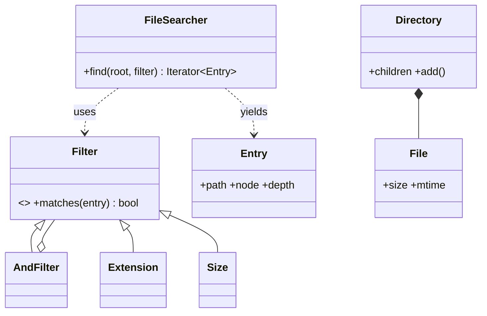

# 设计题解：Linux find 命令 API（File Search API）

## 题目与澄清

你要设计一个类似 Linux `find` 的搜索 API：给定一棵目录树，按大小、格式（后缀）、名字等条件跨目录找文件，条件如「大于 5MB 的文件」「所有 XML 文件」。接口要干净、可扩展：以后加新条件，不该去改搜索代码。

先用两句话说清这个系统：**有一棵已经存在的目录树，我们要提供一个函数，按条件（大小、后缀、名字……）把树里满足条件的文件找出来。** 难点不在遍历，而在“条件”怎么表示，才能在不改搜索代码的前提下新增条件、并让条件自由组合。

开场的三个澄清问题与它们改变的东西：

1. **“树是内存里的对象，还是真实磁盘？”** 答“内存里的”，我们直接遍历对象；答“磁盘”，遍历换成 `os.scandir`，但过滤器完全不变——这正是把“遍历”和“判断”分开的好处。我们提供 `scan_disk` 把磁盘读成同一种树来演示这一点。
2. **“多个条件之间是什么关系？只有 AND，还是还要 OR、NOT？”** 只有 AND，可以用一个过滤器列表；有 OR 和 NOT，就需要可递归组合的结构（决策一）。
3. **“结果是要全部列表，还是边找边处理？符号链接要不要跟随？”** 决定返回列表还是生成器，以及要不要做环检测（决策三、四）。

不做：按文件内容搜索、权限和属主、并行遍历、`-exec` 执行命令（结果是迭代器，调用方自己消费就行）。

## 需求与分级

- **第 1 关：单个条件的搜索。** 目录树（`Directory` / `File`）和 `find(root, filter)`：按后缀找“所有 XML 文件”，按大小找“大于 5MB 的文件”，按名字通配符找。这一关为节点类型、`Filter` 抽象基类与几个最基本的子类（`Extension`、`Size`、`NameGlob`）而存在。
- **第 2 关：条件组合。** “XML 且大于 5MB”“后缀是 py 或 md，但名字不以 old 开头”。这一关为 `AndFilter`、`OrFilter`、`NotFilter` 和 `& | ~` 运算符而存在（“可扩展接口”最自然的第一个追问就是组合）。
- **第 3 关：新增条件。** 面试官要求加“修改时间”或“是否空目录”。判据是：**改了几个文件？** 好的答案是新增一个类、零处修改。这一关为“开闭”而存在，也是 Amazon 评分里 “Logical and Maintainable” 的直接体现。
- **第 4 关：遍历的工程问题。** 惰性（取第一个结果就停）、剪枝（`-prune`）、深度限制、符号链接环、真实磁盘。

## 核心对象与职责

**一句话地图：** 树只负责存放，过滤器只负责回答“这个位置满足吗”，搜索器只负责走树，三者互不知道对方的细节。

- `File` / `Directory` / `Symlink`：三种节点，各自带 `kind`。**节点不存自己的路径**：一个目录可以通过符号链接从两个路径到达，存路径会出错；真实文件系统里名字也是存在父目录里的。`Directory` 拥有“同一目录内名字唯一”这个不变量，重名抛 `DuplicateNameError`。
- `Entry`：遍历时临时构造的“路径 + 节点 + 深度”，不可变。过滤器看 `Entry`，因为“路径”和“深度”是遍历的产物，不属于节点。
- `Filter`：抽象基类，只有一个方法 `matches(entry) -> bool`，以及三个组合运算符。子类 `Extension`、`NameGlob`、`Size`、`Modified`、`OfType` 是叶子条件；`AndFilter`、`OrFilter`、`NotFilter` 是组合节点。它们都是冻结的数据类，不可变，因此可复用、可跨线程共享。
- `FileSearcher`：持有“是否跟随链接”“最大深度”两项配置，`find` 是惰性生成器。它只认识 `Filter` 这个接口，不认识任何具体条件。
- `FindStats`：测试和调试用的计数器，证明惰性与剪枝真的发生。


图只画了有代表性的类：`OrFilter`、`NotFilter` 与 `AndFilter` 结构相同，`NameGlob` 与 `Extension` 一样是叶子条件，`Symlink` 与 `File` 一样挂在 `Directory` 下。

注意 `AndFilter` 与 `NotFilter` 都“持有”`Filter`，同时又是 `Filter`——这就是组合模式（Composite）：叶子和容器对调用方是同一个接口。

## 关键设计决策

### 决策一：条件怎么表示——一堆参数，还是一棵可组合的对象树

问题：要支持“大小、后缀、名字、时间”，还要 AND / OR / NOT。**选项 A：** `find(root, name=None, ext=None, min_size=None, max_size=None, after=None, ...)`。第 1 关就够用，但每加一个条件就要改函数签名与函数体；参数之间只能是 AND，OR 和 NOT 无处可放；调用方看不出哪些参数互相冲突。**选项 B：** 一个 `Filter` 接口加子类，组合靠 `AndFilter` / `OrFilter` / `NotFilter`。

选择：B，这是规约模式（Specification）——把“一条业务规则”做成一个可以回答是/否、可以组合的小对象，同时也是组合模式（Composite）的一次应用。例：`Extension("xml") & Size.over("5MB")` 是一棵两个叶子的树，求值时先问左边，左边为假就不问右边（短路，对应 POSIX `find` 对 `-a` 的要求）。因此**便宜的条件（名字、后缀）放左边，昂贵的（读内容）放右边**。

两个细节：组合运算符返回新对象，不修改原对象，所以 `big = Size.over("5MB")` 可以在三个不同表达式里复用；`Not` 没有“只匹配文件”的隐含语义——`~Extension("py")` 会把目录也选进来，要排除目录必须显式写 `& OfType(Kind.FILE)`，测试里有这条。

### 决策二：遍历和判断分开，还是让每个节点自己“搜索”

问题：**选项 A：** 给节点加方法 `File.search(filter)`、`Directory.search(filter)`，递归调用子节点（经典的组合模式写法）。**选项 B：** 节点只是数据，`FileSearcher.find` 是外部函数。

选择：B。原因是节点上的 `search` 会把“遍历策略”（深度优先还是广度优先、要不要跟随链接、要不要剪枝）固化进节点；而这些恰恰是面试官最爱追问、最可能变化的部分。B 里只有一处遍历代码，遍历策略的所有变化只影响 `FileSearcher`。另外，节点不存路径、不知道搜索的存在，也就不需要为符号链接指向同一目录的情形做特殊处理。

这是“拒绝模式”的一个例子：我们没有用访问者模式（Visitor）。访问者适合“对同一棵树做很多种互不相关的操作”，而这里的操作只有一种——收集满足条件的位置；“对结果做什么”（打印、求总大小、删除）是调用方消费迭代器的事。

### 决策三：返回列表，还是惰性生成器；递归，还是显式栈

问题：树可能有几亿个节点。**选项 A：** 返回 `list[str]`，递归遍历。简单，但必须走完整棵树才能返回第一个结果；目录深度超过约 1000 层时 Python 抛 `RecursionError`；内存里要装下所有结果。**选项 B：** `find` 是生成器（`yield`），内部用一个显式栈做深度优先。

选择：B。调用方 `next(searcher.find(...))` 只取第一个结果时，只会走到第一个匹配为止：测试里 `a.txt` 前面只有根和 `.bashrc`，`FindStats.visited` 恰好是 3。3000 层的目录链也能搜（测试里有）。栈里放的是待访问的 `Entry`，同一目录的子项按名字**逆序**压栈，这样弹出时是字典序，输出稳定、测试好写。

复杂度：访问每个节点一次，O(N)（N 为访问到的节点数）；每个目录排序一次，O(k log k)；栈里至多存当前路径上每层的兄弟节点。诚实地说，跟随链接时每个目录要把祖先链复制成新集合，最坏 O(深度) 每目录。

### 决策四：符号链接环——用全局 visited，还是祖先链

问题：目录 `/a` 里有链接 `/a/loop → /a`。跟随链接会无限循环。**选项 A：** 全局 `visited` 集合：展开过的目录不再展开。能防环，但会漏报：`/alias → /a` 和 `/a` 都是合法的路径，搜 `x.txt` 应该得到 `/a/x.txt` 和 `/alias/x.txt` 两个结果，全局 visited 会漏掉第二个。**选项 B：** 每个栈项带一个“祖先目录 id 链”；展开目录前检查它是否已在自己的祖先链里——只有“走回了自己的祖先”才是环。

选择：B。测试 `test_following_links_terminates_on_cycles_and_reports_both_legal_paths` 就是这个差别。默认不跟随链接（和 `find` 默认的 `-P` 一致），把链接当叶子，根本没有环的问题；悬空链接（目标不存在）跟随时也当叶子处理。

### 决策五：要不要为 `-size` 等条件各自建类层级

坦白一点：`Size`、`Modified` 这类“区间”条件，也可以做成一个通用的 `Range(attr, lo, hi)`。我们没有，因为 `Size` 要附带“只有普通文件才有大小”这条语义，并且 `Size.over("5MB")` 要表达“严格大于”，这些都是该条件自己的规则，通用类反而要把它们推给调用方。这是“简单的答案”：每个条件一个小类，每个类 ≤ 10 行，新增条件不需要理解通用框架。

## 代码走读

%% code:begin solution.py %%
```python
"""Linux find 命令 API（File Search API）：一棵目录树 + 可组合的过滤器 + 惰性遍历。

设计五行：
1. 树节点只有三种：`File`、`Directory`、`Symlink`；节点不存自己的路径，路径是遍历时算出的 `Entry`。
2. 过滤器 `Filter` 只有一个方法 `matches(entry) -> bool`（Specification 模式）；`& | ~` 组合出 AND / OR / NOT。
3. 新增一种条件 = 新增一个 `Filter` 子类，`FileSearcher` 和已有过滤器一行都不用改。
4. 遍历是惰性生成器 + 显式栈：取第一个结果不必走完整棵树，深目录不会撞递归上限。
5. 符号链接默认不跟随；跟随时只用“当前祖先链”检测环，不用全局 visited（否则会漏掉合法的第二条路径）。
"""

from __future__ import annotations

import fnmatch
import os
import re
from abc import ABC, abstractmethod
from collections.abc import Callable, Iterator
from dataclasses import dataclass, field
from enum import Enum


class FindError(Exception):
    """本模块的失败基类。"""


class InvalidSizeError(FindError):
    """无法解析的大小字符串，例如 "5XB"。"""


class DuplicateNameError(FindError):
    """同一目录下已有同名节点。"""


# ───────────────────────────── 节点 ─────────────────────────────

class Kind(Enum):
    FILE = "file"
    DIR = "dir"
    SYMLINK = "symlink"


@dataclass
class File:
    name: str
    size: int                                     # 字节
    mtime: int = 0                                # Unix 秒；时间由调用方给，逻辑里不读系统时钟
    kind = Kind.FILE


@dataclass
class Symlink:
    name: str
    target: str                                   # 绝对路径；解析发生在遍历时，所以允许悬空
    mtime: int = 0
    size: int = 0
    kind = Kind.SYMLINK


@dataclass
class Directory:
    name: str
    mtime: int = 0
    size: int = 0
    children: dict[str, "Node"] = field(default_factory=dict)
    kind = Kind.DIR

    def add(self, node: "Node") -> "Node":
        if node.name in self.children:
            raise DuplicateNameError(node.name)
        self.children[node.name] = node
        return node


Node = File | Directory | Symlink


@dataclass(frozen=True, slots=True)
class Entry:
    """遍历到的一个位置：路径 + 节点 + 深度。过滤器看 Entry，不看裸节点。"""
    path: str
    node: Node
    depth: int

    @property
    def name(self) -> str:
        return self.node.name


# ───────────────────────────── 过滤器（Specification）─────────────────────────────

class Filter(ABC):
    """一个谓词。组合运算符返回新对象，不改原对象：不可变，所以可复用、可跨线程共享。"""

    @abstractmethod
    def matches(self, entry: Entry) -> bool: ...

    def __and__(self, other: "Filter") -> "Filter":
        return AndFilter(self, other)

    def __or__(self, other: "Filter") -> "Filter":
        return OrFilter(self, other)

    def __invert__(self) -> "Filter":
        return NotFilter(self)


class AllFilter(Filter):
    def matches(self, entry: Entry) -> bool:
        return True


@dataclass(frozen=True)
class AndFilter(Filter):
    left: Filter
    right: Filter

    def matches(self, entry: Entry) -> bool:
        return self.left.matches(entry) and self.right.matches(entry)   # 短路：便宜的条件放左边


@dataclass(frozen=True)
class OrFilter(Filter):
    left: Filter
    right: Filter

    def matches(self, entry: Entry) -> bool:
        return self.left.matches(entry) or self.right.matches(entry)


@dataclass(frozen=True)
class NotFilter(Filter):
    inner: Filter

    def matches(self, entry: Entry) -> bool:
        return not self.inner.matches(entry)


@dataclass(frozen=True)
class NameGlob(Filter):
    """`-name`：只匹配最后一段名字，区分大小写；`*` 不会跨目录，因为名字里没有 `/`。"""
    pattern: str

    def matches(self, entry: Entry) -> bool:
        return fnmatch.fnmatchcase(entry.name, self.pattern)


@dataclass(frozen=True)
class Extension(Filter):
    """扩展名（不含点，不区分大小写）：`a.tar.gz` 取最后一段 `gz`；`.bashrc` 这类隐藏文件没有扩展名。"""
    ext: str

    def matches(self, entry: Entry) -> bool:
        stem = entry.name.lstrip(".")
        return "." in stem and stem.rsplit(".", 1)[1].lower() == self.ext.lower()


_UNITS = {"": 1, "B": 1, "KB": 1024, "MB": 1024 ** 2, "GB": 1024 ** 3}


def parse_size(text: str) -> int:
    """"5MB" → 5242880；单位按 1024 进制，和 `find -size` 的 k / M / G 一致。"""
    m = re.fullmatch(r"\s*(\d+)\s*([A-Za-z]*)\s*", text)
    unit = m.group(2).upper() if m else None
    if m is None or unit not in _UNITS:
        raise InvalidSizeError(text)
    return int(m.group(1)) * _UNITS[unit]


@dataclass(frozen=True)
class Size(Filter):
    """闭区间 [min_bytes, max_bytes]，None 表示不限。只有普通文件有“大小”，目录和链接恒不匹配。"""
    min_bytes: int | None = None
    max_bytes: int | None = None

    @classmethod
    def over(cls, text: str) -> "Size":
        return cls(min_bytes=parse_size(text) + 1)           # “> 5MB”是严格大于

    def matches(self, entry: Entry) -> bool:
        if entry.node.kind is not Kind.FILE:
            return False
        size = entry.node.size
        return ((self.min_bytes is None or size >= self.min_bytes)
                and (self.max_bytes is None or size <= self.max_bytes))


@dataclass(frozen=True)
class Modified(Filter):
    after: int | None = None
    before: int | None = None

    def matches(self, entry: Entry) -> bool:
        t = entry.node.mtime
        return (self.after is None or t >= self.after) and (self.before is None or t <= self.before)


@dataclass(frozen=True)
class OfType(Filter):
    kind: Kind

    def matches(self, entry: Entry) -> bool:
        return entry.node.kind is self.kind


# ───────────────────────────── 遍历 ─────────────────────────────

@dataclass
class FindStats:
    """测试用它证明“惰性”和“剪枝”真的发生了，而不是只看结果对不对。"""
    visited: int = 0                              # 取出并检查过的 Entry 数
    dirs_entered: int = 0                         # 真正展开了 children 的目录数


class FileSearcher:
    def __init__(self, *, follow_symlinks: bool = False, max_depth: int | None = None) -> None:
        self._follow = follow_symlinks
        self._max_depth = max_depth

    def find(self, root: Directory, flt: Filter | None = None, *,
             prune: Callable[[Entry], bool] | None = None,
             stats: FindStats | None = None) -> Iterator[Entry]:
        """前序深度优先、同目录按名字排序。根目录自己不输出。

        `prune(entry)` 为真时该目录本身仍会被 `flt` 检查，但不展开子节点（对应 `find -prune`）。
        栈里放 (entry, 祖先目录 id 链)：祖先链只用来检测符号链接环。
        """
        flt = flt or AllFilter()
        stats = stats if stats is not None else FindStats()
        stack: list[tuple[Entry, frozenset[int]]] = [(Entry("/", root, 0), frozenset())]
        while stack:
            entry, ancestors = stack.pop()
            stats.visited += 1
            if entry.depth > 0 and flt.matches(entry):
                yield entry
            node = self._resolve_link(root, entry.node)
            if node is None or node.kind is not Kind.DIR or id(node) in ancestors:
                continue                          # 文件、悬空链接，或祖先链上已有的目录（环）
            if (prune is not None and prune(entry)) or (
                    self._max_depth is not None and entry.depth >= self._max_depth):
                continue
            stats.dirs_entered += 1
            chain = ancestors | {id(node)}
            base = "" if entry.path == "/" else entry.path
            for name in sorted(node.children, reverse=True):     # 逆序压栈，弹出时就是升序
                stack.append((Entry(f"{base}/{name}", node.children[name], entry.depth + 1), chain))

    def _resolve_link(self, root: Directory, node: Node) -> Node | None:
        if node.kind is not Kind.SYMLINK:
            return node
        if not self._follow:
            return None                           # 默认把链接当叶子：既不展开，也不会有环
        current: Node = root
        for part in (p for p in node.target.split("/") if p):
            if current.kind is not Kind.DIR or part not in current.children:
                return None
            current = current.children[part]
        return current

    def paths(self, root: Directory, flt: Filter | None = None, **kw) -> list[str]:
        return [e.path for e in self.find(root, flt, **kw)]


def scan_disk(path: str, _top: str | None = None) -> Directory:
    """把真实磁盘目录读成同样的树，于是同一套过滤器可以搜真实文件。
    链接记成 Symlink，目标改写成“相对扫描根的绝对路径”（指到根外的记成悬空）。"""
    top = _top or os.path.realpath(path)
    root = Directory(os.path.basename(path.rstrip("/")) or "/")
    with os.scandir(path) as it:
        for e in it:
            st = e.stat(follow_symlinks=False)
            if e.is_symlink():
                rel = os.path.relpath(os.path.realpath(e.path), top)
                root.add(Symlink(e.name, "/" + rel if not rel.startswith("..") else "/<outside>", int(st.st_mtime)))
            elif e.is_dir(follow_symlinks=False):
                child = scan_disk(e.path, top)
                child.mtime = int(st.st_mtime)
                root.add(child)
            else:
                root.add(File(e.name, st.st_size, int(st.st_mtime)))
    return root


if __name__ == "__main__":
    root = Directory("")
    docs = root.add(Directory("docs"))
    docs.add(File("a.xml", 6 * 1024 ** 2))
    docs.add(File("b.txt", 10))
    root.add(File("c.xml", 100))
    big_xml = Size.over("5MB") | Extension("xml")
    print(FileSearcher().paths(root, big_xml & OfType(Kind.FILE)))
```
%% code:end %%

看四个位置：

1. **`Filter` 与 `AndFilter`**：`&` 返回一个新的 `AndFilter`，`matches` 里用 Python 的 `and`，天然短路。新增条件的全部工作就是继承 `Filter` 并实现 `matches`，测试里现场写了一个 `EmptyDir`，`FileSearcher` 没有任何改动。
2. **`parse_size` 与 `Size.over`**：`"5MB"` 解析成 5242880，`over` 把下界设为 `+1`，因为“大于 5MB”是严格大于；无法解析的字符串抛 `InvalidSizeError`，而不是返回 0。
3. **`FileSearcher.find`**：栈项是 `(entry, ancestors)`。弹出后先问过滤器并 `yield`，再决定要不要展开。展开前依次检查：是不是目录、是不是已经在祖先链里（环）、`prune` 是否要求跳过、是否到了最大深度。`prune` 为真时目录本身仍会被过滤器检查，但子节点不会被展开，对应 `find -prune`。
4. **`_resolve_link`**：链接的解析发生在遍历时，不在创建链接时，所以链接可以悬空，也可以指向后来才创建的东西。

## 测试与自检

测试固定的是行为：

- **各条件的边界：** 后缀取最后一段（`archive.tar.gz` → `gz`）、不区分大小写（`spec.XML` 匹配 `xml`）、隐藏文件 `.bashrc` 没有后缀；“大于 5MB”是严格大于，恰好 5MB 的文件不在结果里，而 `Size(min_bytes=5MB)` 是闭区间，包含它。
- **组合：** `(py | md) & ~名字以 old 开头` 的结果是手算出来的四个路径；`~Extension("py")` 会选中目录，需要 `OfType` 限定。
- **短路：** 用一个会记录调用的过滤器放在 `&` 右边，只有三个 `.py` 文件触发它。
- **惰性与剪枝：** 取第一个结果访问了 3 个位置；剪掉 `src` 后，访问数比完整遍历少 4，展开的目录数少 2。
- **深度：** 3000 层的目录链不触发 `RecursionError`。
- **符号链接：** 不跟随时链接是叶子；跟随时 `/a/loop` 不会死循环，`/alias/x.txt` 与 `/a/x.txt` 都出现在结果里。
- **真实磁盘：** `scan_disk` 读 `tmp_path` 里的真实目录和链接，同一套过滤器直接可用。

两分钟演示：建一个三层的小树，现场写 `Extension("xml") & Size.over("5MB")`，打印路径；再把 `&` 换成 `|` 看结果变化；最后说“新增条件只加一个类”。

## 扩展与追问

**新需求**

- *按修改时间、属主、权限搜索：* 各加一个 `Filter` 子类（修改时间 `Modified` 已有），`FileSearcher` 不动。
- *查询语言（`ext=py and size>1k`）：* 写一个递归下降解析器，把字符串变成 `Filter` 树。`Filter` 树就是它的语法树，不需要改任何已有类。
- *按文件内容搜索：* 一个 `Contains(text)` 过滤器，读取内容。它昂贵，所以必须放在 `&` 的右边。
- *`-exec` / 删除：* 不是搜索器的事，对 `find` 返回的迭代器做 `for` 循环即可。

**并发与线程安全**

过滤器是冻结的，没有可变状态，可以被多个线程共享；`FileSearcher` 的配置在构造后不变，`find` 的所有局部状态（栈、祖先链）都在生成器里，所以同一个搜索器可以同时跑多次搜索。不安全的是**遍历中途有人修改树**：`sorted(node.children)` 在目录里取一次快照，所以遍历不会因为“字典在迭代时改变大小”而崩溃，但可能漏掉或看到新旧混合的内容——一致的快照需要读写锁或写时复制，那是另一个题（见 [[solution-in-memory-file-system]]）。

**持久化与规模**

真实磁盘用 `os.scandir`：它在遍历目录时就带回文件类型与部分属性，避免对每个文件再发一次系统调用。若遍历是瓶颈，可以按子目录并行，每个工作者独占一棵子树，结果经队列汇合。若要反复搜索同一棵树，就需要索引（倒排后缀表、按大小排序的数组），这时 `Filter` 可以增加一个可选的“我能用哪个索引”的方法，但接口先不要为此设计。

## 常见错误

- **一个巨大的参数列表。** `find(root, name, ext, min_size, ...)`：第 3 关的“加一个条件”就是改签名。
- **为每种组合建一个类。** `ExtAndSize`、`ExtOrName` ……类数量随条件数指数增长；组合应该靠 `And` / `Or` / `Not`。
- **递归遍历。** 深目录触发 `RecursionError`。
- **全局 visited 防环。** 会漏报合法的第二条路径。
- **把路径存进节点。** 同一个目录经由链接可以从两个路径到达，存路径必然有一条是错的。
- **没有说明语义：** `*` 是否跨目录（名字里没有 `/`，所以不跨）、后缀是否区分大小写、`archive.tar.gz` 的后缀是 `gz` 还是 `tar.gz`——这些都是要在面试里先说出来的规则，不要让面试官替你发现。
- **Java 习惯：** 给每个节点写 `getName()`、写访问者接口、写 `SearchCriteriaFactory`。Python 里属性、运算符重载和生成器已经覆盖这些需求。
- **返回内部字典。** `Directory.children` 在测试里直接可见是为了树的构造，但搜索结果永远是新建的 `Entry`，不要把内部容器交给调用方。

## 45 分钟怎么分配

- **0–5 分钟：澄清。** 内存还是磁盘；条件之间是否要 OR / NOT；符号链接；语义（大小写、后缀）。
- **5–10 分钟：对象。** 画 `File / Directory / Entry / Filter / FileSearcher`，说“遍历和判断分开”。
- **10–25 分钟：第 1、2 关。** 写节点、`Filter` 基类、`Extension` 和 `Size`，再写 `AndFilter` 与运算符。跑通 “XML 且大于 5MB”。
- **25–35 分钟：第 3 关与遍历。** 现场加一个新条件证明“零处修改”；把递归改成生成器加显式栈，口头解释惰性。
- **35–42 分钟：测试与符号链接。** 写三个断言：后缀边界、组合、环不死循环。
- **42–45 分钟：扩展。** 查询语言、并行遍历、索引。
- **时间不够时先砍：** `scan_disk`、`Modified`、`prune`；保住 `Filter` 的组合和惰性遍历。

## 延伸阅读

- [POSIX `find` 规范](https://pubs.opengroup.org/onlinepubs/9699919799/utilities/find.html)：AND 隐含、`-o` 为 OR、`!` 为 NOT，以及短路求值；这里的 `&`、`|`、`~` 与之对应。
- [Python 官方文档 `fnmatch`](https://docs.python.org/3/library/fnmatch.html)：`fnmatchcase` 区分大小写，结果不随操作系统变化；`*` 与 `?` 不特殊对待 `/`，所以只拿最后一段名字去匹配。
- [规约模式（Specification）](https://martinfowler.com/apsupp/spec.pdf)：Evans 与 Fowler 对可组合业务规则的描述：每条规则只回答「这个对象满足吗」，用 and / or / not 组合成新规则。
- 相关题解：[[solution-in-memory-file-system]]（同一棵树的另一面）。
- 概念：[[patterns.structural|结构型模式（Structural）]]、[[oop.interfaces|接口与抽象基类]]。
