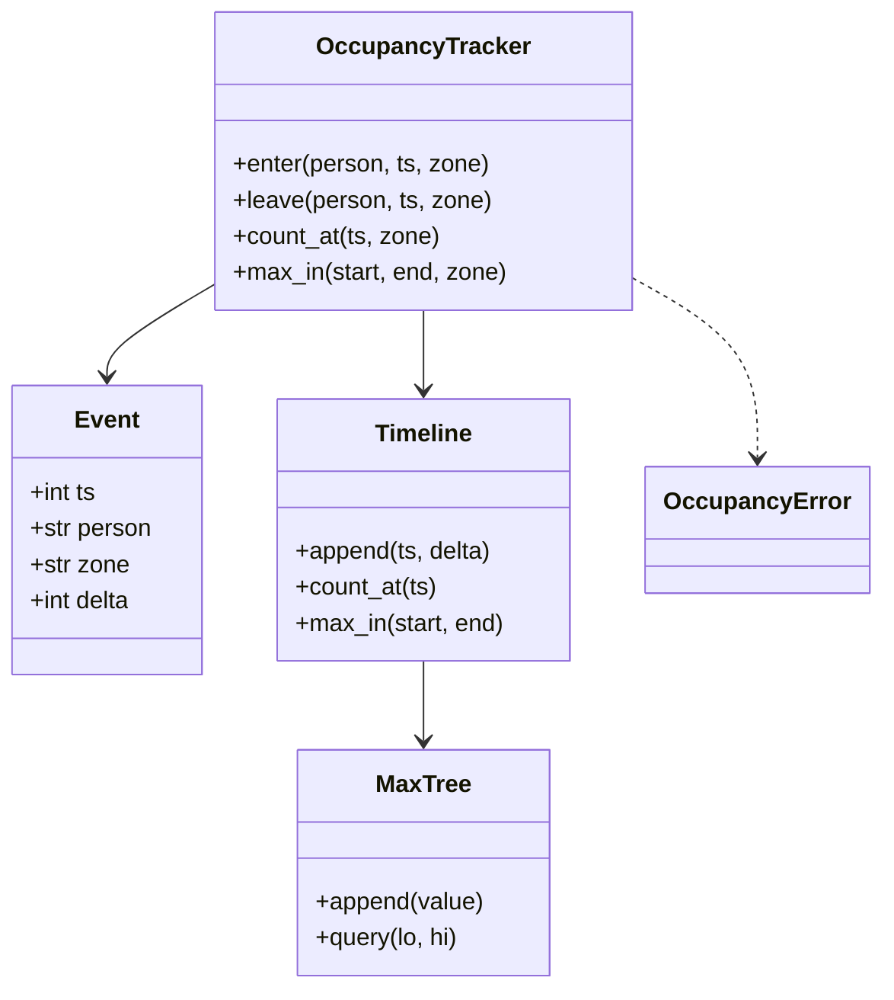

# 设计题解：办公室人数追踪（Occupancy Tracker）（low priority）

## 题目与澄清

办公室人数追踪要回答一个看似简单的问题：任意时刻，楼里有多少人？员工刷卡进门、刷卡出门，每刷一次就产生一个事件，系统要把这些事件记下来，并能回答「现在有多少人」「昨天下午三点有多少人」「上午九点到十点之间最多有过多少人」。它介于对象设计和小型数据库设计之间：既要写类，也要说清数据模型，甚至把同一个模型写成 SQL。

面试官这样提出：设计一个系统，能追踪办公室在任意时刻有多少人。第一步，记录进入和离开，回答当前人数。第二步，回答过去任意时间戳的人数。第三步追问：有多个楼层或楼栋怎么办，事件重复或迟到怎么办。第四步：如果数据存在数据库里，查询怎么写；查询次数很多时怎么加速。

开场要问的三个澄清问题：

1. **查询只问「现在」，还是要问任意历史时刻？** 只问现在，一个集合加计数器就够了；问历史，就必须保留历史，数据模型要从「存状态」变成「存变化」。这个答案决定整道设计的形状。
2. **事件按时间顺序到达吗？同一秒内的多个事件谁先谁后？** 顺序到达时可以只追加；乱序就要缓冲或换结构。同一秒内的事件按到达顺序处理，这个约定要说出来。
3. **有几个楼层／楼栋？要不要区分「谁在楼里」和「有多少人」？** 只要人数，存 +1／−1 就够；要知道是谁，还要记人。多个区域决定要不要分别维护时间线。

范围外内容：人脸识别与考勤规则、访客与尾随进门、事件的鉴权、跨天归档。

## 需求与分级

| 关 | 需求 | 这一关逼出的设计 |
|---|---|---|
| 第 1 关 | 记录进入和离开，回答当前人数 | 存事件而不是人数；非法序列（重复进入、没进就出）怎么处理 |
| 第 2 关 | 回答任意时间戳的人数 | 前缀和；时间有序所以用二分查找；区间最大要把「区间开始时已在楼里的人」算进去 |
| 第 3 关 | 多个楼层；事件重复或迟到 | 每个区域一条时间线，外加一条全局的；重试的幂等；倒流的事件被拒绝 |
| 第 4 关 | 同一个模型写成 SQL；查询很多时的加速 | 事件表加窗口函数；只追加的线段树；预聚合 |

第 1 关最容易写成的版本：

```python
class Office:
    def __init__(self):
        self.people = set()
    def enter(self, p): self.people.add(p)
    def leave(self, p): self.people.discard(p)
    def count(self): return len(self.people)
```

它能回答「现在」，却无法回答「昨天三点」，因为状态被覆盖了，历史已经丢了。再进一步的朴素版本是保留事件列表，每次查询 `sum(e.delta for e in events if e.ts <= t)`，对 n 个事件每次查询要扫 n 步，一百万个事件就是一百万步。后面几关都是在这两个版本之间找一条路。

## 核心对象与职责

人数追踪可以用两句话说清：它把每一次进出记成一个带时间的事件，永远只往后追加；人数不是存下来的，而是从事件累加出来的，所以任何历史时刻都能回答。

- `Event`：一次进出（时间戳、人、区域、+1 或 −1）的不可变记录。时间戳由调用方给出，追踪器从不读系统时钟。
- `Timeline`：一条只追加的人数时间线。拥有三样东西：事件时间数组、前缀和数组（处理完第 i 个事件后的人数）、区间最大值的线段树。不变量：时间数组非递减，前缀和数组与它等长。
- `OccupancyTracker`：对外的入口。拥有每个区域的 `Timeline`、一条全局 `Timeline`，以及「每个人最近一次事件」。它负责校验事件合法（谁能进、谁能出、时间不能倒流）并在一把锁里把事件写进相关的时间线。
- 错误类：`AlreadyInside`、`NotInside`、`OutOfOrder`，继承同一个基类，调用方可以分别捕获。



`Timeline` 把「怎么存、怎么查」封起来，`OccupancyTracker` 只管「事件合不合法」。两者的分工有一个检验：如果要把内存里的数组换成数据库表，`Timeline` 被替换，`OccupancyTracker` 的校验逻辑不动。

## 关键设计决策

### 决策一：存事件，不存人数

问题：既然要回答历史，数据怎么存？

- **选项甲，存状态**：每次变化覆盖「当前人数」。写和读都是 O(1)，但历史没了。
- **选项乙，存事件**：只追加 `(时间, 人, ±1)`；任一时刻的人数是该时刻之前所有 delta 的和。写 O(1)，读需要累加。
- **选项丙，每秒存一份快照**：读 O(1)，但一天 86,400 份，且回答不了秒内的变化。

选择：乙，再用前缀和把读变快。这是事件溯源（Event Sourcing）的思想：把变化当作事实来存，状态是从事实推出来的。它还带来审计能力（谁几点进来）和重建能力（算错了可以重放）。

示例：事件 `a进@10, b进@20, c进@30, a出@40, d进@40, b出@50, c出@60`，前缀和数组是 `[1, 2, 3, 2, 3, 2, 1]`。时刻 25 的人数是 2（a、b），时刻 45 的人数是 3（b、c、d）。

### 决策二：前缀和加二分，区间最大值该用什么

问题：`count_at(t)` 怎么快？`max_in(a, b)` 怎么快？

对 `count_at`：事件按时间追加，所以时间数组有序，前缀和数组也只追加。`bisect_right(times, t) - 1` 找到最后一个时间不晚于 t 的事件，答案就是它对应的前缀和，没有则为 0。追加 O(1)，查询 O(log n)。用 `bisect_right` 而不是 `bisect_left`，因为「等于 t 的事件也算」，这个差别正是常见的 off-by-one。

对 `max_in(a, b)`：答案是两部分的最大值，**区间开始时已经在楼里的人数** `count_at(a)`，与区间内每个事件之后的人数。后者是前缀和数组里一段连续的下标，求一段的最大值：

- **扫描**：O(k)，k 是区间内的事件数。最简单，区间短时完全够用。
- **稀疏表（Sparse Table）**：O(1) 查询，但数据只增时每次追加都要重建，适合静态数据。
- **线段树（Segment Tree）**：O(log n) 查询，追加摊还 O(1)；容量满了翻倍重建。适合持续追加又要频繁查询。

选择：在第 2 关用扫描就够了，说清楚它的代价是 O(k)；在第 4 关「查询次数很多」的追问下换成线段树。参考解直接实现了线段树，让它封在 `Timeline` 里，对外接口 `max_in` 不变，这也正是「第 4 关不碰前面的类」的证据。这里没有模式：线段树是数据结构，不是设计模式。

### 决策三：多区域——每个区域一条时间线，再加一条全局的

问题：多个楼层，要能问「3 楼现在多少人」和「整个办公室多少人」。

- **选项甲，查询时把各区域相加**：`count_at` 是各区域 `count_at` 之和，O(区域数 × log n)。对 `count_at` 够用。
- **选项乙，每个事件同时写进所在区域的时间线和一条全局时间线**：全局查询和区域查询都是一次二分。

甲方案对 `max_in` 是错的：区域一在 1 点有 1 人、区域二在 3 点有 1 人，各自峰值是 1 和 1，相加得 2，但办公室任意时刻最多只有 1 人（测试里有这个用例）。**峰值不能相加，只有前缀和才能相加。**

选择：乙。代价是每个事件写两份，换来所有查询的形状一致。`zone=ALL`（即 `None`）表示整个办公室。换楼层是一次离开加一次进入：离开的区域必须与进入时的区域一致，否则抛 `NotInside`。

### 决策四：重复与迟到——重试幂等，倒流拒绝

问题：刷卡机会重发，网络会延迟。

**重复**：同一个人连续两个 `enter` 不是同一件事。如果第二个与第一个**完全相同**（同时间、同区域、同方向），它是网络重试，应当被忽略并返回 `False`；如果内容不同（时间或区域变了），那是真正的非法序列，抛 `AlreadyInside`。判断依据是「这个人最近一次事件」，所以追踪器为每个人只保存一条，内存随人数而不是随事件数增长。

**迟到**：时间比已入账的最后一个事件更早的事件，抛 `OutOfOrder`。这是有意的保守：前缀和数组只追加，插入中间会让后面所有前缀和失效。要接受乱序，有两条路：在入口加一个缓冲区，等水位线（比如「当前时间减 5 分钟」）之前的事件都到齐再入账，接受 5 分钟的延迟；或者换成 Fenwick 树（树状数组），支持任意顺序的单点更新与前缀查询，每次 O(log n)。

选择：拒绝加返回值。拒绝时**不改变任何状态**：先校验，再写数组。测试里「被拒绝的事件什么都没改」这一条断言守着这个顺序。

### 决策五：同一个模型写成 SQL

事件表 `presence_events(seq, ts, person, zone, delta)`，`seq` 是自增主键，同一秒的事件靠它定序，否则窗口函数的顺序不确定。

```sql
-- 某时刻的人数
SELECT COALESCE(SUM(delta), 0) FROM presence_events WHERE ts <= :t;

-- 区间最大：窗口函数求前缀和，再并上「区间开始时的人数」
WITH running AS (SELECT ts, SUM(delta) OVER (ORDER BY ts, seq) AS cnt FROM presence_events)
SELECT MAX(cnt) FROM (
  SELECT cnt FROM running WHERE ts BETWEEN :a AND :b
  UNION ALL
  SELECT COALESCE((SELECT SUM(delta) FROM presence_events WHERE ts <= :a), 0)
);
```

在真实数据库里，这个窗口函数每次查询是 O(n)。高频查询要把前缀和物化：写入事件时顺带记下当时的人数；或者按分钟做快照，每分钟存期末人数和这一分钟的峰值，区间最大就只读区间内的分钟数行。参考解里带了这两条 SQL，并在测试里用标准库 `sqlite3` 与内存版对拍。

### 决策六：时间由调用方给出，同一秒内按到达顺序

问题：事件的时间从哪来？同一秒内的多个事件怎么排？

- **选项甲，追踪器自己读系统时钟**：`enter(person)` 不带时间，内部取 `time.time()`。调用方省事，但测试无法固定时间，也没法重放历史数据；刷卡机批量上传时，事件时间应当是刷卡发生的时间，而不是服务器收到的时间。
- **选项乙，时间戳是参数**：`enter(person, ts)`，追踪器只比较大小，从不读时钟。测试可以随意构造「昨天下午三点」，导入历史数据也是同一个入口。

选择：乙。同一秒内的事件，用到达顺序定先后，前缀和数组里它们占相邻的位置。后果有两个，都要能说出口：`count_at(t)` 总是 t 这一秒**结束时**的人数（`bisect_right` 把同一秒的所有事件都算进来）；`max_in` 看到的是秒内的中间状态，比如同一秒里先出后进，人数先降后升，先进后出则会多出一个短暂的峰值。如果业务要求「同一秒内先处理离开」，那是需求问题，实现上在写入前按 `(时间, 方向)` 排序。SQL 版里的 `seq` 起的是同一个作用：它把「到达顺序」写进数据，窗口函数才有确定的结果。

## 代码走读

下面是完整的参考解，约 165 行有效代码，全部经过测试。

%% code:begin solution.py %%
```python
"""办公室人数追踪：任意时刻楼里有多少人，某段时间里最多有多少人。

设计五行：
1. 不存「人数」，存进出事件 (时间, 人, +1/-1)；任一时刻的人数是该时刻之前所有事件的前缀和。
2. 事件按时间追加，所以前缀和数组也只追加；`Timeline` 用二分查找回答「t 时刻多少人」。
3. 区间最大值用一棵只追加的线段树（`_MaxTree`），查询 O(log n)。
4. 楼层／楼栋是 `zone`：每个 zone 一条 `Timeline`，再加一条全局的；重复的重试事件被忽略，倒流的事件被拒绝。
5. 同一个模型可以直接写成 SQL（`SQL_COUNT_AT`、`SQL_MAX_IN`），测试里与内存版对拍。
"""

from __future__ import annotations

import bisect
import sqlite3
import threading
from collections.abc import Iterable
from dataclasses import dataclass

ALL = None  # 查询时 zone=ALL 表示整个办公室


class OccupancyError(Exception):
    """人数追踪的错误基类。"""


class AlreadyInside(OccupancyError):
    """这个人已经在楼里，又收到一次不同的进入事件。"""


class NotInside(OccupancyError):
    """这个人不在楼里，却收到离开事件。"""


class OutOfOrder(OccupancyError):
    """事件时间比已入账的最后一个事件更早。"""


@dataclass(frozen=True)
class Event:
    ts: int  # Unix 秒，由调用方给出；追踪器从不读系统时钟
    person: str
    zone: str
    delta: int  # +1 进入，-1 离开


class _MaxTree:
    """只追加的区间最大值线段树。容量不够时翻倍重建，append 摊还 O(1)，query O(log n)。"""

    _NEG = -(10**18)

    def __init__(self) -> None:
        self._cap = 1
        self._n = 0
        self._t = [self._NEG, self._NEG]

    def append(self, value: int) -> None:
        if self._n == self._cap:
            old = self._t[self._cap : self._cap + self._n]
            self._cap *= 2
            self._t = [self._NEG] * (2 * self._cap)
            self._t[self._cap : self._cap + len(old)] = old
            for i in range(self._cap - 1, 0, -1):
                self._t[i] = max(self._t[2 * i], self._t[2 * i + 1])
        i = self._cap + self._n
        self._t[i] = value
        self._n += 1
        i //= 2
        while i:
            self._t[i] = max(self._t[2 * i], self._t[2 * i + 1])
            i //= 2

    def query(self, lo: int, hi: int) -> int:
        """闭区间 [lo, hi] 的最大值；空区间返回极小值。"""
        result = self._NEG
        lo += self._cap
        hi += self._cap + 1
        while lo < hi:
            if lo & 1:
                result = max(result, self._t[lo])
                lo += 1
            if hi & 1:
                hi -= 1
                result = max(result, self._t[hi])
            lo //= 2
            hi //= 2
        return result


class Timeline:
    """一条只追加的人数时间线：times[i] 是第 i 个事件的时间，counts[i] 是处理完它之后的人数。"""

    def __init__(self) -> None:
        self._times: list[int] = []
        self._counts: list[int] = []
        self._tree = _MaxTree()

    def append(self, ts: int, delta: int) -> None:
        count = (self._counts[-1] if self._counts else 0) + delta
        self._times.append(ts)
        self._counts.append(count)
        self._tree.append(count)

    @property
    def size(self) -> int:
        return len(self._times)

    def count_at(self, ts: int) -> int:
        """ts 这一秒结束时的人数：最后一个 time <= ts 的事件之后的前缀和，没有则 0。"""
        i = bisect.bisect_right(self._times, ts) - 1
        return self._counts[i] if i >= 0 else 0

    def max_in(self, start: int, end: int) -> int:
        """闭区间 [start, end] 内出现过的最大人数：区间开始时的人数，与区间内每个事件之后的人数，取最大。"""
        lo = bisect.bisect_left(self._times, start)
        hi = bisect.bisect_right(self._times, end) - 1
        best = self.count_at(start)
        return max(best, self._tree.query(lo, hi)) if lo <= hi else best


class OccupancyTracker:
    """接收进出事件，回答人数查询。事件必须按时间不递减地到达。"""

    def __init__(self) -> None:
        self._all = Timeline()
        self._zones: dict[str, Timeline] = {}
        self._last: dict[str, Event] = {}  # 每个人最近一次事件，用来判断重复与合法性
        self._events: list[Event] = []
        self._last_ts: int | None = None
        self._lock = threading.Lock()

    # ---- 写 ----
    def enter(self, person: str, ts: int, zone: str = "main") -> bool:
        """记录进入。新事件返回 True；与上一个事件完全相同的重试返回 False。"""
        return self._record(Event(ts, person, zone, +1))

    def leave(self, person: str, ts: int, zone: str = "main") -> bool:
        return self._record(Event(ts, person, zone, -1))

    def _record(self, ev: Event) -> bool:
        with self._lock:
            last = self._last.get(ev.person)
            if last == ev:
                return False  # 同一事件重投：忽略，不是错误
            inside = last is not None and last.delta == +1
            if ev.delta == +1 and inside:
                raise AlreadyInside(ev.person)
            if ev.delta == -1 and (not inside or last.zone != ev.zone):  # type: ignore[union-attr]
                raise NotInside(ev.person)
            if self._last_ts is not None and ev.ts < self._last_ts:
                raise OutOfOrder(f"{ev.ts} < {self._last_ts}")
            self._all.append(ev.ts, ev.delta)
            self._zones.setdefault(ev.zone, Timeline()).append(ev.ts, ev.delta)
            self._last[ev.person] = ev
            self._events.append(ev)
            self._last_ts = ev.ts
            return True

    # ---- 读 ----
    def _timeline(self, zone: str | None) -> Timeline | None:
        return self._all if zone is ALL else self._zones.get(zone)

    def current(self, zone: str | None = ALL) -> int:
        with self._lock:
            t = self._timeline(zone)
            return t.count_at(self._last_ts) if t is not None and self._last_ts is not None else 0

    def count_at(self, ts: int, zone: str | None = ALL) -> int:
        with self._lock:
            t = self._timeline(zone)
            return t.count_at(ts) if t is not None else 0

    def max_in(self, start: int, end: int, zone: str | None = ALL) -> int:
        if start > end:
            raise ValueError("start 不能大于 end")
        with self._lock:
            t = self._timeline(zone)
            return t.max_in(start, end) if t is not None else 0

    def who_is_inside_at(self, ts: int) -> frozenset[str]:
        """ts 时在楼里的人：回放事件，O(n)。"""
        with self._lock:
            inside: set[str] = set()
            for ev in self._events:
                if ev.ts > ts:
                    break
                (inside.add if ev.delta > 0 else inside.discard)(ev.person)
            return frozenset(inside)

    @property
    def events(self) -> tuple[Event, ...]:
        with self._lock:
            return tuple(self._events)


# ---- 同一个模型的 SQL 版本 ----
SQL_SCHEMA = """
CREATE TABLE presence_events (
  seq INTEGER PRIMARY KEY AUTOINCREMENT,
  ts INTEGER NOT NULL, person TEXT NOT NULL, zone TEXT NOT NULL, delta INTEGER NOT NULL);
CREATE INDEX idx_presence_ts ON presence_events(ts)
"""
SQL_COUNT_AT = """
SELECT COALESCE(SUM(delta), 0) FROM presence_events
WHERE ts <= :t AND (:zone IS NULL OR zone = :zone)
"""
SQL_MAX_IN = """
WITH scoped AS (SELECT seq, ts, delta FROM presence_events WHERE (:zone IS NULL OR zone = :zone)),
running AS (SELECT ts, SUM(delta) OVER (ORDER BY ts, seq) AS cnt FROM scoped)
SELECT MAX(cnt) FROM (
  SELECT cnt FROM running WHERE ts BETWEEN :a AND :b
  UNION ALL
  SELECT COALESCE((SELECT SUM(delta) FROM scoped WHERE ts <= :a), 0)
)
"""


def load_sqlite(events: Iterable[Event]) -> sqlite3.Connection:
    """把事件灌进内存 SQLite；`seq` 在同一秒内给事件定序，窗口函数才有确定的顺序。"""
    db = sqlite3.connect(":memory:")
    db.executescript(SQL_SCHEMA)
    db.executemany(
        "INSERT INTO presence_events(ts, person, zone, delta) VALUES (?, ?, ?, ?)",
        [(e.ts, e.person, e.zone, e.delta) for e in events],
    )
    return db


if __name__ == "__main__":
    t = OccupancyTracker()
    for person, ts in (("a", 10), ("b", 20), ("c", 30)):
        t.enter(person, ts)
    t.leave("a", 40)
    t.enter("d", 40)
    print(t.count_at(25), t.count_at(45), t.max_in(41, 100))
```
%% code:end %%

**第一处：`Timeline.max_in`。** 先取 `count_at(start)`，再用 `bisect_left` 与 `bisect_right` 找出区间内事件的下标范围，对线段树查询这一段。`lo <= hi` 的判断处理了「区间内没有事件」，这时答案就是区间开始时的人数。漏掉 `count_at(start)` 是这道设计最常见的错误。

**第二处：`OccupancyTracker._record` 的顺序。** 先看是不是相同事件的重试（忽略），再校验是否合法（`AlreadyInside`／`NotInside`），再校验时间（`OutOfOrder`），最后才改数组。三道检查都在写入之前，所以任何异常都不会留下半个事件。整个方法在一把锁里：它是「校验加追加三处」的复合操作。

**第三处：`_MaxTree.append`。** 容量满了就翻倍并重建，摊还 O(1)；每次追加向上更新到根，O(log n)。叶子在 `self._cap + 下标`，查询时从两端向中间收拢，这是迭代式线段树的标准写法。

**第四处：SQL 与内存版共享一份语义。** `load_sqlite` 把追踪器的事件灌进内存数据库，测试对同一批随机事件比较三个答案：暴力求和、内存版、SQL 版。

## 测试与自检

测试按四关分组：

- 第 1 关：空办公室全是 0；`current` 等于进入减离开；重复进入和没进就出被拒绝；被拒绝的事件不改变任何状态。
- 第 2 关：事件之前为 0、事件时刻含该事件、之后保持（13 个时间点的完整序列）；同一秒内按到达顺序，这一秒结束时是 3；时间倒流被拒绝而相同时间戳允许；`max_in` 在区间开始时已有人、区间内无事件、端点闭合、反向区间等情况。
- 第 3 关：分区域与全局人数；区域峰值不能相加；换楼层；离开的区域不对被拒绝；相同事件的重试被忽略；迟到事件被拒绝且状态不变；事件列表是快照。
- 第 4 关：三个随机种子、各 150 次查询，三种实现对拍；1100 个事件覆盖线段树的多次扩容；8 个线程同时在各自的闸机上入场，总数不丢。

两分钟演示：依次进入 a、b、c，a 离开的同时 d 进入，问 `count_at(25)` 得 2，`count_at(45)` 得 3，`max_in(41, 100)` 得 3 并解释为什么区间内没有新事件也是 3。

## 扩展与追问

### 新需求

- **谁在楼里**：`who_is_inside_at(t)` 现在回放事件，O(n)。要快，就多维护一张访问区间表 `visits(person, enter_ts, exit_ts)`，查询是 `enter_ts <= t AND (exit_ts IS NULL OR exit_ts > t)`，在 `enter_ts` 上建索引。事件表与访问区间表是同一事实的两种投影，事件为准。
- **事件丢失（有人进了没刷出）**：每天固定时间对账，把仍在「楼里」的人补一个来源标为自动关闭的离开事件；对不合理的停留时长告警。数据质量问题要在模型里有位置。
- **按楼分区**：事件加 `building` 字段，分区存放；全公司人数是各楼之和，但峰值不能相加（见决策三）。
- **同一秒内「先出后进」还是「先进后出」**：改变的是中间状态，也就改变 `max_in` 可能看到的峰值。这是要问清的业务规则；实现上在写入前按 `(ts, delta)` 排序，或者在 `seq` 上体现。

### 并发与线程安全

多个闸机同时上报，写入是「校验加追加三处」的复合操作，所以 `_record` 整体在一把 `threading.Lock` 里；GIL 不会让这个复合操作原子。读也在锁里，以保证读到的前缀和数组与时间数组等长。吞吐更高时，改成每个闸机一个队列，由单个消费者线程按时间归并后写入（单写者），这样锁也不需要了。

### 持久化与规模

一天 1 亿次进出平均每秒约 1157 个事件。事件按楼分区写进日志；消费者维护分钟级快照表 `(楼, 分钟) → (期末人数, 该分钟峰值)`；区间最大就是对分钟峰值取最大，再按小时、按天做二级聚合。这与「最大值是可以合并的聚合」是同一个思想，而「求和」的合并规则（相加）与「取最大」的合并规则（取大）不同，不要混用。

## 常见错误

1. **只存当前人数**：历史回答不了。
2. **`max_in` 漏掉区间开始时已在楼里的人**：事件 `+1@10, +1@20, −1@30`，`max_in(25, 25)` 应是 2，只看区间内的事件会得到 0。
3. **闭区间与开区间不统一**：`bisect_left` 和 `bisect_right` 用反，端点上的事件被丢掉或多算。
4. **先改数组再校验**：校验失败后留下脏数据，人数永远不对。
5. **用 `datetime.now()` 当事件时间**：测试无法重复，也不是「事件发生的时间」。时间戳由调用方传入。
6. **各区域的峰值相加**：见决策三，峰值不可加。
7. **SQL 的窗口函数没有稳定的排序键**：同一秒的事件顺序不定，前缀和随之不定。`ORDER BY ts, seq`。
8. **把重试当成错误，或把错误当成重试**：只有「完全相同的事件」才是重试。
9. **Java 习惯**：`getCount()`、给 `Timeline` 做一个只有一个实现的接口、直接返回内部的事件列表。这里 `events` 返回元组快照。

## 45 分钟怎么分配

| 分钟 | 做什么 | 口头要说的话 |
|---|---|---|
| 0–5 | 三个澄清问题：现在还是历史、顺序、区域；写下范围外内容 | 「要回答历史，所以我存事件，不存人数。」 |
| 5–10 | 画 `Event`、`Timeline`、`OccupancyTracker`；手算七个事件的前缀和 | 「人数就是前缀和，追加 O(1)，查询二分 O(log n)。」 |
| 10–25 | 写第 1、2 关：`enter`／`leave`、`count_at`、`bisect_right` | 说出为什么用 `bisect_right`，以及非法序列怎么处理 |
| 25–35 | 区间最大：先写扫描，再口述线段树；写第 3 关的区域与重试 | 「区间开始时已在楼里的人也要算。」 |
| 35–42 | 写测试名；写 SQL 版 | 「同一秒用自增 seq 定序，窗口函数才确定。」 |
| 42–45 | 口述乱序、丢失事件、规模 | 「峰值不能相加，只有前缀和可以。」 |

时间不够时先砍：线段树（口述：区间内扫描 O(k)，要加速就上线段树）；再砍区域支持（口述：每个区域一条时间线加全局一条）；保住 `Timeline.count_at` 和 `_record` 的校验顺序。

## 延伸阅读

- [Python 标准库 bisect](https://docs.python.org/3/library/bisect.html)：`bisect_left` 与 `bisect_right` 的区别，是闭区间查询的关键。
- [Prefix sum（Wikipedia）](https://en.wikipedia.org/wiki/Prefix_sum)：前缀和，以及用 Fenwick 树支持乱序更新。
- [SQLite 窗口函数](https://www.sqlite.org/windowfunctions.html)：`SUM(...) OVER (ORDER BY ...)` 的语义，对应 SQL 版的前缀和。
- [Event Sourcing（Martin Fowler）](https://martinfowler.com/eaaDev/EventSourcing.html)：为什么存变化而不是存状态。
- 概念：[[structure.storage|内存持久化（In-Memory Persistence）]]。
