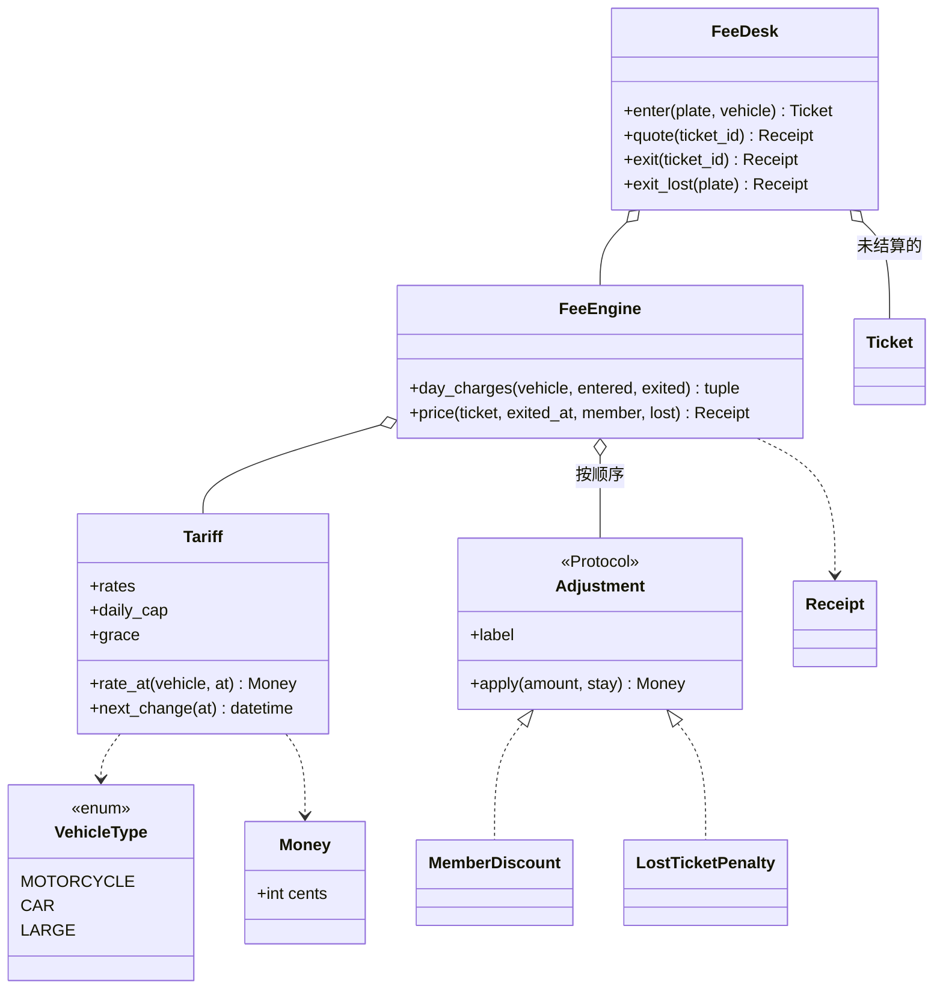

# 设计题解：停车场计费（Parking Lot Fees）

## 题目与澄清

候选人报告的原题（Hello Interview 社区，Amazon 资深岗，亚太地区，2026-09-20）：

> 「The focus was more on calculating the parking fees and has different logics for different scenarios.」代码要求「syntactically correct, although it will not be executed」。——[Hello Interview 社区题库](https://www.hellointerview.com/community/questions?company=Amazon)（题目 `parking-lot-system`）

本仓库的 Amazon kit 还记着三份相关的论坛报告（停车场加车型并追加五六条新需求、按车型找最佳车位、停车票据与收据），编号见 `vault/interviews/companies/amazon/lld/route.md`。它们共同的信号是：停车场在 Amazon 不是考「车位怎么分配」，而是考**出场时那一笔钱怎么算**，并且面试官会一条一条地追加计价场景。

报告没有给出任何具体费率。**以下全部是重建（reconstructed）的部分**：车型的小时单价、高峰与非高峰的时段、周末按非高峰、免费宽限期、每日封顶、会员折扣、丢票罚款，以及并发那一关。它们是本题解为了让「不同场景、不同逻辑」有具体对象而选的一组规则，面试时每一条都应当先问。

先用两句话说清系统：车进停车场时领一张票，票上记着车牌、车型和入场时间；车出场时凭票结算，系统按停了多久、什么车型、什么时段算出该付多少钱，然后这张票作废。车位怎么分配、满了怎么办，在题库的停车场题里已经做过（见 [[solution-parking-lot]]），这里不重做，只在它的出场环节上做一个更精细的计费引擎。

开场该问的三个澄清问题：

1. **不足一小时怎么收？** 整小时进位（停 61 分钟收两小时），还是按时间比例折算？答案决定整个算法的形状：整小时进位下，一次停留只有一个数字（总时长），而按比例折算并且费率随时段变化时，必须把停留切成段。本题解选后者，因为这样「跨过费率边界」才是个真问题，而且按秒折算再每日取整一次，是一个可以用独立算法验证的确定规则。免费宽限期也在这里问：「前 15 分钟免费」是只要不超过 15 分钟就全免，还是从总时长里扣掉 15 分钟？本题解取前者（停留不超过 15 分钟免费，超过则从入场起全额计费）。
2. **费率随什么变？** 车型（摩托、小汽车、大车）、一天中的时段（工作日白天与夜间）、周末。这决定价目表是一张按车型的表，还是一棵条件树。
3. **封顶封什么，丢票怎么收？** 「每天最多 20 元」是日历日，还是从入场起算的 24 小时？丢票是收一笔固定的罚款，还是按最高档收？本题解选日历日封顶，并且丢票照常计价后加一笔固定罚款。

没有问到、但要主动声明的范围外内容：车位分配与楼层（见 [[solution-parking-lot]]）、预约、支付和发票、跨时区与夏令时（见「扩展与追问」）、持久化。

## 需求与分级

| 关 | 需求 | 本关逼出的设计 |
|---|---|---|
| 第 1 关（报告：重点在计费） | 按车型的小时单价，出场时算钱 | `Money` 用整数分；`Tariff` 价目表；`FeeDesk` 发票与结算 |
| 第 2 关（报告：不同场景有不同逻辑；具体场景为推断） | 工作日高峰、夜间、周末的单价不同；停留可能跨过这些边界 | 把停留沿变价时刻切段，每段单价固定；每天只取整一次 |
| 第 3 关（推断） | 前 15 分钟免费；每车型每个日历日封顶 | 宽限期和封顶都是 `Tariff` 里的数据，引擎里各多一两行 |
| 第 4 关（推断） | 会员折扣、丢票罚款；两个出口同时扫同一张票 | `Adjustment` 接缝；用锁一次性取走票；收据留明细 |

要特别说一句：第 2 关最容易写成 `if is_weekend: ... elif is_night: ... else: ...`，再配一个「入场时刻的单价 × 总时长」。这样的代码在第 2 关的第一个测试（19:30 入场、次日 08:30 出场）里就是错的，而且每多一个场景就要多改一次核心方法。

## 核心对象与职责

- `Money`：整数「分」的值对象（frozen dataclass，带 `order=True`）。不变量：金额运算永远是整数运算，没有浮点。
- `VehicleType`：枚举，摩托、小汽车、大车。它只是价目表的行键，**没有行为**，所以不做子类层级（见决策五）。
- `Tariff`：价目表，frozen dataclass，纯数据加两个纯查询：`rate_at(车型, 时刻)` 回答此刻每小时多少，`next_change(时刻)` 回答「下一个可能变价或换日的时刻」。不变量：`next_change` 严格晚于传入时刻，且不会漏掉任何一次变价。
- `DayCharge`：一个日历日的计费结果，同时记着封顶前和封顶后的金额，收据能解释每一分钱。
- `Adjustment`（协议）：出场后的调整，拿到当前金额和这次停留，返回新金额。实现有 `MemberDiscount` 和 `LostTicketPenalty`，都是无状态的 frozen dataclass。
- `FeeEngine`：纯计算，把一次停留变成一张 `Receipt`。它不持有票、不读时钟，所以可以被任意线程同时调用。
- `Ticket`、`Stay`、`Receipt`：三个只读记录。`Stay` 把「这一次停留的全部上下文」交给调整规则，规则就不需要时钟，也不需要回头去查票表。
- `FeeDesk`：唯一有状态的类，持有未结算的票，管发票、报价、结算，以及丢票出场。



所有权上，`FeeDesk` 拥有票的生命周期：入场时放进表里，结算时取走。`FeeEngine` 和 `Tariff` 没有生命周期，创建后不再变化，因此无需任何锁。这一点是整个设计的安全来源：**把有状态的部分压缩到一个类里，其余全部做成纯函数式的东西**，并发问题就只剩下一处需要回答。

## 关键设计决策

### 决策一：跨过费率边界的停留怎么算

问题：小汽车周五 19:30 入场、周六 08:30 出场；工作日 08:00–20:00 是高峰（每小时 400 分），其余时间是非高峰（每小时 200 分）。这一程该收多少？

**方案 A：入场时刻的单价乘总时长。** 代码最短：`rate_at(entered) * hours`。19:30 是高峰，13 小时全按 400 分算是 5200 分。但实际只有 30 分钟在高峰，其余 12.5 小时是非高峰，正确答案是 2700 分。多收了 2500 分，而且这类错误是系统性的：只要停留跨边界就错。

**方案 B：切成段，每段单价固定，每段各自向上取整到分再相加。** 方向对了，但取整出了问题。小汽车周五 19:59:59 入场、20:15:04 出场，高峰只有 1 秒、非高峰 904 秒：整体是 (400×1 + 200×904) ÷ 3600 = 50.2，向上取整是 51 分；每段各自取整是 1 + 51 = 52 分。段数越多，取整的误差越大，而且「同一程换一个入场秒数就多收一分」是用户能看见的 bug。

**方案 C：切成段，同一个日历日内累加「分/小时 × 秒数」，每个日历日除以 3600 后向上取整一次，再套封顶。** 取整只发生在最后一步，且每天一次——因为封顶是按日历日的，天是计费的自然单位。

**选择：C。** 切段的办法不需要预先列举所有场景：`Tariff.next_change(t)` 返回严格晚于 t 的、今天剩下的高峰开始、高峰结束，或下一个午夜，三者取最小。引擎从入场时刻出发，每次跳到下一个变价时刻（或出场时刻），这一段的单价用段起点查，这样每一段内部单价一定不变。至多每天三段，复杂度是停留天数的线性。

这里的模式是：**没有模式**。一个循环加一个「下一个变价时刻」的查询就够了。我们不为它建任何类，因为没有第二种切段方式。

### 决策二：「不同场景不同逻辑」写成 if、写成每场景一个类，还是写成数据

问题：车型、时段、周末，每个都影响单价。第 4 关还会有会员折扣。

**方案 A：核心方法里写条件。**

```python
def fee(vehicle, entered, exited):
    if is_weekend(entered): rate = ...
    elif is_night(entered): rate = ...
    else: rate = ...
```

每加一个场景就改这个方法，并且条件只看入场时刻，同样跨不过边界。

**方案 B：每个场景一个策略类，`WeekendPricing`、`NightPricing`、`PeakPricing`，由工厂按入场时刻挑一个。** 看起来像策略模式（Strategy），但它和决策一的问题是同一个：一程停留会**同时**经过多个场景。挑一个策略来算整程，边界两边的单价就丢了一边。

**方案 C：价目表是数据，引擎按变价时刻切段。** 场景再多，也只是 `rate_at` 里多一个条件，或者 `next_change` 里多一个候选时刻。

**选择：C。** 区分点是：策略模式适合「同一时刻在几个互换的算法里选一个」；而这里要处理的是「一段时间里单价随时间变」，这是时间轴上的数据，不是算法的选择。

什么时候会改主意？如果面试官追加「活动日整天半价」这样的场景，`Tariff` 需要一个节假日集合并在 `rate_at` 和 `next_change` 里各多一处；如果场景多到几十条、各自有不同参数，可以把 `Tariff` 的两个查询拆成一组「时段规则」对象，每个规则回答「在这一刻是否适用，以及下次什么时候可能变」。但这时候才是真有多个实现，之前都不是。

### 决策三：封顶放在哪里，按什么算

问题：「每天最多收 20 元」。

**方案 A：算完整个停留的总额后，统一封一次顶。** 周四 08:00 到周六 08:00 的摩托车，封顶 1000 分，只收 1000 分。但停了两天一夜，一天一个封顶才是通常的意思。

**方案 B：封顶按入场起算的 24 小时窗口。** 更接近有些停车场的真实规则，但要在引擎里维护一个滚动窗口，切段也要多一个「入场时刻加 24 小时」的边界。

**方案 C：封顶按日历日，在每天结算时 `min(当日应收, 封顶)`。** 切段已经在每个午夜断开，所以每天自然有自己的合计。

**选择：C。** 同样是摩托车封顶 1000 分，周四 08:00 到周六 08:00：周四 1000 分封顶，周五 1000 分封顶，周六 00:00–08:00 非高峰 8 小时是 800 分，合计 2800 分。代价是一种已知的不公平：23:00 入场、次日 02:00 出场的车，可能在两个日历日各付一部分，总额比封在一天里高。这个口径要在澄清阶段向面试官确认，选 B 的话要换切段的边界，而其余部分不动，这也是为什么封顶值放在 `Tariff` 里而不是写进循环。

### 决策四：会员折扣和丢票罚款要不要一个接缝

问题：出场后的调整有两个，顺序会影响结果。

**方案 A：`price` 里写 `if member: ...; if lost: ...`。** 两个调整时可以接受，第三个就开始难读，并且顺序是隐藏在代码行次序里的。

**方案 B：`Adjustment` 协议，一个调整一个小类，引擎按列表顺序应用，每一步在收据上留一行明细。**

**选择：B，而且这里的协议是有理由的：已经有两个真实实现。** 顺序是调用方显式给出的：小汽车周五 10:00–12:00 应收 800 分，丢票罚款 1500 分，会员五折。先折扣后罚款是 400 + 1500 = 1900 分；先罚款后折扣是 (800 + 1500) 再减半，只收 1150 分，罚款也被打了折。哪个才对是业务决定，不是实现细节，所以顺序放在装配列表里，让评审的人一眼看见。折扣额向下取整到分（顾客不会多得），收据上每一行都是带符号的金额，总额恒等于各日封顶后金额之和加上各调整行之和。

### 决策五（简单者胜出）：不做车型的类层级，不重做车位

直觉上会写 `Vehicle` 基类，派生 `Motorcycle`、`Car`、`Truck`，各自重写 `hourly_rate()`。但这里车型唯一的作用是在价目表里选一行。三个子类没有一行不同的行为，只是三个常量。`VehicleType` 枚举加一个字典就是全部，新增车型是加一个枚举成员和价目表里一行。题库的停车场题里，车辆和车位共用一把可比较的尺寸标尺，那是因为分配需要比较大小；计费不需要比较，所以这里不继承那个枚举，只借它的名字。

同样，车位分配和占用状态不属于计费。`FeeDesk` 只持有「未结算的票」，不知道有几个车位；一个完整的系统是题库的 `ParkingLot` 在入场时开票，把票号交给 `FeeDesk`，出场时 `unpark` 释放车位，这里不重复。

### 决策六：票的一次性结算

问题：两个出口同时扫了同一张票（重复扫码、闸机重试），只应该收一次钱。

**方案 A：先 `if ticket_id in self._open`，再算费，再 `del`。** 「查」和「删」之间有空隙：两个线程都查到票在，各自算费放行。GIL 只保证单条字节码原子，不保证这两步连在一起。

**方案 B：在锁内一次 `dict.pop`，取不到就抛 `UnknownTicketError`；计价放在锁外。**

**选择：B。** 持锁的只有几条字节码，计价是纯计算不需要锁。有一个细节：如果计价失败（时钟倒退，出场时间早于入场时间），票已经被取走了，所以 `_settle` 要把票放回去，别让车主因为系统时钟的错误而「丢票」。16 个线程同时出场同一张票，恰好一个拿到收据，另外 15 个拿到异常。已结算的票不再保留，所以票表只随未出场的车增长。

## 代码走读

%% code:begin solution.py %%
```python
"""停车场计费（Parking Lot Fees）参考解：车位分配见题库的停车场，这里只做「出场时该收多少钱」。

设计五句话：
1. Tariff 是一张纯数据的价目表：按车型的小时单价（高峰／非高峰）、每日封顶、免费宽限时长；它还会回答
   「从此刻起价格下一次可能变化是什么时候」——午夜、高峰开始、高峰结束。
2. FeeEngine 把一次停留沿这些时刻切成若干段，每段单价固定；一天内的段先用整数「分钟×单价」累加，
   每个日历日只向上取整到分一次，再套当天的封顶。
3. Adjustment 是出场后的调整接缝（会员折扣、丢票罚款），按列表顺序依次应用，每一步都留一行明细。
4. FeeDesk 管票：入场发票、出场凭票结算；开着的票只存在一张表里，结算时在锁内一次性取走，所以同一张票
   不可能被两个出口各付一次。
5. 时间只从注入的时钟进来；金额只用整数「分」，没有浮点。
"""

from __future__ import annotations

import itertools
import threading
from collections.abc import Callable, Mapping, Sequence
from dataclasses import dataclass
from datetime import date, datetime, time, timedelta
from enum import Enum
from typing import Protocol


class ParkingFeeError(Exception):
    """本模块所有失败路径的根。"""


class UnknownTicketError(ParkingFeeError, LookupError):
    """票不存在，或已经结算过。"""


class DuplicatePlateError(ParkingFeeError, ValueError):
    """这个车牌已经有一张未结算的票。"""


class InvalidStayError(ParkingFeeError, ValueError):
    """出场时间早于入场时间。"""


@dataclass(frozen=True, slots=True, order=True)
class Money:
    """金额，单位是「分」。frozen 加 order，可以直接比较和 min()。"""

    cents: int

    def __add__(self, other: Money) -> Money:
        return Money(self.cents + other.cents)

    def __sub__(self, other: Money) -> Money:
        return Money(self.cents - other.cents)

    def __str__(self) -> str:
        sign = "-" if self.cents < 0 else ""
        return f"{sign}{abs(self.cents) // 100}.{abs(self.cents) % 100:02d}"


ZERO = Money(0)


class VehicleType(Enum):
    """车型；与题库停车场的车辆尺寸是同一个概念，这里只关心价目表按它分行。"""

    MOTORCYCLE = "motorcycle"
    CAR = "car"
    LARGE = "large"


@dataclass(frozen=True, slots=True)
class HourlyRate:
    """每小时单价：高峰（工作日）与非高峰（夜间和周末）。"""

    peak: Money
    off_peak: Money


@dataclass(frozen=True, slots=True)
class Tariff:
    """价目表：纯数据加两个纯查询，没有任何状态。"""

    rates: Mapping[VehicleType, HourlyRate]
    daily_cap: Mapping[VehicleType, Money]
    peak_start: time = time(8, 0)
    peak_end: time = time(20, 0)
    grace: timedelta = timedelta(minutes=15)

    def rate_at(self, vehicle: VehicleType, at: datetime) -> Money:
        """at 这一刻每小时收多少：工作日 [peak_start, peak_end) 是高峰，其余是非高峰。"""
        rate = self.rates[vehicle]
        is_peak = at.weekday() < 5 and self.peak_start <= at.time() < self.peak_end
        return rate.peak if is_peak else rate.off_peak

    def next_change(self, at: datetime) -> datetime:
        """严格晚于 at 的、单价或日历日可能变化的最近时刻：今天的高峰边界或下一个午夜。"""
        candidates = [datetime.combine(at.date() + timedelta(days=1), time.min)]
        for edge in (self.peak_start, self.peak_end):
            moment = datetime.combine(at.date(), edge)
            if moment > at:
                candidates.append(moment)
        return min(candidates)


@dataclass(frozen=True, slots=True)
class DayCharge:
    """一个日历日的计费结果：raw 是封顶前，charged 是封顶后。"""

    day: date
    seconds: int
    raw: Money
    charged: Money


@dataclass(frozen=True, slots=True)
class Line:
    """收据上的一行调整：标签加带符号的金额。"""

    label: str
    amount: Money


@dataclass(frozen=True, slots=True)
class Ticket:
    """入场时发出的票。"""

    id: str
    plate: str
    vehicle: VehicleType
    entered_at: datetime


@dataclass(frozen=True, slots=True)
class Stay:
    """一次要结算的停留：调整规则只看它，不看系统时钟。"""

    ticket: Ticket
    exited_at: datetime
    member: bool = False
    lost: bool = False


@dataclass(frozen=True, slots=True)
class Receipt:
    """出场收据：total 恒等于「各日封顶后金额之和 + 各调整行之和」。"""

    ticket_id: str
    plate: str
    entered_at: datetime
    exited_at: datetime
    days: tuple[DayCharge, ...]
    adjustments: tuple[Line, ...]
    total: Money


class Adjustment(Protocol):
    """出场后的调整：拿到当前金额与这次停留，返回调整后的金额。无状态，按列表顺序应用。"""

    label: str

    def apply(self, amount: Money, stay: Stay) -> Money: ...


@dataclass(frozen=True, slots=True)
class MemberDiscount:
    """会员按百分比打折；折扣额向下取整到分，所以顾客不会多得。"""

    percent: int
    label: str = "会员折扣"

    def apply(self, amount: Money, stay: Stay) -> Money:
        return amount - Money(amount.cents * self.percent // 100) if stay.member else amount


@dataclass(frozen=True, slots=True)
class LostTicketPenalty:
    """丢票加收固定罚款，放在折扣之后，所以不会被打折。"""

    penalty: Money
    label: str = "丢票罚款"

    def apply(self, amount: Money, stay: Stay) -> Money:
        return amount + self.penalty if stay.lost else amount


class FeeEngine:
    """纯计算：一次停留 → 收据。不持有票，不读时钟，所以可以随便并发调用。"""

    def __init__(self, tariff: Tariff, adjustments: Sequence[Adjustment] = ()) -> None:
        self._tariff = tariff
        self._adjustments = tuple(adjustments)

    def day_charges(self, vehicle: VehicleType, entered: datetime, exited: datetime) -> tuple[DayCharge, ...]:
        """沿价格变化时刻切段，同一日历日内累加「单价×秒」，每日只取整一次，再套当日封顶。"""
        if exited < entered:
            raise InvalidStayError(f"exit {exited} is before entry {entered}")
        if exited - entered <= self._tariff.grace:
            return ()
        units: dict[date, int] = {}  # 单位：分/小时 × 秒，除以 3600 才是分
        seconds: dict[date, int] = {}
        at = entered
        while at < exited:
            end = min(self._tariff.next_change(at), exited)
            span = int((end - at).total_seconds())
            rate = self._tariff.rate_at(vehicle, at).cents
            units[at.date()] = units.get(at.date(), 0) + rate * span
            seconds[at.date()] = seconds.get(at.date(), 0) + span
            at = end
        cap = self._tariff.daily_cap[vehicle]
        result = []
        for day in sorted(units):
            raw = Money(-(-units[day] // 3600))  # 向上取整到分，每日一次
            result.append(DayCharge(day, seconds[day], raw, min(raw, cap)))
        return tuple(result)

    def price(self, ticket: Ticket, exited_at: datetime, *, member: bool = False, lost: bool = False) -> Receipt:
        days = self.day_charges(ticket.vehicle, ticket.entered_at, exited_at)
        total = sum((d.charged for d in days), ZERO)
        stay = Stay(ticket, exited_at, member, lost)
        lines = []
        for adjustment in self._adjustments:
            after = adjustment.apply(total, stay)
            if after != total:
                lines.append(Line(adjustment.label, after - total))
            total = after
        return Receipt(ticket.id, ticket.plate, ticket.entered_at, exited_at, days, tuple(lines), total)


class FeeDesk:
    """入口发票、出口结算。开着的票只存一份，结算时在锁内取走。"""

    def __init__(self, engine: FeeEngine, clock: Callable[[], datetime] = datetime.now) -> None:
        self._engine = engine
        self._clock = clock
        self._lock = threading.Lock()
        self._open: dict[str, Ticket] = {}
        self._by_plate: dict[str, str] = {}
        self._ids = (f"T{n}" for n in itertools.count(1))

    @property
    def open_count(self) -> int:
        with self._lock:
            return len(self._open)

    def enter(self, plate: str, vehicle: VehicleType) -> Ticket:
        with self._lock:
            if plate in self._by_plate:
                raise DuplicatePlateError(plate)
            ticket = Ticket(next(self._ids), plate, vehicle, self._clock())
            self._open[ticket.id] = ticket
            self._by_plate[plate] = ticket.id
            return ticket

    def quote(self, ticket_id: str, *, member: bool = False) -> Receipt:
        """现在出场要付多少；不结算，票仍然有效。"""
        with self._lock:
            ticket = self._open.get(ticket_id)
        if ticket is None:
            raise UnknownTicketError(ticket_id)
        return self._engine.price(ticket, self._clock(), member=member)

    def exit(self, ticket_id: str, *, member: bool = False) -> Receipt:
        """凭票出场：先在锁内取走票（同一张票只有一个出口取得到），再在锁外计价。"""
        with self._lock:
            ticket = self._take(ticket_id)
        return self._settle(ticket, member=member, lost=False)

    def exit_lost(self, plate: str, *, member: bool = False) -> Receipt:
        """丢票出场：用车牌找到入场记录，照常计价再加罚款。"""
        with self._lock:
            ticket_id = self._by_plate.get(plate)
            if ticket_id is None:
                raise UnknownTicketError(plate)
            ticket = self._take(ticket_id)
        return self._settle(ticket, member=member, lost=True)

    def _take(self, ticket_id: str) -> Ticket:
        ticket = self._open.pop(ticket_id, None)
        if ticket is None:
            raise UnknownTicketError(ticket_id)
        del self._by_plate[ticket.plate]
        return ticket

    def _settle(self, ticket: Ticket, *, member: bool, lost: bool) -> Receipt:
        exited_at = self._clock()
        try:
            return self._engine.price(ticket, exited_at, member=member, lost=lost)
        except InvalidStayError:
            with self._lock:  # 时钟倒退：把票放回去，别让车主白白丢票
                self._open[ticket.id] = ticket
                self._by_plate[ticket.plate] = ticket.id
            raise


def default_tariff() -> Tariff:
    """示例价目表（推断的数字，不是 Amazon 报告里的）。"""
    return Tariff(
        rates={
            VehicleType.MOTORCYCLE: HourlyRate(Money(200), Money(100)),
            VehicleType.CAR: HourlyRate(Money(400), Money(200)),
            VehicleType.LARGE: HourlyRate(Money(600), Money(300)),
        },
        daily_cap={
            VehicleType.MOTORCYCLE: Money(1000),
            VehicleType.CAR: Money(2000),
            VehicleType.LARGE: Money(3000),
        },
    )


if __name__ == "__main__":
    now = [datetime(2026, 10, 16, 19, 30)]
    desk = FeeDesk(FeeEngine(default_tariff(), [MemberDiscount(10), LostTicketPenalty(Money(1500))]), lambda: now[0])
    t = desk.enter("京A12345", VehicleType.CAR)
    now[0] = datetime(2026, 10, 17, 8, 30)
    r = desk.exit(t.id)
    print(r.total, [(str(d.day), str(d.charged)) for d in r.days])
```
%% code:end %%

**第一处：`Tariff.next_change`。** 候选时刻是下一个午夜，加上今天还没过的高峰开始与高峰结束，取最小。注意比较是严格的 `moment > at`：恰好在 08:00 的时刻，下一个变价点是 20:00，而不是 08:00 本身，否则循环会原地不动。

**第二处：`FeeEngine.day_charges` 的循环。** 段的单价用段起点查（`rate_at(vehicle, at)`），因为段内不会再变价。累加的是 `rate * span`（分/小时乘秒），不是分，所以到最后一步才除以 3600 并向上取整；`-(-x // 3600)` 是整数的向上取整，不经过浮点。宽限期的判断放在循环之前：停留不超过宽限期返回空元组，没有任何日历日被计费。

**第三处：`FeeEngine.price` 里的调整循环。** 每个调整拿到当前总额，返回新总额，差额成为收据上的一行。调整没有生效（比如非会员）就不留行，收据保持干净。

**第四处：`FeeDesk.exit` 与 `_take`。** `exit` 在锁内调 `_take`，`_take` 一次 `pop` 并同步删除车牌索引；出了锁才计价。`exit_lost` 先用车牌找到票号，再走同一个 `_take`，所以丢票出场和正常出场共享同一条「只能取一次」的路径。

## 测试与自检

测试按四关分组，全部通过公开方法断言，时钟注入，不读任何私有属性：

- 第 1 关：小汽车高峰两小时 800 分；三种车型分别是 400、800、1200；16 分钟折算为 107 分（400×16÷60 = 106.67 向上取整）；恰好 15 分钟免费，多一秒就收 101 分；出场早于入场抛 `InvalidStayError`。
- 第 2 关：19:30 到 20:30 跨过高峰结束，是 200 + 100 = 300 分；周五晚到周六早，两个日历日分别是 1000 和 1700 分；周末整天按非高峰；高峰窗口左闭右开；取整只在每天一次（上面那个 51 对 52 的例子）。
- 第 3 关：高峰全天 4800 分封顶到 2000；摩托车跨三天各自封顶；低于封顶的停留原样通过。
- 第 4 关：折扣向下取整；非会员没有折扣行；调整顺序改变总额；收据总额等于各日金额加调整行；丢票按车牌出场并关闭票；正常出场没有罚款。
- 失败路径：票不能重复结算；同一车牌不能同时有两张开着的票；`quote` 不结算；时钟倒退时票保留；出场后 `open_count` 回到零。
- 属性测试：25 个随机种子，随机的入场时刻、停留时长（最长近四天）和车型，把 `day_charges` 与一个**逐分钟累加**的朴素算法对拍，两者完全独立（后者不用 `next_change`）。每日金额必须逐日相等，封顶后金额必须等于 `min(应收, 封顶)`。
- 并发：16 个线程用 `Barrier` 同时出场同一张票，恰好一个收据；16 个线程同时入场，票号互不相同。

两分钟演示：造 `FeeDesk(FeeEngine(default_tariff(), [MemberDiscount(10), LostTicketPenalty(Money(1500))]), clock)`，注入周五 19:30，入场一辆小汽车；把时钟拨到周六 08:30 出场，打印 27.00 以及两个日历日的金额 10.00 和 17.00；再演示 `quote` 不会关票，第二次 `exit` 抛异常。

## 扩展与追问

**新需求**

- 节假日或活动日按非高峰计价：`Tariff` 增加一个日期集合，`rate_at` 多一个条件，`next_change` 不用动（日期变化本来就在午夜）。引擎、调整、票表一行不改。
- 按车位类型或楼层定价：`rate_at` 多接一个参数，由 `Ticket` 带上车位类别；仍然只改价目表。
- 月卡、企业账户：新增 `Adjustment` 的实现，注册到列表里。
- 封顶改成入场起 24 小时：这是引擎里切段边界的改动（多一个「入场时刻加 24 小时」的候选），`Tariff` 的封顶数据和调整都不动。

**并发与线程安全**

- `FeeEngine` 和 `Tariff` 不可变，不需要锁；`FeeDesk` 一把锁，临界区只有字典操作，计价在锁外。
- 多进程或多个闸机服务器时，内存里的票表失效，要放到数据库里，结算改为一条条件更新（`DELETE ... WHERE id = ? RETURNING *`，取到才算数），语义与 `dict.pop` 相同。
- 时钟：多机部署时用同一个时间源，出场时间由服务器取，不信任闸机上报的时间。

**持久化与规模**

- 价目表放配置或数据库里，更新时生成新的 `Tariff` 对象整体替换（不可变对象，替换是一次原子的引用赋值）。注意票在入场后价目表若变了，出场用哪一版价目表，是业务问题：可以把版本号写进票。
- 夏令时：本题解用朴素本地时间。夏令时切换日有 23 或 25 小时，按墙上时钟切段会多算或少算一小时；做法是内部全部用 UTC，只在 `rate_at` 里转换成本地时间判断时段，`next_change` 也在本地时间上生成再转回 UTC。这是对数据表示的改动，不是对结构的改动。
- 停留非常长（几个月）时循环是线性的；可以对完整的日历日使用预先算好的整日金额，但这是优化，不应在第一版里写。

## 常见错误

1. **入场时刻的单价乘总时长**：跨边界的停留系统性地错，19:30 到次日 08:30 多收 2500 分。
2. **每段各自取整**：19:59:59 到 20:15:04 收 52 分而不是 51 分。
3. **封顶封在整程总额上**：周四到周六的摩托车只收一份封顶。
4. **用 `float` 存钱，或在计费方法里调 `datetime.now()`**：前者累积误差，后者无法固定「周五晚上」做测试。
5. **宽限期含糊**：不问「全免还是扣除」；15 分钟整免费、15 分 1 秒就收全额，两种口径在边界上差 100 分钱。
6. **调整顺序写在代码行次里**：加第三个调整时没人知道顺序是不是故意的。
7. **先 `if in` 再 `del`**：两个出口会同时收费。
8. **票表不清理**：已结算的票留在字典里，长期运行内存无限增长；这里票在结算时即被移除，并有 `open_count` 可断言。
9. **Java 习惯**：为 `Car`、`Motorcycle`、`Truck` 建类层级却没有任何不同的行为；`getRate()` / `setRate()`；让 `Tariff` 把内部字典直接交给调用方改。

## 45 分钟怎么分配

| 分钟 | 做什么 | 口头要说的话 |
|---|---|---|
| 0–5 | 三个澄清问题：取整规则与宽限期、费率随什么变、封顶口径与丢票；写下范围外内容 | 「车位分配我当作已有，我只做出场时的计费。」 |
| 5–10 | 画 `Tariff`、`FeeEngine`、`FeeDesk` 三个框；说明停留要沿变价时刻切段 | 「跨边界的停留不能用入场价乘总时长，所以我切段。」 |
| 10–25 | 写第 1、2 关：`Money`、`Tariff`、`day_charges` 的循环、`FeeDesk.enter / exit` | 边写边说为什么用整数分、为什么每天只取整一次 |
| 25–33 | 加宽限期和每日封顶 | 「封顶是价目表里的数据，引擎里只多一行 `min`。」 |
| 33–40 | 加 `Adjustment` 与丢票；写两个测试名，如 `test_adjustment_order_matters` | 说出顺序是业务决定 |
| 40–45 | 追问：两个出口同一张票、夏令时 | 「锁内一次 `pop`，计价放在锁外。」 |

代码不会被运行，所以写完之后选一个具体的停留手工推演：19:30 入场、次日 08:30 出场，写出每一段的起止、单价和累加值，与 2700 分对一遍。时间不够时的取舍：先砍 `Adjustment` 的第二个实现和丢票（口述：同一个接缝，顺序是业务决定）；再砍封顶；保住切段循环和宽限期。

## 来源与延伸

- [Hello Interview 社区题库](https://www.hellointerview.com/community/questions?company=Amazon)：本题的主要来源，2026-09-20 的资深岗报告，说明重点在停车费计算、不同场景有不同逻辑，且代码不会被运行。可见部分没有具体费率，所以本题解的一切数字都标为推断。需要登录，只链接不摘录。
- [Python 标准库 datetime](https://docs.python.org/3/library/datetime.html)：`weekday()` 周一为 0、周日为 6，所以工作日是 `< 5`；`datetime.combine` 把日期与时间拼成当天的某个边界。本题解处理的是不带时区的本地时间。
- [Hello Interview：停车场题解](https://www.hellointerview.com/learn/low-level-design/problem-breakdowns/parking-lot)：题库停车场的主要参考。它的计费是「所有车型同一个小时费率、按小时向上取整」，并明确说不要过度设计。本题解不同意的只是前提：Amazon 的报告说重点在计费，面试官一旦说「不同场景不同逻辑」，价目表加切段就是正确的形状；而在没有这句话的版本里，一个函数就够。商业站点，只链接不摘录。
- 题库已有的停车场题解 [[solution-parking-lot]]：车位分配、楼层、占用状态和阶梯计价（`TieredRate`）。它的阶梯计价是按总时长的边际分档，与这里按时间轴切段是两个正交的问题：一个按「停了多久」分档，一个按「什么时候停的」分段。
- Amazon kit 的 `vault/interviews/companies/amazon/lld/pricing_billing.md`：同一个骨架的其他变体（地铁封顶、购物车折扣、AWS 账单），共同点是用整数分和一个按顺序应用的规则列表。

概念背景：[[patterns.strategy|策略模式与可替换算法（Strategy）]]（什么时候需要策略接缝，什么时候是数据；决策二与决策四正是两个方向的例子）、[[problems.machines.parking-lot|停车场（Parking Lot）]]（本题站在它之上）。
