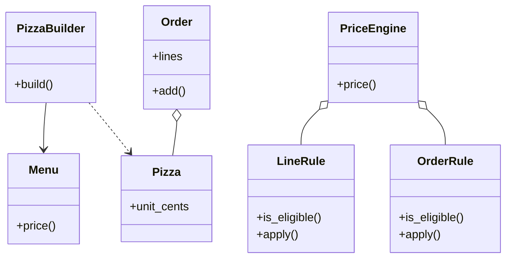

# 设计题解：披萨订单（Pizza Order）

## 题目与澄清

这是一个披萨店的点单系统：顾客自己搭配一份披萨——选尺寸、选饼底、选若干种配料——系统算出这一份的价格；一张订单可以有好几份披萨，系统再把店里的优惠（打折、买二送一、满额减）套上去，给出订单总价。没有数据库、没有支付、没有配送，核心是两个函数：「选择 → 一份披萨的价格」和「订单 + 优惠规则 → 总价」。

面试官这样提出：顾客可以自定义饼底（crust）、尺寸（size）和配料（toppings），要求你设计类，并计算订单总价。起手版本只有「搭配并算价」；之后会追加「某些组合不允许」「加优惠」「一单多份」。

这类题的难点不在算术，而在三个地方：菜单会经常变（新增一种配料不该改代码结构）；搭配有规则（有的配料互斥，有的饼底只能配大号）；优惠要能叠在价格上，又不能把价格减成负数。

开场的三个澄清问题，和每个答案会改变什么：

1. **「配料的价格和尺寸有关吗？同一种配料能加双份吗？」** 价格与尺寸有关（大号配料更贵），说明价格要按「尺寸 × 配料」存成表，而不是每种配料一个数字；能加双份，则配料要带份量，Builder 里的 `topping` 多一个参数。下面的实现取「价格随尺寸变、每种配料最多一份」，双份放在扩展里。
2. **「有没有不允许的组合？比如某个饼底只能做大号，或者两种配料互斥？」** 答「有」，就必须有一个统一的校验点，而且校验规则要能放进菜单数据里，不能散在 `if` 里。答「没有」，Builder 就退化成一个数据类。
3. **「优惠有哪些？是只看一份披萨，还是看整张订单？」** 「周二小号九折」只看一份；「三份里最便宜的一份免费」要看整单。答案决定优惠要不要分两层（决策三）。

此外几件明确不做的事：税费、小费、配送费、支付、库存。它们发生在「算价格」之前或之后，不改变这个系统的形状。

## 需求与分级

机器编码轮会一关一关地加需求。这类题通常这样展开：

- **第 1 关：搭配并算价。** 菜单里有三个尺寸、几种饼底、几种配料；顾客选一种搭配，系统返回单价。要点是**菜单是数据，不是类层级**：新增一种配料是加一行数据。这一关为 `Menu`、`Pizza` 和 `Menu.price` 而存在。
- **第 2 关：校验。** 小号做不了芝心饼底，奶酪和植物奶酪不能同时放，配料最多五种，选了不存在的东西要报错。要点是用 Builder 把「分步选择」和「一次性校验」分开：`build()` 要么返回一份合法的、不可变的披萨，要么抛出带原因的异常。这一关为 `PizzaBuilder` 和 `InvalidChoiceError` 而存在。
- **第 3 关：优惠。** 小号九折、同款买二送一、三份里最便宜的一份免费、满 30 减 3。要点是复用购物车折扣引擎（[[solution-amz-discount-engine]]）的两层结构：行级规则和整单规则，由一个只会「遍历、钳位、记账」的引擎串起来。这一关为 `LineRule`、`OrderRule`、`PriceEngine` 而存在。
- **第 4 关：多份披萨与并发。** 一张订单里有多份披萨，相同的合并成一行；多个线程同时往订单里加、同时算价不出错。可能还会问「订单怎么存下来」。这一关为 `Order` 和它的锁、`Pizza` 的不可变性而存在。

## 核心对象与职责

**一句话地图：** 菜单是数据，Builder 是校验关口，披萨是校验后的不可变结果，订单是披萨的容器，引擎把订单和优惠规则拼成账单。

- `Menu`（以及 `CrustSpec`、`ToppingSpec`）：纯数据。尺寸的基础价、饼底的加价和适用尺寸、配料按尺寸的价格和互斥表、配料数量上限。它拥有一个方法 `price`，前提是调用方已经校验过选择。
- `PizzaBuilder`：分步收集选择，`build()` 时一次性校验。它拥有的不变量是「产出的每一份 `Pizza` 都是合法的」。
- `Pizza`：不可变值对象（[[oop.values|值对象与不可变性（Value Objects）]]），记录尺寸、饼底、已排序去重的配料，以及**构建时定格的单价**。配料排序之后，「同样的披萨」就相等、可哈希，订单才能把它们合并成一行。
- `Order` 与 `OrderLine`：可变的容器和它吐出的不可变快照。同样的披萨合并数量；内部用一把锁保护「读–改–写」；对外只给元组快照。
- `LineRule` / `OrderRule`：两层优惠规则的抽象基类。每个方法都是两问：`is_eligible`（适用吗）和 `apply`（减多少）。
- `PriceEngine`：持有不可变的规则集，`price(lines)` 是纯函数。它的职责只有遍历、钳位（折扣不能超过剩余价格、不能为负）和记账；它不认识任何具体优惠。
- `Adjustment` / `LineResult` / `Receipt`：不可变的账单。`Receipt.total_cents` 永远等于「原价合计 − 全部减免」。



关系上：`Order` 聚合披萨，但披萨是不可变的，所以订单不拥有它们的生命周期，只拥有「每款几份」这张表。`PriceEngine` 持有规则，规则不持有订单，引擎和订单之间只通过 `order.lines` 这个快照相遇。

## 关键设计决策

### 决策一：菜单用数据，还是每种配料一个类（装饰器）

**问题。** 经典教材用装饰器模式（Decorator）做披萨：`Pizza` 是基类，`Cheese(pizza)`、`Pepperoni(pizza)` 一层层包起来，每层在 `cost()` 里加自己的价格。面试官一旦说「再加一种配料」，你要不要写新类？

**选项一：每种配料一个装饰器类。**

```python
class Pepperoni(PizzaDecorator):
    def cost(self) -> int:
        return self._inner.cost() + 150
```

代价：价格硬编码在类里；而配料价格**随尺寸变**，装饰器要么拿到内层披萨的尺寸再分支，要么每个尺寸再来一个类，类数是「配料数 × 尺寸数」。互斥、数量上限这类**跨配料**的规则，装饰器链根本没地方放——每一层只看得到包在它里面的东西。再加上装饰器链不可哈希、不可比较，订单没法合并相同披萨。

**选项二：菜单是数据。**

```python
toppings["pepperoni"] = ToppingSpec({"S": 150, "M": 200, "L": 250})
```

代价：「价格怎么算」从类里搬到了 `Menu.price` 一个函数里；如果将来某种配料的计价逻辑真的不同（比如「按重量」），数据表达不了。

**选择：数据。** 菜单的变化是**数据的变化**，不是行为的变化：所有配料都是「按尺寸查价」这一个行为。装饰器适合行为各不相同的叠加（日志、压缩、缓存），这里行为只有一个，变的只是参数。新增配料是加一行数据，互斥与上限在 `Menu` 里一次性可见。这也是披萨订单里**拒绝一个经典模式**的地方：说得出为什么不用 Decorator，比会写 Decorator 更能说明你理解了它。

### 决策二：校验放在哪里——构造函数、每个 setter，还是 `build()`

**问题。** 「小号 + 芝心」是非法的，「奶酪 + 植物奶酪」也是非法的。什么时候报错？

**选项一：每个 setter 立刻校验。** `size("S")` 之后再 `crust("stuffed")` 立刻抛错。代价：校验依赖选择的顺序——先选饼底、后选尺寸时，中间状态是「芝心 + 还没选尺寸」，setter 不知道该不该报错；互斥配料只能在第二个配料加入时检查，逻辑散在每个 setter 里。

**选项二：把所有字段塞给 `Pizza` 的构造函数。** 校验在 `__post_init__`。代价：`Pizza` 要知道菜单才能校验，值对象就背上了对菜单的依赖；而且调用方要一次凑齐所有参数，没有「分步选」的体验（前端逐步点选、逐步显示价格）。

**选项三（选择）：Builder 只收集，`build()` 一次性校验。** setter 只记录，不判断；`build()` 里按固定顺序检查：尺寸存在 → 饼底存在且支持该尺寸 → 配料不重复 → 数量不超限 → 每种配料存在且不与其他已选互斥。任何一步失败抛 `InvalidChoiceError`，带上具体原因。`Pizza` 本身只是数据，不知道菜单。

收益：校验顺序固定，与调用顺序无关；`Pizza` 保持纯净；同一个 Builder 可以反复 `build()`（前端每点一下就 build 一次试算价格），失败的 `build()` 不会留下半成品，因为它根本没有修改 Builder。这是**建造者模式（Builder）**，而且是它真正有用的场景：分步收集、集中校验、产出不可变对象。如果只有两三个可选字段、没有跨字段校验，Builder 就是过度设计，一个带默认值的 dataclass 就够了。

### 决策三：优惠规则是一层还是两层——复用折扣引擎

**问题。** 「小号九折」只看一份披萨；「三份里最便宜的一份免费」要看所有份；「满 30 减 3」要看折后总额。如果只有一种规则接口，输入该是什么？

**选项一：一个接口，输入是整张订单。** 每个规则自己遍历订单行。代价：最常见的「只看一行」的规则每次都要自己写循环；更糟的是，引擎无法保证每行的减免被正确地钳位和记账，因为它看不到规则内部在对哪一行做什么。

**选项二：两层接口（选择）。** `LineRule` 的输入是一行和该行剩余价格，`OrderRule` 的输入是各行的结果和整单剩余价格。引擎先逐行跑完所有行级规则，再用折后各行结果去跑整单规则。这与购物车折扣引擎完全同构（[[solution-amz-discount-engine]]），所以披萨的优惠不是新发明，而是同一套结构换了一个商品。

这个选择有两个后果值得在面试中点出来：

- **整单规则看的是折后价。** 「最便宜的一份免费」如果按原价算，小号披萨已经九折之后又被整份免掉原价，顾客拿到的减免超过了这份披萨的实际价格。代码里 `CheapestFreePerN` 读的是 `LineResult.final_cents // qty`，即行级折扣之后的每份均价。
- **每减一次，都重新问一遍是否适用。** 满 30 减 3 排在「三送一」后面：前一条把总额压到门槛以下，后一条就不再适用。

**这里同时拒绝了一个模式。** 有人会为「同款买二送一」「异款买二送一」「三份最便宜免费」各写一个子类，再套一个工厂（Factory）来按名字构造。规则集是调用方在构造 `PriceEngine` 时直接传入的几个对象，没有「按配置文件里的字符串创建规则」的需求，就不需要工厂；等真的从数据库里读规则时，一个 `dict[str, type]` 就够了（见扩展）。

### 决策四：价格在构建时定格，还是结算时按菜单现算

**问题。** 顾客把一份披萨放进订单，这时店家把大号基础价从 12.00 改成 13.00。结算时该用哪个价？

**选项一：`Pizza` 只存选择，结算时用 `Menu.price` 现算。** 好处：永远是最新价。代价：购物车里的价格会在顾客眼皮底下变；订单一旦存下来再读出来，价格取决于「什么时候读」；`Pizza` 的相等性和价格脱钩，同一个订单两次算价可能不同。

**选项二（选择）：`build()` 时把单价写进 `Pizza.unit_cents`。** 披萨是「在某个价格下被选定的商品」，价格是它的一部分。后续菜单怎么改都不影响已在订单里的披萨；订单、折扣、账单全部只读 `unit_cents`，不再依赖菜单。代价：订单挂了很久之后价格可能过期；需要「刷新价格」时由调用方重新 `build()` 一次，是显式动作，而不是隐式变化。

这也让相等性更诚实：同样的选择在两个不同的菜单价格下构建，是两个不同的 `Pizza`，不会被合并成一行。

### 决策五：钱用整数分，百分比用基点

和折扣引擎一致：全程整数分，字符串价格通过 `Decimal` 精确转成分（`to_cents`），百分比存成基点（8.5% 存成 850），舍入只发生在 `PercentOff.apply` 里一次、半进位。这里不再重复展开，原因与反例见折扣引擎题解的第一个决策。披萨题里的具体反例：900 分打 8.5% 折，精确值是 76.5 分，半进位得 77；如果用 `float`，`round(900 * 0.085)` 得到 76：Python 的 `round` 是银行家舍入（遇到 .5 取偶数），76.5 变成 76，比半进位的 77 少了一分。

## 代码走读

下面是完整的、经过测试的参考实现。

%% code:begin solution.py %%
```python
"""披萨订单（Pizza Order）：菜单是数据 → Builder 校验组合 → 折扣规则 → 订单总价。

设计五行：
1. 菜单 `Menu` 是数据（尺寸、饼底、配料及其价格、互斥关系、配料上限），新增配料只加一行，不加类。
2. `PizzaBuilder` 分步收集选择，`build()` 一次性校验并产出不可变的 `Pizza`；非法组合在这里就抛 `InvalidChoiceError`。
3. `Pizza` 在构建时把单价定格（分），之后菜单改价不影响已在订单里的披萨。
4. 折扣沿用购物车折扣引擎的两层：`LineRule` 只看一行，`OrderRule` 看整单；`PriceEngine` 只遍历、钳位、记账。
5. 钱一律是整数分，舍入只发生在百分比折扣自己的 `apply` 里；`Order` 的合并数量加锁，对外只给快照。
"""

from __future__ import annotations

from abc import ABC, abstractmethod
from collections.abc import Sequence
from dataclasses import dataclass, field
from decimal import ROUND_HALF_UP, Decimal
from threading import Lock


class PizzaError(Exception):
    """本模块所有可预期失败的基类。"""


class InvalidChoiceError(PizzaError):
    """顾客的选择不合法：未知选项、互斥配料、尺寸不支持该饼底、配料超限。"""


class InvalidRuleError(PizzaError):
    """折扣配置不合法，或某条折扣算出了负数（会凭空造钱）。"""


class InvalidOrderError(PizzaError):
    """订单操作不合法：数量非正、删除不存在的披萨。"""


def to_cents(text: str) -> int:
    """把 "12.50" 这样的十进制字符串精确转成分；绝不经过 float。"""
    return int((Decimal(text) * 100).quantize(Decimal(1), rounding=ROUND_HALF_UP))


def format_cents(cents: int) -> str:
    sign = "-" if cents < 0 else ""
    return f"{sign}{abs(cents) // 100}.{abs(cents) % 100:02d}"


# ───────────────────────────── 菜单（数据） ─────────────────────────────

@dataclass(frozen=True)
class CrustSpec:
    extra_cents: int = 0
    sizes: frozenset[str] | None = None           # None = 所有尺寸都能做


@dataclass(frozen=True)
class ToppingSpec:
    prices: dict[str, int]                        # 尺寸 → 价格（分）；大号配料更贵
    excludes: frozenset[str] = frozenset()        # 与哪些配料互斥


@dataclass(frozen=True)
class Menu:
    base: dict[str, int]                          # 尺寸 → 基础价（分）
    crusts: dict[str, CrustSpec]
    toppings: dict[str, ToppingSpec]
    max_toppings: int = 5

    def price(self, size: str, crust: str, toppings: Sequence[str]) -> int:
        """调用前选择必须已通过校验；价格 = 基础价 + 饼底加价 + 每种配料在该尺寸的价。"""
        return (self.base[size] + self.crusts[crust].extra_cents
                + sum(self.toppings[t].prices[size] for t in toppings))


def default_menu() -> Menu:
    return Menu(
        base={"S": 800, "M": 1000, "L": 1200},
        crusts={"thin": CrustSpec(), "thick": CrustSpec(100),
                "stuffed": CrustSpec(250, frozenset({"M", "L"}))},
        toppings={
            "cheese": ToppingSpec({"S": 100, "M": 150, "L": 200}, frozenset({"vegan_cheese"})),
            "vegan_cheese": ToppingSpec({"S": 150, "M": 200, "L": 250}, frozenset({"cheese"})),
            "pepperoni": ToppingSpec({"S": 150, "M": 200, "L": 250}),
            "mushroom": ToppingSpec({"S": 100, "M": 125, "L": 150}),
            "olive": ToppingSpec({"S": 100, "M": 125, "L": 150}),
            "pineapple": ToppingSpec({"S": 100, "M": 150, "L": 200}),
        },
    )


# ───────────────────────────── 披萨与 Builder ─────────────────────────────

@dataclass(frozen=True, slots=True)
class Pizza:
    """一份配好的披萨，不可变。toppings 已排序去重，所以“同样的披萨”相等、可哈希。"""
    size: str
    crust: str
    toppings: tuple[str, ...]
    unit_cents: int                               # 构建时定格的单价

    @property
    def sku(self) -> str:
        return f"{self.size}/{self.crust}/{'+'.join(self.toppings) or 'plain'}"


class PizzaBuilder:
    """分步收集，`build()` 时一次性校验。链式调用，可复用：每次 `build()` 产出新的 Pizza。"""

    def __init__(self, menu: Menu) -> None:
        self._menu = menu
        self._size: str | None = None
        self._crust = "thin"
        self._toppings: list[str] = []

    def size(self, size: str) -> PizzaBuilder:
        self._size = size
        return self

    def crust(self, crust: str) -> PizzaBuilder:
        self._crust = crust
        return self

    def topping(self, name: str) -> PizzaBuilder:
        self._toppings.append(name)
        return self

    def build(self) -> Pizza:
        menu, size = self._menu, self._size
        if size not in menu.base:
            raise InvalidChoiceError(f"未知尺寸: {size!r}")
        spec = menu.crusts.get(self._crust)
        if spec is None:
            raise InvalidChoiceError(f"未知饼底: {self._crust!r}")
        if spec.sizes is not None and size not in spec.sizes:
            raise InvalidChoiceError(f"{size} 号做不了 {self._crust} 饼底")
        toppings = tuple(sorted(self._toppings))
        if len(set(toppings)) != len(toppings):
            raise InvalidChoiceError("同一种配料不能重复选")
        if len(toppings) > menu.max_toppings:
            raise InvalidChoiceError(f"配料最多 {menu.max_toppings} 种")
        for name in toppings:
            if name not in menu.toppings:
                raise InvalidChoiceError(f"未知配料: {name!r}")
            clash = menu.toppings[name].excludes.intersection(toppings)
            if clash:
                raise InvalidChoiceError(f"{name} 与 {sorted(clash)[0]} 不能同时选")
        return Pizza(size, self._crust, toppings, menu.price(size, self._crust, toppings))


# ───────────────────────────── 订单 ─────────────────────────────

@dataclass(frozen=True, slots=True)
class OrderLine:
    pizza: Pizza
    qty: int

    @property
    def original_cents(self) -> int:
        return self.pizza.unit_cents * self.qty


class Order:
    """可变的订单：同样的披萨合并成一行；对外只给快照。"""

    def __init__(self) -> None:
        self._lines: dict[Pizza, int] = {}
        self._lock = Lock()

    def add(self, pizza: Pizza, qty: int = 1) -> None:
        if qty <= 0:
            raise InvalidOrderError("数量必须为正")
        with self._lock:                          # 读-改-写必须在锁内
            self._lines[pizza] = self._lines.get(pizza, 0) + qty

    def remove(self, pizza: Pizza) -> None:
        with self._lock:
            if self._lines.pop(pizza, None) is None:
                raise InvalidOrderError(f"{pizza.sku}: 不在订单里")

    @property
    def lines(self) -> tuple[OrderLine, ...]:
        with self._lock:
            return tuple(OrderLine(p, q) for p, q in self._lines.items())


# ───────────────────────────── 折扣规则（两层） ─────────────────────────────

class LineRule(ABC):
    """行级折扣：`is_eligible` 问这行能不能用，`apply` 问在剩余价格上减多少。"""

    def __init__(self, label: str) -> None:
        self.label = label

    def is_eligible(self, line: OrderLine) -> bool:
        return True

    @abstractmethod
    def apply(self, line: OrderLine, remaining_cents: int) -> int: ...


class PercentOff(LineRule):
    def __init__(self, label: str, percent: str, sizes: frozenset[str] | None = None) -> None:
        super().__init__(label)
        value = Decimal(percent)
        if not 0 < value <= 100:
            raise InvalidRuleError(f"{label}: 百分比必须在 (0, 100]")
        self._bps, self._sizes = int(value * 100), sizes   # 基点：万分之一

    def is_eligible(self, line: OrderLine) -> bool:
        return self._sizes is None or line.pizza.size in self._sizes

    def apply(self, line: OrderLine, remaining_cents: int) -> int:
        return (2 * remaining_cents * self._bps + 10_000) // 20_000   # 整数半进位


class BuyXGetY(LineRule):
    """同一款披萨买 buy 送 free：先算送几份，再按剩余价格的份额折成钱。"""

    def __init__(self, label: str, buy: int, free: int) -> None:
        super().__init__(label)
        if buy <= 0 or free <= 0:
            raise InvalidRuleError(f"{label}: buy 和 free 都必须为正")
        self.buy, self.free = buy, free

    def is_eligible(self, line: OrderLine) -> bool:
        return line.qty >= self.buy + self.free

    def apply(self, line: OrderLine, remaining_cents: int) -> int:
        free_units = line.qty // (self.buy + self.free) * self.free
        return remaining_cents * free_units // line.qty


class OrderRule(ABC):
    """整单折扣：看行级折扣之后的各行结果和剩余总额，回答适用吗、减多少。"""

    def __init__(self, label: str) -> None:
        self.label = label

    @abstractmethod
    def is_eligible(self, results: Sequence[LineResult], remaining_cents: int) -> bool: ...

    @abstractmethod
    def apply(self, results: Sequence[LineResult], remaining_cents: int) -> int: ...


class ThresholdOff(OrderRule):
    """满 threshold 减 off，门槛按折后总额判断。"""

    def __init__(self, label: str, threshold_cents: int, off_cents: int) -> None:
        super().__init__(label)
        if threshold_cents <= 0 or off_cents <= 0:
            raise InvalidRuleError(f"{label}: 门槛和减免都必须为正")
        self.threshold_cents, self.off_cents = threshold_cents, off_cents

    def is_eligible(self, results: Sequence[LineResult], remaining_cents: int) -> bool:
        return remaining_cents >= self.threshold_cents

    def apply(self, results: Sequence[LineResult], remaining_cents: int) -> int:
        return self.off_cents


class CheapestFreePerN(OrderRule):
    """组合优惠：每 n 份披萨（跨款式），其中最便宜的一份免费。
    价格取行级折扣之后的每份均价（整除向下），从高到低排，每 n 份切一组，每个满组最后（最便宜）的一份免费；不满一组的不算。"""

    def __init__(self, label: str, n: int) -> None:
        super().__init__(label)
        if n < 2:
            raise InvalidRuleError(f"{label}: n 至少为 2")
        self.n = n

    def _prices(self, results: Sequence[LineResult]) -> list[int]:
        return sorted((r.final_cents // r.line.qty for r in results for _ in range(r.line.qty)), reverse=True)

    def is_eligible(self, results: Sequence[LineResult], remaining_cents: int) -> bool:
        return sum(r.line.qty for r in results) >= self.n

    def apply(self, results: Sequence[LineResult], remaining_cents: int) -> int:
        return sum(self._prices(results)[self.n - 1::self.n])


# ───────────────────────────── 账单与引擎 ─────────────────────────────

@dataclass(frozen=True, slots=True)
class Adjustment:
    label: str
    cents: int                                    # 正数 = 减免的金额


@dataclass(frozen=True, slots=True)
class LineResult:
    line: OrderLine
    adjustments: tuple[Adjustment, ...]

    @property
    def final_cents(self) -> int:
        return self.line.original_cents - sum(a.cents for a in self.adjustments)


@dataclass(frozen=True, slots=True)
class Receipt:
    lines: tuple[LineResult, ...]
    order_adjustments: tuple[Adjustment, ...] = field(default=())

    @property
    def subtotal_cents(self) -> int:
        return sum(r.line.original_cents for r in self.lines)

    @property
    def discount_cents(self) -> int:
        return (sum(a.cents for r in self.lines for a in r.adjustments)
                + sum(a.cents for a in self.order_adjustments))

    @property
    def total_cents(self) -> int:
        return self.subtotal_cents - self.discount_cents


class PriceEngine:
    """规则集不可变，`price` 是纯函数：同一份订单快照算多少次结果都一样，引擎可被多线程共享。"""

    def __init__(self, line_rules: Sequence[LineRule] = (), order_rules: Sequence[OrderRule] = ()) -> None:
        self._line_rules = tuple(line_rules)
        self._order_rules = tuple(order_rules)

    @staticmethod
    def _bounded(amount: int, remaining: int, label: str) -> int:
        if amount < 0:
            raise InvalidRuleError(f"{label}: 折扣算出了负数 {amount}，会让总价变高")
        return min(amount, remaining)             # 折扣永远不会把价格减到负数

    def _price_line(self, line: OrderLine) -> LineResult:
        remaining, adjustments = line.original_cents, []
        for rule in self._line_rules:             # 后一条看到的是前一条减完后的剩余价格
            if rule.is_eligible(line):
                amount = self._bounded(rule.apply(line, remaining), remaining, rule.label)
                if amount > 0:
                    adjustments.append(Adjustment(rule.label, amount))
                    remaining -= amount
        return LineResult(line, tuple(adjustments))

    def price(self, lines: Sequence[OrderLine]) -> Receipt:
        results = tuple(self._price_line(line) for line in lines)
        remaining, order_adjustments = sum(r.final_cents for r in results), []
        for rule in self._order_rules:            # 每减一次都重新问一遍是否适用
            if rule.is_eligible(results, remaining):
                amount = self._bounded(rule.apply(results, remaining), remaining, rule.label)
                if amount > 0:
                    order_adjustments.append(Adjustment(rule.label, amount))
                    remaining -= amount
        return Receipt(results, tuple(order_adjustments))


if __name__ == "__main__":
    menu = default_menu()
    order = Order()
    order.add(PizzaBuilder(menu).size("L").crust("thick").topping("pepperoni").topping("mushroom").build(), 2)
    order.add(PizzaBuilder(menu).size("S").topping("cheese").build())
    engine = PriceEngine([PercentOff("小号九折", "10", frozenset({"S"}))],
                         [CheapestFreePerN("买二送一", 3), ThresholdOff("满30减3", to_cents("30"), to_cents("3"))])
    receipt = engine.price(order.lines)
    print(format_cents(receipt.subtotal_cents), "->", format_cents(receipt.total_cents))
```
%% code:end %%

走读三四个设计落在代码里的地方：

1. **`PizzaBuilder.build` 的校验顺序**：先尺寸，再饼底及其适用尺寸，再配料去重、数量、存在性、互斥。每一步一个 `raise InvalidChoiceError(...)`，错误信息带上具体的值（`小号做不了 stuffed 饼底`），这是面试官看「失败路径」时最想看到的东西。互斥检查用 `excludes.intersection(toppings)`，只有真的选到了互斥的另一种才算冲突。
2. **`Pizza` 的 `toppings` 先排序**：`tuple(sorted(...))` 让「橄榄 + 蘑菇」和「蘑菇 + 橄榄」成为同一个值，`Order._lines` 这个以披萨为键的字典才能自动合并。如果不排序，两份一模一样的披萨会占两行，买二送一就不触发。
3. **`PercentOff.apply` 的整数半进位**：`(2 * remaining * bps + 10_000) // 20_000` 是 `remaining * bps / 10000` 的四舍五入，全部整数运算。
4. **`PriceEngine.price` 的整单层**：先把各行的行级折扣算完得到 `results`，再把 `results` 和折后总额交给整单规则。`CheapestFreePerN` 读 `r.final_cents // r.line.qty`，所以它免掉的是折后价。每条整单规则执行前都重新调用 `is_eligible`，传入的是已经被前面规则减过的剩余总额。
5. **`Order.add` 的锁**：`self._lines.get(pizza, 0) + qty` 再写回是读–改–写，必须在锁内；`lines` 在锁内拷贝成元组再返回。

## 测试与自检

测试固定的是行为，不是形状：

- **菜单与定价**：大号厚饼底加培根加蘑菇是 1200 + 100 + 250 + 150 = 1700 分；同样的培根，小号是 150、大号是 250，价格随尺寸变。新增配料只写进菜单数据，不改任何类。
- **校验**：七种非法搭配（缺尺寸、未知尺寸、未知饼底、小号芝心、未知配料、重复配料、奶酪加植物奶酪）都抛 `InvalidChoiceError`；五种配料合法、第六种超限；同一个 Builder 可以反复 `build()`，重复配料之后 `build()` 抛错，而之前产出的披萨不受影响。
- **定格价格**：`build()` 之后把菜单里的大号基础价改成 9999，披萨的 `unit_cents` 还是 1000。
- **优惠**：八点五折作用在 900 分上是 77 分（76.5 半进位）；先九折再买二送一，3000 分 → 减 300 → 2700，送出三分之一是 900，应付 1800；两份买二送一不触发；三份里免最便宜的：1450、1000、800 免 800，四份 1450、1000、900、800 免第三贵的 900（一组三份，剩下 800 凑不成组）；小号半价后再「二送一」免的是折后的 400，不是原价 800。
- **钳位与失败路径**：一个返回双倍价格的坏规则被钳到剩余价格，总价为 0，后面的整单规则不再适用；返回负数的规则抛 `InvalidRuleError`；百分比为 0 或 120、门槛为 0、`n` 小于 2 都在构造时抛错。
- **账单自洽**（性质测试，种子固定，80 张随机订单）：`0 ≤ total ≤ subtotal`，`subtotal − discount = total`，每行 `final ≥ 0`，每笔减免为正。
- **并发**：八个线程用屏障对齐，各自 200 次 `add` 加 `price`，最后数量恰好是 1600，不丢更新。

两分钟演示：订单里有 2 份大号厚饼底培根蘑菇（每份 17.00）和 1 份小号奶酪（9.00），原价 43.00。规则：小号九折（减 0.90）、三份里最便宜的一份免费（这一份折后是 8.10，免 8.10）、满 30 减 3。应付 43.00 − 0.90 − 8.10 − 3.00 = 31.00。把账单逐行读给面试官听，再点一句：如果「免费」按原价 9.00 算，会多送 0.90。

## 扩展与追问

**新需求**

- *双份配料（extra cheese）：* `PizzaBuilder.topping(name, portion=1)`，`Pizza.toppings` 变成 `tuple[tuple[str, int], ...]`，`Menu.price` 里价格乘份量；`ToppingSpec` 加一个 `max_portion`。优惠引擎、订单、账单都不动。
- *左右半边不同配料（half and half）：* 披萨由两个「半边」组成，每半边一组配料，价格取各半边配料价的一半相加。变化集中在 `Pizza` 和 `Menu.price`；`Order` 只关心 `Pizza` 的相等性，`PriceEngine` 只读 `unit_cents`，它们不动。这就是把价格定格在 `Pizza` 里的好处。
- *新的饼底或尺寸：* 只改菜单数据。如果新尺寸要求某些配料不可用，给 `ToppingSpec` 加一个可选的 `sizes` 白名单，在 `build()` 里多一行检查。
- *时段优惠（周二半价）：* 新写一个 `LineRule` 子类，构造时带上星期几，`is_eligible` 里比较一个**注入的时钟**给出的日期，而不是在逻辑里直接取当前时间，这样测试可以固定日期。引擎不动。
- *饮料、配菜：* 订单不再只装披萨。把 `Pizza` 泛化成 `Item` 协议（有 `sku` 和 `unit_cents`），`Order` 以 `Item` 为键。只有当第二种商品真的出现时才做，之前不要提前抽象。
- *只取最划算的优惠：* 照搬折扣引擎的 `Stacking` 枚举，在每层里「只取减免最大的一条」，用一个枚举参数而不是第二个引擎类。

**并发与线程安全**

`PriceEngine` 构造之后只含元组，`price` 是纯函数，可以被任意多个线程共享，不需要锁。`Order` 里有一把 `threading.Lock`，保护「合并数量」这个读–改–写；`lines` 在锁内复制成元组。诚实地说：GIL 保证单个字节码原子，但 `dict.get` 和 `dict.__setitem__` 之间可以切换线程，所以合并必须加锁。更严格的结算做法是：在结算那一刻取一次 `order.lines` 快照，之后只用快照算价、扣库存、记账，这样结算过程中别的线程怎么改订单都不影响本次账单。

**持久化与规模**

`Pizza` 是 `(size, crust, toppings, unit_cents)` 的四元组，天然可序列化成 `{"size": "L", "crust": "thick", "toppings": ["mushroom", "pepperoni"], "unit_cents": 1700}`；订单存成这样的行列表，读回来时直接用字段构造 `Pizza`，**不要**重新走 Builder 现算价格，否则订单的价格会随菜单变化而变化（决策四）。规则存数据库时，序列化成 `{type, label, params}`，用一个 `dict[str, type]` 反序列化——这时才轮到工厂登场，而且它只是一个字典查找。规则数量大（上千条）时，每行遍历全部行级规则是 O(行数 × 规则数)，可以按尺寸建倒排索引，这需要把 `PercentOff` 的适用范围从 `is_eligible` 里的判断提升成可查询的数据。

## 常见错误

- **每种配料一个类，配料价格写死。** 加一种配料就改代码，大号小号价不同时类数爆炸。修复：菜单是数据（决策一）。
- **价格用 `float`。** `0.1 + 0.2` 是 `0.30000000000000004`，逐项累加后总价与期望值 `==` 比较会失败；百分比折扣的舍入方向也不是店家规定的半进位。修复：整数分。
- **校验散落在 setter 里，或根本不校验。** 小号芝心被算出一个价格，订单里出现一份做不出来的披萨。修复：`build()` 一次性校验，失败抛带原因的异常。
- **Builder 里把可变列表直接交给 `Pizza`。** `Pizza` 的配料之后被 Builder 的下一次 `topping()` 改掉，订单里的披萨莫名多了一种配料。修复：`build()` 里转成排序后的元组。
- **配料不排序。** 「橄榄 + 蘑菇」和「蘑菇 + 橄榄」被当作两款披萨，订单两行，买二送一不触发。修复：构建时排序去重。
- **整单优惠按原价算。** 「最便宜的一份免费」免掉的是原价，而这份披萨已经被行级折扣减过，顾客得到的减免比这份披萨的价格还多。修复：整单规则读行级折扣之后的结果（决策三）。
- **满减在每一行里执行。** 三份披萨，满减被扣三次。修复：整单规则只在折后总额上执行一次。
- **Java 习惯：** 写 `getPrice()`、`setSize()`；写 `PizzaFactory`、`MenuSingleton`；让优惠规则持有 `Order` 并直接修改它。Python 里用属性、普通构造函数和显式传参，规则只读快照、返回数字。
- **返回内部字典。** `Order.lines` 直接返回内部 `dict`，调用方在遍历时别的线程修改它，报 `RuntimeError`。修复：锁内复制成元组。

## 45 分钟怎么分配

- **0–5 分钟：澄清。** 问上面的三个问题，把答案写在白板上：价格随尺寸变、每种配料最多一份、优惠分行级和整单两层、钱用整数分。
- **5–10 分钟：对象与接口。** 画 `Menu / PizzaBuilder / Pizza / Order / PriceEngine`。大声说：「菜单是数据，不是类；校验只在 `build()` 里；引擎不认识任何具体优惠。」
- **10–22 分钟：第 1、2 关。** 先写 `Menu` 的三个字典和 `Menu.price`，再写 `Pizza` 和 `PizzaBuilder.build` 的校验。写完先口算一个例子：大号厚饼底加培根加蘑菇 17.00。
- **22–34 分钟：第 3 关。** 写 `LineRule`、`PercentOff` 和 `PriceEngine` 的主循环，再加一个整单规则。强调钳位和「折后价」。如果时间只够一个整单规则，写满减，它最短。
- **34–40 分钟：第 4 关与测试。** 写 `Order.add` 加锁；现场写三个断言：无优惠总价、非法搭配抛错、钳位。
- **40–45 分钟：说扩展。** 点名双份配料、半边不同配料各改哪一个类，以及为什么价格定格在 `Pizza` 里。
- **时间不够时先砍：** 整单规则、`Receipt` 的标签、`Order` 的锁，保住 `Menu` 数据 + `build()` 校验 + 整数分。

## 延伸阅读

- [Python 官方文档 `dataclasses`](https://docs.python.org/3/library/dataclasses.html)：`frozen=True` 与 `slots=True` 让值对象不可变且可哈希。
- [Python 官方文档 `decimal`](https://docs.python.org/3/library/decimal.html)：精确的十进制算术与舍入模式。
- 相关题解：[[solution-amz-discount-engine]]（行级与整单两层折扣、叠加与钳位的完整讨论）、[[solution-online-shopping]]（完整的下单流程：库存、支付、订单状态）。
- 概念：[[patterns.creational|创建型模式（Creational）]]、[[patterns.strategy|策略模式与可替换算法（Strategy）]]、[[oop.values|值对象与不可变性（Value Objects）]]。
