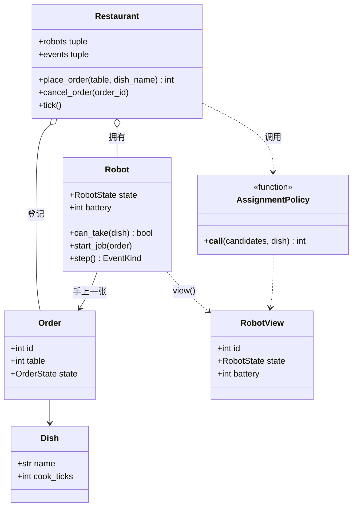

# 设计题解：机器人餐厅（Robot Restaurant）

## 题目与澄清

机器人餐厅是一个调度系统：顾客在某张桌子点一道菜，餐厅里有若干台机器人，空闲的机器人接下这张单，先在厨房把菜做好，再把菜送到桌子上，然后回到空闲状态等下一张单；机器人有电量，电量低了要去充电桩充电。难点不在某一个算法，而在三件事：机器人的状态不能乱跳（做菜中不能直接去充电）；「谁接这张单」的规则要能替换；电量和充电桩这类有限的资源要在不泄漏的前提下分配。

面试官的提法通常只有一个名字，再加追问：先让你设计「机器人餐厅」，然后问多台机器人怎么分配，再问机器人没电了怎么办。订单怎么来、机器人做什么、状态有哪几个、电量怎么算，都没有给定，下面是一套自洽的默认约定，面试时要开口问，不要把它当成面试官的规则。每一关的需求都在「需求与分级」里列明。

开场该问的三个澄清问题：

1. **一台机器人既做菜又送餐，还是做菜机器人和送餐机器人分开？** 题面没说。分开意味着一张单要经过两个队列、两类资源，状态机也变成订单的状态机。下面选「一台机器人从头到尾负责一张单」，因为它让「机器人状态」和「订单阶段」一一对应，是 45 分钟里能写完的版本；分开的变体放在 扩展与追问 里讲。
2. **时间怎么走？实时、还是离散的步？** 机器人「做菜要 4 分钟」若真的用 `time.sleep`，没法测。下面用离散的「刻」（tick）：`tick()` 推进一刻，其余全部是纯逻辑。面试里你也可以说：「我把时间做成一个注入的东西，测试里手动推进。」
3. **分配规则是什么？电量不够时订单怎么办？** 先到先得、谁空闲谁接，是最简单的答案；但「电量不够的机器人能不能接」「没有空闲充电桩时怎么办」正是追问的方向，所以要在开场就把「分配规则可以换」写在白板上。

范围外：菜单管理与价格、支付、多楼层路径规划、机器人故障与维修、订单修改。

## 需求与分级

| 关 | 需求 | 本关逼出的设计 |
|---|---|---|
| 第 1 关 | 一台机器人，点单 → 做菜 → 送餐 → 回到空闲；订单有状态 | 订单与机器人各一个状态枚举；离散时间 `tick()`；未知菜品报错 |
| 第 2 关 | 多台机器人；订单排队；「哪台接」可以换规则；取消排队中的订单 | 待处理队列；分配策略函数；只读快照 |
| 第 3 关 | 电量；低于阈值要去充电；充电桩数量有限；没有空桩怎么办 | 状态机多出 CHARGING；合法转移表；接单前先判断电量够不够做完 |
| 第 4 关 | 多线程同时下单；每张单恰好送达一次 | 一把锁保护全部可变状态；对外只给快照 |

最容易在第 1 关就写歪的地方：为了「简单」，让订单类自己去找机器人、机器人类自己去改订单、餐厅类只是一个外壳。到了第 3 关加入电量，这三个类之间的依赖就缠成一团。下面的切分让每个类只有一个变化原因。

## 核心对象与职责

- `Dish`：菜名和做菜需要的刻数，frozen dataclass，不可变。
- `Order`：订单号、桌号、菜、`OrderState`（PENDING → COOKING → DELIVERING → DELIVERED，或 PENDING → CANCELLED）。它只是一条记录，没有行为；谁推进它是机器人（接手之后）或餐厅（取消）。
- `Robot`：一台机器人，拥有状态（`RobotState`）、电量、手上的订单和剩余刻数；它每刻 `step()` 一次，并且是状态机的唯一执行者。不变量：状态只能按转移表变化，违反就抛 `InvalidTransitionError`。
- `RobotView`：机器人的只读快照（编号、状态、电量、订单号）。分配策略和调用者只能看到它，看不到活的 `Robot`，所以策略改不了机器人。
- `AssignmentPolicy`：一个函数类型——「给定空闲候选的快照和这道菜，返回选中的机器人编号，或 None」。`first_idle` 与 `most_battery` 是两个现成实现。
- `Config`：餐厅参数（充电桩数、每刻耗电、充电速度、低电量阈值、保底电量……）。它同时守着一条数学上的不变量：`reserve < low_battery <= full`。
- `Restaurant`：收单、排队、每刻推进、派单、充电安排，并持有那把锁。它是唯一对外的入口。
- `Event`：发生了什么（哪一刻、什么事、哪台机器人、哪张单），餐厅记在事件日志里，对外是元组快照。



图里省略了 `Config` 和 `Event` 两个类：它们只是数据（参数与事件记录），画进去会让 `Restaurant` 下面并排五个框、图太宽，关系上也没有新信息。

所有权很明确：`Restaurant` 拥有全部 `Robot`，机器人的生命周期跟着餐厅走；订单被餐厅登记，被机器人临时持有。`Robot` 不知道餐厅的存在，它只知道自己的 `Config`——这样机器人可以脱离餐厅单独测试，状态机的每条转移都能直接断言。

## 关键设计决策

### 决策一：机器人的状态怎么表示——枚举加转移表，还是每个状态一个类

问题：机器人有 IDLE、COOKING、DELIVERING、CHARGING 四个状态，每个状态下「这一刻该干什么」不同，而且不是任意两个状态之间都能直接转移（做菜中的机器人不能直接去充电）。

**方案 A：状态模式（State）的完整形态**：`IdleState`、`CookingState`、`DeliveringState`、`ChargingState` 四个类，各自实现 `step(robot)` 与 `next()`。每加一个状态就加一个类，行为和转移都内聚在类里。代价是：四个类、一个基类，每个类十行左右，而 `step` 之间共享的东西（电量、剩余刻数）都要通过 `robot` 回传。

**方案 B：`RobotState` 枚举 + 一张合法转移表 + 一个 `step` 里的 `if/elif`**。转移规则集中在 `_ALLOWED` 这张字典里，一眼看全；`_to(new)` 是唯一改状态的地方，非法转移直接抛异常。`step` 按当前状态分支，四个分支加起来二十几行。

**选择：B。** 状态模式在状态很多、每个状态的行为很重的时候才划算。这里四个状态，每个状态的行为就是「扣电、减一刻、到点转移」，几行就写完。真正要保证的是转移的合法性，而转移表比散落在四个类里的 `next()` 更容易审查。判断标准是：如果你要给面试官解释「为什么只有这些转移」，一张表能直接指给他看；如果状态数涨到十几个、各自有大段行为，再重构成状态模式，改动也只集中在 `Robot` 这一个类里。这是一个「拒绝模式」的决策，要在面试里主动说出来。

### 决策二：「哪台机器人接这张单」——硬编码、子类，还是传入函数

问题：第 2 关问「如果想优先派电量最多的机器人呢」。

**方案 A：在 `_dispatch` 里写死 `min(candidates, key=id)`。** 第 2 关一句话改完；但每换一种规则就要改 `Restaurant`，测试也只能测一种规则。

**方案 B：`AssignmentPolicy` 协议，每种规则一个类。** 规则没有状态，只有一个方法，这样写就是 Java 习惯：一个只含一个方法的类。

**方案 C：策略就是一个函数 `(candidates, dish) -> robot_id | None`。** `first_idle`、`most_battery` 各三行；想要带状态的策略（比如轮询）再写成带 `__call__` 的类，签名不变。

**选择：C。** 这是策略模式（Strategy）的 Python 形态：一等函数就是策略。两个关键细节：第一，策略拿到的是 `RobotView` 的快照而不是活的 `Robot`，所以它只能「选」不能「改」；第二，策略返回编号后，餐厅要校验这个编号确实在候选里，否则抛 `PolicyError`——一个写错的策略不能把订单派给正在送餐的机器人，这是安全不变量，所以用异常而不是 `assert`。

### 决策三：充电桩占用数怎么记——再设计一个计数器，还是数状态

问题：充电桩数量有限（`chargers`）。需要知道「现在占用了几个」才能决定一台低电量机器人能不能去充。

**方案 A：`ChargerPool` 类，里面存 `occupied` 计数，机器人开始充电时 `acquire`，结束时 `release`。** 直觉上很「面向对象」。但它引入了第二份真相：机器人的状态说「我在充电」，池子的计数说「占了 1 个」，两者必须永远同步。哪一天某条路径只改了状态忘了释放，充电桩就「泄漏」，最后所有机器人都在等一个永远不空的桩。

**方案 B：不存计数，现数。** 占用数 = 处于 CHARGING 状态的机器人数，每次安排充电前 `sum(r.state is CHARGING for r in robots)`。机器人离开 CHARGING 的那一刻，占用自然减一，没有可以忘记的释放步骤。

**选择：B。** 能从已有状态推出来的东西就不要再存一份。代价是 O(机器人数) 的一次遍历，餐厅里的机器人数以十计，完全可以忽略；如果真有上万台，就用一个计数器并把它封装在 `Robot` 的转移函数里，让「改状态」与「改计数」成为同一个操作。

### 决策四：没有空桩、电量又低，怎么办——这是第 3 关真正的追问

问题：机器人电量低于阈值（30%），所有充电桩都被占了。有两个朴素答案，都是错的。「低了就不许接单」会让订单在没有桩的情况下无限排队，直到整个餐厅停摆；「低了照接」会让机器人在半路没电。

选择：**接单的条件不是「电量是否低于阈值」，而是「做完这单后电量是否仍不低于保底电量」**，即 `battery - job_cost >= reserve`。默认参数下，一碗面（做 4 刻，每刻耗 1；送 3 刻，每刻耗 2）耗电 10，一碗汤耗电 8。于是一台电量 25（低于阈值 30）的机器人，在没有空桩时仍然可以接一碗汤（25 − 8 = 17 ≥ 10），做完剩 17；但一台电量 12 的机器人接不了汤（12 − 8 = 4 < 10），订单会继续排队，机器人原地等桩。

这条规则要配一个下界保证，才不会出现死锁：下单时就拒绝耗电超过 `low_battery − reserve`（默认 20）的菜（`OrderRejectedError`）。有了它，任何电量不低于阈值的机器人都一定能接任何合法订单，而低于阈值的机器人要么去充电、要么等桩——最终所有人都能回到不低于阈值的状态，系统总有进展。取舍写明：电量低的机器人会在没桩的时候继续干活，把电量压到更低；换来的是吞吐。

排队顺序上，`_dispatch` 是严格先来先服务：队首的订单没人能接，后面的订单也不越过它。代价是队首的一碗耗电高的面可能让后面一碗汤等着，即队头阻塞（head-of-line blocking）；换来的是公平和可预测。想要「谁能做谁先做」，把 `while` 改成遍历整个队列即可，但要接受大订单可能饿死。

### 决策五（简单者胜出）：订单状态不是第二台状态机

订单有 PENDING / COOKING / DELIVERING / DELIVERED / CANCELLED，看起来也该有转移表。但订单的状态变化全部由「某个动作」触发：被机器人接手、做完、送到、被取消——这些动作各自只在一个地方发生（`Robot.start_job`、`Robot.step`、`Restaurant.cancel_order`），所以订单状态只是一个被写入的字段，不需要独立的转移校验。给它再建一个状态机，是把同一个事实在两处各写一遍。真正会出错的是机器人的状态，所以校验放在那里。

## 代码走读

下面是完整的、被测试过的参考解。

%% code:begin solution.py %%
```python
"""机器人餐厅（Robot Restaurant）参考解。

设计五句话：
1. 时间是离散的「刻」（tick）：`Restaurant.tick()` 推进一刻，所有机器人各走一步，所以测试不需要睡眠或真实时钟。
2. `Robot` 是一台状态机（IDLE → COOKING → DELIVERING → IDLE，或 IDLE ↔ CHARGING），合法转移写成一张表，非法转移抛异常。
3. 「哪台机器人接这张单」是一个可替换的策略函数 `AssignmentPolicy`：输入空闲候选的只读视图，返回机器人编号。
4. 充电桩数不另设计数器：数一数处于 CHARGING 的机器人就是占用数；电量低于阈值且有空桩才去充，没桩就继续等或干活。
5. `Restaurant` 用一把锁保护「待处理队列 + 全部机器人 + 事件日志」，对外只给快照（`RobotView`、事件元组）。
"""

from __future__ import annotations

import threading
from collections import deque
from collections.abc import Callable, Iterable, Sequence
from dataclasses import dataclass
from enum import Enum


class RestaurantError(Exception):
    """本模块所有异常的根。"""


class UnknownDishError(RestaurantError, LookupError):
    """菜单上没有这道菜。"""


class UnknownOrderError(RestaurantError, LookupError):
    """没有这个订单号。"""


class OrderRejectedError(RestaurantError, ValueError):
    """订单本身无法被任何机器人完成（耗电超过一台满足阈值的机器人能承担的量）。"""


class OrderNotCancellableError(RestaurantError):
    """订单已被机器人接走（或已结束），不能再取消。"""


class InvalidTransitionError(RestaurantError):
    """机器人状态机收到了表里没有的转移。"""


class PolicyError(RestaurantError):
    """分配策略返回了不在候选里的机器人。"""


@dataclass(frozen=True, slots=True)
class Dish:
    """菜品：名字与做菜需要的刻数。"""

    name: str
    cook_ticks: int


class OrderState(Enum):
    PENDING = "pending"
    COOKING = "cooking"
    DELIVERING = "delivering"
    DELIVERED = "delivered"
    CANCELLED = "cancelled"


class RobotState(Enum):
    IDLE = "idle"
    COOKING = "cooking"
    DELIVERING = "delivering"
    CHARGING = "charging"


class EventKind(Enum):
    ASSIGNED = "assigned"
    COOKED = "cooked"
    DELIVERED = "delivered"
    CHARGE_STARTED = "charge_started"
    CHARGE_DONE = "charge_done"
    CANCELLED = "cancelled"


@dataclass(frozen=True, slots=True)
class Event:
    """发生了什么：订阅者靠它更新自己，不必回头读餐厅内部。"""

    tick: int
    kind: EventKind
    robot_id: int | None
    order_id: int | None


@dataclass(frozen=True, slots=True)
class Config:
    """餐厅参数。电量是 0–100 的整数百分点。"""

    chargers: int = 1
    deliver_ticks: int = 3
    cook_drain: int = 1
    move_drain: int = 2
    charge_rate: int = 10
    full: int = 100
    low_battery: int = 30
    reserve: int = 10

    def __post_init__(self) -> None:
        if self.chargers < 0 or self.charge_rate < 1 or self.deliver_ticks < 1:
            raise ValueError("chargers >= 0, charge_rate >= 1, deliver_ticks >= 1")
        if not 0 <= self.reserve < self.low_battery <= self.full:
            raise ValueError("需要 0 <= reserve < low_battery <= full")

    def job_cost(self, dish: Dish) -> int:
        """做完并送到一份菜要耗多少电。"""
        return dish.cook_ticks * self.cook_drain + self.deliver_ticks * self.move_drain

    @property
    def max_job_cost(self) -> int:
        """保证进度的上限：电量不低于 low_battery 的机器人，任何合法订单做完后仍不低于 reserve。"""
        return self.low_battery - self.reserve


@dataclass(slots=True)
class Order:
    id: int
    table: int
    dish: Dish
    state: OrderState = OrderState.PENDING


@dataclass(frozen=True, slots=True)
class RobotView:
    """机器人的只读快照；策略与调用方只看得到这个。"""

    id: int
    state: RobotState
    battery: int
    order_id: int | None


# 一个策略 = 一个纯函数：从空闲候选里选一台，返回它的编号；没有合适的返回 None。
AssignmentPolicy = Callable[[Sequence[RobotView], Dish], int | None]


def first_idle(candidates: Sequence[RobotView], dish: Dish) -> int | None:
    """编号最小的候选。"""
    return min((r.id for r in candidates), default=None)


def most_battery(candidates: Sequence[RobotView], dish: Dish) -> int | None:
    """电量最多的候选；同电量取编号小的。"""
    best = max(candidates, key=lambda r: (r.battery, -r.id), default=None)
    return None if best is None else best.id


# 合法转移表：状态机的全部规则只在这一处。
_ALLOWED: dict[RobotState, frozenset[RobotState]] = {
    RobotState.IDLE: frozenset({RobotState.COOKING, RobotState.CHARGING}),
    RobotState.COOKING: frozenset({RobotState.DELIVERING}),
    RobotState.DELIVERING: frozenset({RobotState.IDLE}),
    RobotState.CHARGING: frozenset({RobotState.IDLE}),
}


class Robot:
    """一台机器人：自己拥有状态、电量、手上的订单与剩余刻数；每刻 `step()` 一次。"""

    def __init__(self, robot_id: int, battery: int, cfg: Config) -> None:
        self.id = robot_id
        self.battery = battery
        self.state = RobotState.IDLE
        self.order: Order | None = None
        self._remaining = 0
        self._cfg = cfg

    def _to(self, new: RobotState) -> None:
        if new not in _ALLOWED[self.state]:
            raise InvalidTransitionError(f"机器人 {self.id}: {self.state.name} -> {new.name}")
        self.state = new

    def view(self) -> RobotView:
        return RobotView(self.id, self.state, self.battery, self.order.id if self.order else None)

    def can_take(self, dish: Dish) -> bool:
        """空闲，且做完这单后电量仍不低于保底电量。"""
        return self.state is RobotState.IDLE and self.battery - self._cfg.job_cost(dish) >= self._cfg.reserve

    def start_job(self, order: Order) -> None:
        self._to(RobotState.COOKING)
        self.order = order
        self._remaining = order.dish.cook_ticks
        order.state = OrderState.COOKING

    def start_charging(self) -> None:
        self._to(RobotState.CHARGING)

    def step(self) -> EventKind | None:
        """走一刻；这一刻若完成了一个里程碑就返回它。"""
        cfg = self._cfg
        if self.state is RobotState.COOKING:
            assert self.order is not None
            self.battery -= cfg.cook_drain
            self._remaining -= 1
            if self._remaining == 0:
                self._to(RobotState.DELIVERING)
                self._remaining = cfg.deliver_ticks
                self.order.state = OrderState.DELIVERING
                return EventKind.COOKED
        elif self.state is RobotState.DELIVERING:
            assert self.order is not None
            self.battery -= cfg.move_drain
            self._remaining -= 1
            if self._remaining == 0:
                self.order.state = OrderState.DELIVERED
                self._to(RobotState.IDLE)
                return EventKind.DELIVERED
        elif self.state is RobotState.CHARGING:
            self.battery = min(cfg.full, self.battery + cfg.charge_rate)
            if self.battery == cfg.full:
                self._to(RobotState.IDLE)
                return EventKind.CHARGE_DONE
        return None


class Restaurant:
    """餐厅：收单、排队、每刻推进机器人、把空闲机器人派给队首订单。"""

    def __init__(
        self,
        menu: Iterable[Dish],
        batteries: Sequence[int],
        config: Config = Config(),
        policy: AssignmentPolicy = first_idle,
    ) -> None:
        self._menu = {d.name: d for d in menu}
        self._cfg = config
        self._policy = policy
        self._robots = [Robot(i, b, config) for i, b in enumerate(batteries)]
        self._orders: dict[int, Order] = {}
        self._pending: deque[Order] = deque()
        self._events: list[Event] = []
        self._now = 0
        self._next_id = 1
        self._lock = threading.Lock()

    # ---- 查询：全部返回快照 ----
    @property
    def now(self) -> int:
        with self._lock:
            return self._now

    @property
    def robots(self) -> tuple[RobotView, ...]:
        with self._lock:
            return tuple(r.view() for r in self._robots)

    @property
    def events(self) -> tuple[Event, ...]:
        with self._lock:
            return tuple(self._events)

    @property
    def pending_count(self) -> int:
        with self._lock:
            return len(self._pending)

    def order_state(self, order_id: int) -> OrderState:
        with self._lock:
            return self._order(order_id).state

    # ---- 命令 ----
    def place_order(self, table: int, dish_name: str) -> int:
        """收一张单，立即排进队尾，返回订单号。"""
        dish = self._menu.get(dish_name)
        if dish is None:
            raise UnknownDishError(dish_name)
        if self._cfg.job_cost(dish) > self._cfg.max_job_cost:
            raise OrderRejectedError(f"{dish_name} 耗电 {self._cfg.job_cost(dish)}，超过上限 {self._cfg.max_job_cost}")
        with self._lock:
            order = Order(self._next_id, table, dish)
            self._next_id += 1
            self._orders[order.id] = order
            self._pending.append(order)
            return order.id

    def cancel_order(self, order_id: int) -> None:
        """只有还在排队的订单可以取消；机器人一旦接手就不行。"""
        with self._lock:
            order = self._order(order_id)
            if order.state is not OrderState.PENDING:
                raise OrderNotCancellableError(f"订单 {order_id} 已是 {order.state.name}")
            self._pending.remove(order)
            order.state = OrderState.CANCELLED
            self._log(EventKind.CANCELLED, None, order)

    def tick(self) -> None:
        """推进一刻：先让每台机器人走一步，再安排充电，最后派单。三步顺序是设计的一部分。"""
        with self._lock:
            self._now += 1
            for robot in self._robots:
                kind = robot.step()
                if kind is not None:
                    self._log(kind, robot, robot.order if kind is not EventKind.CHARGE_DONE else None)
                    if kind is EventKind.DELIVERED:
                        robot.order = None
            self._send_low_to_charge()
            self._dispatch()

    def run_until_quiet(self, max_ticks: int = 10_000) -> int:
        """一直推进到没有排队订单、也没有机器人在做菜或送餐；返回用了多少刻。"""
        for used in range(max_ticks + 1):
            with self._lock:
                busy = bool(self._pending) or any(
                    r.state in (RobotState.COOKING, RobotState.DELIVERING) for r in self._robots
                )
            if not busy:
                return used
            self.tick()
        raise RestaurantError(f"{max_ticks} 刻内没有安静下来")

    # ---- 内部（调用时已持锁）----
    def _order(self, order_id: int) -> Order:
        try:
            return self._orders[order_id]
        except KeyError:
            raise UnknownOrderError(order_id) from None

    def _log(self, kind: EventKind, robot: Robot | None, order: Order | None) -> None:
        self._events.append(Event(self._now, kind, robot.id if robot else None, order.id if order else None))

    def _send_low_to_charge(self) -> None:
        """电量低的空闲机器人按「最低电量优先」去占空桩；没有空桩就留在原地等。"""
        used = sum(r.state is RobotState.CHARGING for r in self._robots)
        low = sorted(
            (r for r in self._robots if r.state is RobotState.IDLE and r.battery < self._cfg.low_battery),
            key=lambda r: (r.battery, r.id),
        )
        for robot in low[: max(0, self._cfg.chargers - used)]:
            robot.start_charging()
            self._log(EventKind.CHARGE_STARTED, robot, None)

    def _dispatch(self) -> None:
        """严格先来先服务：队首派不出去，后面的也不越过它。"""
        while self._pending:
            order = self._pending[0]
            candidates = [r.view() for r in self._robots if r.can_take(order.dish)]
            chosen = self._policy(candidates, order.dish)
            if chosen is None:
                return
            if chosen not in {c.id for c in candidates}:
                raise PolicyError(f"策略选了不可用的机器人 {chosen}")
            self._pending.popleft()
            robot = self._robots[chosen]
            robot.start_job(order)
            self._log(EventKind.ASSIGNED, robot, order)


if __name__ == "__main__":
    shop = Restaurant([Dish("面", 4), Dish("汤", 2)], batteries=(100, 100))
    first = shop.place_order(table=1, dish_name="面")
    second = shop.place_order(table=2, dish_name="汤")
    print("用了", shop.run_until_quiet(), "刻")
    print(shop.order_state(first), shop.order_state(second))
    for event in shop.events:
        print(event)
```
%% code:end %%

看四个地方：

1. **`_ALLOWED` 与 `_to`**：全部状态规则只有这一张表。`Robot.start_job` 和 `start_charging` 都经过 `_to`，所以「做菜中的机器人被派去充电」不会悄悄发生，而是立刻抛 `InvalidTransitionError`。
2. **`can_take`**：`battery - job_cost >= reserve` 一行就是决策四的全部。`Restaurant._dispatch` 先过滤出能接这单的空闲机器人，再把它们的快照交给策略。
3. **`tick` 的三步顺序**：先让每台机器人走一步，再安排充电，最后派单。刚送完餐、电量已经低于阈值的机器人，会在同一刻先被送去充电（若有空桩），所以它不会马上又接到一张单再把电耗得更低。三步换了顺序，行为就变了，这是设计的一部分，不是实现细节。
4. **`_send_low_to_charge`**：按「电量最低优先」排队占空桩；占用数现数（决策三）。

用一个小例子看时间线：一台电量 100 的机器人，先后收到「面」和「汤」两张单。第 1 刻接面；第 5 刻面做好（做了 4 刻）；第 8 刻面送到；同一刻接下汤；第 10 刻汤做好；第 13 刻汤送到，总共用了 13 刻，机器人剩 82（100 − 10 − 8）。若有两台机器人，两张单并行，8 刻就全部送到。这些数字就是 `run_until_quiet()` 的返回值，测试里有断言。

## 测试与自检

测试按关分组，共 20 条，全部不依赖真实时间：

- 第 1 关：订单状态逐刻变化；事件日志里每个里程碑发生在哪一刻；单台机器人严格按先来先服务；未知菜品与未知订单；一碗根本做不完的菜被下单时拒绝；做完一碗面少 10 点电。
- 第 2 关：两台机器人并行；`first_idle` 与 `most_battery` 选不同的机器人；自定义策略只是一个函数，返回无效编号会抛 `PolicyError`；忙的机器人永远不在候选里（用一个记录候选的「间谍」策略断言）；取消排队中的订单可以，取消已被接手的不行。
- 第 3 关：低电量空闲的机器人去充电并充满；刚送完餐电量掉到阈值下就去充电，充电期间不接新单；桩不够时按最低电量优先；没桩时电量 25 的机器人仍能接汤、电量 12 的不行；一个随机订单流上的性质测试——**电量永远不低于保底电量**。这个界是推出来的：接单时保证了做完仍不低于 `reserve`，所以只要初始电量不低于 `reserve`，任何时刻都不会低于它，而不是「跑出来大概是这样」。
- 第 4 关：六个线程在 `Barrier` 后同时下单，主线程同时推进时间，断言订单号两两不同，每张单恰好被送达一次。

两分钟演示：构造一个两台机器人的餐厅，下三张单，每个 `tick()` 之后打印 `robots`，观察第三张单在前两台都忙时留在队列里；再把一台机器人电量设成 15，看它第一刻就去充电。

## 扩展与追问

**新需求**

- 做菜机器人和送餐机器人分开：把 `Order` 的阶段拆成「等厨师」「等送餐」两个队列，`Robot` 增加一个 `role`；状态机不变，`_dispatch` 按阶段选队列。`Order`、`Dish`、策略函数的签名不变。
- 机器人故障（OFFLINE 状态）：转移表加一行，`can_take` 对它返回 False，进行中的订单放回队首。
- 优先级订单（VIP）：`_pending` 从 `deque` 换成按（优先级, 到达序）排序的堆；`_dispatch` 的 `pending[0]` 变成 `heap[0]`。
- 送餐时间依桌号而不同：`Config.deliver_ticks` 变成函数 `table -> ticks`，`job_cost` 同步改。

**并发与线程安全**

- 现在的做法是一把锁罩住全部可变状态，`tick()` 在锁内完成「机器人推进 + 充电 + 派单」。这里要诚实说明 GIL：CPython 的全局解释器锁保证单条字节码原子，但「检查队首、选机器人、改状态」是多步操作，没有锁就会让两个线程把同一张单派给两台机器人。
- 真要让时间自己走：起一个后台线程循环 `tick()` 并 `Event.wait(间隔)`，下单线程只调用 `place_order`；`Restaurant` 的公开方法本来就线程安全，不需要改。
- 想减小锁粒度：下单只碰队列，推进只碰机器人。可以拆成两把锁，但要规定加锁顺序；对这个规模不值得。

**持久化与规模**

- 把事件日志当作真相来源（事件溯源）：重启后重放日志恢复订单与机器人状态，`Event` 已经带齐了信息；这也是把观察者挂上去的自然位置。
- 上千台机器人时，`_send_low_to_charge` 的遍历要换成维护「空闲集合」，但接口不变。

## 常见错误

1. **在逻辑里用 `time.sleep` 模拟做菜**：测试慢且不确定。改成离散的刻，或注入时钟。
2. **机器人的状态用一堆布尔值**：`is_cooking`、`is_delivering`、`is_charging` 会出现两个同时为真的状态。用枚举加转移表，非法状态根本无法表示。
3. **接单只看「是否空闲」**：电量不够的机器人会在半路停下。接单必须检查做完后的电量。
4. **用 `if battery < 30: refuse` 一刀切**：没有空桩时所有订单永远排队。正确的是看「做得完与否」，并保证下界（决策四）。
5. **充电桩单独记计数**：释放路径漏掉一条，桩就泄漏。能数出来的东西不要存。
6. **把活的 `Robot` 对象交给策略或调用方**：策略可以顺手改状态，绕开转移表。交快照。
7. **`assert robot.state is IDLE` 保护派单安全**：`python -O` 会把它删掉。安全不变量用异常。
8. **Java 习惯**：`getBattery()`、`setState()`、`RobotManager` 单例、一个只转发一次调用的 `OrderService`。这里用属性、函数和一个 `Restaurant` 就够了。
9. **下单就启动一条线程「模拟机器人」**：线程之间的顺序不可测，而且容易同时改一张订单。用 `tick()` 单线程推进，把并发只放在外围。

## 45 分钟怎么分配

| 分钟 | 做什么 | 口头要说的话 |
|---|---|---|
| 0–5 | 三个澄清问题：做菜与送餐是否同一台机器人、时间怎么走、分配与电量规则；声明范围外 | 「我先按一台机器人负责到底、时间用离散的刻来设计。」 |
| 5–10 | 画 `Order`、`Robot`、`Restaurant` 三个框，写出两个状态枚举 | 「机器人状态是枚举加转移表，订单状态只是字段。」 |
| 10–25 | 写第 1 关：`place_order`、`tick`、`Robot.step`，一台机器人跑通 | 边写边说为什么 `step` 返回里程碑而不是自己打印 |
| 25–33 | 第 2 关：队列、`first_idle` 策略函数、多机器人 | 「策略是函数，拿的是快照，不能改机器人。」 |
| 33–40 | 第 3 关：电量、`can_take`、充电；说清没桩时的规则 | 「接单看做完后的电量，不看当前是否低于阈值。」 |
| 40–45 | 测试名两三个，口述并发：一把锁罩住全部可变状态 | 「读队首、选机器人、改状态是一个整体，GIL 不保证它。」 |

时间不够时的取舍：先砍 `cancel_order` 与 `most_battery`（口述）；再砍事件日志；保住状态机和 `can_take`。

## 来源与延伸

- [一亩三分地 thread-1189999](https://www.1point3acres.com/bbs/thread-1189999-1-1.html)：2026-09-18 的 Amazon SDE II 电面报告，跟帖里只提到「设计机器人餐厅以及追问」，正文被隐藏。除题名外，全部题面（订单来源、状态、分配、电量）都是为练习补出的（reconstructed）：第 1 关由题名直接逼出，第 2 关的多机器人与分配策略、第 4 关的并发与取消是推断。
- [一亩三分地 thread-1191952](https://www.1point3acres.com/bbs/thread-1191952-1-1.html)：2026-10-04 的帖子，Amazon Robotics 实习（面试在 2026-03），读者问「低于 50% 但没空 charger 怎么处理」。那是另一个团队的另一道题，这里只借它的问法做第 3 关的充电追问，阈值与规则是自己定的。
- [Python 标准库 enum](https://docs.python.org/3/library/enum.html)：`Enum` 的成员比较用 `is`；两个状态枚举和事件枚举都据此写。
- [Python 标准库 threading](https://docs.python.org/3/library/threading.html#lock-objects)：`Lock` 的语义；用它保护「读队首—选机器人—改状态」这个整体。

概念背景：[[patterns.state|状态模式（State）]]（决策一：何时用枚举加转移表、何时升级成状态类）、[[patterns.strategy|策略模式与可替换算法（Strategy）]]（决策二：一等函数当策略）。题库里相邻的是 [[solution-restaurant]]（桌位、点单、后厨流水线的餐厅系统），那道题讲餐厅的业务流程和订单生命周期；这里把重点放在机器人这一个会被调度、会没电的资源上，两道题可以对照读：同样是「订单」，一个重点在流程，一个重点在资源调度。
