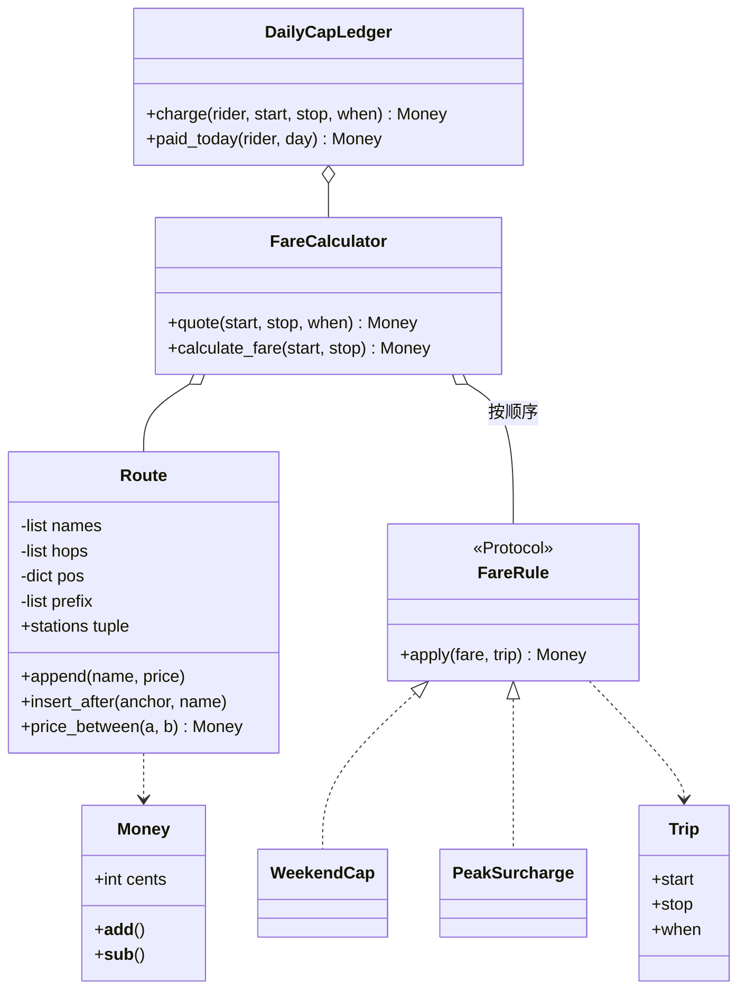

# 设计题解：火车线路票价（Train Fare Calculator）

## 题目与澄清

这是一个火车票价计算系统。一条线性的火车线路上有一串车站，乘客从任意一站上车、任意一站下车，票价按经过多少个区间（相邻两站之间的一段）计算；线路可以随时加站，周末票价要有上限。用它的是售票和结算程序。难点不在算术，而在两处：新需求（加站、周末封顶）应该落在新类上，还是逼你改已经写好的核心方法；以及「现在是周几」这种依赖时间的规则怎么写才测得了。

面试官这样提出：已知一条线路 G → U → H → K → I，每两个相邻站之间的乘车费用为 1（例如从 G 到 I 是 4）。第一步，实现 `calculateFare(start, stop)`。第二步，从 OOP / LLD 的角度想：路线数据从哪里来，设计一个类，支持动态添加（推入）站点。第三步追问：如果是周末，总票价要设一个上限封顶。再往后的几步（每日累计封顶、高峰加价、并发）是自然的延伸，下面一并做了。

封顶封的是「一次行程」还是「一个人一天的总额」、封顶的数额、方向性、未知车站怎么处理，题目都没有说，面试时要问清楚。

开场该问的三个澄清问题：

1. **「总票价封顶」封的是什么？** 题面说的是「总票价需要设置一个上限封顶」。可能是（甲）周末的每一次行程不超过某个数；也可能是（乙）同一个人一整天累计不超过某个数。甲不需要任何状态，乙需要记住「谁今天已经付了多少」。下面两个都做：`WeekendCap` 实现甲，`DailyCapLedger` 实现乙。面试时先问清，再从无状态的那个开始。
2. **路线数据从哪来？加站是只能加到末尾，还是可以插在中间？** 题面说「支持动态添加／推入站点」，「推入」像是追加。追加是 O(1)；插入中间会改变其后所有站的位置，要重排。下面两个都支持，并说明代价差异。
3. **价格是每站统一的，还是每个区间可以不同？** 题面是统一的 1，但把价格设计成「每个区间一个价格」不增加多少复杂度，却能让后面「不同区间不同价」的追问变成零改动。

没有问到、但要主动声明的范围外内容：多条线路与换乘、往返票、折扣卡、持久化与支付。

## 需求与分级

| 关 | 需求 | 本关逼出的设计 |
|---|---|---|
| 第 1 关 | 固定线路 G→U→H→K→I，`calculateFare(start, stop)`，每个区间 1，G 到 I 是 4 | 站名到位置的映射；方向无关；未知车站与同站的行为 |
| 第 2 关 | 线路数据由一个类持有，支持动态加站 | 把线路抽成 `Route`；追加 O(1)；价格表怎么随加站更新 |
| 第 3 关 | 周末总票价封顶 | 一条无状态的定价规则；时间必须从外面传进来；规则与线路分离 |
| 第 4 关 | 同一乘客一天累计封顶；高峰加价；并发 | 唯一有状态的 `DailyCapLedger`；规则按顺序组合；锁与过期清理 |

要特别说一句：第 3 关最容易写成在 `calculateFare` 里直接 `if datetime.now().weekday() >= 5`。这样的代码没法测试（测试今天是周几？），也没法在第 4 关里加规则。

## 核心对象与职责

- `Money`：整数「分」的值对象（frozen dataclass，带 `order=True`）。不变量：金额运算永远是整数运算，没有浮点。题面的「1」在这里是 100 分，所以 G 到 I 是 `Money(400)`。
- `Route`：一条线性线路。拥有站名列表、每个区间的价格、站名到位置的字典、以及前缀和数组（`prefix[i]` 是从首站坐到第 i 站的累计价格）。不变量：`len(prefix) == len(names)`，且 `prefix` 严格由 `hops` 累加得到。任意两站的票价是两个前缀和之差的绝对值，所以查询是 O(1)。
- `Trip`：一次行程（起点、终点、时间）的只读记录，规则看它而不看系统时钟。
- `FareRule`（协议）：「拿到当前价格，返回调整后的价格」。实现有 `WeekendCap` 和 `PeakSurcharge`，都是无状态的 frozen dataclass。
- `FareCalculator`：把线路和规则列表串起来；时钟在构造函数里注入。保持面试官给的签名 `calculate_fare(start, stop)`，同时提供 `quote(start, stop, when)` 让调用方指定时间。
- `DailyCapLedger`：唯一有状态的类，记录「某天某乘客已付多少」，并保证并发时不超封顶；它会清理过期的日期。



所有权上，`FareCalculator` 持有 `Route` 的引用但线路可以在外面继续被加站——这是有意的：题面第 2 问就是「动态加站」，所以线路必须是一个可以独立变化的对象，计算器看到的永远是它最新的状态。而 `Route` 自己用一把锁保护，让「读位置和读前缀和」不会读到加站做了一半的状态。

## 关键设计决策

### 决策一：两站之间的票价怎么算——扫描、位置相减还是前缀和

问题：`calculateFare(G, I)` 要得到经过多少个区间的价格总和，而线路会在运行时变长。

**方案 A：每次从起点扫描到终点累加。** 最直白，O(k)，k 是两站间的区间数。当价格全是 1 时，这个循环就是在数数，纯属浪费。

**方案 B：只存「站名 → 位置」，票价 = |位置之差| × 单价。** 第 1 关的最优解：O(1)，代码两行。但它把「每个区间同价」写进了公式；一旦第 4 关追问「有些区间更贵」，公式就整个错了。

**方案 C：存每个区间的价格，再存前缀和，票价 = |prefix[a] − prefix[b]|。** 查询仍然是 O(1)；统一价格只是「每个区间的价格都是默认值」这一特例。追加一站只要在前缀和末尾再加一项，O(1)。

**选择：C。** 方案 B 是 C 的特例，C 多付出的代价只是多一个数组。它真正的好处在加站上：追加不会改变已有的前缀和，所以已有两站之间的票价永远不变。

**代价和陷阱：在中间插入一站，位置和前缀和都要重排，O(n)。** 这是面试官爱追问的点。以 G→U→H→K→I 在 U 之后插入 N 为例：N 之后所有站的位置加 1，前缀和每一项都可能变；更关键的是语义——原来的区间 U→H 被切成 U→N 和 N→H 两段，各自按默认价格，于是 G 到 I 的票价从 4 变成 5。这里选择「切成两个默认价区间」，另一种选择是「把原价格按比例分给两段」，两种都说得通，要向面试官确认。只做追加的实现可以不做这个重排，所以追加和插入是两个方法，各写各的复杂度。

### 决策二：周末封顶放在哪里——算法里写 if，还是一条规则对象

问题：封顶是时间相关的业务规则，将来会有更多这样的规则（高峰加价、节假日）。

**方案 A：在 `calculate_fare` 里写 `if when.weekday() >= 5: fare = min(fare, cap)`。** 第 3 关当场可用；第 4 关的高峰加价再写一个 `if`，然后是节假日、会员折扣……这个函数迟早长成一团。

**方案 B：`FareRule` 协议，每条规则一个小类，计算器按列表顺序应用。** 这是策略模式（Strategy）。加一条规则只新增一个类、改一处装配列表，`calculate_fare` 本身一个字都不用动。

**选择：B。** 这里有至少两个真实实现（`WeekendCap` 与 `PeakSurcharge`），所以协议不是「为将来准备」。规则是无状态的 frozen dataclass：它们的全部输入是「当前价格」和「这次行程」，因此可以任意复用、并发调用。规则顺序有语义——先加价再封顶与先封顶再加价结果不同——所以顺序是调用方显式给出的列表，而不是类内部隐藏的优先级字段。

### 决策三：时间从哪里来

问题：封顶要知道今天是周几，但「现在几点」是个副作用。

**方案 A：规则里直接 `datetime.now()`。** 测试无法固定今天是周六还是周一，必须靠改系统时间或 mock。

**方案 B：每次调用都由调用方传 `when`。** 干净，但面试官给的签名是 `calculateFare(start, stop)`，没有时间参数。

**方案 C：构造函数注入时钟（一个返回 `datetime` 的可调用对象），`calculate_fare` 保留原签名，同时提供 `quote(start, stop, when)` 显式传时间。**

**选择：C。** 给定的 API 原样可用，测试时传 `lambda: datetime(2026, 10, 17, 9, 0)` 就固定了「周六早上 9 点」。要注意 `charge` 里只取一次时钟：先取 `when` 再用它既算票价又定日期，避免一次行程在 23:59:59 算票价、在 00:00:01 记账，落到不同的两天。

### 决策四：每日封顶的状态与并发

问题：「同一个人一天累计封顶」要记住历史。`charged = min(票价, 封顶 − 已付)` 是三步：读已付、计算、写回。

**方案 A：普通字典，不加锁。** 两个线程同时读到「已付 0」，各自算出能付 600，一起写回 600，总共付了 1200。即使在 CPython 里每条字节码是原子的，「读—算—写」也不是一个原子操作，GIL（全局解释器锁）并不能保护它。

**方案 B：一把全局 `threading.Lock` 罩住整个 `charge`。** 简单且正确。

**方案 C：每个乘客一把锁。** 并行度更高，但锁表本身又要保护，也要清理；这里每次持锁只有微秒级，不值得。

**选择：B。** 测试里用 `Barrier` 同时放行 16 个线程，每个线程乘一次 400 的行程、封顶 1000，断言所有线程实付之和恰好等于 1000——不依赖时序，只检验「钱没有多收」这一不变量。

另一个常被忽略的问题：`_paid` 按天累积，不清理就会无限增长。`charge` 在记账后删除早于「昨天」的日期，只保留今天和昨天（跨午夜的迟到记录），测试 `test_ledger_forgets_old_days_so_memory_stays_bounded` 连续记 28 天后断言只跟踪 2 天。代价是：如果有人拿一个比「已见过的最新日期」早两天以上的时间来记账，这条记录会被下一次记账清理掉——假设时间基本单调，文档里写明。

### 决策五（简单者胜出）：不做 Station 类、不做 Singleton

站点是不是一个 `Station` 类？这里的站只有名字，没有行为，所以就是字符串。给它建一个只有 `name` 的类，只是把 `"G"` 包成 `Station("G")`，调用方多打字，字典键还要处理相等和哈希。如果将来站点有坐标、换乘信息，再把字符串换成 `@dataclass(frozen=True)` 的 `Station`，只改 `Route` 里用字符串的几处。同理，`FareCalculator` 也不做成单例：测试要用不同的线路和时钟各造一个，单例让这件事变难。

## 代码走读

%% code:begin solution.py %%
```python
"""火车线路票价（Train Fare Calculator）参考解。

设计五句话：
1. Route 拥有「有序站点 + 相邻两站的价格 + 前缀和」，任意两站的票价是两个前缀和的差，查询 O(1)。
2. Money 是整数「分」的值对象，所有金额运算都不碰浮点。
3. FareRule 是一条小接缝：拿「原价 + 行程」返回新价格，周末封顶、高峰加价各是一个无状态规则。
4. FareCalculator 把 Route 与规则串起来；时钟从构造函数注入，对外签名仍是 calculate_fare(start, stop)。
5. DailyCapLedger 是唯一有状态的部分：同一乘客同一天的累计封顶，一把锁保证不超额，并清理过期的日期。
"""

from __future__ import annotations

import threading
from collections.abc import Callable, Iterable, Sequence
from dataclasses import dataclass
from datetime import date, datetime, timedelta
from typing import Protocol


class FareError(Exception):
    """本模块所有异常的根。"""


class UnknownStationError(FareError, LookupError):
    """车站不在线路上。"""


class DuplicateStationError(FareError, ValueError):
    """线路上已经有同名车站。"""


@dataclass(frozen=True, slots=True, order=True)
class Money:
    """金额，单位是「分」（最小货币单位）。frozen 加 order，所以可以直接 min() 与比较。"""

    cents: int

    def __add__(self, other: Money) -> Money:
        return Money(self.cents + other.cents)

    def __sub__(self, other: Money) -> Money:
        return Money(self.cents - other.cents)

    def __str__(self) -> str:
        return f"{self.cents // 100}.{self.cents % 100:02d}"


ZERO = Money(0)


class Route:
    """一条线性线路：站名按顺序排列，hops[i] 是第 i 站到第 i+1 站的价格。

    prefix[i] = 从首站坐到第 i 站的累计价格，所以 fare(a, b) = |prefix[a] - prefix[b]|。
    """

    def __init__(self, stations: Iterable[str] = (), hop_price: Money = Money(100)) -> None:
        self._default = hop_price
        self._names: list[str] = []
        self._hops: list[Money] = []
        self._pos: dict[str, int] = {}
        self._prefix: list[int] = []
        self._lock = threading.Lock()  # 加站与查价可能并发，查价要同时读位置与前缀和
        for name in stations:
            self.append(name)

    def __len__(self) -> int:
        with self._lock:
            return len(self._names)

    def __contains__(self, name: object) -> bool:
        with self._lock:
            return name in self._pos

    @property
    def stations(self) -> tuple[str, ...]:
        with self._lock:
            return tuple(self._names)

    def append(self, name: str, price: Money | None = None) -> None:
        """在线路末端加一站；price 是上一站到这一站的价格，缺省用默认价。O(1)。"""
        with self._lock:
            self._append_locked(name, price)

    def _append_locked(self, name: str, price: Money | None) -> None:
        if name in self._pos:
            raise DuplicateStationError(name)
        if self._names:
            hop = self._default if price is None else price
            self._hops.append(hop)
            self._prefix.append(self._prefix[-1] + hop.cents)
        else:
            if price is not None:
                raise FareError("首站之前没有区间，不能指定价格")
            self._prefix.append(0)
        self._pos[name] = len(self._names)
        self._names.append(name)

    def insert_after(self, anchor: str, name: str) -> None:
        """在 anchor 之后插入一站：原来的一个区间被切成两个默认价区间。O(n)，因为后面的位置与前缀和都要重排。"""
        with self._lock:
            j = self._index(anchor)
            if j == len(self._names) - 1:
                self._append_locked(name, None)
                return
            if name in self._pos:
                raise DuplicateStationError(name)
            self._names.insert(j + 1, name)
            self._hops[j : j + 1] = [self._default, self._default]
            self._pos = {n: i for i, n in enumerate(self._names)}
            self._prefix = [0]
            for hop in self._hops:
                self._prefix.append(self._prefix[-1] + hop.cents)

    def _index(self, name: str) -> int:
        try:
            return self._pos[name]
        except KeyError:
            raise UnknownStationError(name) from None

    def price_between(self, start: str, stop: str) -> Money:
        """两站之间的原价，与方向无关；同一站为零。"""
        with self._lock:
            return Money(abs(self._prefix[self._index(start)] - self._prefix[self._index(stop)]))


@dataclass(frozen=True, slots=True)
class Trip:
    """一次行程；规则只看这个，不看系统时钟。"""

    start: str
    stop: str
    when: datetime


class FareRule(Protocol):
    """一条定价规则：拿到当前价格，返回调整后的价格。无状态，按列表顺序依次应用。"""

    def apply(self, fare: Money, trip: Trip) -> Money: ...


@dataclass(frozen=True, slots=True)
class WeekendCap:
    """周末（周六、周日）单程票价封顶。"""

    cap: Money

    def apply(self, fare: Money, trip: Trip) -> Money:
        return min(fare, self.cap) if trip.when.weekday() >= 5 else fare


@dataclass(frozen=True, slots=True)
class PeakSurcharge:
    """工作日 [start_hour, end_hour) 加价 percent%，向下取整到分。"""

    start_hour: int
    end_hour: int
    percent: int

    def apply(self, fare: Money, trip: Trip) -> Money:
        peak = trip.when.weekday() < 5 and self.start_hour <= trip.when.hour < self.end_hour
        return fare + Money(fare.cents * self.percent // 100) if peak else fare


class FareCalculator:
    """两站之间的票价：线路给原价，规则依次调整。"""

    def __init__(
        self,
        route: Route,
        rules: Sequence[FareRule] = (),
        clock: Callable[[], datetime] = datetime.now,
    ) -> None:
        self._route = route
        self._rules = tuple(rules)
        self._clock = clock

    def quote(self, start: str, stop: str, when: datetime) -> Money:
        """在指定时刻乘这一程要付多少（不记账）。"""
        fare = self._route.price_between(start, stop)
        trip = Trip(start, stop, when)
        for rule in self._rules:
            fare = rule.apply(fare, trip)
        return fare

    def calculate_fare(self, start: str, stop: str) -> Money:
        return self.quote(start, stop, self._clock())

    @property
    def clock(self) -> Callable[[], datetime]:
        return self._clock


class DailyCapLedger:
    """同一乘客同一天的累计封顶：本次实付 = min(本次票价, 封顶 - 当日已付)，不会为负。"""

    def __init__(self, calculator: FareCalculator, daily_cap: Money) -> None:
        self._calc = calculator
        self._cap = daily_cap
        self._paid: dict[date, dict[str, Money]] = {}
        self._lock = threading.Lock()  # 「读已付、算、写回」必须是一步，否则两次并发乘车会一起突破封顶

    @property
    def tracked_days(self) -> int:
        with self._lock:
            return len(self._paid)

    def paid_today(self, rider: str, day: date) -> Money:
        with self._lock:
            return self._paid.get(day, {}).get(rider, ZERO)

    def charge(self, rider: str, start: str, stop: str, when: datetime | None = None) -> Money:
        when = when if when is not None else self._calc.clock()
        fare = self._calc.quote(start, stop, when)
        day = when.date()
        with self._lock:
            paid = self._paid.setdefault(day, {}).get(rider, ZERO)
            charged = min(fare, max(self._cap - paid, ZERO))
            self._paid[day][rider] = paid + charged
            for old in [d for d in self._paid if d < day - timedelta(days=1)]:
                del self._paid[old]  # 只保留今天和昨天（跨午夜的迟到记录），避免按天无限增长
            return charged


if __name__ == "__main__":
    route = Route("GUHKI")
    calc = FareCalculator(route, [WeekendCap(Money(300))], clock=lambda: datetime(2026, 10, 17, 9, 0))
    print(calc.calculate_fare("G", "I"), route.stations)
```
%% code:end %%

**第一处：`Route.price_between` 只有一行。** 两个 `_index` 查位置、两次取前缀和、相减、取绝对值。所有复杂度都被推到了「维护前缀和」上，所以追加时必须同时追加 `hops` 和 `prefix`。读代码时盯住 `_append_locked`：首站没有区间，所以 `prefix` 是 `[0]`；之后每加一站，`prefix` 末尾加上这一站的区间价格。

**第二处：`insert_after` 的 `self._hops[j : j + 1] = [default, default]`。** 一个切片赋值把第 j 个区间换成两个，这行就是「切分区间」的全部语义，随后整体重新生成位置字典和前缀和。注意它在最后一站之后插入时直接走追加分支，避免不必要的 O(n)。

**第三处：`FareCalculator.quote` 的规则循环。** 三行：取原价、造 `Trip`、依次 `fare = rule.apply(fare, trip)`。加一条规则时这里一个字都不动。

**第四处：`DailyCapLedger.charge` 的临界区。** 先在锁外调用 `quote`（它只读线路，线路自己有锁），再进锁做读—算—写和清理。`max(self._cap - paid, ZERO)` 保证封顶已满时剩余额度是零而不是负数。

## 测试与自检

测试按四关分组，全部通过公开方法断言，并用注入的固定时钟。要点：

- 第 1 关：G 到 I 是 `Money(400)`；U 到 K 是 200；方向对称；同站为零；未知车站抛 `UnknownStationError`（同时是 `LookupError`）。
- 第 2 关：追加后新站可查；追加时带自己的区间价格；重复站名抛异常且线路不变；`stations` 返回快照；在中间插入后，插入点之前和之后的票价不变，跨过它的多一个区间。
- 随机属性：对随机追加和插入后的线路，任取三站 a ≤ b ≤ d，断言 `fare(a,b) + fare(b,d) == fare(a,d)`，且反向相同——这是前缀和是否被维护对的直接检验。
- 第 3 关：周六、周日封顶，工作日不封，便宜的行程不会被抬高；线路增长后封顶仍然成立。
- 第 4 关：高峰窗口左闭右开且只在工作日；规则顺序有语义；每日封顶按剩余额度收费，乘客之间、天与天之间互不影响；注入的时钟生效；历史被清理；16 个线程同时记账总额恰好等于封顶；4 个线程同时加站时查询始终自洽。

两分钟演示：造 `Route(["G","U","H","K","I"])`，注入周六早上的时钟，`WeekendCap(Money(300))`，演示 `calculate_fare("G","I")` 返回 3.00（原价 4.00 被封顶）；换成周一的时钟返回 4.00；再 `route.append("X")`，G 到 X 在周一是 5.00——一个字都没改计算器。

## 扩展与追问

**新需求**

- 不同区间不同价：已经支持，`append(name, price)` 带价格。`Route` 的其余部分一行不改。
- 多条线路与换乘：`Route` 变成图上的一条边集合，票价变成最短路径的和；`Route` 与 `FareRule` 的接口不变，换的是 `price_between` 的实现。这是一个真正的新类（`Network`），不应该塞进 `Route`。
- 往返票、会员折扣：新增 `FareRule` 的实现，注册到列表里。
- 高峰加价：已经实现，`PeakSurcharge(7, 10, 50)` 表示工作日 7 点到 10 点（不含 10 点）加价 50%，向下取整到分。

**并发与线程安全**

- `Route` 和 `DailyCapLedger` 各自一把锁，互不嵌套（`charge` 在锁外调用 `quote`），因此不会死锁。
- 多进程部署时，封顶额度在内存里没有意义，要放到数据库里做条件更新：`UPDATE paid SET amount = amount + x WHERE rider = ? AND day = ? AND amount + x <= cap`，看影响行数。

**持久化与规模**

- 线路数据放进表里：站点表与区间表；加载时一次性构建 `Route`，加站时先写库再更新内存，失败则回滚内存。
- 站点很多（上万）且频繁在中间插入：把前缀和换成树状数组（Fenwick tree），单点改价和前缀查询都是 O(log n)；位置映射改用链表加平衡索引。这是增量优化，接口不变。

## 常见错误

1. **在 `calculate_fare` 里直接调 `datetime.now()`**：测试无法确定性运行。
2. **用 `float` 存价格**：`0.1 * 3` 不等于 `0.3`；整数分没有这个问题。
3. **把封顶写成 `if` 嵌在计费函数里**，第 4 关加一条规则就要改核心方法。
4. **混淆两种封顶**：每次行程封顶（无状态）与每日累计封顶（有状态）。看到「总票价」要先问。
5. **价格公式写死「位置差 × 1」**：第 4 关一句「有些区间更贵」就全废。
6. **忘了方向**：只处理 `start` 在 `stop` 前面的情况，反向乘车算出负数。
7. **忘了未知车站与同站**：KeyError 直接泄漏，或同站返回非零。
8. **每日累计的字典不清理**，或「读—算—写」不加锁。
9. **Java 习惯**：`getFare()`、`setStations()`，或者让 `stations` 直接返回内部列表让调用方可以随意改；这里返回的是元组快照。

## 45 分钟怎么分配

| 分钟 | 做什么 | 口头要说的话 |
|---|---|---|
| 0–5 | 三个澄清问题：封顶封什么、加站追加还是插入、价格统一与否；写下范围外内容 | 「封顶我先按单程理解，如果是每天累计，我会多加一个记账类。」 |
| 5–10 | 画 `Route`、`FareCalculator` 两个框；说明票价是前缀和之差 | 「查询 O(1)，追加 O(1)，在中间插入 O(n)。」 |
| 10–25 | 写第 1、2 关：`Money`、`Route`、`calculate_fare` | 边写边说为什么用整数分、为什么方向无关 |
| 25–35 | 周末封顶：先问时间从哪来，注入时钟，写 `FareRule` 与 `WeekendCap` | 「时间由外面注入，所以测试能固定成周六。」 |
| 35–42 | 写两三个测试名，如 `test_weekend_fare_is_capped_at_the_cap` | 说出每个测试断言什么 |
| 42–45 | 追问：每日封顶、并发 | 「这是唯一有状态的类，读—算—写要在一把锁里。」 |

时间不够时的取舍：先砍 `PeakSurcharge` 与 `insert_after`（口述：中间插入要重排，O(n)）；再砍 `DailyCapLedger` 的清理逻辑（口述：按天累积需要过期）；保住 `Route` 与 `WeekendCap` 的完整代码。

## 来源与延伸

- 题目出处：Amazon SDE 现场面，2026-10-12，一亩三分地 [thread-1192827](https://www.1point3acres.com/bbs/thread-1192827-1-1.html)。可见部分给出线路 G→U→H→K→I、统一票价、`calculateFare(start, stop)`、动态加站、周末封顶；后半被隐藏。
- 另一份独立报告：LeetCode Discuss [8500377](https://leetcode.com/discuss/post/8500377/)，2026-09，题面相同，称它「最后变成了 OOP／LLD 题」。只作旁证，不摘录。
- 推断（页面自己补充，非报告原文）：封顶是单程还是每日累计、封顶数额、第 4 关的每日累计封顶、高峰加价、并发。置信度：前三关中，题面本身为中，其余为低。
- [Python 标准库 datetime](https://docs.python.org/3/library/datetime.html#datetime.date.weekday)：`weekday()` 周一为 0、周日为 6，所以周末是 `>= 5`；也说明了无时区的「朴素时间」的含义——这里的 `when` 是线路所在地的本地时间。
- [Prefix sum（Wikipedia）](https://en.wikipedia.org/wiki/Prefix_sum)：前缀和的定义，以及用它在 O(1) 内回答区间求和；这里把它用在「两站之间价格之和」上，并讨论插入的代价。

概念背景：[[oop.values|值对象与不可变性（Value Objects）]]（`Money`、`Trip` 为什么是 frozen dataclass）、[[patterns.strategy|策略模式与可替换算法（Strategy）]]（`FareRule` 什么时候该是协议、什么时候一个函数就够）。本仓库的 Amazon kit 里也有一份地铁票价的变体写法，见 `vault/interviews/companies/amazon/lld/pricing_billing.md` 的第 4 节第 9 步，它把「按站数计费＋每日封顶」做成一个类；这里把线路、规则和记账拆成三块，好让每块的变化原因只有一个。
