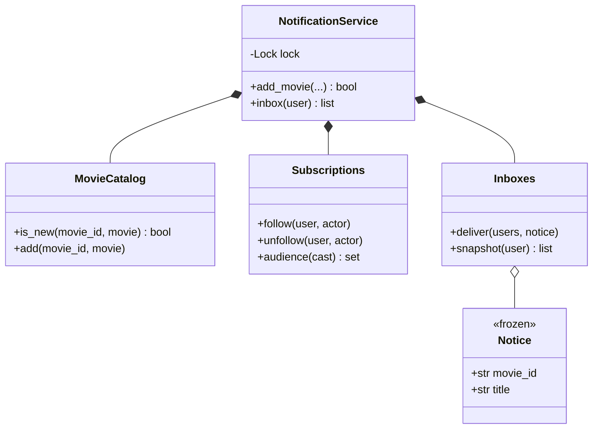
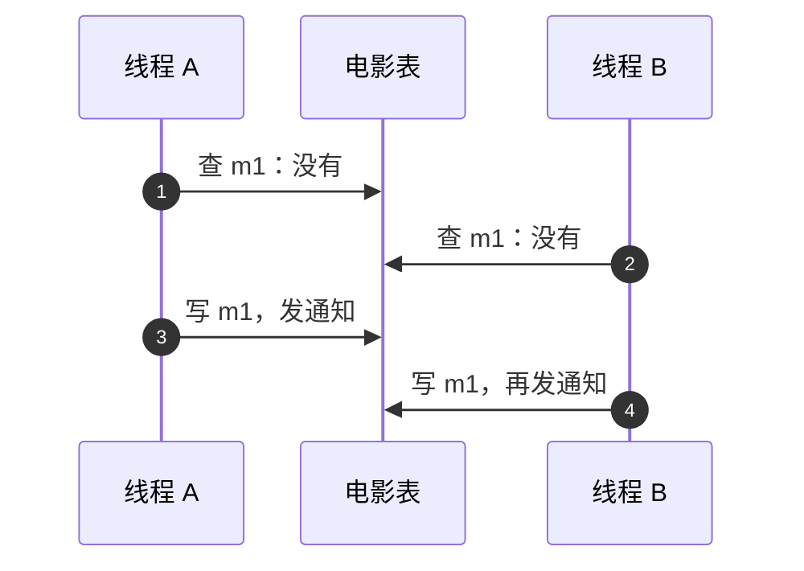

# 设计题解：关注演员与新片通知修复（Actor Follows & Notifications）

## 题目与澄清

CastWatch 是一个电影网站。用户可以关注演员；运营每登记一部新片，系统就要给"关注了这部片子演员的人"各发一条站内通知，用户用 `inbox(user)` 读自己的通知。
服务是进程内的一个类 `NotificationService`，四个方法：`follow(user, actor)`、`unfollow(user, actor)`、`add_movie(movie_id, title, actors) -> bool`、`inbox(user) -> list[Notice]`。
它会被多个线程同时调用。现有代码能跑，但症状很多：通知丢了、取关没有效果、同一部电影重试导入时有时返回真有时返回假、收件箱里的电影顺序是乱的。
这是一个**修复项目**（调试题）：你的工作不是从零设计，而是从症状倒推缺陷、逐个修好、再用测试证明没有修坏别的。
经典的发布订阅题见 [[problems.components.pub-sub|发布订阅与事件总线（Pub-Sub）]] 和 [[problems.components.notification-service|通知服务（Notification Service）]]；
这里的服务更小，但合同更细，每一条都有测试在等着。

开工前先把合同写成自己的话。按"粗心的读者最容易漏掉"的顺序：

1. **谁收到通知**：登记那一刻，关注了卡司里**至少一位**演员的用户，每人**恰好一条** `Notice(movie_id, title)`。关注了两位主演只一条；卡司里同一个演员 id 出现两次也只一条；卡司为空，没有人收到。
2. **关注从不回填**：用户关注一位演员之前登记的电影，不会补发给他。
3. **取关只删这一条关系**：关系或用户根本不存在时什么都不发生；已经收到的历史通知不删。重复关注也是无操作。
4. **重复导入**：同一个 id、片名完全相同、卡司集合相等，返回 `False`，不产生通知——即使这时关注者已经变了。卡司的顺序和重复不影响相等。
5. **冲突导入**：同一个 id，片名不同或卡司集合不同，抛 `RuntimeError("movie_conflict")`，并且什么状态都不改。
6. **输入校验**：所有 id 和片名必须是非空白的 `str`；`actors` 必须是 `list`，每个元素也合法，空列表可以。非法输入抛 `ValueError("invalid_input")`，发生在动任何状态之前。
   "空白"是一张逐个列出的字符表（25 个字符），不是 Python 的 `str.isspace()`；表之外的字符，包括不换行空格 U+00A0，都是合法字符。字符串原样保存，区分大小写，首尾空白不去掉。
7. **收件箱**：按电影**成功登记**的先后顺序返回，不是按 id 字典序；未知用户得到空列表；返回的是副本，调用方怎么改它、之后又登记了新片，都不影响已经拿到的那份；`Notice` 不可变。
8. **入参快照**：`actors` 在调用那一刻复制，之后调用方改自己的列表不影响服务。
9. **并发**：所有方法可以同时调用；同一部电影被并发导入多次，恰好一次返回 `True`，每个受众恰好一条通知；并发调用的结果必须等价于某个串行执行顺序；不同实例互相独立。

开口前值得问的澄清问题，每一个都会改变代码：

- **取关会不会撤回已经发出的通知？** 不会。通知是历史记录，不是订阅状态的投影。这决定了收件箱是只追加的，取关只动关注索引。
- **关注者在登记之后才关注，要不要补发？** 不补。所以通知只在 `add_movie` 里产生，`follow` 不碰收件箱。
- **重复导入时关注者变多了，要不要给新关注者补一条？** 不要。重试是"确认这部片已经登记过"，不是"重新通知"，否则每次重试都会换一批人收到通知。
- **同 id 不同内容是覆盖还是报错？** 报错。覆盖会让已经发出的通知和电影记录对不上；报错加"什么都不改"让调用方有机会发现自己在复用 id。
- **`actors` 传元组、集合、生成器行不行？** 合同写的是列表。接受任意可迭代对象会让一个无限生成器卡死服务，所以只收 `list`，其余一律 `invalid_input`。
- **错误的优先级是什么？** 先校验、再冲突：一个非法的片名对一个已存在的 id，得到的是 `ValueError` 而不是 `RuntimeError`。
- **要不要做持久化、消息队列、推送？** 不要，只在 `## 扩展与追问` 里讨论。

范围之外：真实的推送渠道、通知模板、用户注册、已读状态（作为追加需求在扩展里讨论）。

## 需求与分级

这是调试题，分关的意思是"先修哪个缺陷，修完能验证什么"。

**第 1 关（约 15 分钟，读合同、让测试把缺陷指出来）**：先不要改代码，对合同每一条写一个会失败的测试。现有代码有四处缺陷，下表的症状都是运行得到的：

| 位置 | 症状 | 合同条目 |
|---|---|---|
| `unfollow` | 取关写成了"再关注一次"：`follow("alice", "a1")`、`unfollow("alice", "a1")` 之后登记 `a1` 的电影，alice 仍收到通知 | 4 |
| 受众 | 判据 `cast <= follows`：用户关注 `a1`、`a2`，卡司 `["a1", "z"]` 没人收到（要关注全部卡司才通知）；空卡司反而通知所有有关注记录的用户 | 5 |
| `add_movie` 的返回 | 重复导入返回 `True`，同 id 不同片名返回 `False`，两个结果都反了，也没有抛冲突 | 6、7 |
| `inbox` | 登记 `b`、`a` 两部，读出来是 `a`、`b`：按电影 id 排序，丢了登记顺序 | 8 |

公开的三个用例里 `test_follow` 撞上受众、`test_unfollow` 撞上取关，两个会失败，空收件箱的那个本来就过；返回值和顺序两处公开测试看不到，要自己写测试。示例：用户 alice 关注 `a1`、`a2`，bob 关注 `a2`，carol 关注 `a3`；登记 `m1`，卡司 `["a1", "a2", "a1"]`，
应当返回 `True`，alice 和 bob 各一条，carol 和没关注任何人的 dave 为空。

**起始代码已经做对的**：空白判定用的是合同列出的那张字符表，U+00A0、U+2007 这样的字符仍然合法；所有校验都排在改状态之前，`actors` 不是列表就抛 `invalid_input`；`add_movie` 先复制卡司再校验副本，卡司顺序与重复项不影响"同一部电影"的判断；四个方法都在锁里；`inbox` 返回的是新列表。这些修复时要保住，尤其别在改空白判定、锁或复制的时候顺手弄坏。

**第 2 关（约 15 分钟，守住已经对的部分）**：这一关没有新缺陷，为起始代码已经做对的几条各写一个测试，防止智能体在修缺陷时改坏它们：空白判定不能换成 `strip()`（它把 U+00A0、U+0085、U+2007、U+202F 也当空白）；
`add_movie` 先复制 `actors` 再校验同一份副本；`inbox` 返回副本。参考解还多做了一件事：取关到没人关注时，索引里不能留着空集合。

**第 3 关（约 15 分钟，并发）**：所有状态改动放进同一个临界区。三个要验证的性质：同一部电影被 32 个线程同时导入，恰好一个 `True`；
冲突的并发导入恰好一个赢，其余抛冲突，赢家的片名就是所有收件箱里的片名；取关与登记同时发生，结果是 0 条或 1 条，绝不是 2 条。

**第 4 关（选做，约 15 分钟）**：写 REFLECTION 的三篇短文——入库和发通知哪几步必须一起成败；引入事务发件箱后怎么保证崩溃恢复；
一位演员有一千万关注者怎么办——以及面试官的追加需求（已读与分页）落在哪里。答案在 `## 扩展与追问`。

## 核心对象与职责

| 类 | 单一职责 | 它拥有的不变量 |
|---|---|---|
| `Notice` | 一条通知，只有电影 id 和片名 | 冻结的数据类：创建之后不能改，所以可以放心地在收件箱和调用方之间共享 |
| `MovieCatalog` | 电影登记表，判断"新电影／重复导入／冲突" | 每个 id 只对应一条记录；`is_new` 是只读判定，冲突在任何写入之前抛出 |
| `Subscriptions` | 关注索引：演员 → 关注者集合 | 没有空集合；`audience(cast)` 对卡司求并集，每个用户最多出现一次 |
| `Inboxes` | 每个用户一份只追加的通知历史 | 只追加、保持登记顺序；读取返回新列表；读一个不存在的用户不创建条目 |
| `NotificationService` | 校验入参、持有唯一的锁、把三块状态的改动串成一个原子步骤 | 电影表和收件箱的写入不可分；所有公开方法在同一把锁下 |

`NotificationService` 拥有另外三个对象，生命周期一致，是组合（composition）。三个状态类**自己不带锁**：锁只有一把，由服务持有，
这样"哪些操作在同一个临界区里"一眼就能在 `NotificationService` 的方法体里看清，不会分散在三个类里。
`_Movie` 是登记表内部用的冻结记录（片名加卡司集合），它的相等比较就是"重复还是冲突"的判据。



## 关键设计决策

### 决策一：一个临界区罩住"判重、算受众、写电影、写收件箱"

**问题**：多个线程同时调用，哪些步骤必须不可分割？

先看没有这把锁会怎样。`add_movie` 的骨架是"先查电影表有没有这个 id，没有就登记并给受众发通知"，这是典型的先检查后动作（check-then-act）。
两个线程同时导入同一部电影，都在对方写入之前看到"还没有"，于是都走登记分支，各发一轮通知，两个调用都返回 `True`：



1. 线程 A 查电影表，没有 `m1`。
2. 线程 B 在 A 写入之前也查，同样没有。
3. A 登记并给受众各追加一条通知，返回 `True`。
4. B 也登记并追加，返回 `True`：每个关注者收到两条，合同要求的"恰好一个 `True`"被破坏。

Python 的全局解释器锁（GIL）只保证单条字节码不被撕开，不保证"查一下再写"这一对操作不被切线程。

可选的做法有三个：

- **电影表一把锁、关注索引另一把锁**：每块状态各自安全，但组合起来不安全。登记在读关注者的那一刻拿着关注索引的锁，
  读完就放掉，再去写电影表；如果这中间有人取关，受众已经算出来了，电影却在取关之后才可见。结果不对应任何串行顺序：取关明明发生在登记之前（从调用方的时间线看），却仍然收到了通知。
- **一把总锁**：`add_movie` 的判重、算受众、写电影、写收件箱放进同一个 `with self._lock:`；`follow`、`unfollow`、`inbox` 也拿这把锁。
  这样任何一次调用要么完整发生在另一次之前，要么完整发生在之后，这就是可线性化（linearizable）：并发调用的结果等价于某一个串行顺序，取关与登记同时发生时，alice 得到 0 条或 1 条都合法，但不会是 2 条。
- **每个电影 id 一把锁（分片锁）**：不同电影可以并行导入，但受众要读关注索引，关注索引是跨电影共享的，仍然要再拿一把。多把锁带来锁顺序的纪律和死锁风险，收益只在导入吞吐成为瓶颈时才有。

选一把总锁。临界区里是字典查找、集合并集和列表追加，规模是几万用户时微秒到毫秒级；这个规模下总锁的代价低于任何细粒度方案的复杂度。
用的是 `threading.Lock` 而不是 `RLock`：没有任何方法在持锁时调用另一个公开方法，不需要重入，用不可重入的锁反而能在你误写出重入时立刻死锁暴露问题。

这里不需要任何设计模式。一个类、一把锁。引入"读写锁"或"事件总线"只会让锁的范围更难一眼看清。

### 决策二：受众用"按演员的关注者求并集"，不遍历全部用户，也不上观察者对象

**问题**：登记一部新片时，怎么算出"该收通知的人"，并保证每人恰好一次？

可选的做法：

- **遍历所有用户，检查每个人的关注集合**：现有代码就是这样，而且判据写错了：`cast <= follows`（卡司是关注集合的子集）要求用户关注**全部**演员；
  空卡司是任何集合的子集，所以空卡司会通知每一个有关注记录的用户。把判据改成"有交集"（`not cast.isdisjoint(follows)`）是对的，但每次登记都要扫描全部用户，代价是 O(用户数)。
- **逐个演员追加**：对卡司里每个演员，给他的关注者各追加一条。判据对了，但同时关注两位主演的用户收到两条，卡司里重复的 id 也会重复发。
- **反向索引加并集**：关注索引按演员建（演员 → 关注者集合）；对去重后的卡司，把每个演员的关注者集合并起来，得到的集合里每个用户只出现一次，然后给集合里每个用户追加一条。
  代价与"卡司大小乘关注者数"成正比，只碰相关的人。

选第三个。并集这一步同时解决了判据和去重两件事，不需要再单独写"已通知"的标记。这里也**拒绝了观察者模式**（Observer）的完整写法：
不建订阅者对象、不存回调、不做 `notify()` 的接口。"关注"在这个问题里只是数据（一条用户到演员的关系），通知的内容固定（一条 `Notice`），投递的方式固定（追加到收件箱）。
没有多种订阅者、没有多种投递方式，所以没有任何东西需要被替换；把一个字典里的集合并起来，比任何接口层都直接。
观察者模式在需求出现"邮件、站内信、推送三个渠道，用户各自可以关掉"之后才有位置（见扩展），那时再引入也不会动现有的类。

### 决策三：重复和冲突用"记录比较"判定，返回值与异常各管一件事

**问题**：同一个电影 id 再次导入时，怎么区分"重试"和"冲突"，各自返回什么？

调用方会在超时后原样重试，这是幂等（idempotency）要解决的事：同样的请求发一次和发十次，效果相同。同时，不同的客户端也可能无意复用了同一个 id。

- **后一次覆盖前一次（upsert）**：最简单，但重试会再发一轮通知，换了卡司的覆盖会让已经收到通知的人和新卡司对不上。
- **只按 id 判重，其余内容不看**：重试没问题，但一个复用 id 的错误请求被静默当成"已经登记过"，调用方永远不会知道自己的数据被丢了。
- **按整条记录比较**：用 `_Movie(title, frozenset(cast))` 作为记录，冻结的数据类自带逐字段相等；卡司用集合，顺序和重复自然不影响相等；片名逐字比较，区分大小写和首尾空白。

选第三个，并把结果分成三种：没见过 → 登记并返回 `True`；完全相同 → 返回 `False`、不碰任何状态；不同 → 抛 `RuntimeError("movie_conflict")`。
`False` 的意义是让调用方区分"这次我做了"和"早就做过"，重试因此是安全的；冲突是调用方的错误，用异常而不是第三种返回值，因为合同的返回类型是布尔。
冲突检查放在所有写入之前（`MovieCatalog.is_new` 是只读的），所以"什么都不改"不需要回滚：根本没有开始改。

校验排在冲突之前。一个非法的片名对一个已存在的 id 得到 `ValueError`，因为非法输入连"比较"的资格都没有；反过来，如果先比较，`None` 与记录比较会得到"不同"，错误地报告为冲突。
这里同样没有设计模式。曾经想过为两个错误各定义一个异常子类（`InvalidInput(ValueError)`、`MovieConflict(RuntimeError)`），但合同规定的是异常类型加固定的消息，
子类带来的只有"精确类型检查的测试会失败"的风险，没有任何调用方因此受益，所以直接抛 `ValueError("invalid_input")` 和 `RuntimeError("movie_conflict")`。

### 决策四：空白判定用显式字符表；先复制入参，再校验同一份副本

**问题**：怎么实现"非空白字符串"的校验，并保证"非法输入不留痕"？

Python 里最顺手的写法是 `not value.strip()` 或 `value.isspace()`。它们的空白集合比合同的大：`str.strip()` 会去掉 U+0085（下一行）、U+00A0（不换行空格）、U+2007（数字空格）、U+202F（窄不换行空格）。
合同明确说这些是合法的标识符字符，一个用 `strip()` 的实现会把名字是不换行空格的用户拒之门外。这个缺陷公开测试看不到，是隐藏测试最爱针对的地方。

做法是把合同列出的 25 个字符写成一个模块级的 `frozenset`，判据是 `not isinstance(value, str) or all(ch in BLANK for ch in value)`；空串让 `all` 自然为真，所以空串也非法，不需要单独分支。
`bool`、数字、`None`、字节串都不是 `str`，一并拒绝。不去掉首尾空白，也不规范化 Unicode：`" alice"` 和 `"alice"` 是两个用户。

另一个细节在 `add_movie` 里：校验 `actors` 时，调用方可能在另一个线程里同时改这个列表。如果先逐个校验、再用同一个列表建集合，两步之间列表可能变了，
校验过的内容和存下来的内容不是一回事（先检查后使用，TOCTOU）。所以先 `list(actors)` 复制一份，**对副本**校验并建成 `frozenset`，之后调用方怎么改原列表都与服务无关。
整个校验在拿锁之前完成：非法输入不进临界区，天然不留半截状态。

### 决策五：快照用"返回新列表"，通知冻结，空集合立刻删

**问题**：收件箱返回什么，才能让调用方改不了内部状态，又不过度复制？

- **直接返回内部列表**：调用方 `append` 或 `clear` 就破坏了不变量；后来的导入还会"改变"调用方手里的旧结果。
- **返回 `tuple`**：不可变，但合同的示例把结果和列表比较（`inbox("alice") == [Notice(...)]`），元组与列表永远不相等。
- **返回新列表**：`list(...)` 复制一份引用；因为 `Notice` 是冻结的数据类，浅拷贝就足够独立，不需要深拷贝。

选第三个。复制是 O(通知数)，在规模下可以接受；要避免复制的话，见扩展里的游标分页。读一个不存在的用户用 `get(user, ())`，**不用** `setdefault`，
否则每次有人读一个未知用户就在字典里多一个空列表，读操作就变成了写操作。

关注索引的清理是同一个思路：`unfollow` 之后集合为空就从字典里删掉。不删的话，用户反复关注、取关不同的演员，字典里堆满空集合，索引大小不再与"现存的关注关系"成正比。
测试用两个只读属性 `subscription_count` 和 `tracked_actor_count` 观察它：取关到没有关系时两者都归零。属性是为了测试而公开的只读窗口，测试不读私有字段。

### 决策六：先算后写，用顺序代替回滚

**问题**：登记一部新片要改两处（电影表、收件箱），怎么保证中间不会留下半截状态？

可选的是写回滚日志：改一处就记一条"怎么撤销"，失败时倒着撤销。但这个服务里能让第二步失败的原因，在进入临界区之前就已经被排除了：入参已校验、冲突已在 `is_new` 里判掉。
所以更简单的办法是**重排步骤**：在锁里先做所有可能失败的只读工作（判重、判冲突、算受众），确认之后再做不会失败的写入（电影表赋值、收件箱追加）。
这就是 `add_movie` 里那行注释说的"到这里不会再失败"。回滚日志是为"每一步都可能失败"准备的；步骤可以重排时，重排比回滚便宜得多，也更容易看懂。

## 代码走读

下面是完整的、经过测试的参考解法。先看结构，再看三个地方。

%% code:begin solution.py %%
```python
"""关注演员与新片通知（修复版），设计五行：

1. 关注关系只存一份反向索引"演员 -> 关注者集合"：新片上线时对卡司求并集，天然每人一份，也不必遍历全部用户。
2. 电影 id 对应一条冻结记录（片名、卡司集合）；重复导入拿新记录和旧记录比较：相同返回 False，不同抛冲突。
3. 一把锁罩住"判重、算受众、登记电影、写收件箱"；校验和冲突检查都在第一次写入之前，失败不留痕。
4. 收件箱按插入顺序追加冻结的 `Notice`，读取返回新列表；取关只动索引，不动历史。
5. 集合清空时立刻删除，关注索引的大小只和现存的关注关系成正比。
"""

from __future__ import annotations

import threading
from collections.abc import Iterable
from dataclasses import dataclass

INVALID_INPUT = "invalid_input"
MOVIE_CONFLICT = "movie_conflict"

# 合同逐个列出的"空白字符"：不能用 str.strip() / str.isspace()，它们还会把 U+0085、U+00A0、U+2007、U+202F 当成空白。
_BLANK_CHARS = frozenset(
    "\t\n\v\f\r\x1c\x1d\x1e\x1f  "
    "          "
    "

 　"
)


def _valid(value: object) -> str:
    """合法的标识符：是 str，且至少有一个非空白字符。空串也是空白。"""
    if not isinstance(value, str) or all(ch in _BLANK_CHARS for ch in value):
        raise ValueError(INVALID_INPUT)
    return value


@dataclass(frozen=True)
class Notice:
    movie_id: str
    title: str


@dataclass(frozen=True)
class _Movie:
    """一部已登记的电影。卡司是集合：顺序和重复都不影响相等。"""

    title: str
    cast: frozenset[str]


class MovieCatalog:
    """电影登记表，"新电影／重复导入／冲突"只在这里判定。不带锁，由服务的锁保护。"""

    def __init__(self) -> None:
        self._movies: dict[str, _Movie] = {}

    def is_new(self, movie_id: str, movie: _Movie) -> bool:
        """只读判定：没见过返回 True；记录完全相同返回 False；同 id 不同内容抛冲突。不修改任何东西。"""
        known = self._movies.get(movie_id)
        if known is None:
            return True
        if known != movie:
            raise RuntimeError(MOVIE_CONFLICT)
        return False

    def add(self, movie_id: str, movie: _Movie) -> None:
        self._movies[movie_id] = movie

    def __len__(self) -> int:
        return len(self._movies)


class Subscriptions:
    """关注索引：演员 -> 关注者集合。不带锁，由服务的锁保护。"""

    def __init__(self) -> None:
        self._followers: dict[str, set[str]] = {}

    def follow(self, user: str, actor: str) -> None:
        self._followers.setdefault(actor, set()).add(user)

    def unfollow(self, user: str, actor: str) -> None:
        users = self._followers.get(actor)
        if users is None:
            return
        users.discard(user)
        if not users:
            del self._followers[actor]

    def audience(self, cast: Iterable[str]) -> set[str]:
        """关注了卡司中至少一人的用户，每人一次。"""
        users: set[str] = set()
        for actor in cast:
            users.update(self._followers.get(actor, ()))
        return users

    @property
    def edge_count(self) -> int:
        return sum(len(users) for users in self._followers.values())

    @property
    def actor_count(self) -> int:
        return len(self._followers)


class Inboxes:
    """每个用户一份按插入顺序追加的通知历史。不带锁，由服务的锁保护。"""

    def __init__(self) -> None:
        self._notices: dict[str, list[Notice]] = {}

    def deliver(self, users: Iterable[str], notice: Notice) -> None:
        for user in users:
            self._notices.setdefault(user, []).append(notice)

    def snapshot(self, user: str) -> list[Notice]:
        """新列表；`Notice` 本身是冻结的，所以调用方拿到的和内部状态互不影响。读不创建条目。"""
        return list(self._notices.get(user, ()))


class NotificationService:
    """所有公开方法都在同一把锁下执行：任意并发调用等价于某一个串行顺序（可线性化）。"""

    def __init__(self) -> None:
        self._lock = threading.Lock()
        self._catalog = MovieCatalog()
        self._subscriptions = Subscriptions()
        self._inboxes = Inboxes()

    def follow(self, user: str, actor: str) -> None:
        _valid(user)
        _valid(actor)
        with self._lock:
            self._subscriptions.follow(user, actor)

    def unfollow(self, user: str, actor: str) -> None:
        _valid(user)
        _valid(actor)
        with self._lock:
            self._subscriptions.unfollow(user, actor)

    def add_movie(self, movie_id: str, title: str, actors: list[str]) -> bool:
        _valid(movie_id)
        _valid(title)
        if not isinstance(actors, list):
            raise ValueError(INVALID_INPUT)
        # 先把调用方的列表复制成不可变集合再校验：之后调用方怎么改它，校验过的内容都不变。
        cast = frozenset(_valid(actor) for actor in list(actors))
        movie = _Movie(title, cast)
        with self._lock:
            if not self._catalog.is_new(movie_id, movie):
                return False
            # 到这里不会再失败：先算出受众，再一并提交，电影和通知要么都在要么都不在。
            audience = self._subscriptions.audience(cast)
            self._catalog.add(movie_id, movie)
            self._inboxes.deliver(audience, Notice(movie_id, title))
            return True

    def inbox(self, user: str) -> list[Notice]:
        _valid(user)
        with self._lock:
            return self._inboxes.snapshot(user)

    @property
    def subscription_count(self) -> int:
        """现存的（用户，演员）关注关系个数。"""
        with self._lock:
            return self._subscriptions.edge_count

    @property
    def tracked_actor_count(self) -> int:
        """至少有一个关注者的演员个数：最后一个关注者取关后应当归零。"""
        with self._lock:
            return self._subscriptions.actor_count

    @property
    def movie_count(self) -> int:
        with self._lock:
            return len(self._catalog)


if __name__ == "__main__":
    service = NotificationService()
    service.follow("alice", "actor-1")
    service.follow("alice", "actor-2")
    service.follow("bob", "actor-2")
    print(service.add_movie("m1", "Opening Night", ["actor-1", "actor-2", "actor-1"]))
    print(service.add_movie("m1", "Opening Night", ["actor-2", "actor-1"]))
    print(service.inbox("alice"), service.inbox("bob"))
    try:
        service.add_movie("m1", "Another Title", ["actor-1"])
    except RuntimeError as exc:
        print("conflict:", exc)
```
%% code:end %%

**第一处：`NotificationService.add_movie`**。顺序是：校验 `movie_id` 和 `title`（拿锁之前）；检查 `actors` 是列表；复制并逐个校验卡司，建成 `frozenset`；
然后进入 `with self._lock`，先 `is_new`（冲突在这里抛），再 `audience`，最后 `catalog.add` 和 `inboxes.deliver`。
决策一和决策六同时落在这个方法里：一个 `with` 块是原子边界，块内先读后写是失败安全的顺序。重复导入在 `is_new` 返回 `False` 时直接 `return False`，什么都没碰。

**第二处：`Subscriptions`**。`audience` 的循环只有三行：对卡司里每个演员，把关注者集合并进结果。`unfollow` 里的 `if not users: del ...` 是"空集合立刻删"。
`edge_count` 和 `actor_count` 是只读属性，由服务在锁里读出来，测试靠它们验证"取关不留空集合"。

**第三处：`_valid` 和 `_BLANK_CHARS`**。25 个字符分成几行写，加上注释说明为什么不能用 `strip()`。`_valid` 返回原值，所以 `add_movie` 里可以写成生成器表达式 `frozenset(_valid(a) for a in list(actors))`，校验和建集合是一次遍历。

运行模块底部的演示，输出是：

```
True
False
[Notice(movie_id='m1', title='Opening Night')] [Notice(movie_id='m1', title='Opening Night')]
conflict: movie_conflict
```

前两行是首次登记返回 `True`、顺序打乱的重复导入返回 `False`；第三行是 alice 和 bob 各一条；第四行是同 id 不同卡司抛出的冲突。

## 测试与自检

测试文件里有四十九个用例（含参数化展开），没有一个 `sleep`。按合同条目分组：

- **合同示例**：登记后重试返回 `False` 且收件箱只有一条；公开的三个用例（关注、取关、未知用户）；`follow` 与 `unfollow` 返回 `None`，`add_movie` 返回的是 `True`/`False` 本身而不是别的真值。
- **关注与取关**：取关只删一条关系，另一个演员、另一个用户不受影响；取关不存在的关系是无操作；重复关注是无操作；关注不回填、取关不删历史；取关到没人关注时 `tracked_actor_count` 归零。
- **受众**：同时关注多位主演且卡司有重复 id，恰好一条；非关注者没有；空卡司没人收到；id 区分大小写、首尾空白原样保存。
- **重复与冲突**：关注者变了的重复导入仍是 `False` 且新关注者没有通知；卡司顺序和重复不影响相等；片名不同、卡司多一个、卡司少一个、卡司不同，四种冲突都抛 `movie_conflict`，之后原记录仍然是"重复导入"；片名比较精确到大小写和首尾空白。
- **收件箱**：登记 z、a、m、B 四部，读出顺序一致；改返回的列表、之后的导入都不影响已经拿到的快照；`Notice` 赋值抛 `FrozenInstanceError`；入参列表之后被改，不影响已登记的卡司；不同实例互相独立。
- **校验**：十一种坏的 id（`None`、数字、`True`、字节串、元组、列表、空串、空格、制表换行、全角空格……）对八个入口各测一遍，失败后服务状态不变；`actors` 的六种坏输入；合同表里 25 个空白字符各测一次；
  U+00A0、U+0085、U+2007、U+202F、U+200B、U+FEFF 这些"长得像空白"的字符必须合法；校验先于冲突。
- **并发**：32 个线程用 `threading.Barrier` 同时导入同一部电影，连做 40 轮，每轮恰好一个 `True`，十个关注者各有 40 条且顺序一致；
  八个线程用八个不同的片名抢同一个 id，恰好一个赢、其余全抛 `movie_conflict`、所有收件箱里的片名等于赢家的；
  取关与登记同时发生一百次，结果只能是空或一条；八个线程各登记 25 部不同的电影，每条恰好一次，且每个线程自己的相对顺序保住；
  一个写线程登记 200 部、两个读线程反复取快照，每个快照都必须是完整历史的**前缀**，这是可线性化的直接检验；
  八个线程反复关注与取关，结束后两个计数归零。
  测试开头的夹具把线程切换间隔调到一微秒，让没加锁的"先检查后动作"更容易暴露：把 `add_movie` 的 `with self._lock` 去掉，识别同一部电影并发导入的那个测试几乎每次都会失败。

两分钟演示：模块底部的 `__main__` 登记合同里的例子，输出就是上面四行；然后说出三件事：锁罩住了什么（判重、受众、两处写入）、为什么受众用并集、为什么冲突检查要放在写入之前。

公开测试也要跑：把 `solution.py` 复制成工作区里的 `notification_service.py`，用 `python3 -m pytest` 或 `python3 -m unittest test_client` 运行，三个公开用例应当全过。
公开用例只覆盖了合同的一小部分，所以再自己写一个"受众去重"的测试、一个"冲突不留痕"的测试和一个屏障并发测试，不要只依赖公开用例。

## 扩展与追问

**新需求**

- *已读标记与游标分页*：收件箱只追加、不删除，所以列表下标是稳定的游标。`Inboxes` 里给每个用户加一个已读水位（整数），新增 `page(user, after, limit)` 和 `mark_read(user, upto)`；
  未读数是长度减水位。`Notice` 保持不可变，不需要给每条通知存可变的已读标志。关注索引、电影表、受众计算一行不动。
- *按渠道发送、用户可以关掉某个渠道*：这时观察者模式才有位置。受众算出来之后，对每个渠道（一个接收用户和 `Notice` 的函数或协议对象）各投递一次；`Inboxes` 变成其中一个渠道。
  `Subscriptions`、`MovieCatalog` 不动；每个渠道失败互不影响，是新增的错误处理，不是对现有代码的修改。
- *按电影类型订阅*：`Subscriptions` 的键从"演员"泛化成"主题"，`audience` 接受一组主题而不是卡司；电影表与收件箱不动。
- *电影改名或改卡司*：这是"更新"而不是"导入"，要新增一个明确的 `update_movie`，规定是否重新通知；不能放松冲突检查，否则幂等的定义被破坏。

**并发与线程安全**（对应 REFLECTION 第一问）

- *原子边界在哪里*：在同一个临界区里：判重和冲突检查、读关注者算受众、写电影表、写收件箱。`follow`、`unfollow`、`inbox` 拿同一把锁，所以受众就是登记那一刻的关注者，调用结果等价于某个串行顺序。
  冲突检查和受众计算都在任何写入之前，之后的写入不会失败，所以电影和通知要么都在要么都不在；校验在锁之外、状态之前，非法输入进不了临界区。
- *一把锁的代价*：所有操作串行，登记的临界区随受众大小增长。规模小时可以接受；增长后可以把读者和写者分开（读写锁或写时复制快照），或者按用户哈希分片收件箱，
  但"登记"仍要在一个原子步骤里同时更新电影表和各分片，所以分片需要按固定顺序取锁，复杂度会明显上升。
- *多个进程*：每个进程各有各的内存和锁，`threading.Lock` 管不到别的进程。要么让一个进程独占这个服务，要么把状态放进共享存储，并把"判重、算受众、写入"放进同一个事务。

**持久化与规模**（对应 REFLECTION 第二、三问）

- *事务发件箱（transactional outbox）*：问题是"先存电影再发通知"之间崩溃，电影在而通知永远丢了。做法：在**同一个数据库事务**里写电影行和发件箱行（受众也在这个事务里读出），要么都提交要么都回滚。
  重启后一个中继进程扫描未发送的发件箱行，逐条投递再标记已发送。崩溃可能发生在"投递之后、标记之前"，所以投递是至少一次；接收端用 (用户, 电影 id) 做唯一键去重，效果上就是恰好一次。
  同一个 id 的重复导入仍在事务里被判成无操作，与内存版同一个规则。
- *一位演员一千万关注者*：现在的做法在锁里给一千万个收件箱各追加一条，持锁时间与关注者数成正比，期间所有操作被挡住，内存也多一千万份。
  推拉结合：关注者少的演员照旧在登记时写收件箱（写扩散）；超大演员只记一条"发布事件"，读收件箱时再合并（读扩散）。
  读扩散要保住合同的规则：关注之前的电影不回填，取关之后的电影不收到，已经收到的历史不删，所以要记录每个用户对这位演员的**关注区间**（关注与取关时的全局登记序号），读时只合并区间内的电影。
  或者登记只写事件，后台分批投递，以 (用户, 电影 id) 为幂等键。代价是读路径要合并两路并按登记顺序排序，通知可能晚到。
- *内存增长*：电影表和收件箱按合同必须保留历史，只增不减；真实系统要给收件箱设保留期或迁到冷存储。

## 常见错误

- **取关写成了关注**：`unfollow` 里复制粘贴了 `add`，测试里"取关后不收到"一个用例就能抓到。
- **用子集判断受众**：`cast <= follows` 要求关注全部演员，空卡司通知所有人；把它改成"有交集"才对，更好的是用反向索引求并集。
- **逐演员追加通知**：同时关注两位主演的用户收到两条。
- **重复导入与冲突的返回反了**：重复返回 `True`、冲突返回 `False`；正确的是重复返回 `False`、冲突抛异常。
- **冲突时已经写了一半**：先把电影写进表、再发现卡司不同，状态已经被污染。冲突检查必须在所有写入之前。
- **收件箱按 id 排序**：`sorted(..., key=lambda n: n.movie_id)`，登记 z 再登记 a，读出来却是 a 在前。
- **返回内部列表**：调用方 `clear()` 一下，历史就没了；或者后来的导入"改变"了调用方手里的旧结果。
- **用 `strip()` 或 `isspace()` 判空白**：把不换行空格也拒绝了；合同给的是一张固定的字符表。
- **先校验再用，两步之间调用方改了列表**：先复制成副本，对副本校验。
- **`setdefault` 出现在读路径上**：读一个未知用户就在字典里留下一个空条目。
- **取关后留下空集合**：索引越积越大，行为上看不出来，只有数计数的测试能抓到。
- **在一个线程里 `follow`、另一个线程里 `add_movie`，却各用一把锁**：见决策一，结果不对应任何串行顺序。
- **Java 味的写法**：为两个错误各建一个异常子类却没有人需要区分；写 `getInbox`/`setFollow`；为了"线程安全"给每个字典各套一个同步包装类。
- **用 AI 修复时只说"修一下这个服务"**：没有合同里的规则和数据，它会挑几条违反；把合同的例子逐条交给它，并先让它为每条规则写一个会失败的测试。
- **改测试迁就代码**：测试失败时让智能体"把测试改成通过"，要先判断是代码错还是测试错；合同的例子不能改。

## 45 分钟怎么分配

项目整体约 60 分钟（含反思短文），下面按 45 分钟的紧凑节奏排：

- **0–5 分钟｜读合同和代码**：不要动手。把合同九条用自己的话写成注释，标出"哪几条现有代码一定违反"。对智能体说的第一句话也是这份清单。
- **5–15 分钟｜让测试指出缺陷**：跑公开测试，看到的失败是一部分；再为受众、冲突、顺序、取关各写一个失败用例。每次只让智能体修一个缺陷，修完全部重跑。
- **15–25 分钟｜校验、快照、空集合**：自己决定空白判定用字符表而不是 `strip()`、先复制再校验、返回副本；让智能体写样板，你读 diff。
- **25–35 分钟｜并发**：把所有写入收进一个 `with self._lock`；自己写屏障测试（32 线程同时导入同一部电影），让智能体帮忙想边界，但锁的范围自己核对。
- **35–45 分钟｜短文**：留出最后十分钟写 REFLECTION 的三个问题，各约一百五十字：原子边界、发件箱怎么恢复、超大演员怎么推拉。不要留到最后一分钟，也不要写成复述代码。

时间不够时的取舍顺序：先砍并发测试里的"读者线程"，再砍空集合清理，再砍千万关注者的口述。
**绝不能砍的是**：受众并集与去重、重复与冲突的区别、校验先于冲突、一个临界区罩住登记的全部写入、三篇短文。

## 延伸阅读

- [[solution-pub-sub]]：经典发布订阅题解，讲回调式订阅者、投递线程与慢订阅者隔离；这里的订阅是纯数据，不需要回调，两种取舍可以对照读。
- [[solution-notification-service]]：多渠道通知服务的题解，对应上面"按渠道发送"的扩展。
- [[problems.components.pub-sub|发布订阅与事件总线（Pub-Sub）]]、[[problems.components.notification-service|通知服务（Notification Service）]]：同类问题在知识树里的入口。
- 复合操作（Compound Actions）与测试并发代码（Testing Concurrency）：先检查后动作与屏障测试的原理，见知识树的并发进阶部分。
- [Python 文档：threading.Barrier](https://docs.python.org/3/library/threading.html#threading.Barrier)：让线程同时起跑的标准工具。
- [Python 文档：sys.setswitchinterval](https://docs.python.org/3/library/sys.html#sys.setswitchinterval)：调小线程切换间隔，让并发缺陷更容易在测试里暴露。
- [Python 文档：str.isspace](https://docs.python.org/3/library/stdtypes.html#str.isspace)：Python 的"空白"定义比合同的字符表宽，对照着读就知道为什么不能直接用。
- [microservices.io：Transactional outbox](https://microservices.io/patterns/data/transactional-outbox.html)：把"改数据"和"发消息"放进同一个事务的标准写法。
