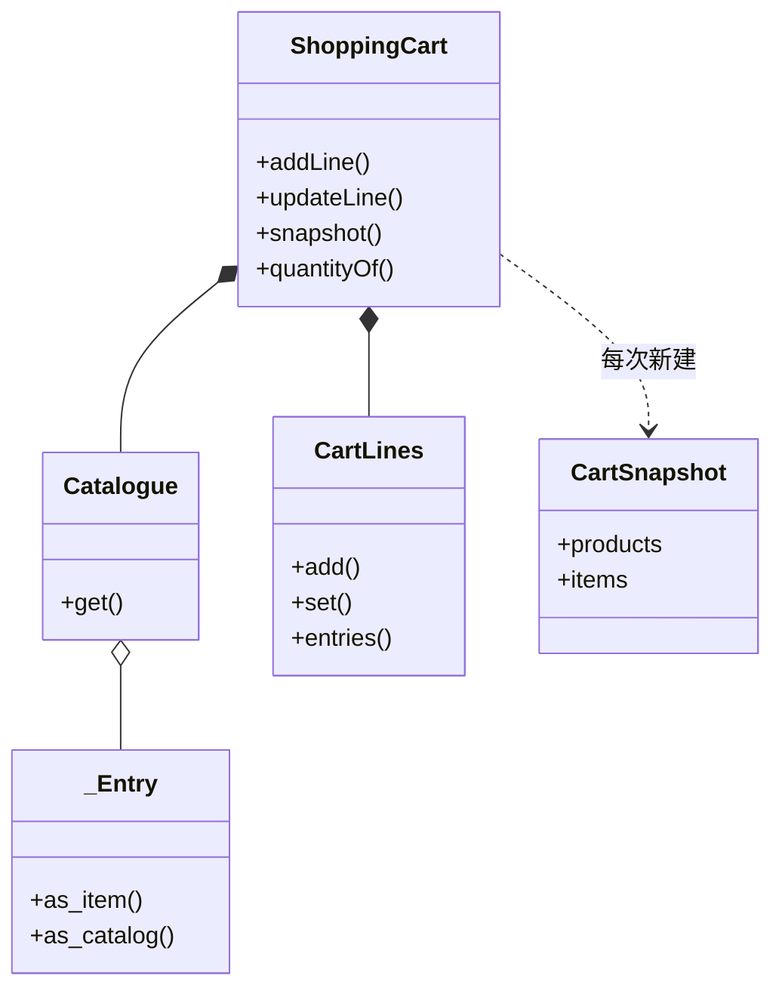
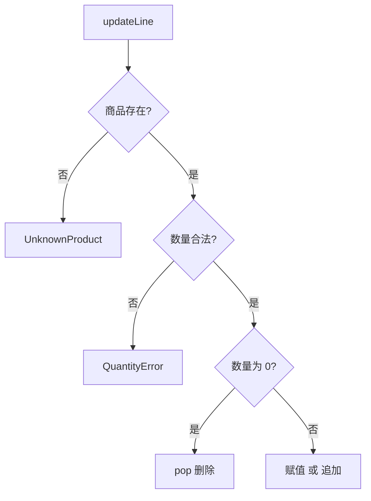
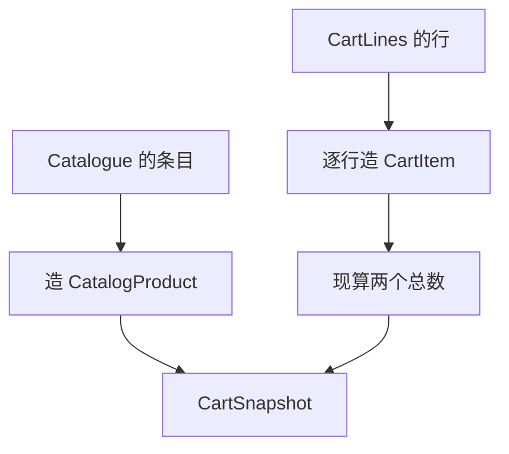

# 设计题解：服装购物车（Apparel Shopping Cart）

## 题目与澄清

一家服装店的网页要显示商品目录和购物车。目录、页面渲染和 HTTP 传输都已经写好，缺的是中间那块"购物车状态"：顾客点"加入购物车"，调用 `addLine(商品 ID)`；点加减号或输入数量，调用 `updateLine(商品 ID, 数量)`；页面每次重画之前调用 `snapshot()`，拿到目录、购物车各行和合计。工作区里的 `cart.py` 是模板，三个方法都是 `NotImplementedError`；`models.py` 给出四个数据类（`Product`、`CatalogProduct`、`CartItem`、`CartSnapshot`），传输层 `server.py` 把快照转成 JSON 发给页面。这是一个"补全"型项目：不修坏代码，也不排查事故，只实现一个组件。组件小，所以考点集中在四件小事上，每一件都有隐藏测试会去踩：**行的顺序、数量的边界、整数合计、快照的独立**。

先把合同写成十条，按"粗心的读者最容易漏掉"的顺序：

1. **加一**：数量加 1；从 0 变成非零的行追加在购物车末尾；已有的行保持位置。
2. **改量是绝对值**：`updateLine(id, 3)` 之后数量就是 3，不论之前是几；范围 0 到 1,000,000，两端都含。
3. **正数更新可以新建行**，落在末尾；已有的行改量不挪位置。
4. **零就是删除**：更新为 0 删除这一行；行本来不在时什么都不做，不报错。
5. **删除后再加回来**，不论走加一还是 `updateLine`，这一行都落在末尾。
6. **快照有两个有序视图**：`products` 永远按目录原序，每项是 `id / name / priceCents / cartQuantity`，没加的商品是 0；`items` 按行的插入序，每项是 `id / name / priceCents / quantity / lineTotalCents`。
7. **合计**：`lineTotalCents = 单价 × 数量`；`totalQuantity` 是各行数量之和；`totalPriceCents` 是各行小计之和；没有行时两个总数都是 0。
8. **`empty` 当且仅当没有任何行**。只放了单价为 0 的商品，总价是 0，但购物车不空。
9. **精确整数**：单价与数量各至多 1,000,000，一行至多 10 的 12 次方，整个目录（至多 100 个商品）至多 10 的 14 次方，远超 32 位整数。
10. **独立**：目录在构造时被拷贝；之后的调用不改变已经拿到的快照；改动一个快照不影响购物车和下一个快照；两辆购物车不共享可变状态。

合同还给了两个调用示例。示例一：目录里只有一顶 1250 分的帽子，`addLine` 之后 `updateLine(帽子, 3)`，购物车只有一行，数量 3，小计 3750，总数量 3，总价 3750，`empty` 为假。示例二：两个商品 `p1`、`p2`，依次加 `p1`、`p2`，把 `p1` 更新为 0，再加 `p1`，`items` 的顺序是 `["p2", "p1"]`，而 `products` 仍是 `["p1", "p2"]`。这两个例子是你的第一批测试。

下面这些澄清问题，每个答案都会改变代码：

- **"加一"和"更新为正数"在行序上有区别吗？** 没有：新出现的行都在末尾，已有的行都不动。但它们是两个入口，实现里很容易一个对一个错，所以要各写一遍测试。
- **更新为 0 而行不存在，要不要报错？** 不要，什么都不做。这是"幂等的删除"，页面上的减号按钮在数量 1 时点两次也不应该出错。
- **目录里两个商品名字、价格都一样呢？** 它们仍是两个商品，身份只看 `id`。凡是按名字或价格找商品的写法都是错的。
- **总价超过 32 位怎么办？** 在 Python 里整数不会溢出，所以只要全程用整数就是精确的；这一条真正的考点是"不要经过浮点数，不要把总价存进一个有宽度的类型"。示例：单价 3200 分的衬衫放满 1,000,000 件，小计是 3,200,000,000，超过 32 位有符号整数的上限 2,147,483,647；按 32 位回绕会得到 -1,094,967,296。
- **快照可以是不可变的吗？** 可以：冻结的数据类加元组，或者新建的可变副本，两种都被接受，只要调用方改不动内部状态。
- **要不要线程安全？** 合同说调用是顺序的，传输层也只有一辆购物车按顺序处理请求，所以不要求；但要能说清楚"顺序调用"与"线程安全"的区别（见"扩展与追问"）。
- **输入验证归谁？** 传输层。它把 JSON 数字按数学值判断是不是整数，`1`、`1.0`、`1e0` 是同一个数；小数、布尔值、带引号的数字在改状态之前就以 400 拒绝；加一时它先读当前数量，已经在 1,000,000 就拒绝。购物车自己面对的是合法输入；本解仍然多加了一道防线（见决策五），因为组件的价值之一就是别人写错时它不悄悄写坏数据。

范围之外：结账、支付、库存、持久化、多线程同步。

## 需求与分级

这个项目没有隐藏的阶段，分关是实现的顺序：先让行序可信，再让合计可信，最后让独立可信。每一关做完都能单独跑测试。

**第 1 关（约 15 分钟，加一与快照的骨架）**：实现构造、`addLine` 和 `snapshot`，先把顺序以外的部分跑通：目录原序的 `products`、按插入序的 `items`、两个总数、`empty`。这一关就要决定行放在哪种容器里（决策一），因为后面所有顺序规则都建在它上面。

**第 2 关（约 15 分钟，改量与删除）**：实现 `updateLine`：绝对值、正数新建、零删除、缺席时什么都不做。陷阱集中在"零"：把 0 存成一行数量为 0 的记录，会让再加回来的行占着旧位置；而把它从容器里删掉，再加回来就自然在末尾。

**第 3 关（约 15 分钟，精确合计）**：小计和总价。写一个把目录放满、每行都是 1,000,000 件的测试，期望值由常量推出：每行 10 的 12 次方，一百行 10 的 14 次方。再写一个只含单价为 0 的商品的测试，防止用"总价是否为 0"来判断 `empty`。

**第 4 关（选做，约 15 分钟，独立与书面回答）**：把"调用方改输入、调用方改快照、两辆车共用输入"三条通道各写一个测试；再写工作区里的两篇短文：行序怎么在"删掉又加回来"时保持，以及你怎么验证输入、旧快照、不同购物车互不影响。短文各约一百字，写"你做了什么检查"，不写"代码是怎样的"。

## 核心对象与职责

| 类型 | 单一职责 | 它拥有的不变量 |
|---|---|---|
| `Product`、`CatalogProduct`、`CartItem`、`CartSnapshot` | 工作区给定的数据形状（可变数据类） | 字段名与返回形状；每次调用都是新建的副本 |
| `_Entry` | 目录里一个商品的冻结副本，会造出快照里的两种条目 | 构造之后不可改；价格是非负整数，名字非空 |
| `Catalogue` | 不可变的目录：保持原序、按 ID 查找 | ID 唯一；构造之后不再改变；不引用调用方的对象 |
| `CartLines` | 有序的购物车行：商品 ID 到数量 | 只存 1 到 1,000,000 的数量，0 从不入库；字典的插入序就是行序 |
| `ShoppingCart` | 组装：先确认商品存在，再交给行去改，最后现算合计、造快照 | 不存第二份状态；失败的调用不改变任何东西 |

`ShoppingCart` 组合一个 `Catalogue` 和一个 `CartLines`，两者随购物车生灭；`_Entry` 是目录的元素，快照里的对象全是 `snapshot()` 现建的，不在任何地方保存。三个小类里没有一个只是转发：`Catalogue` 守住"拷贝、唯一、有序"，`CartLines` 守住"零不入库、数量有界、顺序"，`ShoppingCart` 把它们的先后组织起来并造快照。如果把 `CartLines` 删掉、字典直接放进 `ShoppingCart`，也能工作；留着它是为了让"数量的合法范围"和"顺序"这两条规则只出现在一个地方，下一次需求（比如一次加 n 件）只改它。



一次 `updateLine` 的路径是先查商品、再校验数量、最后才写，前两步失败时购物车没有被碰过：



一次 `snapshot` 的路径只读状态、只造新对象：



## 关键设计决策

### 决策一：行序怎么存

**问题**：行序有三条规则：新行在末尾、已有的行不挪位置、删除再加回来落在末尾。数量变化很频繁，一辆购物车至多 10,000 次修改。

**选项 A：一个列表，每个元素是 `[id, 数量]`。** 查找要线性扫描，删除要 `list.remove` 或切片，都是 O(行数)；行数至多 100，所以慢不是问题，问题是"改量"要先找到那一项再改里面的数量，找不到才追加，三条规则分散在三个分支里，每个分支都可能写错。

```python
for line in self._lines:
    if line[0] == product_id:
        line[1] += 1
        break
else:
    self._lines.append([product_id, 1])
```

**选项 B：一个字典存数量，另一个列表存顺序。** 字典负责查，列表负责顺序。这是两份必须同步的状态：删除时要同时改两处，漏掉一处，列表里就留下一个幽灵 ID，或者字典里有一个不在顺序里的行。

**选项 C：每行存一个单调递增的序号，快照时按序号排序。** 序号跟着行走，删除再加回来拿到新序号，规则也满足。代价是每次快照要排序（O(n log n)），多了一个计数器要维护，而且"行序"变成了"序号的排序结果"，读代码的人要多绕一步。

**选项 D（采用）：一个字典，`商品 ID → 数量`，只存数量大于 0 的行。** Python 3.7 起，字典保证迭代顺序等于插入顺序，而且有两条正好是这里要的规则：给已有的键重新赋值，键的位置不变；`pop` 之后再赋值，键落在末尾。

```python
d = {}
d["p1"] = 1; d["p2"] = 1; d["p1"] = 3
print(list(d.items()))      # [('p1', 3), ('p2', 1)]
del d["p1"]; d["p1"] = 1
print(list(d.items()))      # [('p2', 1), ('p1', 1)]
```

三条顺序规则不需要任何代码，只需要"删除是真删除"这一条纪律：数量为 0 的行不入库。一个结构同时是"按 ID 查"的索引和"按插入序遍历"的序列，没有第二份状态要同步。

**模式？** 不需要。这是选对了数据结构，而不是套了一个设计模式。要避免的错误是"为顺序引入一个有序集合的抽象"：只有一种实现，也不会有第二种。

### 决策二：怎样让调用方、快照、实例互不影响

**问题**：三条通道都可能泄漏。输入：调用方构造后改了自己的 `Product` 或清空了自己的列表。输出：调用方改了拿到的快照。实例：两辆购物车共享了某个可变对象。工作区的模板在构造函数里写了 `self._products = products`，这一行就是第一条通道的漏洞：它保存的是调用方的列表本身。

```python
class Naive:
    def __init__(self, products):
        self._products = products          # 别名，不是拷贝
    def names(self):
        return [(p.name, p.priceCents) for p in self._products]

hat = Product("p1", "Canvas Hat", 1250)
cart = Naive([hat])
hat.name = "changed outside"
```

之后调用 `names()` 得到的是 `changed outside`；如果调用方清空了列表，得到的是空列表。

**输入这一侧的选项**：(A) 保存调用方的列表，别名，错；(B) `list(products)`，浅拷贝，列表是新的但里面的 `Product` 还是调用方的对象，`hat.name = ...` 依然会泄漏；(C) `copy.deepcopy(products)`，对，但拷出来的仍然是可变的 `Product`，购物车内部又要保证自己不改它们；(D，采用) 构造时就把每个商品读成一个**冻结的** `_Entry`（`@dataclass(frozen=True, slots=True)`）：从此购物车内部没有任何东西指向调用方的对象，也没有任何东西可以被改。

**输出这一侧的选项**：(A) 返回内部列表，错；(B) 返回内部状态的 `deepcopy`，对，但内部状态本身就带着可变对象，拷贝是补丁；(C) 缓存上一次的快照，状态没变就原样返回，错：两次调用拿到同一批对象，一个调用方改坏了，另一个也坏；(D，采用) 内部只存冻结的条目和整数，`snapshot()` 每次**现建**全部对象和列表，没有任何一个对象被两次返回；(E) 返回冻结的数据类加元组，也对，把"改快照"在类型上堵死，但工作区的 `models.py` 把字段声明为 `list`，换成元组就偏离了给定的数据形状，所以这里不选，但在"扩展与追问"里说明代价。

**实例这一侧**：状态只放在实例上。类属性里的字典或模块级的列表会让两辆车共享。这一条几乎不会被写错，但一旦写错，别的测试都会莫名其妙地失败，是个值得单独测试的点。

**为什么拷贝放在构造，而不是每次读时再拷**：构造只发生一次，读发生很多次；同时"在哪里拷贝"决定了"不变量在哪里建立"：目录是构造时建立的冻结值，之后没有任何路径能改它。

**模式？** 值对象（Value Object）加"构造即拷贝"。快照也不是备忘录（Memento）：备忘录是为了"以后能恢复到那一刻"，这里的快照只读，永远不会被送回购物车；也没有复制原型（Prototype）的需要，每次都用构造函数造新的。

### 决策三：合计存起来，还是每次现算

**问题**：`totalQuantity` 与 `totalPriceCents` 可以在每次修改时增量更新，也可以每次快照时从各行重新求和。

**选项 A：增量维护。** `addLine` 让总数加 1、总价加单价；`updateLine` 要先减去旧小计，再加新小计；删除要减去整行。每个入口都有一份"增量算术"，漏掉任何一个分支，总数就和行对不上，而且不会报错，只会在某一次点击之后悄悄偏离。

**选项 B：发布—订阅，行变化时通知合计更新。** 为一个至多 100 行的求和引入观察者（Observer），没有任何收益：只有一个订阅者，永远不会有第二个。

**选项 C（采用）：不存，快照时现算。** 一行的小计是 `单价 × 数量`，两个总数是对 `items` 的两个 `sum`。数据只有一份，没有"总数与行对不上"的可能；每次快照最多遍历 100 行：一辆放满 100 行的购物车，一次 `snapshot()` 约 24 微秒，比一次 HTTP 往返小几个数量级，不是瓶颈。什么时候才值得增量：行数上万、快照极其频繁；那时要保留这个"现算"的版本当作测试里的参照，对拍增量版本。

**模式？** 刻意不用观察者，也不用缓存失效。这里"简单的答案是对的"：派生的数据不要存。

### 决策四：整数怎么存

**问题**：金额是分，单价最大 1,000,000 分（一万元），数量最大 1,000,000，一行最大 10 的 12 次方，一百行最大 10 的 14 次方。

**选项 A：浮点数。** 在这个范围内，10 的 14 次方小于 2 的 53 次方（9,007,199,254,740,992），浮点数碰巧是精确的；但类型错了：测试比较的是 `type(实际) is type(期望)`，`3750.0` 与 `3750` 类型不同，会判不过；而且只要有人把单价改成"元"（1250 变成 12.5），浮点数就开始舍入。

**选项 B：`Decimal`。** 对"元"有意义，对"分"没有：没有除法、没有舍入，只有整数乘法和加法，`Decimal` 增加了类型的复杂度（JSON 序列化要特殊处理）而没有收益。

**选项 C（采用）：Python 的 `int`，单位是分。** 任意精度，不会溢出；乘法和加法都是精确的。这一条的考点是别的语言里的陷阱：C 或 Java 的 32 位整数会让 3,200,000,000 回绕成 -1,094,967,296，JavaScript 的数字在 2 的 53 次方之后才开始丢精度，所以对页面来说这里恰好够用。写测试时，期望值由常量推出（`100 * 10**6 * 10**6`），不要把一个跑出来的数字抄进去。

**模式？** 不需要；只是"金额用整数分"这个惯用法，加上 `type(x) is int` 的检查。

### 决策五：要不要校验合同已经保证的输入

**问题**：合同说调用都是合法的商品 ID 和数量，传输层也已经拦住了小数、布尔、越界。购物车自己要不要再检查？

**选项 A：信任调用方，不检查。** 最短。但"加一"在数量 1,000,000 上会悄悄变成 1,000,001，一个未知的 ID 会在 `KeyError` 里炸出一段和购物车无关的堆栈；而且 `True` 在 Python 里是 `1`，`updateLine(id, True)` 会"成功"。

**选项 B：用 `assert`。** `python -O` 会把它们整个删掉，护栏在最需要的地方消失。

**选项 C（采用）：在写入之前抛出命名的异常。** 未知 ID 抛 `UnknownProductError`（同时是 `LookupError`），数量不是 `int`（`bool` 也不行）、越界、或加一会越界抛 `QuantityError`（同时是 `ValueError`）；两个异常都带着出错的 ID 与数量。顺序固定：先查商品，再查数量，最后写；所以失败的调用不会留下半个修改。成本是几行代码，收益是组件在被别人误用时失败得清楚。注意：这是**本解**多加的，隐藏测试只会用合法输入，所以不会因为它而变红；如果你不确定，宁可保留，也不要删。

**模式？** 不需要；这是"在边界处验证，先验证后修改"，不是模板方法或责任链。

## 代码走读

下面是完整的参考解，和测试里使用的是同一个文件：

%% code:begin solution.py %%
```python
"""服装购物车（Apparel Shopping Cart）参考解：公开 API 与真实工作区的 `cart.py` 一致，可以原样放进去。

设计一共五行：
1. 目录（`Catalogue`）在构造时把调用方的商品拷成私有的冻结条目（`_Entry`），之后怎么改自己的 `Product` 都与购物车无关。
2. 购物车的行只存「商品 ID → 数量」，只存数量大于 0 的行；字典的插入序就是行序，
   改量不动位置，删除再加回去就落在末尾，正好是合同要的顺序。
3. 总数不另存，每次快照从各行现算：数据只有一份，没有"总数与行对不上"的可能；至多 100 行，现算的代价可以忽略。
4. 全是 `int`：单行至多 10**12，全目录至多 10**14，超出 32 位但 Python 的整数不会溢出，也不经过浮点数。
5. 每次 `snapshot()` 都新建全部对象与列表，所以旧快照、被调用方改坏的快照、另一辆购物车，彼此都碰不到。

产品规则（逐条都有测试）：
 1. `ShoppingCart(products)`：目录至多 100 个商品，商品靠 `id` 区分（`id` 唯一）；名字或价格相同不算同一个商品；
    每个商品起始数量为 0。目录被拷贝：之后调用方改动或清空自己的列表与对象，都不影响购物车；构造也不修改调用方的对象。
 2. `addLine(id)`：数量加 1。从 0 变成非零的行追加在行序末尾；已有的行保持原来的位置。
 3. `updateLine(id, quantity)`：把数量设成绝对值（0 到 1_000_000）。正数可以新建行（追加在末尾），已有行保持位置；
    0 删除这一行，行不存在时什么都不做；删除后再加回来，行落在末尾。
 4. `snapshot()` 返回 `CartSnapshot`：`products` 按目录原序，每项 `id / name / priceCents / cartQuantity`；
    `items` 按行的插入序，每项 `id / name / priceCents / quantity / lineTotalCents`。
 5. `lineTotalCents = priceCents * quantity`；`totalQuantity` 是各行数量之和；`totalPriceCents` 是各行小计之和；
    `empty` 当且仅当没有任何行；空购物车的两个总数都是 0。
 6. 总价是精确的整数：单价与数量各至多 10**6，一行至多 10**12，整本目录至多 10**14，都远超 2**32。
 7. 快照互相独立：之后的任何调用都不改变已经拿到的快照；改动一个快照不影响下一个快照；两辆购物车不共享可变状态。
 8. 失败不留痕（合同保证入参合法，这是本解多加的防线）：未知商品 ID 抛 `UnknownProductError`；
    数量不是 `int`（`bool` 也不行）或超出 0 到 1_000_000、或 `addLine` 会让数量超过 1_000_000，抛 `QuantityError`；
    两种失败之后购物车都没有任何变化；ID 和数量同时有错时，先报未知商品。
 9. `quantityOf(id)` 是多加的只读口：返回当前数量（不在购物车里是 0），未知 ID 同样抛 `UnknownProductError`。
10. 调用是顺序的，不加锁。结账、支付、库存、持久化、同步都不在范围内；HTTP 层对 JSON 数字的校验由传输层负责。
"""

from __future__ import annotations

from collections.abc import Iterable, Iterator
from dataclasses import dataclass

MAX_QUANTITY = 1_000_000


class CartError(Exception):
    """购物车自己抛出的错误的基类。"""


class UnknownProductError(CartError, LookupError):
    """商品 ID 不在目录里。"""

    def __init__(self, product_id: str) -> None:
        super().__init__(f"未知商品：{product_id!r}")
        self.product_id = product_id


class QuantityError(CartError, ValueError):
    """数量不是 0 到 1_000_000 的整数，或加一会越界。"""

    def __init__(self, product_id: str, quantity: object) -> None:
        super().__init__(f"商品 {product_id!r} 的数量 {quantity!r} 不合法（要求 0 到 {MAX_QUANTITY} 的整数）")
        self.product_id = product_id
        self.quantity = quantity


@dataclass
class Product:
    """调用方交进来的商品：构造时被拷贝，之后与购物车无关。"""

    id: str
    name: str
    priceCents: int


@dataclass
class CatalogProduct(Product):
    """快照里的目录条目：商品加上它在购物车里的数量。"""

    cartQuantity: int


@dataclass
class CartItem(Product):
    """快照里的购物车行。"""

    quantity: int
    lineTotalCents: int


@dataclass
class CartSnapshot:
    """某一时刻购物车的独立副本：每次调用 `snapshot()` 都重新构造。"""

    products: list[CatalogProduct]
    items: list[CartItem]
    totalQuantity: int
    totalPriceCents: int
    empty: bool


@dataclass(frozen=True, slots=True)
class _Entry:
    """目录里的一个商品，冻结：快照只从它读值，永远拿不到它本身。"""

    id: str
    name: str
    price_cents: int

    @classmethod
    def copy_of(cls, product: Product) -> _Entry:
        """从调用方的对象拷出一个条目；价格必须是非负整数、名字非空。"""
        if type(product.priceCents) is not int or product.priceCents < 0 or not product.name:
            raise ValueError(f"商品 {product.id} 的名字为空或价格不是非负整数")
        return cls(product.id, product.name, product.priceCents)

    def as_catalog(self, cart_quantity: int) -> CatalogProduct:
        return CatalogProduct(self.id, self.name, self.price_cents, cart_quantity)

    def as_item(self, quantity: int) -> CartItem:
        return CartItem(self.id, self.name, self.price_cents, quantity, self.price_cents * quantity)


class Catalogue:
    """不可变的目录：保持原序、按 ID 查找。不变量：ID 唯一；构造之后不再改变。"""

    def __init__(self, products: Iterable[Product]) -> None:
        self._entries = tuple(_Entry.copy_of(p) for p in products)  # 立刻拷贝，之后不再引用调用方的对象
        self._by_id = {entry.id: entry for entry in self._entries}
        if len(self._by_id) != len(self._entries):
            raise ValueError("目录里有重复的商品 ID")

    def get(self, product_id: str) -> _Entry:
        try:
            return self._by_id[product_id]
        except KeyError:
            raise UnknownProductError(product_id) from None

    def __iter__(self) -> Iterator[_Entry]:
        return iter(self._entries)


class CartLines:
    """有序的购物车行：商品 ID → 数量。不变量：只存 1 到 MAX_QUANTITY 的数量，0 从不入库。"""

    def __init__(self) -> None:
        self._quantity: dict[str, int] = {}

    def quantity_of(self, product_id: str) -> int:
        return self._quantity.get(product_id, 0)

    def add(self, product_id: str) -> None:
        current = self._quantity.get(product_id, 0)
        if current >= MAX_QUANTITY:
            raise QuantityError(product_id, current + 1)
        # 已有的键重新赋值不改变它在字典里的位置；新键追加在末尾
        self._quantity[product_id] = current + 1

    def set(self, product_id: str, quantity: int) -> None:
        if type(quantity) is not int or not 0 <= quantity <= MAX_QUANTITY:
            raise QuantityError(product_id, quantity)
        if quantity == 0:
            self._quantity.pop(product_id, None)  # 不存在时什么都不做
        else:
            self._quantity[product_id] = quantity

    def entries(self) -> tuple[tuple[str, int], ...]:
        """按插入序的 (ID, 数量) 元组，是副本，不是内部字典的视图。"""
        return tuple(self._quantity.items())

    def __len__(self) -> int:
        return len(self._quantity)


class ShoppingCart:
    """目录 + 购物车行 + 快照的组装：自己不存第二份状态。"""

    def __init__(self, products: Iterable[Product]) -> None:
        self._catalogue = Catalogue(products)
        self._lines = CartLines()

    @property
    def line_count(self) -> int:
        """当前有几行（数量大于 0 的商品数）。"""
        return len(self._lines)

    def quantityOf(self, productId: str) -> int:
        """某个商品当前的数量（不在购物车里是 0），O(1)，不必为一个数字构造整份快照。"""
        self._catalogue.get(productId)
        return self._lines.quantity_of(productId)

    def addLine(self, productId: str) -> None:
        self._catalogue.get(productId)  # 先确认商品存在；失败时行还没被碰过
        self._lines.add(productId)

    def updateLine(self, productId: str, quantity: int) -> None:
        self._catalogue.get(productId)
        self._lines.set(productId, quantity)

    def snapshot(self) -> CartSnapshot:
        # 每个对象、每个列表都现建：快照与购物车内部、与别的快照没有共享的可变部分
        items = [self._catalogue.get(pid).as_item(quantity) for pid, quantity in self._lines.entries()]
        products = [entry.as_catalog(self._lines.quantity_of(entry.id)) for entry in self._catalogue]
        return CartSnapshot(
            products=products,
            items=items,
            totalQuantity=sum(item.quantity for item in items),
            totalPriceCents=sum(item.lineTotalCents for item in items),
            empty=not items,
        )


if __name__ == "__main__":
    demo = ShoppingCart([Product("p1", "Canvas Hat", 1250), Product("p2", "Wool Scarf", 2400)])
    demo.addLine("p1")
    demo.addLine("p2")
    demo.updateLine("p1", 0)  # 删除 p1
    demo.addLine("p1")  # 再加回来：落在末尾
    shot = demo.snapshot()
    print([item.id for item in shot.items], shot.totalQuantity, shot.totalPriceCents, shot.empty)
    # 精确总价：3200 分的衬衫放满 1_000_000 件是 3_200_000_000，超过 32 位有符号整数的上限 2_147_483_647
    big = ShoppingCart([Product("shirt", "Trail Shirt", 3200)])
    big.updateLine("shirt", MAX_QUANTITY)
    print(big.snapshot().totalPriceCents, big.snapshot().totalPriceCents > 2**31 - 1)
    # 旧快照不受之后调用的影响
    before = big.snapshot()
    big.updateLine("shirt", 0)
    print(before.totalQuantity, big.snapshot().totalQuantity)
```
%% code:end %%

**第一处：`CartLines.add` 与 `set` 里的顺序。** `self._quantity[product_id] = current + 1` 一行同时处理了"新行追加"和"已有的行保持位置"，这是字典的行为，不是代码写出来的；`set` 里的 `pop` 才是删除，数量为 0 的行从不入库。两个入口写的是同一个字典，所以一个对另一个就对。`add` 里的上限检查在写入之前，失败不会改动字典。

**第二处：`Catalogue.__init__`。** 构造时 `_Entry.copy_of(p)` 把调用方的对象逐个读成冻结条目，之后购物车内部没有任何东西引用调用方的对象；重复 ID 在这里被拒绝，因为后面的字典索引会悄悄丢掉一个。`get` 把 `KeyError` 换成 `UnknownProductError`，并用 `from None` 省去链式的噪音。

**第三处：`snapshot`。** 两个列表推导式和一个 `CartSnapshot(...)` 构造，每一次都从冻结条目和整数现建所有对象；两个总数是对 `items` 的 `sum`，`empty` 是 `not items`，不是"总价为 0"。没有缓存、没有 `deepcopy`，因为没有任何可变的内部对象需要被拷。

**第四处：`addLine` / `updateLine` 的顺序。** 第一行 `self._catalogue.get(productId)` 先确认商品存在；之后才交给 `CartLines`，它先校验数量、后写入。所以 ID 与数量同时有错时报的是未知商品，而且无论哪个错，购物车都没有变化。

## 测试与自检

测试文件里有二十四个测试函数，参数化展开后是二十九个用例，没有一个依赖时间。按合同条目分组：

- **例子与顺序**：合同的两个例子逐项断言；已有的行加一、改量都不挪位置；正数更新新建行落在末尾；更新为 0 删除、缺席时什么都不做；"删除再用 `updateLine` 加回来"也落在末尾；改量是绝对值。
- **合计与整数**：空购物车和空目录；一百个商品都放满 1,000,000 件，期望值由 `MAX_PRICE * MAX_Q` 等常量推出；价格 1、999,999、0 混在一起，不带舍入；所有数字的类型都是 `int`，`empty` 是 `bool`，字段名和顺序与合同一致；价格为 0 的商品让购物车不空、总价为 0；名字和价格相同的两个商品仍是两个。
- **独立**：构造后改调用方的对象再看快照；旧快照在之后的每一步都不变；对一个快照"清空列表、改字段"，下一个快照仍然正确；两次 `snapshot()` 返回的对象不共享；两辆购物车共用同一批 `Product` 对象，一辆动，另一辆不动。
- **失败不留痕**：未知 ID，包括"ID 与数量同时有错"；数量为 -1、1,000,001、`True`、`1.0`、`"3"`、`None`；数量上限两端含，上限上再加一被拒绝；重复 ID 的目录被拒绝。
- **与朴素模型对照**：固定种子，一万次随机的加一、更新、删除，每隔 97 步把快照与一个最笨的列表模型逐项比较，每 500 步留下一个旧快照，最后统一深比较它们没变。一万这个数来自合同里"每辆车至多 10,000 次修改"，不是跑出来的。

测试要能抓住缺陷。下面是十种故意写错的实现，以及它们让哪些用例变红：

| 故意写错 | 第一批变红的用例 |
|---|---|
| 删除时把数量写成 0 而不是 `pop` | 例子二的顺序、缺席与删除、"删除再用更新加回"、随机对照，共 4 个 |
| 重新赋值时把键放到最前面 | 示例一的形状、已有行不挪位置、新行落末尾，共 9 个 |
| `updateLine` 当成增量 | 示例一、已有行不挪位置、绝对值、上限的两端、随机对照，共 5 个 |
| 按目录顺序重建行 | 例子二的顺序、行序的三个用例、随机对照，共 5 个 |
| 总价按 32 位回绕 | 超 32 位的精确值、奇数价格、随机对照，共 3 个 |
| 构造时不拷贝，保存调用方的对象 | 构造后改调用方的对象，共 1 个 |
| 缓存上一次的快照 | 改快照不影响购物车、两次快照不共享对象，共 2 个 |
| 行字典放在类上而不是实例上 | 29 个用例里的 24 个，几乎全红 |
| 去掉 `add` 的上限检查 | 上限两端、随机对照，共 2 个 |
| `empty` 用"总价是否为 0"判断 | 价格为 0 的商品让购物车不空，共 1 个 |

最后一行只有专门的用例抓得住：在价格全不为 0 的购物车里，"总价为 0"与"没有行"永远同时成立，混进一个单价为 0 的商品才会把两者分开。

两分钟演示给面试官：模块底部的 `__main__` 先打印 `['p2', 'p1'] 2 3650 False`（加 p1、p2，删 p1，再加 p1），然后打印 `3200000000 True`（一行满额的衬衫超过 32 位上限），最后打印 `1000000 0`（旧快照留着数量，购物车已经清空）。然后说出：行放在字典里所以顺序免费；快照每次现建所以三条通道都堵住；合计现算所以数据只有一份。

公开测试也要跑：把 `solution.py` 复制成工作区里的 `cart.py`，在文件末尾加一行 `from models import Product, CatalogProduct, CartItem, CartSnapshot`，让测试比较的是工作区自己的类，然后在工作区目录运行 `python3 test_client.py`。它不是 pytest 的用例，而是一个脚本：对 `public_cases.json` 里的每个夹具走一遍"构造、逐步调用、每步比较"，还会故意改动每个快照、对另一辆购物车操作，再检查旧快照没变；通过时每个夹具打印一行描述。把它包成 pytest 用例（每个夹具一个）也一样通过。HTTP 层可以自己试：`PORT=18431 python3 server.py`（别用 8080），再向 `/api/action` 提交 `{"action":"update","productId":"shirt","quantity":1e6}`，返回的 `totalPriceCents` 是 3200000000，小数、布尔和字符串数量都得到 400。

## 扩展与追问

**新需求**

- *一次加 n 件（`addLine(id, n)`）*：改 `CartLines.add` 的参数和上限判断，`ShoppingCart` 的两个入口多传一个参数；目录、快照、合计都不动。
- *清空购物车 / 删除某一行*：`CartLines` 多一个 `clear()`，`remove` 就是 `set(id, 0)`；因为"零不入库"，不需要新状态。
- *库存上限*：`Catalogue` 的条目多一个 `stock`，`CartLines.set` 之前由 `ShoppingCart` 比较；商品的"可售数量"是目录的一部分，不是行的一部分，所以行的代码不动。
- *折扣、运费、税*：在 `snapshot()` 里把"小计求和"换成一个 `price_rules(items) -> 合计` 函数，输入是 `items`，输出还是整数分；规则多了才值得做成策略对象（Strategy）。取整规则要写进合同，否则每次舍入都是一次争论。
- *价格变动*：现在快照读的是目录里的价格，目录是冻结的，所以价格不会变。如果目录可以改价，就要决定"购物车里的行是否锁定加入时的价格"：锁定就要在行里存单价，不锁定就每次现查，两种语义都对，必须写进合同。

**并发与线程安全**（对应书面回答第二问）

- *顺序调用与线程安全的区别*：合同里的调用是顺序的，所以不需要锁。若两个线程同时调用，`addLine` 是"读当前数量、判断上限、写回"三步的复合操作，两个线程可能读到同一个旧值、各写一次，结果少加一件；`snapshot` 是读目录、读行、求和三步，被另一个线程的写入切开，会得到总数与行对不上的半个状态。
- *修法*：一把 `threading.Lock` 罩住整个 `addLine`、`updateLine` 和 `snapshot`；锁只给赋值加没有用。GIL 保证单个字节码级别的操作不会撕裂，但不保证这三步整体原子。
- *不靠锁*：因为状态可以做成不可变值（每次修改产出新的行字典，一次赋值换掉），读者只需拿一次引用就能读到一致的行；写者仍要串行。

**持久化与规模**

- *行存到数据库*：一张 `cart_lines(cart_id, product_id, quantity, position)` 表；"追加在末尾"变成 `position = 当前最大 + 1`，删除再加回来拿到新 position，规则一一对应；改量用 `UPDATE`，不动 `position`。
- *快照的一致性*：在一个事务里读目录、读行，或者读时带一个版本号；否则两次读之间被别人改了，快照会是拼凑的。
- *规模*：一个购物车的行数有上限（这里是 100），所以现算合计没有问题；如果购物车要存到缓存里，快照应当是序列化出来的值，天然独立。

## 常见错误

- **把调用方的列表存进 `self`**：模板里的 `self._products = products` 就是这个错误；浅拷贝 `list(products)` 也不够，里面的对象还是调用方的。
- **把 0 存成一行**：再加回来占着旧位置，`items` 里还会多一行数量为 0 的记录。
- **按目录顺序重建 `items`**：`products` 才按目录序，`items` 按插入序；删除再加回来后两者顺序不同，这正是示例二想暴露的错误。
- **`updateLine` 当成增量**：连续两次 `updateLine(id, 3)` 得到 6。
- **用总价是否为 0 判断 `empty`**：只买了单价为 0 的商品时会判错。
- **经过浮点数**：`lineTotalCents` 变成 `3750.0`，测试按类型比较会判不过；`int(price * quantity * 1.0)` 在这个范围内数值碰巧精确，但类型和习惯都是错的。
- **缓存快照**：省了一次构造，却让两个调用方共享同一批对象。
- **把行字典写成类属性或模块变量**：两辆车互相看见对方的商品。
- **在上限上悄悄超出**：`addLine` 把 1,000,000 加成 1,000,001，传输层的上限检查就成了唯一的防线。
- **用 `assert` 当校验**：`python -O` 会把它们整个去掉。
- **只信公开测试**：公开测试只有两个夹具；顺序、边界、独立三类缺陷各自还有很多写法没被覆盖，要自己写。
- **对智能体只说"实现一个购物车"**：没有合同里的十条，它会在行序、零、独立里挑几条违反；先把十条和两个示例交给它，一次只给一个失败的测试，期望值由你独立写出，不接受"把测试改成通过"。

## 45 分钟怎么分配

项目窗口最长 60 分钟；前 45 分钟做完实现和测试，余下留给两篇短文。

- **0–5 分钟｜读合同**：不要先写代码。把上面十条用自己的话写成注释，标出"隐藏测试最可能针对哪一条"；打开 `cart.py`、`models.py`，先看模板里的 `self._products = products` 这一行。对智能体说出来的第一句话也是这份清单。
- **5–10 分钟｜定骨架**：口头说出结构：冻结的目录、"ID 到数量"的字典、每次现建的快照；让智能体起草 `snapshot` 的样板（形状清楚、容易验证）；容器的选择、零的处理、拷贝的位置，这三个决定自己定。
- **10–22 分钟｜`addLine`、`updateLine`、`snapshot`**：每写完一个就跑 `python3 test_client.py`，再把合同的两个示例写成你自己的断言；一次只让智能体改一件事。
- **22–32 分钟｜合计与整数**：加"放满"的测试，期望值用常量推出；加"只有价格为 0 的商品"的测试。
- **32–40 分钟｜独立**：三条通道各一个"改了再看"的测试；留旧快照，之后每一步都深比较。
- **40–45 分钟｜随机对照与收尾**：最笨的列表模型对照一万次随机操作；删掉没用到的代码。
- **45–60 分钟｜短文**：两篇各约一百字：第一篇写"删除是真删除，字典保证顺序"和你怎么测；第二篇写三条通道各怎么堵、各用什么测试证明，不要复述代码。

时间不够时的取舍顺序：先砍随机对照，其次砍 `quantityOf` 和异常里的详细字段，再砍价格为 0 的用例；**绝不能砍的是**：合同两个示例的逐项断言、零就是真删除、构造时拷贝、每次快照现建、两篇短文。

## 延伸阅读

- [[solution-online-shopping]]：经典的在线购物题解：商品目录、购物车、订单状态机与库存扣减；这里只保留购物车一层，更看重顺序、整数与快照的合同。
- [[problems.marketplaces.online-shopping|在线购物（Amazon）]]：同一问题的知识树入口。
- 防御性拷贝（Defensive Copying）：输入拷贝、输出新建与只读视图的取舍。
- [[oop.values|值对象与不可变性（Value Objects）]]：冻结数据类为什么让推理变简单。
- 容器的选择与惯用法（Collections Idioms）：字典的插入序与 `pop` 的成本。
- [[structure.storage|内存持久化（In-Memory Persistence）]]：行与目录放在内存里的仓储写法。
- 时间与数字（Time & Numbers）：整数分、浮点比较与何时用 `Decimal`。
- [Python 文档：dict 的迭代顺序](https://docs.python.org/3/library/stdtypes.html#dict)：插入序是语言保证，以及更新已有键不改变位置。
- [Python 文档：dataclasses（frozen 与 slots）](https://docs.python.org/3/library/dataclasses.html)：冻结条目的写法。
- [Python 文档：copy 模块](https://docs.python.org/3/library/copy.html)：浅拷贝与深拷贝各自拷到哪一层。
- [Python 教程：浮点数运算的问题与限制](https://docs.python.org/3/tutorial/floatingpoint.html)：为什么金额不用浮点数。
- [RFC 8259 第 6 节：JSON 的数字](https://www.rfc-editor.org/rfc/rfc8259#section-6)：`1`、`1.0`、`1e0` 在语法上不同，传输层要按数学值判断整数。
