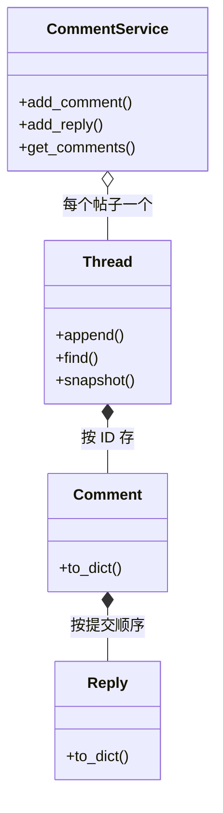
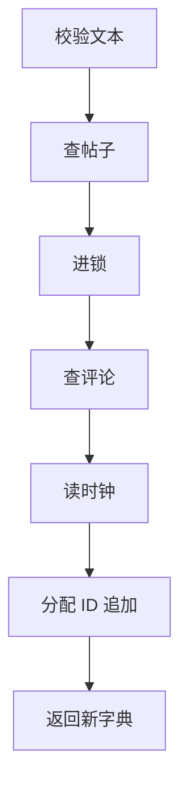

# 设计题解：评论与回复（Comments & Replies）

## 题目与澄清

一个讨论平台已经有帖子，现在要给它加评论：用户可以在帖子下留言（评论），也可以回复别人的评论（回复）。结构只有两层，帖子 → 评论 → 回复，回复下面不再有回复。
HTTP 服务和帖子仓库都已经写好，你要实现的是它们背后的进程内服务 `CommentService`：三个方法，`add_comment`、`add_reply`、`get_comments`。
服务同时被很多请求线程调用，返回给调用方的是普通字典与列表。这类项目评的不是"会不会存一个列表"，而是你会不会把合同读细、把"检查"和"修改"放进同一段不可分割的代码、
把内部状态守住（调用方随便改返回值，服务里的数据也不能变），并且能说清楚为什么这样做。数据放在内存里，所以重点是数据结构、锁的范围和返回值的形状。

公开接口：`CommentService(post_store)`，其中 `post_store.exists(post_id)` 回答"这个帖子在不在"；三个方法与异常 `NotFoundError`、`ValidationError`。先把合同用自己的话写成十二条，这是开工前的第一件事：

1. **三个返回形状固定**。评论字典有六个键：`id`、`post_id`、`user_id`、`content`、`created_at`、`replies`；回复字典有六个键：`id`、`post_id`、`comment_id`、`user_id`、`content`、`created_at`，没有 `replies`。
   `add_comment` 返回的评论里 `replies` 是空列表；`get_comments` 返回评论列表，每条评论带着自己的回复字典列表。
2. **文本合法的标准**：`user_id` 和 `content` 必须是 `str`，并且 `str.strip()` 之后非空。`None`、数字、列表、字节串、空串、只含空白的串，一律 `ValidationError`。
3. **去空白只用来判空**：存下来、返回的都是调用方给的原值，首尾空白保留。`" u1 "` 和 `"u1"` 是两个不同的用户名。
4. **检查顺序固定**：先校验 `user_id` 与 `content`，再查帖子，加回复时最后才查评论。同时有两个错误时，先到先赢，所以顺序是合同的一部分。
5. **两种"找不到"**：帖子不存在是 `NotFoundError`；评论不存在是 `NotFoundError`；评论存在但属于另一个帖子，也是 `NotFoundError`，和"不存在"无法区分。
6. **两条独立的 ID 序列**：评论 ID 与回复 ID 各自从 1 开始递增，互不影响。示例里第一条评论和第一条回复的 ID 都是 1。ID 不按帖子分：帖子 10 上的评论占了 1，帖子 20 上的下一条评论就是 2。
7. **失败不消耗 ID**：任何被拒绝的调用之后，下一次成功的调用拿到的是"如果失败从未发生"时本该拿到的 ID。
8. **顺序就是提交顺序**：评论按成功提交的先后返回，每条评论下的回复也是；后提交的 ID 更大。`created_at` 只是随响应带出的元数据，不能拿它排序（时钟可能回拨，两次调用可能落在同一个时刻）。
9. **`created_at` 以秒为单位**，浮点数。
10. **帖子之间互不影响**：帖子 10 上的活动永远不会出现在帖子 20 里；存在但没有评论的帖子返回 `[]`，不存在的帖子抛 `NotFoundError`。
11. **返回值是快照**：调用方对返回的字典或列表做任何修改（改字段、往 `replies` 里追加、清空列表），都不能影响服务内部，也不能影响之后的读取。
12. **线程安全**：并发调用下 ID 不重复，写入互不破坏；与写入同时发生的读取看到的是某一个时刻的整串，不会是半截。一把 `threading.Lock()` 就够。

开口前值得问的澄清问题，每一个都会改变代码：

- **评论 ID 是全站唯一还是每个帖子各从 1 开始？** 合同给的例子（用帖子 20 回复帖子 10 的评论 1 必须是 `NotFoundError`）只在 ID 全站唯一时才有清晰的意思：
  若各帖子各自从 1 开始，评论 1 在帖子 20 里也可能存在。所以按全站唯一做，并且让"评论属于哪个帖子"成为查找的一部分。
- **帖子会被删除吗？** 帖子仓库只有一个 `exists`，没有删除。这决定了"先查帖子、再进锁"是安全的（决策三）；如果将来能删帖，就要重新想这一步。
- **回复可以回复回复吗？** 不可以：回复挂在评论上，没有 `parent_reply_id`。这让数据结构简化成两层，每条评论拥有自己的回复列表。
- **两个同时到达的请求，谁先谁后？** 取决于谁先拿到锁。合同只要求"先提交的 ID 更小、更靠前"，不要求跨线程的公平。
- **评论可以修改、删除吗？** 不在范围内；这也是为什么回复列表只在末尾追加，快照里的回复对象可以放心共享（决策四）。

范围之外：评论的分页、点赞、编辑与删除、通知、持久化、跨进程部署（后三者只在 `## 扩展与追问` 里讨论）。

## 需求与分级

**第 1 关（约 12 分钟）：评论与读取。** 校验两个文本，查帖子，存评论，`get_comments` 按提交顺序返回。示例：向帖子 10 加评论 `("u1", "Hello Leet")`，得到 ID 为 1 的评论、`replies` 为 `[]`；
`get_comments(10)` 返回含这一条的列表；`get_comments(20)` 返回 `[]`；`add_comment(999, …)` 抛 `NotFoundError`；`add_comment(10, "", …)` 抛 `ValidationError`。
这一关要把"检查顺序"和"存与返回原值"做对，因为之后每一关都建立在这两件事上。

**第 2 关（约 12 分钟）：回复与资源关系。** `add_reply` 要查三样：文本、帖子、评论是否属于这个帖子。
示例：先在帖子 10 加评论 1，再用帖子 20 回复评论 1，必须 `NotFoundError`，而且之后帖子 10 里评论 1 的 `replies` 仍是空的。回复 ID 与评论 ID 是两条序列，第一条回复的 ID 是 1。
这一关决定数据结构：回复怎么找到它的评论，才能不扫描全站。

**第 3 关（约 12 分钟）：ID、顺序与快照。** 失败的调用不消耗 ID；顺序来自提交而不是时间戳；返回值是快照。
示例：时钟被拨回过去，评论仍按提交顺序返回；把 `get_comments` 的结果清空，再读一次，数据完好；`add_comment` 返回的 `replies` 列表不会随后来的回复而变长。

**第 4 关（约 9 分钟 + 短文）：并发。** 十几个线程同时加评论，ID 恰好是 1 到 N，没有重复也没有缺口；与写入同时读取的线程，每次看到的都是某一时刻的整串。
然后是三篇简短的书面回答：为什么读—改—写必须在一把锁里、全局锁与按帖子加锁怎么取舍；为什么必须返回快照；多实例部署时 ID 与快照怎么变。

## 核心对象与职责

整个服务只有五个对象，每一个都有一件只有它负责的事：

| 对象 | 职责 | 它守着的不变量 |
|---|---|---|
| `CommentService` | 校验、查帖子、加锁、分配 ID、读时钟，把结果交给 `Thread` | 所有可变状态都只在锁里被读写；ID 在所有检查之后才分配 |
| `Thread` | 一个帖子下全部评论 | 字典的插入顺序就是提交顺序，也就是 ID 升序；只有这个帖子的评论 |
| `Comment` | 一条评论和它的回复列表 | `replies` 只在末尾追加；`to_dict` 每次新建 |
| `Reply` | 一条回复（不可变） | 提交之后不再变化，所以快照可以放心共享它 |
| `PostStore`（协议） | 回答"帖子在不在" | 服务只依赖这一个方法 |

两个异常 `NotFoundError`、`ValidationError` 是调用方（HTTP 层）区分 404 与 400 的依据，它们是服务与外界的契约。



所有权的方向是：服务拥有各个 `Thread`，`Thread` 拥有它的 `Comment`，`Comment` 拥有它的 `Reply`。没有反向引用，所以任何一层被丢弃都不会留下悬空的指针；
回复里记着 `comment_id` 和 `post_id` 这两个整数，是给返回值用的，不是给查找用的。

写路径与读路径要分开看：



只有 `C` 到 `G` 在锁里；前两步是纯检查，不改任何状态，所以放在锁外，既缩短临界区，也避免在持锁时调用外部对象（决策三）。读路径更短：查帖子、进锁、`snapshot()`、出锁。

## 关键设计决策

### 决策一：每个帖子一个 `Thread`，评论按 ID 存在字典里

**问题。** 回复要找到它的评论，并且要确认这条评论属于调用方给出的帖子。合同还要求"加回复不要扫描全站"，"读取的代价与返回的评论加回复总数成正比"。

**选项 A：全站一个评论列表，查找时线性扫描。**

```python
self._comments: list[Comment] = []
def find(post_id, comment_id):
    return next((c for c in self._comments if c.id == comment_id and c.post_id == post_id), None)
```

每次加回复都是 O(全站评论数)，读一个帖子也要过滤全表。写法最短，规模一大就垮。

**选项 B：全站一个字典 `comment_id → Comment`，再比较 `comment.post_id`。** 查找是 O(1)，但"这个帖子的全部评论"要扫整个字典再过滤；
"评论属于别的帖子"靠一次比较判断，能写对，也容易漏掉（忘了比较，帖子 20 就能回复帖子 10 的评论）。

**选项 C（采用）：`dict[post_id, Thread]`，每个 `Thread` 里一个 `dict[comment_id, Comment]`。** 加评论是 O(1) 的字典插入；加回复是两次 O(1) 的字典查找；
读一个帖子只遍历这个帖子自己的评论，代价与返回的数据量成正比。最重要的是：评论放在哪个帖子的 `Thread` 里，就只能从那个帖子找到。
"评论存在但属于别的帖子"不需要一次专门的比较，它在结构上就是"没找到"，这个错误无法写出来。

**为什么字典而不是列表。** Python 字典保证迭代顺序等于插入顺序，所以 `Thread` 既是"按 ID 查"的索引，又是"按提交顺序遍历"的序列，一个结构两用，不需要再维护第二份。

**模式？** 这里没有设计模式，只是选对了数据结构：用键把"属于谁"编码进结构，比在代码里反复检查归属更牢靠。

### 决策二：一把全局锁，只罩"读时钟、分配 ID、追加"

**问题。** 加评论是几步：分配 ID、构造对象、放进结构。如果这几步之间可以被别的线程插入，ID 会重复，或者结构里的顺序与 ID 的大小不一致。

**选项 A：只给 ID 计数器加锁（或直接用 `itertools.count`）。** CPython 里对 `itertools.count` 调用 `next` 是原子的（这是实现细节，不是语言保证），两个线程不会拿到同一个数。
但"拿到 ID"和"追加到结构"是两步：线程 1 拿到 5，线程 2 拿到 6，线程 2 先追加，结构里的顺序是 6、5，违反"后提交的 ID 更大"。
加回复里"先查到评论、再追加"也是两步；这个系统不能删评论，所以这里碰巧不出错，但这只是巧合，不是设计，一旦能删评论就要出错。

**选项 B：每个帖子一把锁。** 不同帖子的写入可以并行。但 ID 序列是全站的，两个帖子上的并发写入仍要争用同一个计数器，所以还需要一把全局锁或一个原子计数器；
同时还要管理"锁的字典"自己的并发创建（谁来创建第一把锁？）。更何况内存里的临界区只有几次字典操作，是微秒级的，而 CPython 的 GIL 本来就让纯 Python 代码无法真正并行：
分片锁在这里买不到吞吐，只买到复杂度。

**选项 C（采用）：一把 `threading.Lock`，罩住"读时钟、分配 ID、追加"和整个读取。** 临界区里只有字典与列表操作，没有 I/O、没有睡眠、没有调用外部对象，所以争用的代价几乎为零。
读也必须在锁里（决策四），否则读到的可能是半截状态。ID 在持锁之后、在所有可能失败的步骤之后才分配，所以失败的调用不消耗 ID。

**什么时候换。** 如果写入量大到锁成了瓶颈（要先测，不要猜），先换成每个帖子一把锁并把 ID 改成每帖子独立的序列，这是产品决定，不是实现细节；
再往后就是换成数据库，让它的事务和序列来裁决（`## 扩展与追问`）。这里不做，因为现有规模没有理由。

**模式？** 不用锁分片、不用读写锁：读写锁在 Python 标准库里没有，自己写一个只为了让读取并行，在 GIL 下得不偿失。简单的答案是对的。

### 决策三：文本校验与帖子检查在锁外

**问题。** `add_comment` 的检查有三件：文本合法、帖子存在、然后写入。要不要把检查也放进锁里？

**选项 A：整个方法都在锁里。** 看起来保险，但它让一次对 `post_store.exists` 的调用发生在持锁期间。今天这是一次字典查找，明天它可能是一次网络请求；
把外部调用放在持锁期间，一个慢的帖子仓库会让所有写入排队，更糟的是它如果回调进服务，会死锁。

**选项 B（采用）：检查在锁外，写入在锁里。** 文本校验只看参数，不碰状态；帖子存在性看的是别人的数据。这个系统里帖子不会被删除，所以"检查时存在、写入时还存在"成立，锁外检查是安全的。
这条理由是明说的前提：如果将来帖子可以被删除，检查和写入之间就有了缝，要么把检查移进锁里，要么（更好）让存储层的外键约束裁决。

**结果。** 临界区更短；"文本先于帖子"的顺序由代码行的先后天然保证，不需要靠锁。回复里"评论是否存在"则必须在锁内查，因为评论是本服务自己的状态，别的线程正在往里加。

### 决策四：返回快照——新建字典与列表，内部对象不出门

**问题。** `get_comments` 要把数据交给调用方，而调用方（HTTP 层、测试）会遍历、序列化、甚至修改它拿到的东西，同时别的线程还在写。

**选项 A：直接返回内部列表或字典。**

```python
def get_comments(self, post_id):
    return self._threads[post_id].comments        # 内部对象交出去了
```

后果有三层：调用方 `.clear()` 或追加就破坏了服务内部状态；调用方遍历时别的线程在追加，遍历的是一个正在变长的列表，得到不一致的结果，
对字典则可能直接抛 `RuntimeError: dictionary changed size during iteration`；两个调用方拿到同一份对象，彼此互相影响。

**选项 B：`copy.deepcopy`。** 正确，但通用的深拷贝要处理循环引用、自定义类型，比这里需要的慢得多，而且把"什么需要复制"藏了起来。

**选项 C（采用）：每个对象有 `to_dict()`，每次新建字典与列表；`Reply` 是不可变的 `frozen` 数据类。**
值里只有字符串和数字，它们本身不可变，所以拷贝一层就够：新字典、新列表，值直接引用。`n` 条评论、共 `m` 条回复，一次读取新建
`1 + 2n + m` 个容器对象（外层列表、`n` 个评论字典、`n` 个回复列表、`m` 个回复字典），代价与返回的数据量成正比，满足合同的复杂度要求。

**快照要在锁里生成。** 如果先在锁里取出评论列表、锁外再慢慢转成字典，那么这段时间里别的线程可以往同一条评论的 `replies` 里追加，你转出来的"评论"可能比它的回复列表旧、也可能新，同一次读取里出现两个时刻。
所以 `snapshot()` 整体在锁里完成：读到的是某一个瞬间的整串。代价是读取与写入互斥；规模大了可以把"拷贝引用"留在锁里、"转字典"挪到锁外，前提是被引用的对象都不可变，这正是 `Reply` 设成 `frozen` 的原因。

**add_comment 的返回值也是快照。** 它返回的 `replies` 是一个新的空列表，不是评论内部的那个；后来再加回复，调用方手里的那份不会变长（测试里有一条专门断言）。

### 决策五：顺序来自插入，不来自 `created_at`

**问题。** "按创建顺序返回"，用什么当依据？

**选项 A：按 `created_at` 排序。** 看起来自然，但 `time.time()` 不是单调时钟：系统时间可以被校准回拨，两次调用也可能得到同一个值；排序在时间相同时还要定一个次序。
合同明确说 `created_at` 是响应元数据，不是顺序的依据。

**选项 B（采用）：顺序就是插入顺序，由持锁时的追加决定。** 字典和列表都保持插入顺序；ID 在同一把锁里分配，所以 ID 升序与列表顺序一致，三者永远相同。
测试里把假时钟故意拨回过去，顺序依然是提交顺序。

### 决策六：不写 `IdGenerator`、不写 `CommentRepository`

**问题。** 计数器、存储看起来可以各抽成一个类。

**选项 A：`IdGenerator` 类、`CommentRepository` 接口。** 每个只有一个实现，每个只转发一个调用；它们不拥有任何不变量。这是把 Java 的分层搬过来，没有一个测试因为它们存在而更容易写。
**选项 B（采用）：两个 `itertools.count(1)`，数据结构就是 `Thread`。** `itertools.count` 就是 Python 里的"自增序列"，一行；`Thread` 之所以是类，是因为它真的拥有一个不变量（字典的插入顺序等于提交顺序）。
`PostStore` 是协议，是因为它确实是外部依赖，测试要换成假的；它是类型提示，不是"为了扩展而抽象"。

## 代码走读

整份参考解如下，下面再挑四个地方看设计决定怎样落在代码里。

%% code:begin solution.py %%
```python
"""评论与回复（Comments & Replies）：帖子 → 评论 → 回复两级结构的进程内服务。
设计：每个帖子一个 `Thread`，评论按提交顺序存在以评论 ID 为键的 dict 里，状态按帖子天然隔离；
回复是不可变的 `Reply`，挂在所属评论的列表里；评论 ID 与回复 ID 是两条独立的全局递增序列；
文本校验与帖子检查在锁外，锁里只做"读时钟 → 分配 ID → 追加"这一小段，ID 在所有检查之后才分配；
对外只给每次新建的字典与列表（快照），内部对象永不出门；读取也在锁里，看到的是某一时刻的整串。
"""

from __future__ import annotations

import itertools
import threading
import time
from collections.abc import Callable
from dataclasses import dataclass, field
from typing import Protocol, TypedDict, TypeGuard

Clock = Callable[[], float]
"""时钟：返回以秒为单位的浮点时间；生产用 `time.time`，测试注入假时钟。"""


class NotFoundError(Exception):
    """帖子或评论不存在（评论存在但属于别的帖子，也算不存在）。"""


class ValidationError(Exception):
    """`user_id` 或 `content` 不是字符串，或去掉首尾空白后为空。"""


class PostStore(Protocol):
    """服务只需要帖子仓库回答一个问题：这个帖子在不在。"""

    def exists(self, post_id: int) -> bool: ...


class ReplyDict(TypedDict):
    id: int
    post_id: int
    comment_id: int
    user_id: str
    content: str
    created_at: float


class CommentDict(TypedDict):
    id: int
    post_id: int
    user_id: str
    content: str
    created_at: float
    replies: list[ReplyDict]


def _require_text(value: object, field_name: str) -> None:
    """必须是字符串且去空白后非空；`strip` 只用来判空，存进去的仍是原值。"""
    if not isinstance(value, str) or not value.strip():
        raise ValidationError(f"{field_name} must be a string with at least one non-whitespace character")


def _is_id(value: object) -> TypeGuard[int]:
    """ID 是真正的整数；`True` 虽然等于 1，却不是 ID。"""
    return isinstance(value, int) and not isinstance(value, bool)


@dataclass(frozen=True, slots=True)
class Reply:
    """一条回复。不可变：一旦提交就不会再变，所以快照可以直接共享它。"""

    id: int
    post_id: int
    comment_id: int
    user_id: str
    content: str
    created_at: float

    def to_dict(self) -> ReplyDict:
        return {
            "id": self.id,
            "post_id": self.post_id,
            "comment_id": self.comment_id,
            "user_id": self.user_id,
            "content": self.content,
            "created_at": self.created_at,
        }


@dataclass(slots=True)
class Comment:
    """一条评论和它的回复（按提交顺序）。唯一会变的是 `replies`，且只会在末尾追加。"""

    id: int
    post_id: int
    user_id: str
    content: str
    created_at: float
    replies: list[Reply] = field(default_factory=list)

    def to_dict(self) -> CommentDict:
        """每次都新建字典和列表；值只有字符串与数字，一层拷贝就够。"""
        return {
            "id": self.id,
            "post_id": self.post_id,
            "user_id": self.user_id,
            "content": self.content,
            "created_at": self.created_at,
            "replies": [reply.to_dict() for reply in self.replies],
        }


class Thread:
    """一个帖子下的全部评论。不变量：dict 的插入顺序就是提交顺序，也就是 ID 升序。"""

    def __init__(self) -> None:
        self._comments: dict[int, Comment] = {}

    def append(self, comment: Comment) -> None:
        self._comments[comment.id] = comment

    def find(self, comment_id: object) -> Comment | None:
        """按 ID 直接取，不扫描；别的帖子的评论不在这个 dict 里，所以天然取不到。"""
        return self._comments.get(comment_id) if _is_id(comment_id) else None

    def snapshot(self) -> list[CommentDict]:
        return [comment.to_dict() for comment in self._comments.values()]


class CommentService:
    """评论服务。一把锁保护所有可变状态；公开方法返回的都是新对象。"""

    def __init__(self, post_store: PostStore, clock: Clock = time.time) -> None:
        self.post_store = post_store
        self._clock = clock
        self._lock = threading.Lock()
        self._threads: dict[int, Thread] = {}
        self._comment_ids = itertools.count(1)
        self._reply_ids = itertools.count(1)

    def add_comment(self, post_id: int, user_id: str, content: str) -> CommentDict:
        """先校验文本，再查帖子；都通过之后才进锁、读时钟、分配 ID。"""
        _require_text(user_id, "user_id")
        _require_text(content, "content")
        self._require_post(post_id)
        with self._lock:
            now = self._clock()
            comment = Comment(next(self._comment_ids), post_id, user_id, content, now)
            thread = self._threads.get(post_id)
            if thread is None:
                thread = self._threads[post_id] = Thread()
            thread.append(comment)
            return comment.to_dict()

    def add_reply(self, post_id: int, comment_id: int, user_id: str, content: str) -> ReplyDict:
        """顺序固定：文本 → 帖子 → 评论（必须在这个帖子下）。评论查不到就不分配回复 ID。"""
        _require_text(user_id, "user_id")
        _require_text(content, "content")
        self._require_post(post_id)
        with self._lock:
            thread = self._threads.get(post_id)
            comment = thread.find(comment_id) if thread is not None else None
            if comment is None:
                raise NotFoundError(f"comment {comment_id!r} not found under post {post_id!r}")
            now = self._clock()
            reply = Reply(next(self._reply_ids), post_id, comment.id, user_id, content, now)
            comment.replies.append(reply)
            return reply.to_dict()

    def get_comments(self, post_id: int) -> list[CommentDict]:
        """整串快照在锁里生成：不会看到"回复已经在、评论却还没有"的半截状态。"""
        self._require_post(post_id)
        with self._lock:
            thread = self._threads.get(post_id)
            return thread.snapshot() if thread is not None else []

    def _require_post(self, post_id: object) -> None:
        if not _is_id(post_id) or not self.post_store.exists(post_id):
            raise NotFoundError(f"post {post_id!r} not found")


class _DemoPosts:
    def exists(self, post_id: int) -> bool:
        return post_id in (10, 20)


if __name__ == "__main__":
    service = CommentService(_DemoPosts())
    first = service.add_comment(10, "u1", "Hello Leet")
    service.add_reply(10, first["id"], "u2", "Hi Code")
    for item in service.get_comments(10):
        print(item["id"], item["content"], [r["content"] for r in item["replies"]])
```
%% code:end %%

**一，`_require_text` 与 `_is_id`。** `isinstance(value, str)` 在前、`value.strip()` 在后，所以 `None`、数字、列表根本不会走到 `strip`（对它们调用 `strip` 会抛 `AttributeError`，而合同要的是 `ValidationError`）；
函数只判断、不改写，存下来的仍是原值。`_is_id` 单独排除 `bool`：`True == 1`，如果不排除，`add_reply(10, True, …)` 会悄悄命中评论 1。

**二，`add_comment` 的顺序。** 文本、帖子两步在 `with self._lock` 之前，进锁之后先读时钟、再 `next(self._comment_ids)`。ID 是最后一步才分配的：
时钟抛异常、`Comment(...)` 构造失败，都发生在分配之前，所以不会烧掉一个 ID。测试里有一条专门用抛异常的时钟验证这件事。

**三，`Thread` 的创建。** `self._threads.get(post_id)` 之后再 `is None` 判断，而不是 `get(...) or Thread()`，原因是 `Thread` 将来只要加一个 `__len__`，空的 `Thread` 就为假，
`or` 会每次悄悄造一个新的，把评论写进一个马上被丢掉的对象里。显式地写 `is None` 是少花一行换一个永远不会踩的坑。读取一个从未有评论的帖子时不创建 `Thread`，直接返回新的空列表。

**四，`get_comments`。** 整个 `snapshot()` 在锁里；返回的是新列表，里面是新字典。调用方的任何修改都落在这些新对象上。

## 测试与自检

测试文件有 43 个用例（参数化后），断言的都是行为：

- **README 里的例子逐字照搬**：评论、回复、`get_comments` 三步返回的字典与注入的时钟值完全相等；公开冒烟测试的场景（两条评论、两条回复、跨帖子、错误码）原样走一遍。
- **校验**：十一种非法文本（`None`、`5`、`1.5`、`True`、`[]`、`b"x"`、`""`、空格、`"\t\n"`、不间断空格加宽空格）对两个方法、两个参数都抛 `ValidationError`，并且不留痕迹；首尾空白原样保存。
- **顺序**：用一个假帖子仓库记下被问过的帖子 ID，验证"文本非法时根本没有去查帖子"。
- **资源关系**：七种非法帖子 ID（含 `True`、`"10"`、`10.0`）、七种非法评论 ID，对三个方法都是 `NotFoundError`；用帖子 20 回复帖子 10 的评论是 `NotFoundError`。
- **ID**：两条序列互相独立、全站统一；每种失败（文本、帖子、评论、时钟）之后下一个 ID 不跳号。
- **顺序与时间**：时钟拨回过去，顺序仍是提交顺序；交错的回复各归各的评论；默认时钟返回落在调用前后之间的浮点秒。
- **快照**：修改 `add_comment` 的返回值、`get_comments` 的结果（改字段、清空列表、改嵌套回复）、`add_reply` 的返回值，之后再读，数据完好；旧快照不随新数据变长。
- **并发**：十六个线程各加四十条评论，ID 恰好是 1 到 640、没有缺口，每个线程自己的评论保持自己的顺序；十二个线程对同一条评论各加三十条回复，回复 ID 是 1 到 360；
  两个帖子上各两个写线程互不串；三个读线程与一个写线程同时跑，每次读到的评论 ID 都是 1 开头的连续前缀，回复不会出现在别的评论下，除最后一条之外每条评论都已经有两条回复。

**一个诚实的说明：并发测试靠概率抓错。** 在 GIL 之下，没有锁的读取几乎总是侥幸正确：切换线程很少恰好发生在遍历字典的中间。
读写并发这条测试把 `sys.setswitchinterval` 调到很小，让线程切换极其频繁，把偶发的交错放大；去掉读取处的锁，它能稳定地失败。
但它仍是"抓不到不代表没有"的测试：锁的范围要靠读代码核对，测试只是兜底。

**两分钟演示。** 加一条评论、回复它、读出来，口述"文本→帖子→锁→ID→追加"；然后把读出来的列表清空再读一次，说明快照；最后用别的帖子回复，说明"属于哪个帖子"是结构保证的。

## 扩展与追问

### 新需求

- **回复可以删除或评论可以编辑。** `Comment` 变成可变对象，`Reply` 的"不可变"前提被打破：快照里共享 `Reply` 的做法要退回"每次都拷贝"；评论的删除要决定回复是否一起消失。`CommentService` 不用变，只增加方法；`Thread` 增加 `remove`。
- **按帖子分页读取。** `Thread.snapshot()` 增加 `offset` 与 `limit`，因为字典有序，用 `itertools.islice` 就够；调用方给的游标要用"评论 ID"而不是页号，否则翻页时有新评论插入会重复或漏掉。
- **三层嵌套。** 把 `Comment` 和 `Reply` 合成同一个带 `parent_id` 的节点类，`Thread` 里再放一个"父 ID → 子列表"的字典；`CommentService` 的锁与 ID 逻辑不变。合同里"回复不是递归的"这条要被推翻，所以先问产品。

### 并发与线程安全

- **写入变多，一把锁不够了。** 先测：临界区只有几次字典操作，GIL 下锁分片通常也买不到并行。真要拆，每个帖子一把锁、每个帖子独立的 ID 序列；ID 不再全站唯一，合同要改。
- **读取变多。** 读取者互相排斥是浪费。可以把评论列表换成"写时复制"：写入时造出新的不可变序列并替换引用，读取者只拿引用、不拿锁。代价是每次写入拷贝一份列表。
- **为什么 GIL 不够。** GIL 保证单个字节码操作的原子，"检查 → 追加"是多条字节码；两个线程可以交错在其中任何两条之间。GIL 保护的是解释器，不是你的不变量。

### 持久化与规模

- **多实例部署（REFLECTION 的第三问）。** 进程里的锁只管同一个进程。两个实例各自从 1 数起，会生成相同的 ID。所以 ID 要交给共享的存储生成：数据库的自增列或序列，写入在一个事务里完成。
  序列只保证唯一和递增，不保证连续：回滚的事务会留下空洞，合同里"失败不消耗 ID"在多实例下只能弱化为"ID 唯一且随提交顺序递增"。
  "回复属于这个帖子"变成一条带外键的约束，或者一条 `WHERE id = ? AND post_id = ?` 的查询，查不到就是 `NotFoundError`。
- **快照语义怎么变。** `get_comments` 变成一次查询（评论和回复一起拿），或者一个只读事务里的两次查询；事务的隔离级别（至少是可重复读）给你"某一个时刻"的保证。
  如果读走从库，还要接受从库有延迟：刚写入的评论可能读不到，需要"读自己的写"（写入后的短时间内走主库，或把版本号带在响应里）。
- **缓存。** 热门帖子的评论树可以缓存整份快照，写入时失效；缓存里的东西也必须是不可变或每次拷贝的，原因与决策四相同。

## 常见错误

- **返回内部列表或字典**：最常见的一个。调用方的修改直接写进了服务，并发下还会得到遍历中被改的结果。
- **用 `created_at` 排序，或者把它当 ID 用**：时钟回拨或两次调用同一时刻时顺序就错。顺序要靠插入，ID 要靠序列。
- **ID 在检查之前分配**：先 `next(counter)` 再校验，失败的调用烧掉一个 ID，示例里"第一条评论 ID 是 1"的断言就不成立。
- **锁只包计数器，不包追加**：ID 唯一了，顺序却可能和 ID 反过来；加回复"先查评论、后追加"之间被打断也是同一类错误。
- **去空白后再存**：判空用 `strip`，存与返回都要用原值；很多人写成 `content = content.strip()` 之后直接存，首尾空白就丢了。
- **帖子检查在文本校验之前**：两种错误同时存在时，错误类型和合同相反，隐藏测试会专门检查。
- **按帖子分别计数评论 ID**：合同说的是两条独立序列，评论一条、回复一条，不是"每个帖子一条"。
- **评论属于别的帖子时放行**：在全站字典里查到评论就直接加回复，忘了比较 `post_id`。放进 `Thread` 之后这个错误就写不出来了，这是决策一的好处。
- **`True` 当成 ID**：`isinstance(True, int)` 为真，`True == 1`，会悄悄命中评论 1。
- **`get(...) or Thread()`**：对象为假时会悄悄丢数据（见代码走读第三点）。
- **只写了正常路径的测试，并发测试用 `sleep` 碰运气**：并发测试要用屏障让线程同时起跑，断言的是不变量，而不是时间。
- **用 AI 起草时只说"实现评论服务"**：没有十二条合同，生成的代码会在其中几条上出错（最常见的是返回内部对象、锁范围太小、顺序按时间）。先把合同和数字例子逐条交给它，再自己写验收测试。
- **让智能体把失败的测试改成通过**：先看是代码错还是测试错；合同里的例子不能改。

## 45 分钟怎么分配

- **0–5 分钟｜读合同。** 不要先写代码。把十二条用自己的话写成注释，标出"哪几条会被隐藏测试针对"（检查顺序、失败不烧 ID、快照、错帖子回复）。给智能体的第一句话也是这份清单，而不是"写个评论服务"。
- **5–10 分钟｜定骨架并分工。** 口头说出结构：每个帖子一个 `Thread`、评论字典按 ID 存、回复列表挂在评论上、一把锁、两个 `itertools.count`。让智能体起草三个方法的骨架与 `to_dict`；
  锁的范围、ID 分配的位置、快照怎么拷贝、检查顺序这四个决定自己做。
- **10–20 分钟｜第 1、2 关。** 先做评论与读取，跑公开冒烟测试；再做回复。每次只给智能体一个失败的用例，改完立刻运行。
- **20–30 分钟｜第 3 关。** 逐条补合同里的例子：失败不烧 ID、时钟回拨、修改返回值。每补一条先写会失败的测试，再让智能体改。
- **30–38 分钟｜并发。** 自己写屏障测试：十几个线程各加几十条评论，断言 ID 是 1 到 N；再加一个读线程，断言每次读到的是连续前缀。让智能体帮忙想边界，锁的范围你自己核对。
- **38–45 分钟｜短文。** 留出最后八分钟写三个问题，各一百五十字左右：锁里要放什么、为什么；为什么返回快照、快照在锁里生成；多实例时 ID 靠谁、快照靠谁。不要留到最后一分钟，也不要写成复述代码。

时间不够时的取舍顺序：先砍并发的"读线程"测试，再砍时钟抛异常这类边角，再砍分页之类的口述扩展。**绝不能砍的是**：检查顺序、ID 在检查之后分配、锁罩住"分配并追加"、返回新建的字典、三篇短文。

## 延伸阅读

- [[solution-stack-overflow]]：问答社区的经典题解，问题—回答—评论三层与投票；这里的合同更细（检查顺序、两条 ID 序列、快照），以这里为准。
- [[problems.social.stack-overflow|问答社区（Stack Overflow）]]：同一类"父子资源"问题的知识树入口。
- [[structure.storage|内存持久化（In-Memory Persistence）]]与防御性拷贝（Defensive Copying）：用键编码归属、返回快照的原理。
- 复合操作（Compound Actions）与测试并发代码（Testing Concurrency）：检查再动作、屏障测试。
- [Python 文档：threading.Lock](https://docs.python.org/3/library/threading.html#lock-objects)：互斥锁的语义，以及 `with` 上下文的写法。
- [Python 文档：itertools.count](https://docs.python.org/3/library/itertools.html#itertools.count)：进程内的自增序列。
- [Python 文档：dict 的有序性](https://docs.python.org/3/library/stdtypes.html#dict)：字典按插入顺序迭代，是"一个结构两用"的依据。
