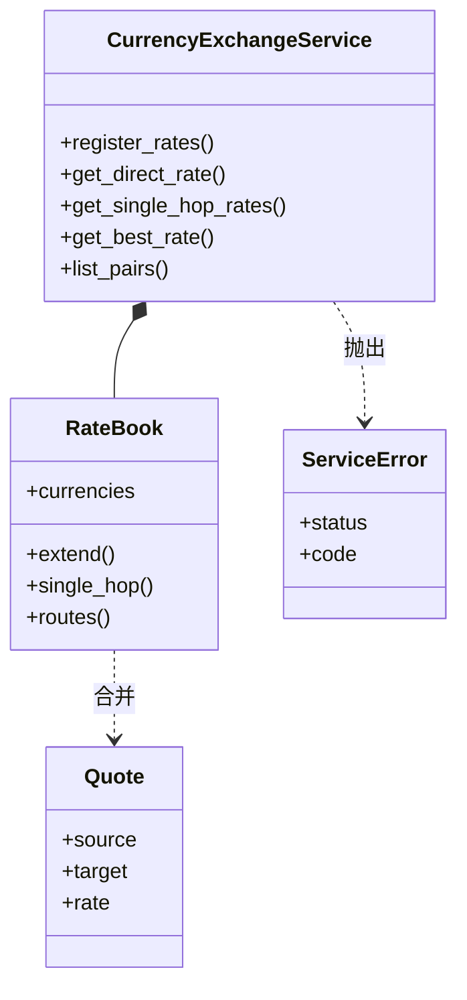
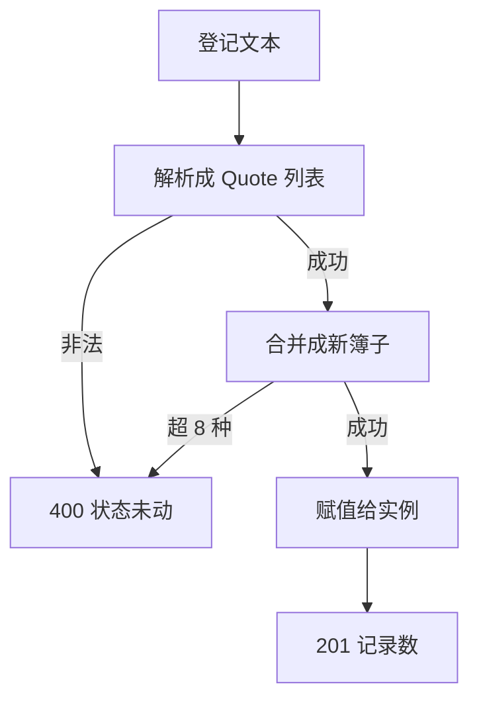

# 设计题解：汇率换算（Currency Conversion）

## 题目与澄清

一个支付服务收到一批有向汇率报价，格式是一段文本 `FROM:TO:RATE,FROM:TO:RATE,…`，意思是"1 单位 FROM 换 RATE 单位 TO"。服务有五个方法：`register_rates(文本)` 登记一批报价；`get_direct_rate(S, T)` 取直达汇率；`get_single_hop_rates(S, T)` 取直达加上经过恰好一种中转货币的全部汇率；`get_best_rate(S, T)` 在所有简单路径里取最优汇率和路径；`list_pairs(S=None)` 列出已登记的报价。成功返回 `(状态码, 字典或列表)`，失败抛 `ServiceError(状态码, 代码)`。这是一个从零实现的项目：模板里每个方法都是 `NotImplementedError`，一个已写好的 HTTP 适配器把这五个方法暴露出去。同一个服务实例上的调用按顺序执行，所以难点不在并发，而在三件事：输入的语法要严，浮点数的比较要有规矩，错误的先后要固定。

先把合同写成十四条，按"一个粗心的读者最容易漏掉"的顺序：

1. **登记只接受非空字符串**：`None`、数字、字节串、空串都是 `(400, "invalid_input")`。
2. **每条记录恰好三段**：空记录、空字段、多余的冒号、首尾逗号都非法；任何字段都不去空白、不改大小写。
3. **货币码是 3 到 5 个 ASCII 大写字母**，`FROM == TO` 的自报价非法。
4. **汇率字面量要整串匹配固定语法**：`1`、`1.`、`.5`、`+2.5e-1` 合法；空白、十六进制、下划线、Unicode 数字、`nan`、`inf` 非法。
5. **解析后的值要有限且落在 `[1e-12, 1e12]`，含两端**；边界看的是解析后的 binary64 值，不是字面量；不做货币舍入。
6. **累计图里的货币至多 8 种**，边的起点和终点都算；一批报价让它超限，这批非法。
7. **报价有方向**；同一有向对重复出现，后写的覆盖先写的，跨调用也一样。
8. **成功返回 `(201, {"registered_count": n})`**，`n` 是这次调用的记录数，重复的也算。
9. **整批原子**：任何一条非法或超限，整个调用什么都不改变，包括同批里更早的覆盖和新货币。
10. **查询的错误顺序**：先查两个码的格式（400），再查是否出现过（404 `currency_not_found`），最后才找路线（404 `route_not_found`）；只作过终点的货币也算出现过。
11. **两个码相同且出现过**：直达 `rate` 是 1，单次中转 `rates` 是 `[1]`，最优 `best_rate` 是 1、`path` 是 `[码]`。
12. **单次中转**：直达边加上每个 `S→M→T` 的两段乘积，相同数值都保留，升序。
13. **最优路线**：所有简单有向路径，乘积从 1 起从左到右连乘；与最大值 M 差不超过 1e-5 的合格，合格者里边数最少、再是货币序列字典序最小，返回被选路径自己的乘积。
14. **返回值是独立快照**，数字是 float 而不是布尔值或字符串，不带多余字段；不同实例互不共享状态。

两个数字例子是你的第一批测试。登记 `USD:EUR:0.9,EUR:CAD:1.5,USD:CAD:1.2` 得到 `(201, {"registered_count": 3})`；从 USD 到 CAD，直达是 `1.2`，单次中转是 `[1.2, 1.35]`，最优是 `1.35`、路径 `["USD", "EUR", "CAD"]`。另一个例子：先登记 `GBP:JPY:180`，再登记 `GBP:JPY:200,JPY:usd:2`，第二批因为 `usd` 不是大写而整批失败，GBP 到 JPY 仍是 180，JPY 到 GBP 是 `route_not_found`，因为没有登记反方向。

开口前值得问的澄清问题，每个答案都会改变代码：

- **汇率的字面量怎么判断合法？** 固定语法，整串匹配。这决定了你不能直接 `try: float(token)`：Python 的 `float()` 接受 `"1_0"`、`" 1 "`、`"nan"`、`"inf"` 和阿拉伯数字 `"١٢"`，全都不在语法里。
- **边界 `1e12` 含不含？** 含两端，而且看解析后的值：字面量 `1000000000000.00000001` 看上去比 1e12 大，但最近的 binary64 恰好就是 1e12，所以合法。
- **货币数超限，是拒绝整批还是只拒绝新增的那条？** 整批。同批更早的记录也不生效。
- **两个码相同但从没出现过呢？** 仍是 `currency_not_found`；"相同码返回 1"只对出现过的码成立。
- **一个码格式错、另一个码是未知货币，报哪个？** 400：格式永远先查。
- **最优路线的容差以什么为基准？** 全局最大值 M，不是已经选中的那条路径。
- **平局的字典序按什么比？** 按"货币码序列"逐个元素比较，不是把码拼成一个字符串再比：`["SRC", "ABC", "TTT"]` 小于 `["SRC", "ABCD", "TTT"]`，而拼接后的 `SRCABCTTT` 反而大于 `SRCABCDTTT`。
- **返回值能不能是不可变的？** 可以：可变副本和不可变结果都允许，只要调用方改不动内部状态。
- **要不要线程安全？** 合同说同一实例上的调用按顺序执行，所以不要求；但要能说清楚这个保证和线程安全的区别（见"扩展与追问"）。

## 需求与分级

这个项目没有隐藏的阶段，分关是实现的顺序：先让输入可信，再让查询可信，最后让选择可信。每一关都能单独运行测试。

**第 1 关（约 15 分钟，登记与直达）**：实现 `register_rates` 和 `get_direct_rate`。登记的陷阱集中在三处：汇率语法要用整串匹配（正则里的 `$` 会放过末尾的换行，`re.match(r"^[A-Z]{3,5}$", "ABC\n")` 返回匹配，`re.fullmatch` 不会）；`float()` 之后还要检查有限和区间；货币数在整批合并之后才能数。这一关就要把"整批原子"做对，否则后面每一关都建在会漏状态的地基上。

**第 2 关（约 15 分钟，单次中转与列表）**：实现 `get_single_hop_rates` 和 `list_pairs`，并把查询的错误顺序抽成一个共同的检查。单次中转要保留相同数值的重复项，所以结果是列表而不是集合；列表要按起点再按终点排序，过滤码走和查询相同的两层检查。示例：登记 `SSS:TTT:6,SSS:MMM:2,MMM:TTT:3,SSS:NNN:3,NNN:TTT:2,SSS:OOO:1,OOO:TTT:5`，从 SSS 到 TTT 的单次中转是 `[5.0, 6.0, 6.0, 6.0]`：直达的 6，加上经 MMM 的 6、经 NNN 的 6 和经 OOO 的 5。

**第 3 关（约 20 分钟，最优路线）**：实现 `get_best_rate`。这一关的缺陷来自浮点数：最大乘积、容差、边数、字典序四步各有一个出错的写法。示例：登记 `AAA:BBB:0.1,BBB:CCC:3,AAA:CCC:0.3`，两跳的乘积是 `0.1*3.0 = 0.30000000000000004`，比直达的 `0.3` 大 `5.55e-17`；不用容差、直接取最大值会选两跳，用容差则选直达。

**第 4 关（选做，约 15 分钟，书面回答）**：三个问题，各约一百字：坏批次与返回值怎样不留痕、顺序调用与并发安全的区别；简单路径怎样避开环、八种货币的成本、为什么返回的乘积有时比最大值小；面向更大的图或实时行情要改哪一处、语义怎样取舍。不要实现，只需要说清楚思路。

## 核心对象与职责

| 类型 | 单一职责 | 它拥有的不变量 |
|---|---|---|
| `ServiceError` | 对外的错误：状态码加稳定代码 | 代码是固定字符串，调用方只靠它分支 |
| `Quote` | 一条已验证的有向报价（冻结的数据类） | 码合法、起点不等于终点、汇率有限且在区间内 |
| `RateBook` | 不可变的汇率簿：存边、推出货币集合、枚举路线 | 货币至多 8 种；构造之后不再改变 |
| `CurrencyExchangeService` | 编排：解析、合并、赋值，以及查询的错误顺序 | 失败的调用不改变 `self._book`；成功的登记只赋值一次 |

文本解析（`parse_quotes`、`parse_quote`）和最优路线的选择（`best_path`）是模块级函数，不是类：它们没有状态，也不会有第二种实现。`CurrencyExchangeService` 组合一个 `RateBook`，簿子随服务生灭；`Quote` 是解析的产物，登记完就丢，不被保存。



一次登记的流程是先解析、再合并、最后赋值，前两步失败时服务的状态没有被碰过：



`RateBook` 里"出现过的货币"由边推出：起点和终点都算。这样做是为了不存第二份状态：如果另存一个货币集合，两份数据就有可能不同步，比如只作终点的货币漏登记。成本是每次查询都重新算一次集合，货币至多 8 种、边至多 56 条，这个成本可以忽略。

## 关键设计决策

### 决策一：怎样让登记整批原子

**问题**：一批报价里，第 37 条汇率写成了 `oops`；或者前 36 条合法，却让货币总数变成第 9 种。服务不能让调用方看到"前 36 条已经生效"。

**选项 A：就地修改，出错时回滚。** 边写边改字典，同时记下旧值，出错时按记录恢复：

```python
undo = []
try:
    for quote in quotes:
        undo.append(((quote.source, quote.target), self._rates.get((quote.source, quote.target))))
        self._rates[(quote.source, quote.target)] = quote.rate
    check_currency_limit(self._rates)
except ServiceError:
    for key, old in reversed(undo):
        ...  # 旧值是 None 就删除，否则写回
    raise
```

每个能失败的步骤都要想一遍"回滚得对不对"，而且回滚本身出错就没有后路了。

**选项 B：先拷贝字典，改拷贝，再换掉。** 比 A 简单，但"拷贝、校验、赋值"三步散在服务方法里，下一个人在中间插一行读旧状态的代码，原子性就悄悄丢了。

**选项 C：状态是不可变值，`extend` 返回新值。** `RateBook.extend` 把旧簿子的边拷贝一份、合并报价、构造新簿子；构造函数检查货币数，超限直接抛错。服务只在 `extend` 成功返回之后才做那一次赋值：

```python
quotes = parse_quotes(rates_stream)
self._book = self._book.extend(quotes)
```

**选择 C。** 原子性变成了一个结构上的事实：只有一处写入，写入之前的所有失败都发生在旧簿子之外。不需要回滚代码，也就没有回滚的缺陷。成本是每次登记拷贝一次字典，最多 56 条边，可以忽略。**模式**：不可变值对象（Value Object）加"构造即校验"；不需要事务、备忘录（Memento）或命令（Command）模式，这些都是为"必须撤销"准备的，而这里只需要"没有发生"。

### 决策二：怎样解析汇率文本

**问题**：语法是固定的，Python 的 `float()` 却更宽松。如果直接 `float(token)`，下面这些都会被放过：

```python
>>> [float(t) for t in ("1_0", " 1 ", "nan", "inf", "١٢")]
[10.0, 1.0, nan, inf, 12.0]
```

**选项 A：`try: float(token) except ValueError`，再检查区间。** 代码最短，但 `1_0`、空白和 Unicode 数字都合法了；`nan` 与 `inf` 虽然会被后面的有限性检查挡住，但那三种挡不住。

**选项 B：自己写字符级状态机识别语法。** 正确，但行数多，正则本来就是做这件事的。

**选项 C：先用一个正则整串匹配语法，再把匹配到的字符串交给 `float()`。**

```python
_RATE = re.compile(r"[+-]?(?:[0-9]+(?:\.[0-9]*)?|\.[0-9]+)(?:[eE][+-]?[0-9]+)?")
if _RATE.fullmatch(token) is None:
    raise _invalid()
rate = float(token)
if not (math.isfinite(rate) and RATE_MIN <= rate <= RATE_MAX):
    raise _invalid()
```

**选择 C。** 语法保证 `float()` 不会抛错，也保证了它只看到 ASCII 数字；`float()` 负责"最近的 binary64"，这是它的强项。`fullmatch` 而不是 `match` 加 `$`：`$` 会放过末尾的换行。区间检查在解析之后，因为 `1e999` 的字面量合法、解析结果是 `inf`，`1e-999` 解析成 `0.0`，都要被区间挡住。对 3 到 5 位大写码同理，`_CODE.fullmatch`。**模式**：先校验形状、再转换（Parse, don't validate 的前半句）；不需要解析器类，一条正则加一个函数就够了。

### 决策三：最优路线怎样选，容差的基准是什么

**问题**：乘积是浮点数，路径越长，舍入误差越多；两条数学上相等的路径，浮点结果可能差一个末位。题目要的是"与最大值差不超过 1e-5 的路径里，边数最少，再字典序最小"。

**选项 A：精确比较，取乘积最大的。** `0.1*3.0` 比 `0.3` 大 5.55e-17，于是长路线赢了直达，而用户看到的汇率其实是同一个。

**选项 B：以已选路径为基准，往下传递。** 先按乘积降序排，依次看"与上一条合格路径的差是否在容差内"。结果：M = 2.0，共三条路线，乘积分别是 `2.0`（三条边）、`1.999991`（两条边）、`1.999982`（一条边），相邻两条的差都是 9e-6，链式比较会一路选到一条边的路径；但它和 M 的差是 1.8e-5，超出了容差。

**选项 C：先取全局最大值 M，所有路径都和 M 比。**

```python
top = max(product for _, product in found)
eligible = [(p, v) for p, v in found if top - v <= TOLERANCE]
return min(eligible, key=lambda item: (len(item[0]), item[0]))
```

**选择 C。** 合格集合只取决于 M 和每条路径自己的乘积，和遍历顺序无关，所以结果是确定的。具体数字：上面那组报价，选中的是两条边的 `["AAA", "DDD", "TTT"]`，返回的是它自己的乘积 `1.999991`，比 M = 2.0 小 9e-6。返回 M 是错的：M 属于另一条路径。键 `(len(path), path)` 一次完成"边数少优先、再字典序"，列表比较是逐个元素比，正好是"货币码序列"的字典序。**模式**：一个排序键加一次 `min`，不是策略模式——选择规则只有一种，没有要替换的算法。

### 决策四：路线怎么找，要不要引入图算法

**问题**：要的是"所有简单路径里的最优"，且要按容差内的所有路径选边数和字典序。

**选项 A：Bellman-Ford 或 Dijkstra，把乘积取对数变成加法。** 它们求的是一个最优值，不枚举路径，没法做"容差内再比边数"；更要命的是汇率图里常有套利环（A→B→A 乘积大于 1），最长路径问题在有环时没有最优解，必须限制成简单路径，这又回到枚举；取对数还会改变浮点结果，输出和连乘有末位的差别（`0.1*3.0*0.7` 是 `0.21000000000000002`，`exp(log 0.1 + log 3 + log 0.7)` 是 `0.21000000000000005`）。

**选项 B：递归深度优先，枚举所有简单路径。**

```python
def walk(path, product):
    here = path[-1]
    if here == target:
        yield list(path), product
        return
    for nxt, rate in self._out.get(here, {}).items():
        if nxt not in path:
            path.append(nxt)
            yield from walk(path, product * rate)
            path.pop()
```

**选择 B，因为规模被合同钉死了。** 货币至多 8 种，从 A 到 H 的简单路径在完全图里一共 1957 条（`Σ 6!/(6-k)!`，k 从 0 到 6）；在这台机器上，枚举加选择约 1 毫秒。这个成本是阶乘增长的：9 种货币 13700 条，10 种 109601 条，12 种 9864101 条。所以上限 8 是设计的一部分，不是随手写的数字，放宽它之前要先换算法。

两个细节：一，"走到 T 就停"其实由"路径里已有的货币不再进入"推出——一条路径经过 T 之后再回到 T 是不允许的，所以不停也枚举不出新路径，`return` 只是省下无用的递归；二，乘积从 `1.0` 开始、每走一条边乘一次，顺序固定为从左到右，这就是合同要求的浮点计算顺序。**模式**：递归生成器。不引入 `Graph` 类层次或路径搜索策略：只有一种搜索，一个方法就够了。

### 决策五：返回值怎样与内部状态隔离

**问题**：调用方拿到 `{"rates": [...]}` 后可能改它；也可能先拿着旧结果，之后又有新的登记进来。

**选项 A：返回内部对象，靠约定"别改"。** 调用方改了 `rates` 列表，下次查询就是错的。

**选项 B：每次 `copy.deepcopy` 内部结构。** 正确，但内部存的本来就是不可变的浮点数和字符串，深拷贝是无谓的成本。

**选项 C：每次查询现算一个新的字典和列表。** 列表里是浮点数（不可变），所以"新容器"就是完整的隔离：

```python
return 200, {"from": s, "to": t, "rates": self._book.single_hop(s, t)}
```

`single_hop` 每次新建列表，`routes` 每次 `list(path)` 复制路径；`list_pairs` 每次从排序后的元组新建字典。

**选择 C。** 不可变的底层加上"每次新建容器"，隔离是自然得到的，不需要拷贝工具。之后的登记不会改变已拿到的结果，因为登记换掉的是整个 `RateBook`，不是改旧簿子里的列表。

## 代码走读

下面是完整的参考解答（Python 3.11，只用标准库）。

%% code:begin solution.py %%
```python
"""汇率换算服务：批量报价整批登记，三种路线查询。

设计（五行）：
1. `parse_quotes` 把整段文本先解析成 `Quote` 列表；任何一条不合法就抛 400，此时服务的状态还没被碰过。
2. `RateBook` 是不可变的汇率簿：`extend` 返回一本新簿子，登记 = 解析成功、合并成功之后一次赋值。
3. 返回值每次都新建字典和列表（浮点数本身不可变），调用方改返回值碰不到内部状态。
4. 路线用递归深度优先枚举所有简单路径（货币至多 8 种，最多 1957 条），只在 `best_path` 里选一条。
5. 错误优先级固定：先格式（400），再货币是否出现过（404 currency_not_found），最后有没有路（404 route_not_found）。
"""

from __future__ import annotations

import math
import re
from collections.abc import Iterator, Mapping
from dataclasses import dataclass

MAX_CURRENCIES = 8
RATE_MIN, RATE_MAX = 1e-12, 1e12
TOLERANCE = 1e-5  # 最优路线的绝对容差：以全局最大乘积为基准

_CODE = re.compile(r"[A-Z]{3,5}")  # fullmatch：`$` 会放过末尾的换行，fullmatch 不会
_RATE = re.compile(r"[+-]?(?:[0-9]+(?:\.[0-9]*)?|\.[0-9]+)(?:[eE][+-]?[0-9]+)?")


class ServiceError(Exception):
    """对外的错误：status 是 HTTP 状态码，code 是稳定的字符串。"""

    def __init__(self, status: int, code: str) -> None:
        self.status, self.code = status, code
        super().__init__(code)


def _invalid() -> ServiceError:
    return ServiceError(400, "invalid_input")


@dataclass(frozen=True, slots=True)
class Quote:
    """一条有向报价：1 单位 source 换 rate 单位 target。"""

    source: str
    target: str
    rate: float


def is_code(value: object) -> bool:
    return isinstance(value, str) and _CODE.fullmatch(value) is not None


def parse_quote(record: str) -> Quote:
    """一条记录恰好三段；货币 3–5 位大写；汇率按语法匹配后再看解析出的 binary64 值。"""
    parts = record.split(":")
    if len(parts) != 3:
        raise _invalid()
    source, target, token = parts
    if not (is_code(source) and is_code(target)) or source == target:
        raise _invalid()
    if _RATE.fullmatch(token) is None:
        raise _invalid()
    rate = float(token)  # 最近的 binary64；语法已保证不会抛错
    if not (math.isfinite(rate) and RATE_MIN <= rate <= RATE_MAX):
        raise _invalid()
    return Quote(source, target, rate)


def parse_quotes(stream: object) -> list[Quote]:
    """整段先解析完：空串、空记录、非字符串都是 400。这一步不碰任何服务状态。"""
    if not isinstance(stream, str) or stream == "":
        raise _invalid()
    return [parse_quote(record) for record in stream.split(",")]


class RateBook:
    """不可变的汇率簿。不变量：边的端点至多 MAX_CURRENCIES 种；构造之后不再改变。"""

    def __init__(self, rates: Mapping[tuple[str, str], float] | None = None) -> None:
        self._rates = dict(rates or {})
        self._out: dict[str, dict[str, float]] = {}
        for (source, target), rate in self._rates.items():
            self._out.setdefault(source, {})[target] = rate
        if len(self.currencies) > MAX_CURRENCIES:
            raise _invalid()

    @property
    def currencies(self) -> frozenset[str]:
        """出现过的货币：边的起点和终点都算（只作终点的也算）。"""
        return frozenset(c for pair in self._rates for c in pair)

    def extend(self, quotes: list[Quote]) -> RateBook:
        """合并一批报价，返回新簿子；后面的同向报价覆盖前面的。原簿子不变，所以失败时无需回滚。"""
        merged = dict(self._rates)
        for quote in quotes:
            merged[(quote.source, quote.target)] = quote.rate
        return RateBook(merged)

    def rate(self, source: str, target: str) -> float | None:
        return self._rates.get((source, target))

    def pairs(self, source: str | None = None) -> list[tuple[str, str, float]]:
        """按起点、再按终点排序的所有报价。"""
        return sorted((s, t, r) for (s, t), r in self._rates.items() if source in (None, s))

    def single_hop(self, source: str, target: str) -> list[float]:
        """直达报价，加上每个中转货币 M（M 不是 source 也不是 target）的两段乘积；升序，重复值保留。"""
        rates = []
        direct = self.rate(source, target)
        if direct is not None:
            rates.append(direct)
        for middle, first in self._out.get(source, {}).items():
            second = self.rate(middle, target)
            if second is not None:  # 自报价在登记时就被拒绝，所以 middle 不可能等于 source 或 target
                rates.append(first * second)
        return sorted(rates)

    def routes(self, source: str, target: str) -> Iterator[tuple[list[str], float]]:
        """递归枚举 source 到 target 的所有简单有向路径及其乘积；走到 target 就停，不穿过它。"""

        def walk(path: list[str], product: float) -> Iterator[tuple[list[str], float]]:
            here = path[-1]
            if here == target:
                yield list(path), product
                return
            for nxt, rate in self._out.get(here, {}).items():
                if nxt not in path:  # 简单路径：每种货币至多出现一次，环就走不起来
                    path.append(nxt)
                    yield from walk(path, product * rate)  # 从 1 开始，从左到右连乘
                    path.pop()

        yield from walk([source], 1.0)


def best_path(routes: Iterator[tuple[list[str], float]]) -> tuple[list[str], float] | None:
    """先找全局最大乘积 M；乘积与 M 的差不超过容差的都算合格；合格里选边数最少，再选字典序最小。"""
    found = list(routes)
    if not found:
        return None
    top = max(product for _, product in found)
    eligible = [(path, product) for path, product in found if top - product <= TOLERANCE]
    return min(eligible, key=lambda item: (len(item[0]), item[0]))


class CurrencyExchangeService:
    def __init__(self) -> None:
        self._book = RateBook()

    def register_rates(self, rates_stream: str) -> tuple[int, dict]:
        quotes = parse_quotes(rates_stream)
        self._book = self._book.extend(quotes)  # 解析与合并都成功之后，唯一的一次写入
        return 201, {"registered_count": len(quotes)}

    def _known_pair(self, source: object, target: object) -> None:
        """错误优先级的前两层：两个码的格式都先查，再查有没有出现过。"""
        if not (is_code(source) and is_code(target)):
            raise _invalid()
        known = self._book.currencies
        if source not in known or target not in known:
            raise ServiceError(404, "currency_not_found")

    def get_direct_rate(self, from_currency: str, to_currency: str) -> tuple[int, dict]:
        self._known_pair(from_currency, to_currency)
        rate = 1.0 if from_currency == to_currency else self._book.rate(from_currency, to_currency)
        if rate is None:
            raise ServiceError(404, "route_not_found")
        return 200, {"from": from_currency, "to": to_currency, "rate": rate}

    def get_single_hop_rates(self, from_currency: str, to_currency: str) -> tuple[int, dict]:
        self._known_pair(from_currency, to_currency)
        if from_currency == to_currency:
            rates = [1.0]
        else:
            rates = self._book.single_hop(from_currency, to_currency)
        if not rates:
            raise ServiceError(404, "route_not_found")
        return 200, {"from": from_currency, "to": to_currency, "rates": rates}

    def get_best_rate(self, from_currency: str, to_currency: str) -> tuple[int, dict]:
        self._known_pair(from_currency, to_currency)
        if from_currency == to_currency:
            path, rate = [from_currency], 1.0
        else:
            best = best_path(self._book.routes(from_currency, to_currency))
            if best is None:
                raise ServiceError(404, "route_not_found")
            path, rate = best
        return 200, {"from": from_currency, "to": to_currency, "best_rate": rate, "path": path}

    def list_pairs(self, from_currency: str | None = None) -> tuple[int, list[dict]]:
        if from_currency is not None:
            if not is_code(from_currency):
                raise _invalid()
            if from_currency not in self._book.currencies:
                raise ServiceError(404, "currency_not_found")
        rows = self._book.pairs(from_currency)
        return 200, [{"from_currency": s, "to_currency": t, "rate": r} for s, t, r in rows]


if __name__ == "__main__":
    service = CurrencyExchangeService()
    service.register_rates("USD:EUR:0.9,EUR:CAD:1.5,USD:CAD:1.2")
    print(service.get_single_hop_rates("USD", "CAD"))
    print(service.get_best_rate("USD", "CAD"))
```
%% code:end %%

三处值得停下来看的地方：

**一、登记只有一个写入点。** `register_rates` 的第二行 `self._book = self._book.extend(quotes)` 是整个类里唯一给 `_book` 赋值的地方。`parse_quotes` 在它之前，任何一条记录非法都抛出，服务状态没有被碰过；`extend` 在构造新 `RateBook` 时检查货币数，超限也抛出，而赋值还没有发生。要验证原子性，只要看这一行：它的左边是旧状态，右边是已经完成的新状态。

**二、错误顺序集中在 `_known_pair`。** 三个查询方法的第一行都是它：先查两个码的格式，再查是否出现过。把它写成一处，错误优先级只在一处定义：以后有人新增查询，不会各自再排一遍。`route_not_found` 留给各方法自己，因为"没有路"的含义每个方法不同（没有直达边、没有直达也没有一次中转、没有任何简单路径）。

**三、最优路线是生成器加一次选择。** `routes` 一条一条地产出路径和乘积，`best_path` 把它们收成列表后做三件事：求 M、过滤合格者、取键最小的。两步分开，选择规则可以脱离图单独测试：给它一个手写的 `(路径, 乘积)` 列表就能测容差和平局。

## 测试与自检

测试按合同分组，每条规则至少有一个测试，边界两侧各一个：

- **登记语法**：28 个非法流（类型、空记录、段数、空白、大小写、长度、自报价）和 39 个汇率字面量（合法与非法各一组，含 `1_0`、`nan`、Unicode 数字）；汇率区间两端含在内，`1e-13` 和比 1e12 大 0.1 的字面量在外；字面量比 1e12 多出一个远小于最小间隔的尾数时，解析结果恰好是 1e12，合法。
- **原子性**：坏批次之后列表整体不变；同批更早的覆盖和新货币不会漏进去；第 9 种货币让整批失败；失败之后查询仍然可用。
- **错误优先级**：格式错先于未知，未知先于无路线；空服务；相同码；只作终点的货币。
- **单次中转**：重复值保留、升序、不含更长路线、没有直达边也能有结果。
- **最优路线**：环不会被走；经过 T 的路线不存在；乘积大的赢过边数少的；容差内选边数少的并返回自己的乘积；容差外保持最大值；差恰好等于 1e-5（`2e-5 - 1e-5 == 1e-5` 在浮点里成立）仍合格；基准是 M 而不是已选路径；字典序按码序列；乘积从左到右连乘；七条边、每条边取区间两端时结果仍有限且非零。
- **对照实现**：另用"对所有中间货币的所有排列穷举"写一个最优路线的参照，在十二个固定种子的随机图和一张八种货币的完全图上，比较路径与乘积，同时比较单次中转的列表。
- **快照与隔离**：清空所有返回值之后再查，结果不变；之后的登记不改变已拿到的结果；不同实例互不影响。

两分钟演示：登记 `USD:EUR:0.9,EUR:CAD:1.5,USD:CAD:1.2`，依次调用三个查询，得到 `1.2`、`[1.2, 1.35]`、`1.35` 加路径；再提交一批含 `usd` 的坏批次，说明旧汇率还在；最后登记 `AAA:BBB:0.1,BBB:CCC:3,AAA:CCC:0.3`，讲"为什么选直达"。

自检一个技巧：每条测试都问"如果实现错了，哪一行会失败"。可以故意改坏实现：把 `<=` 改成 `<`、把 `fullmatch` 改成 `match`、让容差追着已选路径走、让登记边写边改，每一种都应该有至少一个测试变红。

## 扩展与追问

**新需求**

- **加一个反向自动登记选项**：只改 `register_rates` 里把一条 `Quote` 展开成两条的一行；`RateBook` 不动。
- **报价带时间、过期失效**：`Quote` 增加一个时间字段，`RateBook` 的边值变成 `(汇率, 时间)`；`routes` 的乘积不变，只是读边的地方过滤掉过期的。
- **放宽 8 种货币上限**：先换最优路线算法。枚举是阶乘增长（10 种就是 10 万条路径），可以限制最大跳数、用分支限界（当前乘积乘以剩余最大汇率仍小于已知最优就剪枝），或者放弃"容差内选边数"的合同、改成近似。

**并发与线程安全**

合同说同一实例上的调用按顺序执行，所以"整批原子"只是"出错不留痕"，不是"并发安全"。两者的区别可以用两个线程说清：线程 A 和线程 B 各自读到同一本旧簿子，各自合并出新簿子，后赋值的那个覆盖了先赋值的，另一批报价就丢了。在这个实现上让两个线程在合并之后、赋值之前相遇，最后列表里只剩一批：`[{'from_currency': 'AAA', 'to_currency': 'BBB', 'rate': 2.0}]`，`CCC:DDD:3` 没了。解法是一把锁包住"读旧簿子、合并、赋值"三步（复合操作，Compound Action）；只给赋值加锁没有用，因为问题出在"读"和"写"之间。读者那边不需要锁：簿子不可变，读者只要取一次 `self._book` 引用，就读到一本一致的簿子（用一个写线程连续登记两千次、一个读线程反复检查两条边是否同批，没有出现过不一致）。

**持久化与规模**

- **换成数据库**：报价表的主键是（起点, 终点），登记是一个事务，货币数的检查放进事务里；`routes` 变成递归查询，或者把活跃的簿子缓存在内存里、用版本号失效。
- **实时行情**：给簿子加版本号，查询读某个版本的快照；最优路线的结果按版本缓存。语义上要重新约定：一次查询看到的是登记时的快照，还是最新价？跨版本的路线不应该混用。
- **更大的图**：不再枚举所有简单路径，改成带剪枝的搜索或预计算每对货币的最优值；代价是"容差内选边数、再字典序"这条合同要重新讨论，因为预计算只保留一个最优，保不住容差内的平局信息；套利环也要决定是拒绝、忽略还是报警。

## 常见错误

- **直接 `float(token)`**：放过下划线、空白、`nan`、`inf` 和 Unicode 数字；`float` 是转换工具，不是语法检查。
- **用 `re.match` 加 `$`**：`$` 让末尾的换行也能通过；用 `fullmatch`。
- **只检查字面量不检查解析后的值**：`1e999` 的字面量合法，解析结果是无穷。
- **边写边改再回滚**：回滚本身也会出错；先算出新状态，再一次赋值。
- **只检查"新加的"货币是否超过 8**：同批里有重复对、覆盖旧对时会算错；在合并之后数边的端点。
- **货币集合单独存**：和边不同步，只作终点的货币漏登记。
- **错误顺序写反**：先查未知货币再查格式，或者"同一个码出现两次就返回 1"跳过了出现过的检查。
- **单次中转用集合**：相同数值的两条路径被合并成一个；用列表，排序时保留重复。
- **容差追着已选路径走**：基准必须是全局最大值。
- **返回 M**：返回的是被选路径自己的乘积，可能略小。
- **把码拼成字符串再比字典序**：`ABC` 与 `ABCD` 的序在拼接前后相反。
- **用对数加最短路**：处理不了套利环，浮点结果也和连乘不同。
- **返回内部列表**：调用方改了它，服务的下一次查询就错了；每次新建。
- **让编程智能体"把测试改成通过"**：先判断是代码错还是测试错；容差、平局这类语义自己定。

## 45 分钟怎么分配

- **0 到 5 分钟｜读规则、问澄清问题**：把十四条规则写成注释，圈出四个会影响代码的决定：汇率语法、区间含不含两端、容差基准、平局怎么比。给智能体的第一句话也是这份清单，加上 `USD→CAD` 的三个数字。
- **5 到 15 分钟｜登记与直达**：先写测试（坏批次后旧汇率还在、第 9 种货币、`usd` 小写、`1e-13`），再让智能体实现；解析顺序（语法、转换、区间）自己定。
- **15 到 25 分钟｜单次中转、列表、错误顺序**：先写"格式错先于未知"和"相同码"的测试；返回值每次新建。
- **25 到 38 分钟｜最优路线**：先写 `0.1*3.0` 的例子、容差内选边数、基准是 M、字典序四个测试，再实现递归枚举。选择规则写成独立函数。
- **38 到 42 分钟｜回归**：运行公开测试和自己的全部测试；让智能体另写一个排列穷举的对照实现，在随机图上比较。
- **42 到 45 分钟｜书面回答**：三个问题各约一百字：坏批次不留痕与返回快照，说清它们和线程安全的区别；简单路径、八种货币的 1957 条、容差以 M 为基准；规模变大时改什么、语义取舍什么。

时间不够时的取舍：先砍书面回答的展开，再砍最优路线的对照实现；绝不能砍的是整批原子、错误顺序、容差以 M 为基准、返回被选路径自己的乘积。

## 延伸阅读

- [[solution-lcp-password-reset]]：同样是"失败不留痕、先检查后写"的项目，那里靠写入顺序，这里靠不可变值加一次赋值。
- [[solution-lcp-parcel-return-policy]]：严格输入语法的另一个例子：扁平 JSON 子集、64 位整数不溢出。
- [[solution-lcp-rate-limiter]]：同样处理浮点与比较边界；那里的状态要加锁，这里的合同不要求。
- 边界校验（Validate at the Boundary）、不变量与封装（Invariants）：先校验形状、构造时拒绝非法状态。
- 防御性拷贝（Defensive Copying）、值对象与不可变性（Value Objects）：返回快照与不可变簿子。
- 时间与数字（Time & Numbers）：浮点比较与容差。
- 复合操作（Compound Actions）：读—合并—赋值为什么要一起加锁。
- [Python 文档：浮点算术的问题与限制](https://docs.python.org/3/tutorial/floatingpoint.html)：为什么 `0.1*3.0` 不等于 `0.3`。
- [Python 文档：re.fullmatch](https://docs.python.org/3/library/re.html#re.fullmatch)：整串匹配与 `$` 的区别。
- [Python 文档：float](https://docs.python.org/3/library/functions.html#float)：`float()` 接受的字符串语法。
- [Python 文档：math.isclose](https://docs.python.org/3/library/math.html#math.isclose)：相对与绝对容差。
