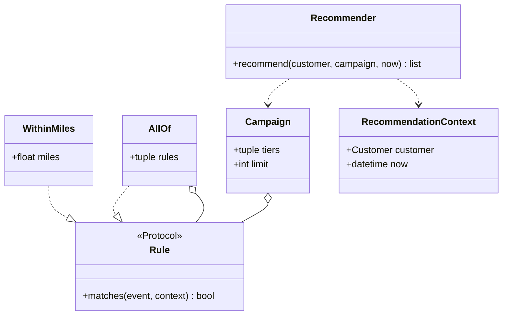

# 设计题解：活动推荐规则修复（Event Campaigns）

## 题目与澄清

一个票务市场（SeatScout）给客户发推荐活动，名字像「离你近」「这个周末」「五十美元以下」。一个活动（campaign）不是代码，而是一张**分级列表**：每一级是一条规则，规则由小规则拼成，运营人员改配置就能新建活动，不用碰推荐器。
分析发现客户最爱的是：一百英里以内、票价低于五十美元、这个周末或接下来三十天的演出；而且"至少推荐几场"的活动比"空手而归"的活动效果好。规则重写之后，线上出了五个现象：

1. 客户明明分享了精确位置，推荐的却是他家所在城市附近的演出。
2. 「这个周末」从来不出现周日的演出。
3. 「五十美元以下」把便宜票已经卖光的演出推了出来。
4. 一个活动同时发给很多客户时，后面的客户拿到前面客户附近的演出。
5. 有些客户一场推荐都没有，尽管有演出还有票。

你要修的是 `campaigns.py` 里的规则和 `Recommender.recommend`，数据类型（`Customer`、`Event`、`Listing`、`LocationService`、`Campaign` 等）是固定的。开口之前，先把合同用自己的话写成十一条，每一条都有测试在等：

1. **出发点**：客户的 `location` 有值就用它；没有就取 `home_city` 的坐标（位置服务必须认识这个城市）；两者都没有就是"没有出发点"。
2. **`within_miles(m)`**：有出发点、演出城市有坐标，并且距离**小于等于** m 才匹配；缺任何一样都是"不匹配"，不抛异常。
3. **`in_metro_area()`**：演出在客户家所在城市，或在与它**直接相邻**的城市；邻接是双向的、不传递的；客户没有 `home_city` 时谁也不匹配。它只看 `home_city`，不看 `location`。
4. **`within_days(d)`**：开始时间落在 `[now, now + d×24 小时]`，两端都含，已经开始的不算。
5. **`this_weekend()`**：开始时间不早于 `now`，并且落在 `[周六 00:00, 下周一 00:00)`；周六、周日指正在过的这个周末，周一到周五指即将到来的那个。一周从周一到周日。
6. **`price_under(c)`**：存在**一张**票，数量大于 0 并且价格严格小于 c。
7. **`all_of` / `any_of`**：全部匹配 / 任一匹配；没有规则时前者匹配一切，后者什么都不匹配；可以嵌套到任意深度，也要能装下"别处写的、带 `matches(event, context)` 的任何对象"。
8. **规则无状态**：一条规则的答案只取决于它收到的 `event` 和 `context`；同一个规则对象可以服务很多客户、很多活动、很多次调用。
9. **可推荐活动**：开始时间不早于 `now`，并且至少有一张数量大于 0 的票；按 `(开始时间, id)` 排序。
10. **逐级尝试**：第一个至少匹配一场可推荐活动的级别给出结果——它的匹配项，保持顺序，最多 `limit` 个；后面的级别不再看。先匹配，后截断。
11. **兜底**：没有任何级别命中时，**对每一位客户**都返回可推荐活动的前 `limit` 个；只有可推荐活动为空时，结果才为空。

开口前值得问的澄清问题，每一个都会改变代码：

- **时间是什么时区？** 答案是全部带时区的 UTC，所以"周几""零点"都按 UTC 算，不需要时区换算；但规则不能偷偷调用 `datetime.now()`，"现在"由调用方传入（`context.now`）。这是周末规则可以被测试的前提：测试把"现在"拨到周一、周六、周日，逐一验证。
- **周末在周日夜里算哪一个？** 周一为一周之首，所以周六日属于**当前**这一周；周日 23:59:59 的"这个周末"仍然是正在过的这个。下一秒（周一 00:00）起才指下一个。
- **"没有出发点"和"距离为 0"是一回事吗？** 不是。缺位置信息是"不知道"，不能当成"就在你脚下"。这一条是现象四、五里最隐蔽的缺陷来源之一。
- **规则能不能缓存距离？** 可以优化，但缓存的键必须包含"是谁在问"。更稳妥的做法是不在规则里放缓存，需要时放在一次 `recommend` 调用的范围里（决策一）。
- **`limit` 小于 1 或没有任何级别怎么办？** 合同保证不会发生（每个活动至少一级，`limit` 至少为 1），所以不为它加分支。

范围之外：真实的推荐排序（按相关性打分）、分页、个性化学习、多时区客户。

## 需求与分级

**第 1 关（约 15 分钟）：把五个现象各对到一处缺陷。** 读修复前的代码，不要急着改。逐条把现象对到代码里的位置，这一步就是调试里"假设驱动"：

| 现象 | 缺陷所在 | 为什么会这样 |
|---|---|---|
| 分享了位置却按家推荐 | 出发点函数先看家所在城市 | 优先级写反了 |
| 周日永远没有 | 周末窗口的终点只比周六晚一天，且是闭区间 | 周日 00:00 就已经结束了 |
| 售罄的便宜票被推荐 | 价格规则用 `<=`，且不看数量 | 两个条件都丢了一半 |
| 后面的客户拿到前面客户的演出 | 距离规则在自己身上记了"按演出算好的距离" | 有状态的规则被共用 |
| 有些客户一场都没有 | 先截断再匹配；兜底只给没有 `home_city` 的客户 | 顺序错了，兜底条件错了 |

**第 2 关（约 15 分钟）：规则逐条符合定义。** 位置规则（出发点优先级、缺失即不匹配、含边界），时间规则（两个窗口），价格规则，两个组合子（修复前的 `all_of` 只看最后一条规则的结果）。这一关的主要产出是边界测试：恰好等于、差一微秒、差一秒。

**第 3 关（约 10 分钟）：推荐器。** 可推荐集合、排序、先匹配后截断、第一个命中的级别、兜底。示例：用同一个活动同时发给住西雅图的 Pat 和人在斯波坎的 Sam，两人的结果不同，且交换顺序结果不变。

**第 4 关（选做，约 5 分钟）：复用与扩展。** 让一条别处写的规则放进组合子；用多个线程共用同一个推荐器和同一个活动；再把三个书面问题答完（怎么不改推荐器就加新规则、怎么试验未验证的信号、兜底怎么保证又怎么看得见）。

一个很容易拿来验收的例子——Pat 住西雅图，一场贝尔维尤周日 20:00 的演出，2026-11-05（周四）09:00 发出，活动是「周末那一级、再加 14 天内那一级」——**在修复前的代码上也返回 `["c1"]`**：周末那一级因为终点错了不命中，第二级 `within_days(14)` 里的 `all_of` 只看最后一条规则，碰巧通过。一个例子通过不能证明代码正确，这是第一课。

## 核心对象与职责

| 类 | 单一职责 | 它拥有的不变量 |
|---|---|---|
| `WithinMiles`、`InMetroArea`、`PriceUnder`、`ThisWeekend`、`WithinDays` | 各自回答"这场演出对这位客户算不算" | 冻结的数据类，只带构造参数；答案只来自 `matches` 的两个参数 |
| `AllOf`、`AnyOf` | 把若干规则合成一条 | 持有规则的元组；"全部"与"任一"的空集语义不同（空 `AllOf` 为真，空 `AnyOf` 为假） |
| `RecommendationContext` | 一次推荐里"谁在问、现在几点、查哪张表" | 冻结；规则要的一切易变输入都从这里来 |
| `Campaign` | 一张分级列表加 `limit` | 级别按顺序尝试；`tiers` 在构造时转成元组 |
| `Recommender` | 持有演出，按活动与客户产出 id 列表 | 演出在构造时排好序；每次调用只读，不留痕 |

规则与推荐器之间唯一的契约是 `matches(event, context) -> bool`。`Rule` 是一个只有一个方法的 `typing.Protocol`：别处写的规则（例如"来自客户家乡的艺人"）不需要继承任何东西。



`AllOf` 里装的是 `Rule`，而它自己也是 `Rule`，这就是组合（Composite）：叶子和组合体对外是同一种东西，所以嵌套深度没有上限。`Recommender` 只认 `Campaign.tiers` 里的 `Rule`，完全不知道有哪些具体规则，这就是"加规则不改推荐器"的全部原因。
相关的知识树入口：[[patterns.structural|结构型模式（Structural）]]、[[oop.values|值对象与不可变性（Value Objects）]]、时间与数字（Time & Numbers）。同构的经典题是 [[solution-amz-discount-engine]]（可叠加的折扣规则）与知识树里的规则引擎题（Rule Engine）。

## 关键设计决策

### 决策一：规则不存任何东西，需要记忆就放在一次调用的范围里

**问题**：现象四（后面的客户拿到前面客户的演出）是怎么来的？

修复前的 `within_miles` 在自己身上放了一个字典：键是演出 id，值是第一次算出的"在不在半径内"。第一位客户（住西雅图）来问塔科马的演出，约 25 英里，字典里记下"在"；第二位客户（人在斯波坎）来问同一场演出，字典里已经有这个键，直接返回"在"——不管他离塔科马其实有两百多英里。更糟的是，缺少位置信息时它先把距离记成 `0.0`，"0 英里"小于任何半径，结论就成了"在"；这个结论又被记下来，之后有位置的客户也被当成"就在演出地"。
同一个规则对象被所有客户、所有活动共用（合同第 8 条），所以**规则身上的任何可变状态都是共享状态**。

可选的做法有三个：

- **规则里带缓存，键换成 `(客户 id, 演出城市)`**：能修好，但缓存无上限地增长；而且客户换了位置（`location` 变了，`id` 没变）就会命中旧值。缓存的失效条件落在规则之外，规则自己说不清。
- **全局 `functools.lru_cache`**：同样的失效问题，加上多个推荐器实例之间互相串。
- **规则只带构造参数，需要缓存就放在一次 `recommend` 的范围里**：一次调用里"同一位客户、同一个出发点"是固定的，在这个范围内按演出城市记距离是安全的，调用结束就丢。

选第三种，并且在这个规模下连它也不做：一次调用最多把每场演出算一次距离，一条 haversine 公式是几次三角函数，演出几千场时也是微秒级。先正确，再测量，才决定要不要优化（见 缓存与记忆化（Caching & Memoization））。
实现上，用 `@dataclass(frozen=True, slots=True)`：冻结之后给实例属性赋值会抛 `FrozenInstanceError`，"无状态"由语言保证，不靠自觉。

```python
# 修复前：规则身上有一个字典，记着第一次算出的结论，所有客户共用
def matches(self, event, context):
    memo = self._verdicts
    if event.id not in memo:
        memo[event.id] = gap_to(event, context) <= self.miles
    return memo[event.id]

# 修复后：每次只用收到的两个参数，没有 self._verdicts
def matches(self, event, context):
    here = origin_of(context.customer, context.locations)
    venue = context.locations.coordinates_of(event.city)
    if here is None or venue is None:
        return False
    return context.locations.distance_miles(here, venue) <= self.miles
```

这里不需要任何设计模式。缓存（Memoization）是优化，不是结构；用装饰器去包一层缓存，只会让"为什么两个客户拿到同一个答案"更难一眼看出。

### 决策二：缺失信息等于"不匹配"，既不抛异常，也不当成距离 0

**问题**：客户没有出发点，或演出城市没有坐标，`within_miles` 该怎么答？

选项一：抛异常。推荐器要为每个客户、每场演出处理异常，一个坏数据让整个活动失败；运营加规则时还得记得"这条规则可能抛"。选项二：用哨兵距离，例如 `0.0` 或 `inf`。修复前的代码用了 `0.0`，于是"不知道"被读成"就在身边"；用 `inf` 能凑合，但是 `within_miles(float("inf"))` 又变成永远匹配。选项三：直接返回 `False`——规则的语义是"我能确认它在这个半径里"，确认不了就是没有。

选三。出发点本身也值得单独一个函数：

```python
def origin_of(customer, locations):
    if customer.location is not None:      # 分享的精确位置优先
        return customer.location
    if customer.home_city is None:
        return None
    return locations.coordinates_of(customer.home_city)   # 城市不认识就是 None
```

优先级写反（先看家）是现象一的原因；把"找出发点"从规则里抽出来也让它能单独测试。`in_metro_area` 则只看 `home_city`：合同说它匹配"家所在城市或相邻城市"，一个只有精确位置、没有家的客户，没有"家"可言，于是谁也不匹配；而且家所在的城市即使位置服务不认识它的坐标，邻接关系仍然有效，所以它不经过出发点。

模式：无。一个 `None` 判断胜过任何"位置策略"（Strategy）对象，因为只有一种计算方式，没有多个可替换的实现。

### 决策三：周末窗口用"本周一零点加 5 天与 7 天"算，"今天"由调用方注入

**问题**：周末窗口怎么算才不容易错？

修复前的写法是对 7 取模往前推到周六，终点是周六零点加一天。两个问题：终点只到周日 00:00，于是周日的演出一律落在窗口之外，而闭区间让周日 00:00 整的演出反而命中；取模写法还在周日把"这个周末"推到了下一个周六：

| 现在 | 正确窗口（含起、不含止） | 取模写法的起点 |
|---|---|---|
| 周一 11-02 09:00 | 周六 11-07 00:00 到周一 11-09 00:00 | 周六 11-07 |
| 周四 11-05 09:00 | 周六 11-07 00:00 到周一 11-09 00:00 | 周六 11-07 |
| 周六 11-07 09:00 | 周六 11-07 00:00 到周一 11-09 00:00 | 周六 11-07 |
| 周日 11-08 09:00 | 周六 11-07 00:00 到周一 11-09 00:00 | **周六 11-14** |

表中的日期是用代码跑出来的。可选的做法：

- **按周几分支**：周六日一支，周一到周五一支。三条分支、每条一个偏移，边界容易漏。
- **取模**：`(5 - weekday) % 7`。短，但周日算错，因为周日的"当前周末"在**过去**的一天。
- **从周一出发**：一周从周一到周日，所以任何一刻都有唯一的"本周一零点"（`今天零点 - weekday 天`）。周末就是它加 5 天到加 7 天。周六日自动指向正在过的周末，周一到周五自动指向即将到来的，没有分支。

选第三种，窗口是半开区间 `[start, end)`；再加一条"不早于 now"。

```python
def weekend_window(now):
    monday = now.replace(hour=0, minute=0, second=0, microsecond=0) - timedelta(days=now.weekday())
    return monday + timedelta(days=5), monday + timedelta(days=7)
```

**注入"今天"**：规则里没有 `datetime.now()`，`now` 是 `context.now`。所以周末规则的测试不需要冻结时钟的库，也不需要等到周六：测试里把 `now` 依次设成周一到周日，把演出放在周五 23:59:59、周六 00:00、周日 23:59:59、周一 00:00 四个边界上检查。跨月（2026-10-30 周五，周末是 10-31 与 11-01）和跨年（2026-12-30 周三，周末是 2027-01-02 与 01-03）也各有一个例子，都由 `timedelta` 加法自动处理。

模式：无。一个函数加一个比较，不需要"日历策略"。

### 决策四：价格规则的两个条件必须落在同一张票上

**问题**：`price_under(5000)` 对"一张 2000 美分的票已售罄、另一张 9000 美分的票有货"的演出应该匹配吗？

不该。客户要买的是**一张**既买得到又够便宜的票。两种写法看起来都像对的：

- **两次 `any`**：`any(有货) and any(价格低于上限)`。上例会通过：有货的那张不便宜，便宜的那张没货，各自满足一个条件。
- **一次 `any`，条件在同一个 listing 上**：`any(l.quantity > 0 and l.price_cents < cents for l in listings)`。

选后者。边界用严格小于：5000 美分整的票不是"五十美元以下"。这条规则也解释了现象三：修复前用 `<=` 并且不看数量。

### 决策五：先匹配、后截断；兜底用同一个可推荐集合

**问题**：现象五（有些客户一场都没有）怎么来的？

修复前的 `recommend` 先把可推荐活动截到 `limit` 个，再让每一级去匹配这"前几场"。最早的几场如果都不在客户附近，匹配结果就是空的，哪怕第 20 场就在隔壁。随后兜底只给没有 `home_city` 的客户，其他人拿到空列表。
正确的顺序是：

1. 可推荐集合：过滤（没开始、有票）、排序一次。
2. 逐级：对**整个**集合匹配，匹配到的前 `limit` 个。第一个非空的级别决定结果。
3. 都没有命中：同一个集合的前 `limit` 个，对每位客户一样。

```python
for tier in campaign.tiers:
    hits = (e for e in pool if tier.matches(e, ctx))
    picked = [e.id for e in islice(hits, campaign.limit)]   # 惰性：够了就停
    if picked:
        return picked
return [e.id for e in pool[: campaign.limit]]
```

用生成器加 `islice` 的好处是：凑够 `limit` 个就停止评估后面的演出，规则很贵（比如要查库存）时能省下大部分调用；而结果和"先全部匹配再切片"完全一样。排序放在 `Recommender` 的构造函数里做一次，因为演出在构造后不变；可推荐集合每次调用重新算，因为它依赖 `now` 和库存。
`Recommender` 自己没有任何会随调用变化的字段，所以多个线程共用同一个实例也是安全的（见 `## 扩展与追问`）。

### 决策六：组合子是两个小类，不要抽象基类，也不要运算符重载的规则框架

**问题**：`all_of` / `any_of` 怎么实现，才能装下"别处写的规则"？

选项一：定义 `BaseRule(ABC)`，所有规则继承它，再加 `__and__` / `__or__` 让运营写 `a & b | c`。代价是别处写的规则必须继承你的基类；运算符的优先级与短路规则又要让使用者记一遍；还多出一层"规格模式（Specification）"的词汇。选项二：`typing.Protocol`，结构化子类型——任何有 `matches(event, context)` 的对象都是规则，不需要继承。选项三：规则就是函数 `(event, context) -> bool`，组合子是高阶函数。三不如二：函数版丢掉了 `repr` 与相等比较，调试和测试断言时看不出一条规则长什么样。

选二，`AllOf` / `AnyOf` 是持有元组的冻结数据类，`all` 和 `any` 内置函数天然短路、空集语义正确（`all([])` 为真，`any([])` 为假）。拒绝的是：基类、运算符重载、"规则工厂注册表"。运营要新建活动时写的是数据：`Campaign("this-weekend", [all_of(this_weekend(), nearby), ...], 5)`。
这里确实用了组合模式（Composite），但只是"叶子与组合体有同一个方法"这一句话，没有可以被拆掉的类层次。

## 代码走读

先看文件顶部"固定的数据类型"那一段：它在真实工作区里是 `models.py`，这里按同样的公开接口自己写了一份，只为让文件能单独运行；放进真实工作区时换成 `from models import ...`，其余一字不改，公开测试照常跑。

然后看 `origin_of` 与 `WithinMiles.matches`：先出发点（`here`），再演出城市的坐标（`venue`），任何一个是 `None` 就 `return False`，最后才计算距离并用 `<=` 比较半径。这十行就是决策一和决策二的全部落点。注意没有任何 `self.` 开头的可变字段。

接着是 `weekend_window` 与 `ThisWeekend`：窗口是 `(start, end)`，比较是 `max(now, start) <= 开始时间 < end`：既不早于现在，又落在半开的周末窗口里。`PriceUnder` 里的 `any` 把数量与价格两个条件放在同一个生成器表达式里。

最后是 `Recommender.recommend`：上下文一次建好，可推荐集合一次算好，`for tier in campaign.tiers` 里 `islice(hits, campaign.limit)`，循环之后是兜底。`_can_recommend` 单独成一个方法，因为"可推荐"在逐级和兜底里是同一个集合，不能写两遍。

%% code:begin solution.py %%
```python
"""活动推荐规则修复（Event Campaigns）：参考解。

设计五行：
1. 规则是只带配置的冻结对象：`matches(event, context)` 的答案只取决于这两个参数，自己不记任何东西；
2. "这位客户是谁、现在几点、查哪张表"全部经由 `RecommendationContext` 传入，所以一个规则对象
   可以被任意多个客户、活动和线程共用；
3. `all_of` / `any_of` 只要求成员有 `matches` 方法，因此能嵌套到任意深度，也能装下别处写的规则；
4. 周末窗口用"本周一零点 + 5 天 / + 7 天"得到：周六日落在当前这一周，周一到周五则指向即将到来的周末；
5. `Recommender` 先得到排好序的"可推荐集合"，再逐级匹配：先匹配、后截断；没有一级命中就返回这个集合的开头。

models:begin 到 models:end 之间是工作区里固定不动的数据类型，这里写了一份自己的实现，只为让本文件能单独运行；
放进真实工作区时把这一段换成 `from models import ...`，其余部分原样使用。
"""

from __future__ import annotations

import math
from collections import defaultdict
from collections.abc import Iterable, Sequence
from dataclasses import dataclass
from datetime import datetime, timedelta
from itertools import islice
from typing import Protocol

# ---- models:begin ----
EARTH_RADIUS_MILES = 3958.8


@dataclass(frozen=True)
class Coordinates:
    latitude: float
    longitude: float


@dataclass(frozen=True)
class Customer:
    id: str
    home_city: str | None = None
    location: Coordinates | None = None


@dataclass(frozen=True)
class Event:
    id: str
    name: str
    city: str
    starts_at: datetime


@dataclass(frozen=True)
class Listing:
    event_id: str
    price_cents: int
    quantity: int


class Inventory:
    """票务库存：按活动 id 分桶，每个桶里是该活动的所有挂牌。"""

    def __init__(self, listings: Iterable[Listing] = ()) -> None:
        self._stock: defaultdict[str, list[Listing]] = defaultdict(list)
        for item in listings:
            self._stock[item.event_id].append(item)

    def listings_for(self, event_id: str) -> list[Listing]:
        return list(self._stock.get(event_id, []))  # 每次给调用方一份新列表


class LocationService:
    """城市到坐标的表，加一张无向的邻接图。"""

    def __init__(self, cities: dict[str, Coordinates], adjacent: Iterable[tuple[str, str]] = ()) -> None:
        links: defaultdict[str, set[str]] = defaultdict(set)
        for a, b in adjacent:
            links[a].add(b)
            links[b].add(a)
        self._links = links
        self._coords = dict(cities)

    def coordinates_of(self, city: str) -> Coordinates | None:
        return self._coords.get(city, None)

    def adjacent_cities(self, city: str) -> frozenset[str]:
        return frozenset(self._links[city]) if city in self._links else frozenset()

    def distance_miles(self, origin: Coordinates, target: Coordinates) -> float:
        """大圆距离：haversine 取 asin 的写法。"""
        phi_a = math.radians(origin.latitude)
        phi_b = math.radians(target.latitude)
        half_dphi = (phi_b - phi_a) / 2
        half_dlam = math.radians(target.longitude - origin.longitude) / 2
        a = math.sin(half_dphi) ** 2 + math.cos(phi_a) * math.cos(phi_b) * math.sin(half_dlam) ** 2
        return 2 * EARTH_RADIUS_MILES * math.asin(min(1.0, math.sqrt(a)))  # min 防浮点误差越过 1


@dataclass(frozen=True)
class RecommendationContext:
    """规则判断时能看到的全部输入：谁在问、此刻几点、位置表、库存。"""

    customer: Customer
    now: datetime
    locations: LocationService
    inventory: Inventory


class Rule(Protocol):
    def matches(self, event: Event, context: RecommendationContext) -> bool: ...


@dataclass(frozen=True)
class Campaign:
    name: str
    tiers: Sequence[Rule]
    limit: int

    # a Campaign is shared by many callers, so its tiers are frozen into a tuple on creation
    def __post_init__(self) -> None:
        object.__setattr__(self, "tiers", (*self.tiers,))


# ---- models:end ----


def origin_of(customer: Customer, locations: LocationService) -> Coordinates | None:
    """出发点：精确位置第一；其次是位置表认识的家乡城市；两样都没有就返回 None。"""
    if customer.location is not None:
        return customer.location
    if customer.home_city is None:
        return None
    return locations.coordinates_of(customer.home_city)


def weekend_window(now: datetime) -> tuple[datetime, datetime]:
    """半开区间 [周六 00:00, 下周一 00:00)。以周一为一周之首，周六日就属于 `now` 所在的这一周。"""
    today = now.replace(hour=0, minute=0, second=0, microsecond=0)
    monday = today - timedelta(days=now.weekday())
    return monday + timedelta(days=5), monday + timedelta(days=7)


@dataclass(frozen=True, slots=True)
class WithinMiles:
    miles: float

    def matches(self, event: Event, context: RecommendationContext) -> bool:
        here = origin_of(context.customer, context.locations)
        venue = context.locations.coordinates_of(event.city)
        if here is None or venue is None:
            return False  # 不知道在哪里，就不能说"在范围内"；它既不是异常，也不是 0 英里
        return context.locations.distance_miles(here, venue) <= self.miles


def within_miles(miles: float) -> Rule:
    return WithinMiles(miles=miles)


@dataclass(frozen=True, slots=True)
class InMetroArea:
    def matches(self, event: Event, context: RecommendationContext) -> bool:
        base = context.customer.home_city
        # 家本身算，直接相邻的城市算；没有家，就没有都市圈
        return base is not None and event.city in {base, *context.locations.adjacent_cities(base)}


def in_metro_area() -> Rule:
    return InMetroArea()


@dataclass(frozen=True, slots=True)
class PriceUnder:
    cents: int

    def matches(self, event: Event, context: RecommendationContext) -> bool:
        # 买得到和够便宜要由同一张票同时满足
        offers = context.inventory.listings_for(event.id)
        return any(o.quantity > 0 and o.price_cents < self.cents for o in offers)


def price_under(cents: int) -> Rule:
    return PriceUnder(cents=cents)


@dataclass(frozen=True, slots=True)
class ThisWeekend:
    def matches(self, event: Event, context: RecommendationContext) -> bool:
        opens, closes = weekend_window(context.now)
        return max(context.now, opens) <= event.starts_at < closes


def this_weekend() -> Rule:
    return ThisWeekend()


@dataclass(frozen=True, slots=True)
class WithinDays:
    days: int

    def matches(self, event: Event, context: RecommendationContext) -> bool:
        horizon = context.now + timedelta(days=self.days)
        return context.now <= event.starts_at <= horizon


def within_days(days: int) -> Rule:
    return WithinDays(days=days)


@dataclass(frozen=True, slots=True)
class AllOf:
    rules: tuple[Rule, ...]

    def matches(self, event: Event, context: RecommendationContext) -> bool:
        return all(r.matches(event, context) for r in self.rules)


def all_of(*rules: Rule) -> Rule:
    return AllOf(rules=rules)


@dataclass(frozen=True, slots=True)
class AnyOf:
    rules: tuple[Rule, ...]

    def matches(self, event: Event, context: RecommendationContext) -> bool:
        return any(r.matches(event, context) for r in self.rules)


def any_of(*rules: Rule) -> Rule:
    return AnyOf(rules=rules)


class Recommender:
    """唯一持有数据的对象：活动在构造时按 (开始时间, id) 排好，之后每次推荐都只读。"""

    def __init__(self, events: Iterable[Event], inventory: Inventory, locations: LocationService) -> None:
        by_start = sorted(events, key=lambda e: (e.starts_at, e.id))
        self._events = tuple(by_start)
        self._stock = inventory
        self._places = locations

    def _can_recommend(self, event: Event, now: datetime) -> bool:
        """没开始，并且至少还有一张能买的票。"""
        if event.starts_at < now:
            return False
        return any(o.quantity > 0 for o in self._stock.listings_for(event.id))

    def recommend(self, customer: Customer, campaign: Campaign, now: datetime) -> list[str]:
        ctx = RecommendationContext(customer, now, self._places, self._stock)
        pool = [e for e in self._events if self._can_recommend(e, now)]
        for tier in campaign.tiers:
            hits = (e for e in pool if tier.matches(e, ctx))
            picked = [e.id for e in islice(hits, campaign.limit)]  # 先匹配，再截断
            if picked:
                return picked  # 第一个有命中的级别说了算
        return [e.id for e in pool[: campaign.limit]]  # 没有级别命中：每位客户拿到同样的开头


if __name__ == "__main__":
    from datetime import UTC

    places = LocationService(
        {"seattle": Coordinates(47.6062, -122.3321), "bellevue": Coordinates(47.6101, -122.2015)},
        [("seattle", "bellevue")],
    )
    concert = Event("c1", "Harbor Lights Concert", "bellevue", datetime(2026, 11, 8, 20, tzinfo=UTC))
    recommender = Recommender([concert], Inventory([Listing("c1", 4200, 8)]), places)
    close = any_of(within_miles(25), in_metro_area())
    campaign = Campaign("weekend-picks", [all_of(this_weekend(), close), all_of(within_days(14), close)], 3)
    print(recommender.recommend(Customer("pat", home_city="seattle"), campaign, datetime(2026, 11, 5, 9, tzinfo=UTC)))
```
%% code:end %%

## 测试与自检

测试按合同逐条写，另外给每个缺陷各留一个能失败的断言：

- **位置**：分享位置的客户优先于家所在城市；家所在城市没有坐标时没有出发点；缺信息永远不匹配；半径含边界（用位置服务算出的距离本身作半径是匹配，用比它小的最近浮点数不匹配）。
- **都市圈**：家所在城市、双向邻接、不传递（贝尔维尤与雷德蒙德相邻，西雅图客户看不到雷德蒙德）、没有坐标的城市也能邻接、只有位置没有家的客户不匹配。
- **时间**：`within_days` 两端含、差一微秒就不含；`this_weekend` 对周一到周五、周六、周日、周一零点分别参数化，每次在五个边界点上检查；跨月和跨年各一个。
- **价格**：数量与价格在同一张票上、严格小于、没有票的演出不匹配。
- **组合**：首条不过末条过、中间不过首末都过；空 `all_of` 与空 `any_of`；嵌套；一个外部写的 `Hometown` 规则。
- **复用**：同一个规则对象依次服务多位客户，用 `itertools.permutations` 换各种顺序，答案必须与"每次新建规则"相同；同一个规则用不同的 `now` 反复调用；同一个活动发给 Pat、Sam、Kim，再回头给 Pat，结果不变。
- **推荐器**：已开始或没有票的演出不可推荐；同一时刻按 id；第一个命中的级别胜出；先匹配后截断（最早三场在远处，近处两场仍被推荐）；兜底对五种客户都一样；只有可推荐集合为空时才是空；返回的列表归调用方所有，修改它不影响下一次调用。
- **并发**：八个线程用屏障同时起跑，共用一个推荐器、一个活动，各自调用 200 次，结果必须等于单独计算的结果。规则无状态，所以不加锁也成立；这个测试证明的是"没有共享可变状态"，不是"锁没有错"。

每个缺陷都对应一个杀死它的测试。验证办法是反过来做：把参考解里的一处改成修复前的写法（出发点写反、`<=`、周末终点少一天、`all_of` 只看最后一条、先截断……共二十四处），每一处至少让一个测试失败。

两分钟演示：打开 Python，建一个位置服务、两位客户，同一个活动先发给 Pat 再发给 Sam，再换顺序；把 `now` 拨到周日 20:00，看周日 21:00 的演出还在，19:00 的已经不在。

## 扩展与追问

**新需求**：

- 运营想要一条"来自客户家乡的艺人"的新规则：写一个有 `matches(event, context)` 的类，放进某一级。**不改**：`Recommender`、`Campaign`、`AllOf`、`AnyOf`、其他规则。需要艺人信息就把一个"艺人目录"加进 `RecommendationContext`（它是冻结数据类，加字段不影响现有规则），或者让新规则在构造时拿着目录。
- 试验一个还没验证的信号（天气、季节、重复出现的演出名）：不要直接放进所有活动。先新建一个只给小部分客户的活动，里面放新规则那一级；同时对这部分客户**记录**旧活动本来会推荐什么（影子模式，不展示），比较两边的点击率、购买转化率、取消订阅率，以及"新规则命中但旧规则没有"的演出占比。对照要看同一批客户、同一段时间，样本量够了才下结论。
- 按相关性排序而不是按时间：排序放在 `Recommender`，变成一个 `key` 参数；规则不变。

**并发与线程安全**：规则与 `Campaign` 是不可变的；`Recommender` 构造后只读；所以多个线程共用没有数据竞争，不需要锁。唯一的可变对象是 `Inventory`（库存会变）：一次 `recommend` 里"可推荐"与 `price_under` 各读一次库存，两次之间库存变了，会出现"这场演出被判可推荐、但价格规则看到已售罄"。对推荐场景这是可以接受的（最终一致，下次就对了），要强一致就在一次调用开始时对库存取一份快照。

**持久化与规模**：

- 演出几百万场：先用城市索引或空间索引把候选缩小到"半径内的城市"，再在候选上跑规则；规则本身不变，变的是"候选集合怎么得到"。
- 规则要从数据库读：给每个规则类加 `to_dict` / `from_dict`，活动存成树。因为规则是只带参数的数据类，序列化很直接，这也是不把状态放进规则的又一个收益。
- 兜底保证与可见性：只要可推荐集合非空，推荐器就一定返回结果，这一点由"兜底用同一个集合"保证，不靠任何一级规则的数据质量。想让它在分析里看得见，就让 `recommend` 返回的不只是 id 列表，还带上"命中的级别序号，或兜底"；兜底结果还应该按相关性（比如客户所在地区的热门）而不是纯按时间排序，并统计兜底率，兜底率突然升高多半说明某条规则的数据坏了。

## 常见错误

- **在规则里缓存**：看起来是优化，实际是把"谁在问"漏出了键。规则无状态，缓存放在调用的范围里。
- **用 `0.0` 或 `inf` 表示缺位置**：`0.0` 让所有人"就在演出地"，`inf` 让半径无穷大的规则匹配一切。缺失就是不匹配。
- **先家后位置**：出发点优先级写反，分享了精确位置的客户拿到家附近的演出。
- **周末写成"周六到周日"**：终点写成周日零点，周日整天落在外面；或者用闭区间，把下周一零点的演出放了进来。
- **周日取模**：`(5 - weekday) % 7` 在周日得到 6，窗口跳到下周。
- **`all_of` 里用循环变量保存结果**：每轮覆盖上一轮，只有最后一条规则起作用，空列表时又因为初始值是真而"碰巧正确"。用内置 `all`。
- **价格规则 `<=`、不看数量**，或者"有货"与"便宜"各用一次 `any`。
- **先 `[:limit]` 再匹配**，兜底再只给部分客户：有些客户一场都收不到，而且从日志里看不出来，因为"结果为空"不是异常。
- **Java 味的写法**：`getMatches()`、抽象基类加访问者、给每条规则建一个工厂。Python 里数据类加 `Protocol` 就够了。
- **只用 题目给的例子验收**：修复前的代码也能通过它。用智能体修复时，必须自己补边界测试，并且在改之前先写出能失败的测试。
- **让智能体"把所有问题都修了"**：它会一次改十处，你无法判断哪一处是对的。一次一个现象，一个失败测试。

## 45 分钟怎么分配

- **0–8 分钟｜读合同并分诊**：先不要写代码。把十一条规则用自己的话写成注释，然后读修复前的代码，把五个现象各对到一处缺陷，写在一张表里。对智能体说的第一句话是这张表和十一条规则，不是"修一下推荐器"。
- **8–20 分钟｜先写失败的测试，再让智能体改**：每个现象一个失败测试（周日 19:00 的演出、售罄的便宜票、两位客户共用一个规则、先截断的列表），一次只给它一个；每改一处就跑全部测试。设计决定留给自己：规则不存状态、缺失即不匹配、窗口怎么算、先匹配后截断。
- **20–32 分钟｜边界与组合**：恰好等于、差一微秒；周一到周日参数化；`all_of` 首、中、末各一次失败；换顺序复用同一个规则。这一步是"验证智能体的输出"的主体，不能省。
- **32–38 分钟｜推荐器与兜底**：先匹配后截断、第一个命中的级别、兜底对每位客户一样。
- **38–45 分钟｜书面回答**：留出最后七八分钟，三个问题各写一百五十字左右：怎么不改推荐器就加规则、什么让规则可以安全复用；怎么试验未验证的信号、测什么；兜底怎么保证、怎么在分析里看见。不要留到最后一分钟。

时间不够时的取舍：先砍并发测试和跨年例子，再砍书面回答的篇幅；**绝不能砍**的是：每个现象一个失败测试、周末边界、先匹配后截断、兜底、规则无状态。

## 延伸阅读

- [[solution-amz-discount-engine]]：可叠加折扣规则的经典题解，规则怎么组合、先后顺序怎么定；这里的规则是布尔判断，不产生金额，组合子更简单。
- 规则引擎（Rule Engine）：同一类问题的知识树入口。
- 假设驱动（Hypothesis-Driven）、验证输出（Verification）：把现象对到缺陷、逐个验证智能体改动的做法。
- [Python 文档：dataclasses（frozen 与 slots）](https://docs.python.org/3/library/dataclasses.html)：冻结数据类的语义，规则无状态的语言保证。
- [Python 文档：datetime 与 timedelta](https://docs.python.org/3/library/datetime.html)：`weekday()`、零点归一与时间差的算术。
- [Python 文档：typing.Protocol](https://docs.python.org/3/library/typing.html#typing.Protocol)：结构化子类型，不继承也能当规则。
- [Python 文档：itertools.islice](https://docs.python.org/3/library/itertools.html#itertools.islice)：惰性截断，凑够就停。
