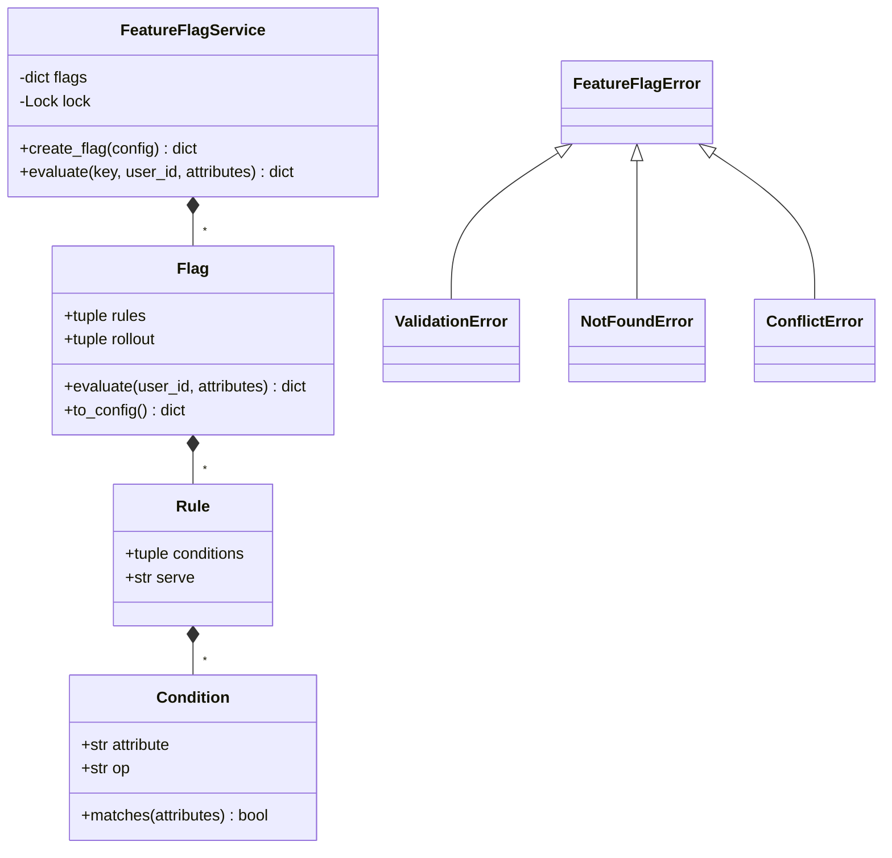

# 设计题解：功能开关与实验分组（Feature Flag）

## 题目与澄清

产品团队想把一个新功能先放给一小部分用户、再逐步放大，或者同时跑两个版本做 A/B 实验。承载这件事的是功能开关（Feature Flag）服务：
每个开关有一组名字固定的变体（Variant，例如开关功能是 `off` 与 `on`，实验是 `baseline` 与 `candidate`），
服务要回答「这个用户该看到哪个变体」。回答的依据按固定顺序有三层：开关是否启用；一串按顺序匹配用户属性的定向规则（Targeting Rule）；
规则没有覆盖的用户，按百分比稳定地分进各个变体（Percentage Rollout）。服务把配置存在内存里，对外是六个方法：
`create_flag`、`get_flag`、`update_flag`、`delete_flag`、`list_flags`、`evaluate`；HTTP 层已经写好，只负责把三种异常翻译成 400、404、409。
这个题目的重心不在 CRUD，而在三件事：求值语义要逐条精确，分桶要确定且稳定，配置更新与并发求值之间不能读到半成品。
经典的规则求值思路见 [[patterns.strategy|策略模式与可替换算法（Strategy）]]，内存存储与锁的写法见 [[structure.storage|内存持久化（In-Memory Persistence）]]。

先把合同用你自己的话写下来，这是开工前的第一件事。按「一个粗心读者最容易漏掉」的顺序：

1. **配置的形状**：`key`（只允许字母、数字、下划线、连字符，一到六十四个字符，整串匹配）、`enabled`（布尔）、`variants`（非空、互不相同、非空字符串的列表）、
   `default_variant`（必须是某个变体）、`rules`（可省略，默认空列表）、`fallthrough.rollout`（必填、非空）。
2. **规则与条件**：规则是 `{conditions, serve}`；`conditions` 可省略（默认空列表），条件之间是 AND，空列表命中所有用户；`serve` 必须是某个变体。
   条件是 `{attribute, op, value}`，`attribute` 是非空字符串。
3. **七个操作符**：`eq`、`neq`、`in`、`not_in`、`gt`、`lt`、`contains`。配置时 `value` 的类型随操作符：`eq`/`neq` 要字符串、数字或布尔，
   `in`/`not_in` 要列表，`gt`/`lt` 要数字（布尔不算），`contains` 要字符串。类型不对是配置错误，抛 `ValidationError`。
4. **放量表**：键必须是已声明的变体（没写的变体权重为 0），值是非负整数（浮点与布尔都不行，哪怕是 `20.0`），总和恰好 100。
5. **规范化**：丢掉开关、规则、条件、`fallthrough` 里所有多余的属性，存下来的配置形状固定；返回的字典调用方随便改，传入的字典在创建之后再被改，存储里的开关也不能变。
6. **更新与创建**：创建遇到同名开关抛 `ConflictError`；更新是整体替换，正文里的 `key` 必须等于路径里的 key，开关不存在抛 `NotFoundError`；
   `delete_flag` 返回开关此前是否存在；`list_flags` 按创建顺序返回。
7. **求值的入参**：`user_id` 必须是非空字符串，`attributes` 给了就必须是对象（不给当作空对象），否则 `ValidationError`；这两项先于「开关是否存在」检查。
8. **求值的顺序**：已停用 → `{"value": default_variant, "reason": "DISABLED"}`；否则规则自上而下，第一条条件全部命中的赢，返回
   `{"value", "reason": "RULE_MATCH", "rule_index"}`；都不命中就分桶，返回 `{"value", "reason": "FALLTHROUGH"}`。`rule_index` 只出现在规则命中的结果里。
9. **属性缺失或类型不符**：条件为 False，不抛异常；缺属性时 `neq` 与 `not_in` 也是 False（「不等于」只在属性存在时才有意义）。
10. **相等看类型**：布尔不是数字，`true` 不等于 `1`；数字按精确值比较，整数 `10**23` 不等于浮点 `1e23`，`5` 等于 `5.0`。
11. **分桶公式**：把 `开关key + ":" + user_id` 按 UTF-8 编码后取 SHA-256，摘要当作大端整数，对 10000 取余，得到 0..9999 的桶号，不能用随机数。
    变体按 `variants` 列表的顺序（不是放量表键的顺序）依次占累计区间，一个百分点占 100 个桶，区间左闭右开。
12. **稳定性**：同一个 `(flag_key, user_id)` 永远得到同一个桶；放量比例不进哈希，只决定区间边界。
13. **并发**：多线程同时创建、更新、删除、求值，要求创建同名开关恰好一个成功，更新进行时的求值只会看到完整的旧版或新版。

开口前值得问的澄清问题，每一个都会改变代码：

- **放量表里 `20.0` 算不算整数？** 合同说「整数百分比」，按字面理解浮点不行。选严格：`isinstance(x, int)` 并排除布尔，
  代价是一个把 JSON 数字全读成浮点的客户端会被拒；放宽的代价是要决定 `20.5` 怎么办。写进合同比猜好。
- **更新时配置不合法、开关又不存在，先报哪个？** 这里先校验再查存在，所以得到 `ValidationError`。理由是校验不依赖存储状态，可以放在锁外、最先做；
  这也让「非法配置不留痕」的说法没有例外。
- **属性缺失时 `neq` 算不算命中？** 按合同不算：缺失的属性让整个条件为 False。一个常见的直觉是「没有这个属性当然不等于」，那会把没填国家的用户放进「国家不是美国」的规则里。
- **用户 ID 要不要做规范化（去空白、转小写）？** 不做。哈希吃的是原样字符串，规范化只会让两个不同的用户共享一个桶，且改变已有的分组。
- **要不要记录评估日志、做实验曝光上报？** 不要。那是求值之外的事件流，加进来会让「求值是纯函数」这一点失效。

范围之外：HTTP 层与状态码映射（已有）、鉴权、持久化到磁盘、配置的审计历史、规则里的嵌套逻辑（OR 与 NOT）、实验的统计显著性。

## 需求与分级

**第 1 关（约 15 分钟，存储与校验）**：创建、读取、列出、删除，外加完整的校验矩阵。这一关定下整个设计的形状：
配置先被解析成一个校验过的对象再入库，入库之前不碰任何共享状态。用一个例子把「规范化」想清楚：
传入 `{"key": "k", ..., "color": "red"}` 时，返回与存储的配置里没有 `color`；传入没写 `rules` 的配置时，返回里 `rules` 是空列表。
第 1 关还决定了返回值的做法：每次从内部对象生成新字典，而不是把内部字典交出去。

**第 2 关（约 15 分钟，规则求值）**：停用、规则顺序、七个操作符。先写停用与「首个命中赢」两条，再逐个操作符加测试。
例子：规则一是 `region` 在 `["EU","UK"]` 里且 `seats` 大于 18，用户属性 `{"region": "EU", "seats": 30}` 得到 `{"value": "candidate", "reason": "RULE_MATCH", "rule_index": 0}`；
属性 `{"region": "EU"}`（缺 `seats`）则整条规则不命中，落到放量。这一关考的是「缺失与类型不符都是 False」和「相等看类型」。

**第 3 关（约 15 分钟，分桶放量）**：把合同公式写成一个函数，再把变体按顺序累计成区间。合同给出的例子：开关 `search_ranker` 的放量是 `baseline: 80 / candidate: 20`，
`acct-1` 的桶号是 468，落在 baseline；`acct-42` 的桶号是 8016，落在 candidate。把这两个数字写成测试，是这一关最便宜也最有价值的保险。
接着做稳定性：放量改成 70/30，原来在 candidate 的用户一个都不能少。

**第 4 关（约 15 分钟，并发与多实例）**：三十二个线程抢着创建同名开关，只能有一个成功；更新与求值同时进行时，求值的结果必须是一个完整版本里的结果。
选做的反思是三篇短文：为什么哈希里放 `flag_key` 与 `user_id` 却不放比例、怎样不读到半个更新、怎样在多个实例之间共享配置而分组不变。

## 核心对象与职责

| 类 | 单一职责 | 它拥有的不变量 |
|---|---|---|
| `Condition` | 一个条件：读属性、按操作符比较 | 缺失属性一律不命中；值的类型在构造之前已由校验保证 |
| `Rule` | 一条规则：条件的 AND 加一个 `serve` | 空条件列表命中所有用户 |
| `Flag` | 一个校验过的开关：求值、取区间、导出配置 | 冻结（frozen），规则与条件是元组，放量表已按 `variants` 排序且总和 100 |
| `FeatureFlagService` | 一个字典加一把锁：存取 `Flag` | 字典里的每个值都是完整且不可变的版本；创建判重与插入在同一把锁里 |
| `FeatureFlagError` 及三个子类 | 把失败分成三类 | 校验失败 400、不存在 404、冲突 409，与 HTTP 层一一对应 |

`FeatureFlagService` 拥有它存的 `Flag`，`Flag` 拥有自己的 `Rule`，`Rule` 拥有自己的 `Condition`，一路是组合（composition），
而且因为全部冻结，所有权的转移没有副作用：服务把引用交给求值线程，求值线程不可能改它。



服务类里没有任何求值逻辑：它只管「谁在什么时候能看到哪一版」。求值逻辑全在 `Flag` 里，是一个不碰共享状态的纯函数，
这样并发的论证只需要看服务类的三行锁，而不必逐行审查求值。

## 关键设计决策

### 决策一：桶号只由 `(flag_key, user_id)` 决定，放量比例只移动区间边界

**问题。** 实验要从 20% 放到 30%，产品要求已经看到新版本的用户不能被换回旧版本。分组怎么设计才能做到？

**选项。**
- 把比例放进哈希：`sha256(f"{flag_key}:{user_id}:{rollout}")`。比例一变，所有人的桶号全部重算，已入组的用户被洗牌，上述要求落空。
- 每个用户第一次出现时随机分组并存下来。稳定性靠一张分配表，表要存、要同步、要清理，多个实例之间还得共享这张表。
- 桶号只看 `(flag_key, user_id)`，放量比例只决定区间边界。分组是配置与用户的纯函数，不需要任何额外状态。

**选择第三种。** 桶号稳定，区间是从 0 开始按 `variants` 顺序累计的。例子：`variants` 为 `["baseline", "candidate"]`，80/20 时 baseline 占 [0, 8000)，candidate 占 [8000, 10000)；
改成 70/30 时 baseline 缩到 [0, 7000)，candidate 扩到 [7000, 10000)。candidate 的区间只是向下扩大，所以原来在里面的人全部还在里面。
实际数一遍：用 `u0` 到 `u9999` 一万个用户在 `search_ranker` 里分组，80/20 时 candidate 有 2006 人，70/30 时是 2999 人；
原来的 2006 人一个不少，换组的 993 人正好是桶号落在 [7000, 8000) 的那些人，而且全部是 baseline 变成 candidate，没有反向流动。

**哈希里为什么还要放 `flag_key`。** 如果只用 `user_id`，同一个用户在所有开关里都是同一个桶号：每个实验的 20% candidate 是同一批人，
实验之间互相污染，同一批用户永远是「小白鼠」。放进 `flag_key` 之后，不同开关的分组彼此独立。

**模式。** 这是一致性哈希（Consistent Hashing）思想的最简形式：不需要环，只需要稳定的哈希加可移动的边界。没有用到设计模式。

**一个必须知道的代价：`variants` 的顺序也是分组的一部分。** 区间按 `variants` 的顺序累计，如果有人把 `["baseline", "candidate"]` 改成 `["candidate", "baseline"]`，
80/20 的含义就变了：candidate 变成 [0, 2000)。同样一万个用户里有 3943 人换组。所以更新配置时调换变体顺序是一个危险操作，应该在评审里被看见。

### 决策二：存冻结的 `Flag`，更新是一次引用替换

**问题。** 运营在改一个开关，同时几千个请求在求值。怎么保证求值不会看到「规则是新的、变体表是旧的」这样的半成品？

**选项。**
- 存可变字典，更新时在锁里逐字段改，求值也在同一把锁里读。正确，但求值的全部计算（哈希、规则匹配）都在锁里，所有请求排队。
- 读写锁（Read-Write Lock）。读者并发，写者独占。标准库没有，要自己写；写者饥饿等问题随之而来；Python 的 GIL 下纯计算本来也不并行，收益有限。
- 存冻结对象，更新时在锁外造好整个新对象，锁内一次赋值替换引用。求值在锁内只取引用，锁外计算。

**选择第三种。** 做法是：`parse_flag` 把配置解析成冻结的 `Flag`、`Rule`、`Condition`（`@dataclass(frozen=True, slots=True)`，容器用元组）；
服务只在三个地方碰锁：创建的判重加插入、更新的存在检查加替换、求值的取引用。临界区里只有一次字典操作。
求值线程拿到引用之后，无论更新线程在做什么，它手里的那一版都不会再变，所以它要么看到完整旧版，要么看到完整新版，没有第三种可能。
这条论证只依赖两点：字典赋值在锁里是一步，`Flag` 冻结。

```python
def update_flag(self, key, config):
    flag = parse_flag(config)              # 校验和造对象都在锁外
    _require(flag.key == key, "key mismatch")
    with self._lock:
        if key not in self._flags:
            raise NotFoundError(key)
        self._flags[key] = flag            # 一次引用替换
    return flag.to_config()
```

**模式。** 这是不可变数据加整体替换，在并发语境里也叫写时复制（Copy-on-Write）的一个特例。它与值对象（Value Object）一脉相承，见
[[oop.values|值对象与不可变性（Value Objects）]]。注意冻结要彻底：如果 `Rule.conditions` 是列表，冻结的 dataclass 也挡不住 `rule.conditions.append(...)`，所以用元组。

### 决策三：七个操作符用一张函数表，拒绝策略类层次

**问题。** `eq`、`neq`、`in`、`not_in`、`gt`、`lt`、`contains` 七种比较，怎么组织？

**选项。**
- 经典的策略模式：一个 `Operator` 基类，七个子类，各有 `matches` 方法，再配一个工厂按名字取实例。
- 一长串 `if op == "eq": ... elif ...` 写在 `Condition.matches` 里。
- 一张 `dict[str, Callable[[Any, Any], bool]]`，名字到函数；每个操作符是一个纯函数，没有状态。

**选择第三种，拒绝第一种。** 七个操作符都没有状态，不需要子类、不需要实例、不需要工厂；一个函数就是一个策略（Strategy）的最小形式，见
[[patterns.strategy|策略模式与可替换算法（Strategy）]]。字典还顺手给了校验一个现成的集合：`ALLOWED_OPS` 就是字典的键。
`if/elif` 链也行，缺点是校验与求值要各写一遍操作符列表，加第八个操作符时容易只改一处。
那种「每个操作符一个类」的写法在 Java 里常见，是语言没有一等函数时的绕路；在 Python 里它只增加文件与导航成本，不增加任何灵活性。
什么时候该换回类：操作符开始带配置（例如带编译好的正则、带缓存的集合查找）或需要独立的校验逻辑时。

### 决策四：相等是类型感知的，布尔不是数字

**问题。** Python 里 `True == 1` 为真，`isinstance(True, int)` 也为真。JSON 里的 `true` 与 `1` 是不同的值，`gt` 对布尔也不该成立。直接用 `==` 会怎样？

**选项。**
- 直接用 `==` 和 `>`：规则 `eq 1` 会命中属性 `true`，规则 `gt 0` 会命中 `true`。数字比较倒是精确的：`10**23 == 1e23` 在 Python 里是 `False`，因为 `1e23` 实际是 99999999999999991611392。
- 写一个 `_same(a, b)`：只要有一方是布尔，就要求双方都是布尔且相等；双方都是数字（非布尔）按精确值比较；双方都是字符串按字符串比较；其余一律不相等。
  再写一个 `_is_number`，把布尔排除在数字之外，`gt` 与 `lt` 用它。

**选择第二种。** 它只有六行，却把三个容易被隐藏测试针对的边界一次定住：布尔与数字不混，`5` 等于 `5.0`，容器与空值不等于任何东西。
`in` 与 `not_in` 对列表里的每个元素都用 `_same`，所以 `in [1, 2]` 不会命中 `true`。

### 决策五：校验先于存储，错误分三类，校验顺序固定

**问题。** 配置有一大串可能的错误，怎样保证非法输入既不会创建开关，也不会替换掉旧的？

**选择。** 把校验写成一个纯函数 `parse_flag(config) -> Flag`：成功返回冻结对象，失败抛 `ValidationError`，不碰服务的任何状态。
创建与更新都是「先 `parse_flag`，再进锁」，所以非法配置根本到不了存储。错误分成三类：格式或取值不对是 `ValidationError`，
目标不存在是 `NotFoundError`，重复创建是 `ConflictError`，三类共用基类 `FeatureFlagError`，HTTP 层按类映射状态码，服务里没有一行 HTTP 的东西。
`evaluate` 里同样是先校验 `user_id` 与 `attributes`，再查开关，所以对一个不存在的开关传空 `user_id` 得到 400，而不是 404；这是合同写明的顺序。
用异常而不是返回错误值，是因为这三类失败都是调用方必须处理的合同违反，见 异常与错误值（Exceptions vs Values）。

**一个 Python 特有的坑。** 校验 `key` 的正则如果写成 `re.match(r"^[A-Za-z0-9_-]{1,64}$", key)`，字符串 `"abc\n"` 也会通过，因为 `$` 能匹配末尾换行之前的位置。
实际运行：`re.match` 对 `"abc\n"` 返回匹配，`re.fullmatch` 返回空。所以用 `fullmatch`，正则里也不要写 `^` 与 `$`。

### 决策六：返回值与入参都做拷贝，从冻结对象导出新字典

**问题。** 调用方拿到的字典可能被修改，传进来的字典在创建之后也可能被修改。怎样不让这些修改污染存储？

**选项。** 每次返回前 `copy.deepcopy(内部字典)`；或者返回只读视图（`MappingProxyType`），或者存冻结对象，需要字典时现生成。

**选择第三种。** 存储里根本没有字典，所以没有东西可被改：`to_config()` 每次新建字典与列表，`in` 列表这类嵌套值深拷贝一次；
入参方向，`parse_flag` 构造冻结对象时已经把需要的值复制出来（`in` 的列表转成元组并深拷贝），之后调用方怎么改自己的字典都与存储无关。
只读视图在这里不够：`MappingProxyType` 只保护最外层，嵌套的列表仍然可改；`deepcopy` 整个内部字典可行，但每次读都要付出整棵树的复制，而且内部字典本身仍然可变，别处一漏就污染。
防御性拷贝（Defensive Copying）的原则是「在边界上拷贝」：入口一次、出口一次，其余全部在不可变对象里。

## 代码走读

下面是完整的参考解。先看四个落点，再整体读一遍。

第一处是 `bucket` 与 `Flag.pick`：`bucket` 是合同公式的逐字翻译，返回 0 到 9999；`pick` 按 `variants` 的顺序累计 `percent * 100`，
第一个让 `bucket_number < upper` 成立的变体胜出。比较用 `<` 而不是 `<=`，就是区间左闭右开：桶号 8000 不属于 [0, 8000)。
放量表总和是 100，所以循环一定在最后一个变体之前或当中返回，末尾那一行 `raise` 永远走不到，留着只是让类型检查与读者都明白这里有一个被校验保证的前提。

第二处是 `Condition.matches` 与 `_OPS`：缺失属性在函数表之前就返回 `False`，所以七个操作符的函数都不需要处理「没有这个属性」。
`neq` 与 `not_in` 因此也是缺失即不命中，这一条规则只写在一个地方。

第三处是 `parse_flag`：一串 `_require` 把合同的每一条变成一行；最后返回的 `Flag` 里 `rollout` 已经按 `variants` 排好序，求值时不必再排序。

第四处是服务类的三个方法：`create_flag`、`update_flag`、`evaluate` 的共同点是，校验在锁外，锁里只有一次字典读或写。

%% code:begin solution.py %%
```python
"""功能开关与实验分组服务（Feature Flag）的参考解。公开 API 与真实工作区的 `feature_flags.py` 一致，可以原样放进去。

设计五句话：
1. 配置先经 `parse_flag` 校验并规范化，成为不可变的 `Flag`（含 `Rule`、`Condition`），服务里只存这个冻结对象。
2. 求值是纯函数：已停用 → 默认变体；否则规则从上到下，第一条全部条件命中的赢；都不命中 → 按分桶落进放量区间。
3. 分桶只看 `(flag_key, user_id)` 的哈希，放量比例只决定区间边界，所以比例变化时已分到的用户不会被重新洗牌。
4. 更新是一次字典赋值（换掉整个冻结的 `Flag`）；求值在锁内取出引用，锁外计算，读到的永远是完整的旧版或新版。
5. 对外进出一律经 `to_config()` 生成新字典，调用方怎么改都碰不到存储里的东西。
"""

from __future__ import annotations

import copy
import re
import threading
from collections.abc import Callable
from dataclasses import dataclass
from hashlib import sha256
from typing import Any

ALLOWED_OPS = frozenset({"eq", "neq", "in", "not_in", "gt", "lt", "contains"})
KEY_PATTERN = re.compile(r"[A-Za-z0-9_-]{1,64}")
BUCKET_SPACE = 10000  # 一个百分点占 100 个桶单位


class FeatureFlagError(Exception):
    """所有服务错误的基类。"""


class ValidationError(FeatureFlagError):
    """输入不合法（HTTP 400）。"""


class NotFoundError(FeatureFlagError):
    """开关不存在（HTTP 404）。"""


class ConflictError(FeatureFlagError):
    """同名开关已存在（HTTP 409）。"""


def _require(ok: bool, message: str) -> None:
    if not ok:
        raise ValidationError(message)


def _is_number(x: Any) -> bool:
    """JSON 数字：int 或 float，布尔不算。"""
    return isinstance(x, (int, float)) and not isinstance(x, bool)


def _same(a: Any, b: Any) -> bool:
    """类型感知的相等：true 不等于 1；数字按精确值比较（10**23 不等于 1e23）；容器不相等。"""
    if isinstance(a, bool) or isinstance(b, bool):
        return isinstance(a, bool) and isinstance(b, bool) and a == b
    if _is_number(a) and _is_number(b):
        return a == b
    return isinstance(a, str) and isinstance(b, str) and a == b


# 七个操作符：一张「名字 → (实际值, 配置值) → bool」的表，不为每个操作符建一个类。
_OPS: dict[str, Callable[[Any, Any], bool]] = {
    "eq": _same,
    "neq": lambda a, v: not _same(a, v),
    "in": lambda a, v: any(_same(a, x) for x in v),
    "not_in": lambda a, v: not any(_same(a, x) for x in v),
    "gt": lambda a, v: _is_number(a) and a > v,
    "lt": lambda a, v: _is_number(a) and a < v,
    "contains": lambda a, v: isinstance(a, str) and v in a,
}


def bucket(flag_key: str, user_id: str) -> int:
    """用户在某个开关里的稳定桶号，范围 0..9999；只依赖 (flag_key, user_id)。"""
    raw = sha256((flag_key + ":" + user_id).encode("utf-8")).digest()
    return int.from_bytes(raw, "big") % BUCKET_SPACE


@dataclass(frozen=True, slots=True)
class Condition:
    """一个条件：属性缺失一律不命中，包括 neq 与 not_in。"""

    attribute: str
    op: str
    value: Any  # in / not_in 时是 tuple

    def matches(self, attributes: dict[str, Any]) -> bool:
        if self.attribute not in attributes:
            return False
        return _OPS[self.op](attributes[self.attribute], self.value)

    def to_config(self) -> dict[str, Any]:
        value = list(self.value) if isinstance(self.value, tuple) else self.value
        return {"attribute": self.attribute, "op": self.op, "value": copy.deepcopy(value)}


@dataclass(frozen=True, slots=True)
class Rule:
    """条件之间是 AND；空条件列表命中所有用户。"""

    conditions: tuple[Condition, ...]
    serve: str

    def matches(self, attributes: dict[str, Any]) -> bool:
        return all(c.matches(attributes) for c in self.conditions)

    def to_config(self) -> dict[str, Any]:
        return {"conditions": [c.to_config() for c in self.conditions], "serve": self.serve}


@dataclass(frozen=True, slots=True)
class Flag:
    """校验并规范化之后的开关；冻结，所以可以不加锁地被多个线程同时读。"""

    key: str
    enabled: bool
    variants: tuple[str, ...]
    default_variant: str
    rules: tuple[Rule, ...]
    rollout: tuple[tuple[str, int], ...]  # (变体, 百分比)，按 variants 顺序，只含配置里写出的键

    def pick(self, bucket_number: int) -> str:
        """按 variants 顺序累计区间，返回桶号落入的变体。"""
        upper = 0
        for variant, percent in self.rollout:
            upper += percent * (BUCKET_SPACE // 100)
            if bucket_number < upper:
                return variant
        raise FeatureFlagError("rollout does not cover the bucket space")

    def evaluate(self, user_id: str, attributes: dict[str, Any]) -> dict[str, Any]:
        if not self.enabled:
            return {"value": self.default_variant, "reason": "DISABLED"}
        for index, rule in enumerate(self.rules):
            if rule.matches(attributes):
                return {"value": rule.serve, "reason": "RULE_MATCH", "rule_index": index}
        return {"value": self.pick(bucket(self.key, user_id)), "reason": "FALLTHROUGH"}

    def to_config(self) -> dict[str, Any]:
        return {
            "key": self.key,
            "enabled": self.enabled,
            "variants": list(self.variants),
            "default_variant": self.default_variant,
            "rules": [r.to_config() for r in self.rules],
            "fallthrough": {"rollout": dict(self.rollout)},
        }


def _parse_condition(raw: Any) -> Condition:
    _require(isinstance(raw, dict), "condition must be an object")
    attribute, op, value = raw.get("attribute"), raw.get("op"), raw.get("value")
    _require(isinstance(attribute, str) and attribute != "", "condition attribute must be a non-empty string")
    _require(isinstance(op, str) and op in ALLOWED_OPS, "unknown condition op")
    if op in ("eq", "neq"):
        _require(isinstance(value, (str, int, float, bool)), f"{op} needs a string, number or boolean")
    elif op in ("in", "not_in"):
        _require(isinstance(value, list), f"{op} needs a list")
        value = tuple(copy.deepcopy(value))
    elif op in ("gt", "lt"):
        _require(_is_number(value), f"{op} needs a number")
    else:
        _require(isinstance(value, str), "contains needs a string")
    return Condition(attribute, op, value)


def _parse_rule(raw: Any, variants: list[str]) -> Rule:
    _require(isinstance(raw, dict), "rule must be an object")
    conditions = raw.get("conditions", [])
    _require(isinstance(conditions, list), "conditions must be a list")
    serve = raw.get("serve")
    _require(isinstance(serve, str) and serve in variants, "serve must be a declared variant")
    return Rule(tuple(_parse_condition(c) for c in conditions), serve)


def parse_flag(config: Any) -> Flag:
    """校验并规范化一份配置；额外属性丢弃，任何不合法都抛 ValidationError。"""
    _require(isinstance(config, dict), "config must be an object")
    key = config.get("key")
    _require(isinstance(key, str) and KEY_PATTERN.fullmatch(key) is not None, "invalid key")
    _require(isinstance(config.get("enabled"), bool), "enabled must be a boolean")
    variants = config.get("variants")
    _require(
        isinstance(variants, list)
        and len(variants) > 0
        and all(isinstance(v, str) and v != "" for v in variants)
        and len(set(variants)) == len(variants),
        "variants must be a non-empty list of unique non-empty strings",
    )
    default = config.get("default_variant")
    _require(isinstance(default, str) and default in variants, "default_variant must be a declared variant")
    raw_rules = config.get("rules", [])
    _require(isinstance(raw_rules, list), "rules must be a list")
    rules = tuple(_parse_rule(r, variants) for r in raw_rules)
    fallthrough = config.get("fallthrough")
    _require(isinstance(fallthrough, dict), "fallthrough must be an object")
    rollout = fallthrough.get("rollout")
    _require(isinstance(rollout, dict) and len(rollout) > 0, "rollout must be a non-empty object")
    for variant, percent in rollout.items():
        _require(variant in variants, "rollout key is not a declared variant")
        _require(isinstance(percent, int) and not isinstance(percent, bool) and percent >= 0,
                 "rollout weights must be non-negative integers")
    _require(sum(rollout.values()) == 100, "rollout weights must sum to 100")
    ordered = tuple((v, rollout[v]) for v in variants if v in rollout)
    return Flag(key, config["enabled"], tuple(variants), default, rules, ordered)


class FeatureFlagService:
    """内存里的开关服务：锁只保护字典，校验与求值都在锁外做。"""

    def __init__(self) -> None:
        self._flags: dict[str, Flag] = {}
        self._lock = threading.Lock()

    def create_flag(self, config: dict) -> dict:
        flag = parse_flag(config)  # 先校验：非法配置不碰锁，也不留痕
        with self._lock:
            if flag.key in self._flags:
                raise ConflictError(f"flag {flag.key} already exists")
            self._flags[flag.key] = flag
        return flag.to_config()

    def get_flag(self, key: str) -> dict | None:
        with self._lock:
            flag = self._flags.get(key)
        return None if flag is None else flag.to_config()

    def update_flag(self, key: str, config: dict) -> dict:
        flag = parse_flag(config)
        _require(flag.key == key, "key in body must match the path")
        with self._lock:
            if key not in self._flags:
                raise NotFoundError(f"flag {key} not found")
            self._flags[key] = flag  # 一次引用替换：读者看到旧版或新版，没有中间态
        return flag.to_config()

    def delete_flag(self, key: str) -> bool:
        with self._lock:
            return self._flags.pop(key, None) is not None

    def list_flags(self) -> list[dict]:
        with self._lock:
            flags = tuple(self._flags.values())
        return [f.to_config() for f in flags]

    def evaluate(self, key: str, user_id: str, attributes: dict | None = None) -> dict:
        _require(isinstance(user_id, str) and user_id != "", "user_id must be a non-empty string")
        if attributes is None:
            attributes = {}
        _require(isinstance(attributes, dict), "attributes must be an object")
        with self._lock:
            flag = self._flags.get(key)  # 锁内只取引用
        if flag is None:
            raise NotFoundError(f"flag {key} not found")
        return flag.evaluate(user_id, attributes)  # 锁外算：Flag 冻结，不会被别的线程改


if __name__ == "__main__":
    service = FeatureFlagService()
    service.create_flag({
        "key": "search_ranker", "enabled": True, "variants": ["baseline", "candidate"],
        "default_variant": "baseline", "rules": [],
        "fallthrough": {"rollout": {"baseline": 80, "candidate": 20}},
    })
    print(service.evaluate("search_ranker", "acct-1"), service.evaluate("search_ranker", "acct-42"))
```
%% code:end %%

## 测试与自检

测试文件有 47 个测试函数（含参数化共 143 个用例），按合同分成几组：

- **形状与规范化**：多余属性被丢掉、`rules` 与 `conditions` 默认空列表、`list_flags` 的顺序（更新不改位置，删除后重建排到末尾）。
- **校验矩阵**：四十多种非法配置各一个用例，包括 `key` 末尾换行、六十五个字符、`enabled` 写成 `1`、放量表写成 `80.0`、总和 99 与 101；
  每个用例还断言「失败之后什么都没留下」。
- **操作符**：四十多行 `(操作符, 配置值, 属性, 期望)` 的表，覆盖缺失、类型不符、布尔与数字、`10**23` 与 `1e23`、空子串。
- **分桶**：两个钉死的例子：`acct-1` 的 468 与 `acct-42` 的 8016；用测试自己重写的公式算出桶号恰为 0、7999、8000、9999 的四个用户，断言区间边界左闭右开；
  放量表键序与 `variants` 序不同时仍按 `variants` 序；0% 与 100%；两个开关的分组不同；二十到三十的稳定性（三千个用户，换组的人桶号都在 [7000, 8000)）。
- **隔离**：改入参、改每个方法的返回值、改求值结果，都不影响之后的读。
- **并发**：三十二个线程创建同名开关，恰好一个成功；三十二个线程删除，恰好一个得到 `True`；四十个线程创建不同开关，全部落地；
  更新线程反复在两个版本之间切换，六个求值线程读取，每个结果必须属于某一个完整版本。

两条值得单独说的测试方法。第一，桶号用测试自己重写的公式核对，不拿被测代码解释自己；错的公式与错的实现会互相印证，只有独立的第二份才能抓到。
第二，放量比例的统计测试，界限不是「我跑了一次，偏差是 26」，而是从二项分布推出来：一万个用户、比例 20%，标准差是 `sqrt(10000 × 0.2 × 0.8)` 等于 40，
测试允许偏差五倍标准差，也就是 200。哈希是确定的，所以这个测试不会因为运气失败；界限写成表达式，是为了让改变用户数或比例的人能同步改界限。
并发更新的测试里，两个版本被设计成「看上去一半一半就一定出错」：版本一的规则列表有一条、变体是 `x1` 与 `z`，版本二有两条、变体是 `y2` 与 `z`，
合法结果只有 `("x1", 0)` 与 `("y2", 1)` 两种，任何交叉都说明读到了半个更新。

两分钟演示：创建 `search_ranker`（80/20）、求值 `acct-1` 与 `acct-42`，口述桶号 468 与 8016；然后更新为 70/30，求值同样的用户，
指出 candidate 的人只多不少；最后用一个线程更新、多个线程求值，口述「读到的是引用，引用指向的对象不会变」。

## 扩展与追问

**新需求**

- *OR 与 NOT、规则分组*：在 `Rule` 里把 `conditions` 换成一棵表达式树（`And`、`Or`、`Not`、`Condition`），`Flag.evaluate`、服务类、放量与分桶都不动；
  `matches` 是唯一被替换的接口。校验里加一个递归的 `_parse_expression`。
- *按用户属性分桶（例如按公司 ID 而不是用户 ID）*：`bucket` 多接收一个「分桶属性」名，从 `attributes` 里取值；`Flag` 加一个字段 `bucket_by`，默认 `user_id`。
  分桶函数的合同不变，只是输入换了。
- *多变量实验的互斥组*：新增一个「层」对象，层里的开关共享一个桶空间，各占一段不重叠的区间；`Flag.pick` 不变，层负责先选开关。
- *前置条件（开关 B 依赖开关 A）*：求值时先求 A，再用 A 的结果决定 B 的规则；注意环检测，放在校验里。
- *评估原因里带上命中的条件*：`evaluate` 的返回值多一个字段，`Condition.matches` 不变。

**并发与线程安全**（对应第二篇短文）

- *当前方案的代价*：锁里只有一次字典读写，临界区几乎为零；哈希与规则匹配都在锁外，求值之间几乎不互相等待（CPython 的 GIL 仍让纯 Python 计算串行，锁的争用不再是额外的瓶颈）。
- *更强的保证*：想让求值完全不拿锁，可以把整张字典也做成不可变快照：写者复制整张表、替换一项、整体替换引用；读者读一个全局引用，无需任何锁。
  代价是写者的复制成本与 `n` 成正比，开关数量很大且更新频繁时不划算。
- *读到某一版之后，后续请求会不会又读到更旧的版本*：同一个线程里不会（引用只前进）；不同线程之间因为拿到锁的先后，也只会按锁的顺序看到版本，不会回退。
- *批量更新多个开关要原子*：当前的 `update_flag` 只保证单个开关；要批量就要在服务里加一个 `apply_batch`，先解析全部，再在一次加锁中全部替换，任何一个失败则全部不替换。

**持久化与规模**（对应第一篇与第三篇短文）

- *多个实例共享配置*：分桶是纯函数，所以只有配置需要共享：放在数据库或配置中心，每次保存得到一个单调递增的版本号；
  每个实例在本地缓存最新的冻结快照，订阅推送并定期全量拉取兜底；收到版本号不大于当前的消息就丢弃，保证快照只前进。
  这样三个实例配置一致时，同一个 `(flag_key, user_id)` 必然得到同一个分组，不需要共享分配表，也不需要任何实例间的协调。
- *传播期间的不一致*：实例一已经看到 70/30，实例二还在 80/20，同一个用户在两边可能得到不同的答案，但只会出现在 [7000, 8000) 这一段桶里；
  这是最终一致的代价，要更强的保证就在响应里带版本号，让调用方知道自己看到的是哪一版。
- *存到数据库*：整份替换对应一次事务里替换整行（配置存成一个 JSON 列加版本号），不要把一个开关拆成多张表的多次更新；否则要自己再做一遍原子性。
- *规模*：一个开关的求值是几次比较加一次哈希，纳秒到微秒；开关数量大时按 key 分片字典即可，求值路径上没有跨开关的共享状态。
- *把求值搬到客户端或边缘*：下发冻结的配置加同一个分桶公式，客户端自己求值，服务端只管配置；公式必须在所有语言里逐字一致，所以要用测试向量（例如 `acct-1` 对应 468）锁住。

## 常见错误

- **用 `random` 或内置 `hash()` 分桶**：前者不稳定，后者每个进程的结果不同（连续两次运行 `hash("acct-1") % 10000` 得到 1938 和 8490），重启服务或换一个实例，用户的分组就变了。
- **把放量比例放进哈希**：比例一变，所有用户重新洗牌，已入组的用户被换走。
- **区间按放量表键的顺序累计**：放量表是字典，键序不是合同；区间必须按 `variants` 的顺序。
- **区间用 `<=`**：桶号恰好等于边界的用户被放进前一个变体，边界上的用户比例偏一个桶单位，测试里的 7999 与 8000 两个用户会立刻暴露。
- **把布尔当数字**：`isinstance(True, int)` 是真，`gt 0` 会命中 `true`；`eq 1` 会命中 `true`。
- **属性缺失时让 `neq` 命中**：缺国家的用户被放进「国家不是美国」的规则。
- **类型不符时抛异常**：属性是字符串而规则是 `gt`，应当是不命中，不能让一个脏属性把整个求值打成 500。
- **正则用 `re.match` 加 `$`**：`"abc\n"` 通过校验，存下一个带换行的 key，之后路径永远找不到它。
- **返回内部字典**：调用方改了返回值，存储里的配置跟着变；或者只做浅拷贝，嵌套的 `in` 列表仍然共享。
- **更新时原地改旧对象**：求值线程会读到新规则配旧变体的半成品，这正是第二篇短文要你说清楚的事。
- **先查存在再创建，两步之间不在同一把锁里**：两个线程都看到「不存在」，都创建，后到的静默覆盖了先到的。
- **求值整个放在锁里**：正确，但哈希与规则匹配都排队，吞吐被一个线程的速度封顶。
- **用 AI 生成时只给一句「实现一个功能开关服务」**：没有合同里的十三条，生成的代码会在上面几条里挑几条违反；把合同和 `acct-1 → 468` 这类数字例子写进指令，
  并自己写分桶边界与并发更新的测试。
- **让智能体把失败的测试改成通过**：先判断是代码错还是测试错，合同里的数字例子不能改。

## 45 分钟怎么分配

项目给 60 分钟，其中约 15 分钟留给与智能体的来回沟通和三篇短文，真正动手写代码约 45 分钟。

- **0–5 分钟｜读合同**：不要先写代码。把上面十三条用自己的话写成注释，逐条标出「哪一条会被隐藏测试针对」。
  对智能体说的第一句话也是这份清单加两个数字例子，不是「写个功能开关」。
- **5–10 分钟｜定骨架并分工**：口头说出结构：冻结的 `Flag`、`Rule`、`Condition`，一个只管字典与锁的服务类。
  让智能体起草 `parse_flag` 与操作符表（输入输出都清楚，容易验证）；分桶的输入、区间的累计方式、更新的原子方式、返回值是否拷贝，这四个决定自己留着。
- **10–22 分钟｜校验、存储、规则求值**：每写完一块就跑公开测试，再把合同里的数字例子写成自己的断言。每次只让智能体做一个失败的测试。
- **22–32 分钟｜分桶与稳定性**：把合同公式写成函数；用自己重写的公式算出边界用户；写 20% 到 30% 的稳定性测试。
- **32–38 分钟｜并发**：自己写屏障测试，两个版本设计成「交叉即出错」；让智能体帮忙想边界，但锁的范围自己核对。
- **38–45 分钟｜短文**：留出最后的时间写三个问题，各约一百五十字：为什么哈希不含比例、怎样不读到半个更新、怎样共享配置；不要写成在复述代码。

时间不够时的取舍顺序：先砍选做的多实例讨论（口述），再砍并发测试的读者线程数量，再砍 OR 与 NOT 的扩展；
**绝不能砍的是**：合同里的数字例子逐条断言、校验先于存储、冻结对象加整份替换、分桶不含比例、三篇短文。

## 延伸阅读

- [[patterns.strategy|策略模式与可替换算法（Strategy）]]：一个函数就是一个策略的最小形式，对应操作符函数表。
- [[structure.storage|内存持久化（In-Memory Persistence）]]：字典加锁的存储写法，创建判重与插入为什么要同一把锁。
- [[oop.values|值对象与不可变性（Value Objects）]]：冻结对象为什么让并发与拷贝都变简单。
- [Python 文档：hashlib](https://docs.python.org/3/library/hashlib.html)：`sha256` 的用法，以及为什么不能用内置 `hash()` 做跨进程稳定的分桶。
- [Python 文档：dataclasses（frozen 与 slots）](https://docs.python.org/3/library/dataclasses.html)：冻结的数据类，以及 `slots=True` 的限制。
- [OpenFeature 规范](https://openfeature.dev/specification/)：功能开关求值接口的行业规范，可以对照本服务的求值结果与原因的设计。
